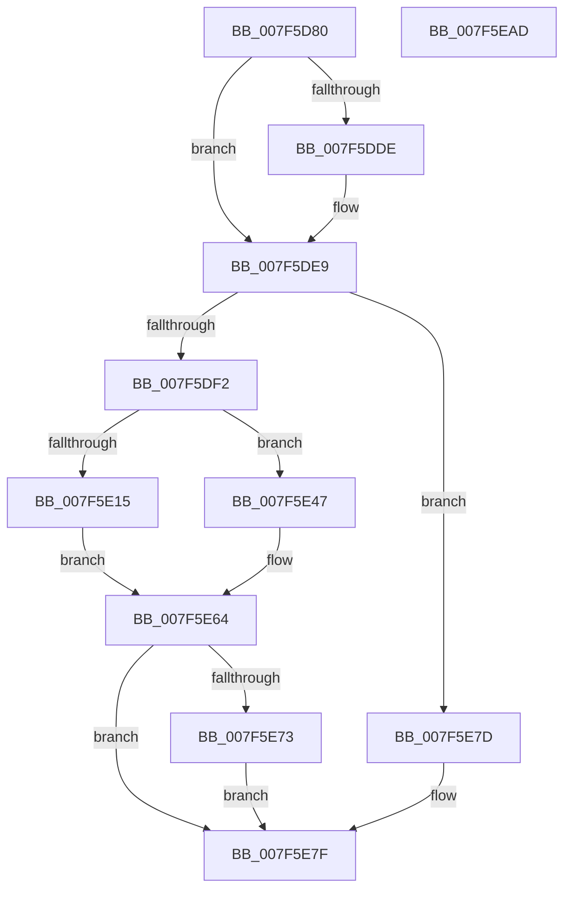

# CmpHiveCachePnpNotificationCallback

- RVA: `0x007F5D80`–`0x007F5EAE` (길이 `302` bytes)
- VA: `0x00000001407F5D80`
- 실행 섹션: `PAGE`
- PDB 이름 있음: `예`; PDB Function 태그: `아니요`
- unwind 정보 RVA: `0x000D7508`
- 디코드: `75`개 명령, `302/302` bytes 표시
- 미해석 바이트: `0` (있으면 어셈블리에 `.byte`로 보존)

> 이 문서는 커널 이미지의 기계어와 PDB 기호를 분석해 생성했습니다. 4번과 5번은 함수 원형과 자료형을 바이너리 사용 방식에서 추정한 C 해석이며 원본 소스 복구 결과는 아닙니다.

## 1. Dependencies

- 직접 호출 지점: **11**; 고유 호출 대상: **10**
- 직접 호출자로 확인된 함수: **0**
- RIP 상대 이미지 참조: **3**

### Outgoing calls
- `0x007F5DBA` → [CmpInitializeThreadInfo](../../text/3F/CmpInitializeThreadInfo_function_003FBE70.md) (function, `0x003FBE70`)
- `0x007F5DF7` → [CmpAttachToRegistryProcess](../../pagecmrc/BC/CmpAttachToRegistryProcess_function_00BC98E0.md) (function, `0x00BC98E0`)
- `0x007F5DFF` → [CmpHiveCacheEntryLockAcquire](CmpHiveCacheEntryLockAcquire_function_007F5CD8.md) (function, `0x007F5CD8`)
- `0x007F5E26` → [ObfDereferenceObject](../../text/2F/ObfDereferenceObject_function_002F9350.md) (function, `0x002F9350`)
- `0x007F5E2E` → [CmpHiveCacheEntryLockRelease](CmpHiveCacheEntryLockRelease_function_007F5D3C.md) (function, `0x007F5D3C`)
- `0x007F5E3B` → [CmpHiveCacheEntryCleanup](CmpHiveCacheEntryCleanup_function_007F5B38.md) (function, `0x007F5B38`)
- `0x007F5E5F` → [SetFailureLocation](../../text/46/SetFailureLocation_function_0046EF54.md) (function, `0x0046EF54`)
- `0x007F5E69` → [CmpDetachFromRegistryProcess](../../pagecmrc/BC/CmpDetachFromRegistryProcess_function_00BC9920.md) (function, `0x00BC9920`)
- `0x007F5E76` → [CmpHiveCacheEntryLockRelease](CmpHiveCacheEntryLockRelease_function_007F5D3C.md) (function, `0x007F5D3C`)
- `0x007F5E84` → [CmCleanupThreadInfo](../../text/41/CmCleanupThreadInfo_function_0041FD50.md) (function, `0x0041FD50`)
- `0x007F5E93` → [_security_check_cookie](../../text/6A/_security_check_cookie_function_006AC640.md) (function, `0x006AC640`)

### Direct callers
- 이 함수 시작 RVA로 연결되는 직접 call은 확인되지 않았습니다. 간접 호출은 완전히 역산할 수 없습니다.

### Static image references
- `0x007F5D93` → RVA `0x00E0A740` (`.data`; read)
- `0x007F5DC6` → RVA `0x00026BF0` (`.rdata`; read)
- `0x007F5DE2` → RVA `0x00026BF8` (`.rdata`; read)

## 2. Other-region calls and transfers

- 다른 실행 섹션으로 향하는 call: **7**
  - `0x007F5DBA` → [CmpInitializeThreadInfo](../../text/3F/CmpInitializeThreadInfo_function_003FBE70.md) (`PAGE` → `.text`)
  - `0x007F5DF7` → [CmpAttachToRegistryProcess](../../pagecmrc/BC/CmpAttachToRegistryProcess_function_00BC98E0.md) (`PAGE` → `PAGECMRC`)
  - `0x007F5E26` → [ObfDereferenceObject](../../text/2F/ObfDereferenceObject_function_002F9350.md) (`PAGE` → `.text`)
  - `0x007F5E5F` → [SetFailureLocation](../../text/46/SetFailureLocation_function_0046EF54.md) (`PAGE` → `.text`)
  - `0x007F5E69` → [CmpDetachFromRegistryProcess](../../pagecmrc/BC/CmpDetachFromRegistryProcess_function_00BC9920.md) (`PAGE` → `PAGECMRC`)
  - `0x007F5E84` → [CmCleanupThreadInfo](../../text/41/CmCleanupThreadInfo_function_0041FD50.md) (`PAGE` → `.text`)
  - `0x007F5E93` → [_security_check_cookie](../../text/6A/_security_check_cookie_function_006AC640.md) (`PAGE` → `.text`)
- 별도 외부 분기/꼬리 이동을 확인하지 못했습니다.

## 3. Assembly (complete function range)

```asm
007F5D80  4C 8B DC                        mov r11, rsp
007F5D83  49 89 5B 08                     mov qword ptr [r11 + 8], rbx
007F5D87  49 89 73 18                     mov qword ptr [r11 + 0x18], rsi
007F5D8B  57                              push rdi
007F5D8C  48 81 EC 80 00 00 00            sub rsp, 0x80
007F5D93  48 8B 05 A6 49 61 00            mov rax, qword ptr [rip + 0x6149a6]
007F5D9A  48 33 C4                        xor rax, rsp
007F5D9D  48 89 44 24 78                  mov qword ptr [rsp + 0x78], rax
007F5DA2  0F 57 C0                        xorps xmm0, xmm0
007F5DA5  33 C0                           xor eax, eax
007F5DA7  0F 11 44 24 30                  movups xmmword ptr [rsp + 0x30], xmm0
007F5DAC  4C 8B C9                        mov r9, rcx
007F5DAF  49 89 43 B8                     mov qword ptr [r11 - 0x48], rax
007F5DB3  49 8D 4B A8                     lea rcx, [r11 - 0x58]
007F5DB7  48 8B DA                        mov rbx, rdx
007F5DBA  E8 B1 60 C0 FF                  call 0x1403fbe70
007F5DBF  49 8B 41 04                     mov rax, qword ptr [r9 + 4]
007F5DC3  0F 57 D2                        xorps xmm2, xmm2
007F5DC6  48 2B 05 23 0E 83 FF            sub rax, qword ptr [rip - 0x7cf1dd]
007F5DCD  0F 11 54 24 48                  movups xmmword ptr [rsp + 0x48], xmm2
007F5DD2  0F 11 54 24 58                  movups xmmword ptr [rsp + 0x58], xmm2
007F5DD7  0F 11 54 24 68                  movups xmmword ptr [rsp + 0x68], xmm2
007F5DDC  75 0B                           jne 0x1407f5de9
007F5DDE  49 8B 41 0C                     mov rax, qword ptr [r9 + 0xc]
007F5DE2  48 2B 05 0F 0E 83 FF            sub rax, qword ptr [rip - 0x7cf1f1]
007F5DE9  48 85 C0                        test rax, rax
007F5DEC  0F 85 8B 00 00 00               jne 0x1407f5e7d
007F5DF2  48 8D 4C 24 48                  lea rcx, [rsp + 0x48]
007F5DF7  E8 E4 3A 3D 00                  call 0x140bc98e0
007F5DFC  48 8B CB                        mov rcx, rbx
007F5DFF  E8 D4 FE FF FF                  call 0x1407f5cd8
007F5E04  8B 83 A8 00 00 00               mov eax, dword ptr [rbx + 0xa8]
007F5E0A  40 B6 01                        mov sil, 1
007F5E0D  83 E8 03                        sub eax, 3
007F5E10  83 F8 02                        cmp eax, 2
007F5E13  76 32                           jbe 0x1407f5e47
007F5E15  48 8B 8B 60 01 00 00            mov rcx, qword ptr [rbx + 0x160]
007F5E1C  C7 83 A8 00 00 00 03 00 00 00   mov dword ptr [rbx + 0xa8], 3
007F5E26  E8 25 35 B0 FF                  call 0x1402f9350
007F5E2B  48 8B CB                        mov rcx, rbx
007F5E2E  E8 09 FF FF FF                  call 0x1407f5d3c
007F5E33  BA 05 00 00 00                  mov edx, 5
007F5E38  48 8B CB                        mov rcx, rbx
007F5E3B  E8 F8 FC FF FF                  call 0x1407f5b38
007F5E40  33 FF                           xor edi, edi
007F5E42  40 32 F6                        xor sil, sil
007F5E45  EB 1D                           jmp 0x1407f5e64
007F5E47  33 D2                           xor edx, edx
007F5E49  C7 44 24 20 10 00 00 00         mov dword ptr [rsp + 0x20], 0x10
007F5E51  BF 89 01 00 C0                  mov edi, 0xc0000189
007F5E56  33 C9                           xor ecx, ecx
007F5E58  44 8B CF                        mov r9d, edi
007F5E5B  44 8D 42 2B                     lea r8d, [rdx + 0x2b]
007F5E5F  E8 F0 90 C7 FF                  call 0x14046ef54
007F5E64  48 8D 4C 24 48                  lea rcx, [rsp + 0x48]
007F5E69  E8 B2 3A 3D 00                  call 0x140bc9920
007F5E6E  40 84 F6                        test sil, sil
007F5E71  74 0C                           je 0x1407f5e7f
007F5E73  48 8B CB                        mov rcx, rbx
007F5E76  E8 C1 FE FF FF                  call 0x1407f5d3c
007F5E7B  EB 02                           jmp 0x1407f5e7f
007F5E7D  33 FF                           xor edi, edi
007F5E7F  48 8D 4C 24 30                  lea rcx, [rsp + 0x30]
007F5E84  E8 C7 9E C2 FF                  call 0x14041fd50
007F5E89  8B C7                           mov eax, edi
007F5E8B  48 8B 4C 24 78                  mov rcx, qword ptr [rsp + 0x78]
007F5E90  48 33 CC                        xor rcx, rsp
007F5E93  E8 A8 67 EB FF                  call 0x1406ac640
007F5E98  4C 8D 9C 24 80 00 00 00         lea r11, [rsp + 0x80]
007F5EA0  49 8B 5B 10                     mov rbx, qword ptr [r11 + 0x10]
007F5EA4  49 8B 73 20                     mov rsi, qword ptr [r11 + 0x20]
007F5EA8  49 8B E3                        mov rsp, r11
007F5EAB  5F                              pop rdi
007F5EAC  C3                              ret
007F5EAD  CC                              int3
```

## 4. C-style interpretation (structured pseudocode)

```c
__int64 __fastcall CmpHiveCachePnpNotificationCallback(__int64 a1, __int64 a2)
{
    __int64 result;
    __int64 v_rdi;
    __int64 v_rsi;
    __int64 v_rsp;
    unsigned __int64 v_stack_m10;
    unsigned __int64 v_stack_m20;
    unsigned __int64 v_stack_m30;
    unsigned __int64 v_stack_m40;
    unsigned __int64 v_stack_m58;
    unsigned int v_stack_m68;
    unsigned __int64 v_stack_m8;

    *(unsigned __int64 *)(v_rsp + 8) = v_rbx;
    *(unsigned __int64 *)(v_rsp + 24) = v_rsi;
    v_rsp = (v_rsp) - (128);
    result = (*(unsigned __int64 *)(v_rip + 6375846)) ^ (v_rsp);
    v_stack_m10 = result;
    result = 0;
    v_stack_m58 = v_xmm0;
    *(unsigned __int64 *)(v_rsp - 72) = 0;
    result = CmpInitializeThreadInfo(v_rsp - 88, a2, a3, a1);
    result = (*(unsigned __int64 *)(a1 + 4)) - (*(unsigned __int64 *)(v_rip - 8188381));
    v_stack_m40 = v_xmm2;
    v_stack_m30 = v_xmm2;
    v_stack_m20 = v_xmm2;
    if (!(condition_is_not_equal)) {
        result = *(unsigned __int64 *)(a1 + 12);
        result = (result) - (*(unsigned __int64 *)(v_rip - 8188401));
    }
    if (result != 0) goto loc_007F5E7D;
    result = CmpAttachToRegistryProcess(v_stack_m40, a2, a3, a1);
    result = CmpHiveCacheEntryLockAcquire(a2, a2, a3, a1);
    result = (unsigned int)(((unsigned int)(*(unsigned int *)(a2 + 168))) - (3));
    if (((unsigned int)(result)) <= 2) goto loc_007F5E47;
    *(unsigned int *)(a2 + 168) = 3;
    result = ObfDereferenceObject(*(unsigned __int64 *)(a2 + 352), a2, a3, a1);
    result = CmpHiveCacheEntryLockRelease(a2, a2, a3, a1);
    result = CmpHiveCacheEntryCleanup(a2, 5, a3, a1);
    v_rdi = 0;
    v_rsi = 0;
    goto loc_007F5E64;
loc_007F5E47:
    a2 = 0;
    v_stack_m68 = 16;
    a1 = 0;
    result = SetFailureLocation(a1, a2, a2 + 43, (unsigned int)((unsigned int)((unsigned int)(0xC0000189ULL))));
loc_007F5E64:
    result = CmpDetachFromRegistryProcess(v_stack_m40, a2, a2 + 43, (unsigned int)((unsigned int)((unsigned int)(0xC0000189ULL))));
    if (0 == 0) goto loc_007F5E7F;
    result = CmpHiveCacheEntryLockRelease(0, a2, a2 + 43, (unsigned int)((unsigned int)((unsigned int)(0xC0000189ULL))));
    goto loc_007F5E7F;
loc_007F5E7D:
    v_rdi = 0;
loc_007F5E7F:
    result = CmCleanupThreadInfo(v_stack_m58, a2, a2 + 43, (unsigned int)((unsigned int)((unsigned int)(0xC0000189ULL))));
    a1 = (v_stack_m10) ^ (v_rsp);
    result = _security_check_cookie(a1, a2, a2 + 43, (unsigned int)((unsigned int)((unsigned int)(0xC0000189ULL))));
    return result;
}
```

## 5. (Beta) C Style

```c
int64_t CmpHiveCachePnpNotificationCallback(int64_t Arg1, void *Arg2)
{
    uint8_t *arg2 = (uint8_t *)Arg2;

    int64_t result;
    int64_t local_rdi;
    int64_t local_rsi;
    int64_t local_rsp;
    uint64_t v_stack_m10;
    uint64_t v_stack_m20;
    uint64_t v_stack_m30;
    uint64_t v_stack_m40;
    uint64_t v_stack_m58;
    uint32_t v_stack_m68;
    uint64_t v_stack_m8;

    *(uint64_t *)(local_rsp + 0x8) = local_rbx;
    *(uint64_t *)(local_rsp + 0x18) = local_rsi;
    local_rsp = (local_rsp) - (128);
    result = (*(uint64_t *)(v_rip + 0x6149A6)) ^ (local_rsp);
    v_stack_m10 = result;
    result = 0;
    v_stack_m58 = v_xmm0;
    *(uint64_t *)(local_rsp - 0x48) = 0;
    result = CmpInitializeThreadInfo(local_rsp - 88, Arg2, a3, Arg1);
    result = (*(uint64_t *)(Arg1 + 0x4)) - (*(uint64_t *)(v_rip - 0x7CF1DD));
    v_stack_m40 = v_xmm2;
    v_stack_m30 = v_xmm2;
    v_stack_m20 = v_xmm2;
    if (!(condition_is_not_equal)) {
        result = *(uint64_t *)(Arg1 + 0xC);
        result = (result) - (*(uint64_t *)(v_rip - 0x7CF1F1));
    }
    if (result != 0) goto loc_007F5E7D;
    result = CmpAttachToRegistryProcess(v_stack_m40, Arg2, a3, Arg1);
    result = CmpHiveCacheEntryLockAcquire(Arg2, Arg2, a3, Arg1);
    result = (uint32_t)(((uint32_t)(*(uint32_t *)(arg2 + 0xA8))) - (3));
    if (((uint32_t)(result)) <= 2) goto loc_007F5E47;
    *(uint32_t *)(arg2 + 0xA8) = 3;
    result = ObfDereferenceObject(*(uint64_t *)(arg2 + 0x160), Arg2, a3, Arg1);
    result = CmpHiveCacheEntryLockRelease(Arg2, Arg2, a3, Arg1);
    result = CmpHiveCacheEntryCleanup(Arg2, 5, a3, Arg1);
    local_rdi = 0;
    local_rsi = 0;
    goto loc_007F5E64;
loc_007F5E47:
    Arg2 = 0;
    v_stack_m68 = 16;
    Arg1 = 0;
    result = SetFailureLocation(Arg1, Arg2, Arg2 + 43, (uint32_t)((uint32_t)((uint32_t)(0xC0000189ULL))));
loc_007F5E64:
    result = CmpDetachFromRegistryProcess(v_stack_m40, Arg2, Arg2 + 43, (uint32_t)((uint32_t)((uint32_t)(0xC0000189ULL))));
    if (0 == 0) goto loc_007F5E7F;
    result = CmpHiveCacheEntryLockRelease(0, Arg2, Arg2 + 43, (uint32_t)((uint32_t)((uint32_t)(0xC0000189ULL))));
    goto loc_007F5E7F;
loc_007F5E7D:
    local_rdi = 0;
loc_007F5E7F:
    result = CmCleanupThreadInfo(v_stack_m58, Arg2, Arg2 + 43, (uint32_t)((uint32_t)((uint32_t)(0xC0000189ULL))));
    Arg1 = (v_stack_m10) ^ (local_rsp);
    result = _security_check_cookie(Arg1, Arg2, Arg2 + 43, (uint32_t)((uint32_t)((uint32_t)(0xC0000189ULL))));
    return result;
}
```

### 관측된 메모리 오프셋

구조체 형식이 확인되지 않은 접근은 인자 기준의 오프셋으로만 기록했습니다.

| 기준 인자 | 오프셋 표현 | 폭 (bit) | 접근 |
|---|---:|---:|---|
| `Arg2` | `+ 0xA8` | `32` | `R` |
| `Arg2` | `+ 0xA8` | `32` | `W` |
| `Arg2` | `+ 0x160` | `64` | `R` |

## 6. Execution-region graph

[열기: 2D/3D 그래프와 함수 탐색 컨트롤 패널](../../../control-panel.html?section=page&rva=0x007F5D80&view=graph)

- 2D 그래프는 위에서 아래로 흐르고, 3D 그래프는 빈 공간을 드래그해 회전합니다. Shift+드래그는 이동, 휠은 확대·축소, 함수 노드 선택은 대상 보고서 이동입니다.

### Static fallback


