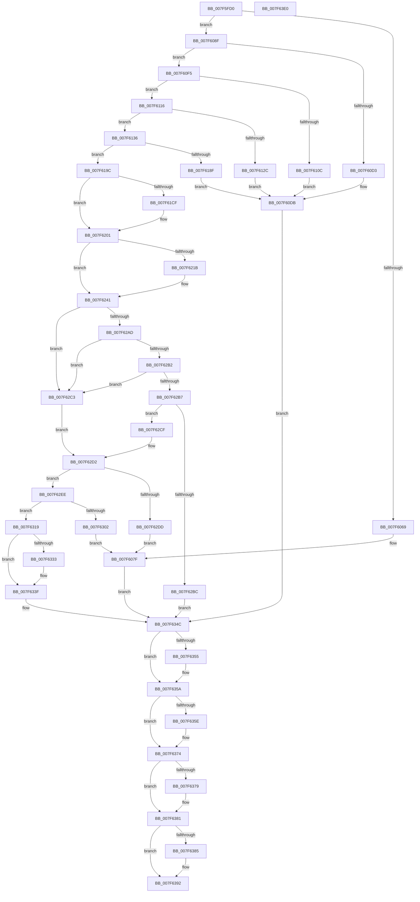

# CmpHiveCachePopulateHiveEntryThread

- RVA: `0x007F5FD0`–`0x007F63E1` (길이 `1,041` bytes)
- VA: `0x00000001407F5FD0`
- 실행 섹션: `PAGE`
- PDB 이름 있음: `예`; PDB Function 태그: `아니요`
- unwind 정보 RVA: `0x000D74E4`
- 디코드: `261`개 명령, `1,041/1,041` bytes 표시
- 미해석 바이트: `0` (있으면 어셈블리에 `.byte`로 보존)

> 이 문서는 커널 이미지의 기계어와 PDB 기호를 분석해 생성했습니다. 4번과 5번은 함수 원형과 자료형을 바이너리 사용 방식에서 추정한 C 해석이며 원본 소스 복구 결과는 아닙니다.

## 1. Dependencies

- 직접 호출 지점: **27**; 고유 호출 대상: **18**
- 직접 호출자로 확인된 함수: **0**
- RIP 상대 이미지 참조: **0**

### Outgoing calls
- `0x007F601D` → [CmpInitializeThreadInfo](../../text/3F/CmpInitializeThreadInfo_function_003FBE70.md) (function, `0x003FBE70`)
- `0x007F6058` → [CmpHiveCacheEntryLockAcquire](CmpHiveCacheEntryLockAcquire_function_007F5CD8.md) (function, `0x007F5CD8`)
- `0x007F6085` → [SetFailureLocation](../../text/46/SetFailureLocation_function_0046EF54.md) (function, `0x0046EF54`)
- `0x007F60C8` → [CmpOpenHiveFiles](../87/CmpOpenHiveFiles_function_00879A68.md) (function, `0x00879A68`)
- `0x007F60E7` → [SetFailureLocation](../../text/46/SetFailureLocation_function_0046EF54.md) (function, `0x0046EF54`)
- `0x007F60FE` → [CmpRequestOplockOnHiveFile](CmpRequestOplockOnHiveFile_function_007F63E8.md) (function, `0x007F63E8`)
- `0x007F611F` → [CmpHiveCacheSubscribePnpNotifications](../7E/CmpHiveCacheSubscribePnpNotifications_function_007E8D2C.md) (function, `0x007E8D2C`)
- `0x007F6184` → [CmpCreateHive](../87/CmpCreateHive_function_00879DF0.md) (function, `0x00879DF0`)
- `0x007F61B2` → [CmSiAllocateMemory](../../text/49/CmSiAllocateMemory_function_00490C18.md) (function, `0x00490C18`)
- `0x007F61FC` → [memcpy](../../text/6C/memcpy_function_006C6840.md) (function, `0x006C6840`)
- `0x007F620A` → [CmSiAllocateMemory](../../text/49/CmSiAllocateMemory_function_00490C18.md) (function, `0x00490C18`)
- `0x007F623C` → [memcpy](../../text/6C/memcpy_function_006C6840.md) (function, `0x006C6840`)
- `0x007F6288` → [CmSiSetEvent](../../text/66/CmSiSetEvent_function_0066DE78.md) (function, `0x0066DE78`)
- `0x007F6290` → [CmpHiveCacheEntryLockRelease](CmpHiveCacheEntryLockRelease_function_007F5D3C.md) (function, `0x007F5D3C`)
- `0x007F629F` → [CmSiWaitForMultipleEvents](../../text/66/CmSiWaitForMultipleEvents_function_0066DE98.md) (function, `0x0066DE98`)
- `0x007F62F4` → [CmpHiveCacheEntryLockAcquire](CmpHiveCacheEntryLockAcquire_function_007F5CD8.md) (function, `0x007F5CD8`)
- `0x007F6326` → [CmpHiveCacheEntryLockRelease](CmpHiveCacheEntryLockRelease_function_007F5D3C.md) (function, `0x007F5D3C`)
- `0x007F6338` → [CmpHiveCacheAcknowledgeOplockBreak](CmpHiveCacheAcknowledgeOplockBreak_function_007F585C.md) (function, `0x007F585C`)
- `0x007F6347` → [CmpHiveCacheEntryCleanup](CmpHiveCacheEntryCleanup_function_007F5B38.md) (function, `0x007F5B38`)
- `0x007F6355` → [CmpDestroyHive](../9B/CmpDestroyHive_function_009B1708.md) (function, `0x009B1708`)
- `0x007F636F` → [CmSiSetEvent](../../text/66/CmSiSetEvent_function_0066DE78.md) (function, `0x0066DE78`)
- `0x007F637C` → [CmpHiveCacheEntryLockRelease](CmpHiveCacheEntryLockRelease_function_007F5D3C.md) (function, `0x007F5D3C`)
- `0x007F638D` → [CmpHiveCacheEntryCleanup](CmpHiveCacheEntryCleanup_function_007F5B38.md) (function, `0x007F5B38`)
- `0x007F63A0` → [CmSiSetEvent](../../text/66/CmSiSetEvent_function_0066DE78.md) (function, `0x0066DE78`)
- `0x007F63A8` → [CmSiFreeMemory](../../text/47/CmSiFreeMemory_function_00475D80.md) (function, `0x00475D80`)
- `0x007F63B1` → [CmCleanupThreadInfo](../../text/41/CmCleanupThreadInfo_function_0041FD50.md) (function, `0x0041FD50`)
- `0x007F63B8` → [PsTerminateSystemThread](../9B/PsTerminateSystemThread_function_009BCE50.md) (function, `0x009BCE50`)

### Direct callers
- 이 함수 시작 RVA로 연결되는 직접 call은 확인되지 않았습니다. 간접 호출은 완전히 역산할 수 없습니다.

### Static image references
- 디코드된 RIP-relative 메모리 참조가 없습니다.

## 2. Other-region calls and transfers

- 다른 실행 섹션으로 향하는 call: **13**
  - `0x007F601D` → [CmpInitializeThreadInfo](../../text/3F/CmpInitializeThreadInfo_function_003FBE70.md) (`PAGE` → `.text`)
  - `0x007F6085` → [SetFailureLocation](../../text/46/SetFailureLocation_function_0046EF54.md) (`PAGE` → `.text`)
  - `0x007F60E7` → [SetFailureLocation](../../text/46/SetFailureLocation_function_0046EF54.md) (`PAGE` → `.text`)
  - `0x007F61B2` → [CmSiAllocateMemory](../../text/49/CmSiAllocateMemory_function_00490C18.md) (`PAGE` → `.text`)
  - `0x007F61FC` → [memcpy](../../text/6C/memcpy_function_006C6840.md) (`PAGE` → `.text`)
  - `0x007F620A` → [CmSiAllocateMemory](../../text/49/CmSiAllocateMemory_function_00490C18.md) (`PAGE` → `.text`)
  - `0x007F623C` → [memcpy](../../text/6C/memcpy_function_006C6840.md) (`PAGE` → `.text`)
  - `0x007F6288` → [CmSiSetEvent](../../text/66/CmSiSetEvent_function_0066DE78.md) (`PAGE` → `.text`)
  - `0x007F629F` → [CmSiWaitForMultipleEvents](../../text/66/CmSiWaitForMultipleEvents_function_0066DE98.md) (`PAGE` → `.text`)
  - `0x007F636F` → [CmSiSetEvent](../../text/66/CmSiSetEvent_function_0066DE78.md) (`PAGE` → `.text`)
  - `0x007F63A0` → [CmSiSetEvent](../../text/66/CmSiSetEvent_function_0066DE78.md) (`PAGE` → `.text`)
  - `0x007F63A8` → [CmSiFreeMemory](../../text/47/CmSiFreeMemory_function_00475D80.md) (`PAGE` → `.text`)
  - `0x007F63B1` → [CmCleanupThreadInfo](../../text/41/CmCleanupThreadInfo_function_0041FD50.md) (`PAGE` → `.text`)
- 별도 외부 분기/꼬리 이동을 확인하지 못했습니다.

## 3. Assembly (complete function range)

```asm
007F5FD0  48 8B C4                        mov rax, rsp
007F5FD3  48 89 58 10                     mov qword ptr [rax + 0x10], rbx
007F5FD7  48 89 70 18                     mov qword ptr [rax + 0x18], rsi
007F5FDB  48 89 78 20                     mov qword ptr [rax + 0x20], rdi
007F5FDF  55                              push rbp
007F5FE0  41 54                           push r12
007F5FE2  41 55                           push r13
007F5FE4  41 56                           push r14
007F5FE6  41 57                           push r15
007F5FE8  48 8D 68 A1                     lea rbp, [rax - 0x5f]
007F5FEC  48 81 EC C0 00 00 00            sub rsp, 0xc0
007F5FF3  45 33 C9                        xor r9d, r9d
007F5FF6  48 89 4D FF                     mov qword ptr [rbp - 1], rcx
007F5FFA  0F 57 C0                        xorps xmm0, xmm0
007F5FFD  44 89 4D FB                     mov dword ptr [rbp - 5], r9d
007F6001  33 C0                           xor eax, eax
007F6003  4C 89 4D EF                     mov qword ptr [rbp - 0x11], r9
007F6007  4C 8B E1                        mov r12, rcx
007F600A  48 89 45 27                     mov qword ptr [rbp + 0x27], rax
007F600E  48 8D 4D 17                     lea rcx, [rbp + 0x17]
007F6012  44 88 4D E8                     mov byte ptr [rbp - 0x18], r9b
007F6016  0F 11 45 17                     movups xmmword ptr [rbp + 0x17], xmm0
007F601A  45 8B F9                        mov r15d, r9d
007F601D  E8 4E 5E C0 FF                  call 0x1403fbe70
007F6022  41 8B 44 24 14                  mov eax, dword ptr [r12 + 0x14]
007F6027  41 8B 7C 24 10                  mov edi, dword ptr [r12 + 0x10]
007F602C  49 8B 1C 24                     mov rbx, qword ptr [r12]
007F6030  49 8B 74 24 20                  mov rsi, qword ptr [r12 + 0x20]
007F6035  4D 8B 74 24 08                  mov r14, qword ptr [r12 + 8]
007F603A  89 45 F7                        mov dword ptr [rbp - 9], eax
007F603D  49 8B 44 24 18                  mov rax, qword ptr [r12 + 0x18]
007F6042  89 7D 07                        mov dword ptr [rbp + 7], edi
007F6045  8A 08                           mov cl, byte ptr [rax]
007F6047  88 4D E7                        mov byte ptr [rbp - 0x19], cl
007F604A  F0 FF 83 78 01 00 00            lock inc dword ptr [rbx + 0x178]
007F6051  48 8B CB                        mov rcx, rbx
007F6054  4C 89 4D 0F                     mov qword ptr [rbp + 0xf], r9
007F6058  E8 7B FC FF FF                  call 0x1407f5cd8
007F605D  83 BB A8 00 00 00 01            cmp dword ptr [rbx + 0xa8], 1
007F6064  41 B5 01                        mov r13b, 1
007F6067  74 26                           je 0x1407f608f
007F6069  41 B9 89 01 00 C0               mov r9d, 0xc0000189
007F606F  C7 44 24 20 20 00 00 00         mov dword ptr [rsp + 0x20], 0x20
007F6077  41 8B F9                        mov edi, r9d
007F607A  33 D2                           xor edx, edx
007F607C  48 8B CE                        mov rcx, rsi
007F607F  41 B8 29 00 00 00               mov r8d, 0x29
007F6085  E8 CA 8E C7 FF                  call 0x14046ef54
007F608A  E9 BD 02 00 00                  jmp 0x1407f634c
007F608F  44 8B 45 F7                     mov r8d, dword ptr [rbp - 9]
007F6093  48 8D 45 0F                     lea rax, [rbp + 0xf]
007F6097  48 89 74 24 40                  mov qword ptr [rsp + 0x40], rsi
007F609C  4C 8D A3 B0 00 00 00            lea r12, [rbx + 0xb0]
007F60A3  48 89 44 24 38                  mov qword ptr [rsp + 0x38], rax
007F60A8  4C 8D 4D FB                     lea r9, [rbp - 5]
007F60AC  4C 21 7C 24 30                  and qword ptr [rsp + 0x30], r15
007F60B1  48 8D 45 E7                     lea rax, [rbp - 0x19]
007F60B5  4C 89 64 24 28                  mov qword ptr [rsp + 0x28], r12
007F60BA  41 83 C8 10                     or r8d, 0x10
007F60BE  8B D7                           mov edx, edi
007F60C0  48 89 44 24 20                  mov qword ptr [rsp + 0x20], rax
007F60C5  49 8B CE                        mov rcx, r14
007F60C8  E8 9B 39 08 00                  call 0x140879a68
007F60CD  8B F8                           mov edi, eax
007F60CF  85 C0                           test eax, eax
007F60D1  79 22                           jns 0x1407f60f5
007F60D3  C7 44 24 20 40 00 00 00         mov dword ptr [rsp + 0x20], 0x40
007F60DB  33 D2                           xor edx, edx
007F60DD  44 8B C8                        mov r9d, eax
007F60E0  48 8B CE                        mov rcx, rsi
007F60E3  44 8D 42 29                     lea r8d, [rdx + 0x29]
007F60E7  E8 68 8E C7 FF                  call 0x14046ef54
007F60EC  4C 8B 65 FF                     mov r12, qword ptr [rbp - 1]
007F60F0  E9 57 02 00 00                  jmp 0x1407f634c
007F60F5  4C 8B C6                        mov r8, rsi
007F60F8  48 8B D3                        mov rdx, rbx
007F60FB  49 8B CC                        mov rcx, r12
007F60FE  E8 E5 02 00 00                  call 0x1407f63e8
007F6103  8B F8                           mov edi, eax
007F6105  3D 03 01 00 00                  cmp eax, 0x103
007F610A  74 0A                           je 0x1407f6116
007F610C  C7 44 24 20 50 00 00 00         mov dword ptr [rsp + 0x20], 0x50
007F6114  EB C5                           jmp 0x1407f60db
007F6116  4C 8B C6                        mov r8, rsi
007F6119  48 8B D3                        mov rdx, rbx
007F611C  49 8B CC                        mov rcx, r12
007F611F  E8 08 2C FF FF                  call 0x1407e8d2c
007F6124  33 C9                           xor ecx, ecx
007F6126  8B F8                           mov edi, eax
007F6128  85 C0                           test eax, eax
007F612A  79 0A                           jns 0x1407f6136
007F612C  C7 44 24 20 60 00 00 00         mov dword ptr [rsp + 0x20], 0x60
007F6134  EB A5                           jmp 0x1407f60db
007F6136  8A 45 E7                        mov al, byte ptr [rbp - 0x19]
007F6139  44 8B 4D FB                     mov r9d, dword ptr [rbp - 5]
007F613D  F6 D8                           neg al
007F613F  48 89 74 24 60                  mov qword ptr [rsp + 0x60], rsi
007F6144  48 8D 45 E8                     lea rax, [rbp - 0x18]
007F6148  48 89 44 24 58                  mov qword ptr [rsp + 0x58], rax
007F614D  1B D2                           sbb edx, edx
007F614F  8B 45 F7                        mov eax, dword ptr [rbp - 9]
007F6152  F7 D2                           not edx
007F6154  48 89 4C 24 50                  mov qword ptr [rsp + 0x50], rcx
007F6159  83 E2 05                        and edx, 5
007F615C  48 89 4C 24 48                  mov qword ptr [rsp + 0x48], rcx
007F6161  48 89 4C 24 40                  mov qword ptr [rsp + 0x40], rcx
007F6166  89 44 24 38                     mov dword ptr [rsp + 0x38], eax
007F616A  4C 89 74 24 30                  mov qword ptr [rsp + 0x30], r14
007F616F  4C 89 64 24 28                  mov qword ptr [rsp + 0x28], r12
007F6174  44 8B 65 07                     mov r12d, dword ptr [rbp + 7]
007F6178  45 8B C4                        mov r8d, r12d
007F617B  48 89 4C 24 20                  mov qword ptr [rsp + 0x20], rcx
007F6180  48 8D 4D EF                     lea rcx, [rbp - 0x11]
007F6184  E8 67 3C 08 00                  call 0x140879df0
007F6189  8B F8                           mov edi, eax
007F618B  85 C0                           test eax, eax
007F618D  79 0D                           jns 0x1407f619c
007F618F  C7 44 24 20 70 00 00 00         mov dword ptr [rsp + 0x20], 0x70
007F6197  E9 3F FF FF FF                  jmp 0x1407f60db
007F619C  48 8B 4D EF                     mov rcx, qword ptr [rbp - 0x11]
007F61A0  BA 43 4D 39 36                  mov edx, 0x36394d43
007F61A5  8B 45 13                        mov eax, dword ptr [rbp + 0x13]
007F61A8  89 81 BC 00 00 00               mov dword ptr [rcx + 0xbc], eax
007F61AE  41 0F B7 0E                     movzx ecx, word ptr [r14]
007F61B2  E8 61 AA C9 FF                  call 0x140490c18
007F61B7  48 8B 4D EF                     mov rcx, qword ptr [rbp - 0x11]
007F61BB  48 89 81 38 07 00 00            mov qword ptr [rcx + 0x738], rax
007F61C2  48 8B 4D EF                     mov rcx, qword ptr [rbp - 0x11]
007F61C6  4C 39 B9 38 07 00 00            cmp qword ptr [rcx + 0x738], r15
007F61CD  74 32                           je 0x1407f6201
007F61CF  41 0F B7 06                     movzx eax, word ptr [r14]
007F61D3  66 89 81 30 07 00 00            mov word ptr [rcx + 0x730], ax
007F61DA  41 0F B7 0E                     movzx ecx, word ptr [r14]
007F61DE  48 8B 45 EF                     mov rax, qword ptr [rbp - 0x11]
007F61E2  66 89 88 32 07 00 00            mov word ptr [rax + 0x732], cx
007F61E9  48 8B 4D EF                     mov rcx, qword ptr [rbp - 0x11]
007F61ED  45 0F B7 06                     movzx r8d, word ptr [r14]
007F61F1  49 8B 56 08                     mov rdx, qword ptr [r14 + 8]
007F61F5  48 8B 89 38 07 00 00            mov rcx, qword ptr [rcx + 0x738]
007F61FC  E8 3F 06 ED FF                  call 0x1406c6840
007F6201  41 0F B7 0E                     movzx ecx, word ptr [r14]
007F6205  BA 43 4D 39 37                  mov edx, 0x37394d43
007F620A  E8 09 AA C9 FF                  call 0x140490c18
007F620F  48 89 83 40 01 00 00            mov qword ptr [rbx + 0x140], rax
007F6216  48 85 C0                        test rax, rax
007F6219  74 26                           je 0x1407f6241
007F621B  41 0F B7 0E                     movzx ecx, word ptr [r14]
007F621F  66 89 8B 38 01 00 00            mov word ptr [rbx + 0x138], cx
007F6226  41 0F B7 0E                     movzx ecx, word ptr [r14]
007F622A  66 89 8B 3A 01 00 00            mov word ptr [rbx + 0x13a], cx
007F6231  48 8B C8                        mov rcx, rax
007F6234  45 0F B7 06                     movzx r8d, word ptr [r14]
007F6238  49 8B 56 08                     mov rdx, qword ptr [r14 + 8]
007F623C  E8 FF 05 ED FF                  call 0x1406c6840
007F6241  48 8B 45 EF                     mov rax, qword ptr [rbp - 0x11]
007F6245  8A 4D E7                        mov cl, byte ptr [rbp - 0x19]
007F6248  48 89 83 70 01 00 00            mov qword ptr [rbx + 0x170], rax
007F624F  4C 21 7D EF                     and qword ptr [rbp - 0x11], r15
007F6253  8B 45 F7                        mov eax, dword ptr [rbp - 9]
007F6256  44 89 A3 48 01 00 00            mov dword ptr [rbx + 0x148], r12d
007F625D  4C 8B 65 FF                     mov r12, qword ptr [rbp - 1]
007F6261  C7 83 A8 00 00 00 02 00 00 00   mov dword ptr [rbx + 0xa8], 2
007F626B  89 83 4C 01 00 00               mov dword ptr [rbx + 0x14c], eax
007F6271  8A 45 E8                        mov al, byte ptr [rbp - 0x18]
007F6274  88 83 7C 01 00 00               mov byte ptr [rbx + 0x17c], al
007F627A  49 8B 44 24 18                  mov rax, qword ptr [r12 + 0x18]
007F627F  88 08                           mov byte ptr [rax], cl
007F6281  48 8D 8B 10 01 00 00            lea rcx, [rbx + 0x110]
007F6288  E8 EB 7B E7 FF                  call 0x14066de78
007F628D  48 8B CB                        mov rcx, rbx
007F6290  E8 A7 FA FF FF                  call 0x1407f5d3c
007F6295  48 8D 93 D0 00 00 00            lea rdx, [rbx + 0xd0]
007F629C  45 32 ED                        xor r13b, r13b
007F629F  E8 F4 7B E7 FF                  call 0x14066de98
007F62A4  48 63 F0                        movsxd rsi, eax
007F62A7  8B D6                           mov edx, esi
007F62A9  85 C0                           test eax, eax
007F62AB  74 16                           je 0x1407f62c3
007F62AD  83 EA 01                        sub edx, 1
007F62B0  74 11                           je 0x1407f62c3
007F62B2  83 EA 01                        sub edx, 1
007F62B5  74 0C                           je 0x1407f62c3
007F62B7  83 FA 01                        cmp edx, 1
007F62BA  75 13                           jne 0x1407f62cf
007F62BC  33 FF                           xor edi, edi
007F62BE  E9 89 00 00 00                  jmp 0x1407f634c
007F62C3  4C 6B FE 38                     imul r15, rsi, 0x38
007F62C7  41 B6 01                        mov r14b, 1
007F62CA  4C 03 FB                        add r15, rbx
007F62CD  EB 03                           jmp 0x1407f62d2
007F62CF  45 8A F5                        mov r14b, r13b
007F62D2  41 B9 16 02 00 00               mov r9d, 0x216
007F62D8  45 39 0F                        cmp dword ptr [r15], r9d
007F62DB  75 11                           jne 0x1407f62ee
007F62DD  33 D2                           xor edx, edx
007F62DF  C7 44 24 20 80 00 00 00         mov dword ptr [rsp + 0x20], 0x80
007F62E7  33 C9                           xor ecx, ecx
007F62E9  E9 91 FD FF FF                  jmp 0x1407f607f
007F62EE  48 8B CB                        mov rcx, rbx
007F62F1  41 B5 01                        mov r13b, 1
007F62F4  E8 DF F9 FF FF                  call 0x1407f5cd8
007F62F9  83 BB A8 00 00 00 02            cmp dword ptr [rbx + 0xa8], 2
007F6300  74 17                           je 0x1407f6319
007F6302  33 D2                           xor edx, edx
007F6304  C7 44 24 20 90 00 00 00         mov dword ptr [rsp + 0x20], 0x90
007F630C  33 C9                           xor ecx, ecx
007F630E  41 B9 89 01 00 C0               mov r9d, 0xc0000189
007F6314  E9 66 FD FF FF                  jmp 0x1407f607f
007F6319  48 8B CB                        mov rcx, rbx
007F631C  C7 83 A8 00 00 00 03 00 00 00   mov dword ptr [rbx + 0xa8], 3
007F6326  E8 11 FA FF FF                  call 0x1407f5d3c
007F632B  45 32 ED                        xor r13b, r13b
007F632E  45 84 F6                        test r14b, r14b
007F6331  74 0C                           je 0x1407f633f
007F6333  8B D6                           mov edx, esi
007F6335  48 8B CB                        mov rcx, rbx
007F6338  E8 1F F5 FF FF                  call 0x1407f585c
007F633D  8B F8                           mov edi, eax
007F633F  BA 04 00 00 00                  mov edx, 4
007F6344  48 8B CB                        mov rcx, rbx
007F6347  E8 EC F7 FF FF                  call 0x1407f5b38
007F634C  48 8B 4D EF                     mov rcx, qword ptr [rbp - 0x11]
007F6350  48 85 C9                        test rcx, rcx
007F6353  74 05                           je 0x1407f635a
007F6355  E8 AE B3 1B 00                  call 0x1409b1708
007F635A  85 FF                           test edi, edi
007F635C  79 16                           jns 0x1407f6374
007F635E  48 8D 8B 10 01 00 00            lea rcx, [rbx + 0x110]
007F6365  C7 83 A8 00 00 00 03 00 00 00   mov dword ptr [rbx + 0xa8], 3
007F636F  E8 04 7B E7 FF                  call 0x14066de78
007F6374  45 84 ED                        test r13b, r13b
007F6377  74 08                           je 0x1407f6381
007F6379  48 8B CB                        mov rcx, rbx
007F637C  E8 BB F9 FF FF                  call 0x1407f5d3c
007F6381  85 FF                           test edi, edi
007F6383  79 0D                           jns 0x1407f6392
007F6385  BA 01 00 00 00                  mov edx, 1
007F638A  48 8B CB                        mov rcx, rbx
007F638D  E8 A6 F7 FF FF                  call 0x1407f5b38
007F6392  F0 FF 8B 78 01 00 00            lock dec dword ptr [rbx + 0x178]
007F6399  48 8D 8B 20 01 00 00            lea rcx, [rbx + 0x120]
007F63A0  E8 D3 7A E7 FF                  call 0x14066de78
007F63A5  49 8B CC                        mov rcx, r12
007F63A8  E8 D3 F9 C7 FF                  call 0x140475d80
007F63AD  48 8D 4D 17                     lea rcx, [rbp + 0x17]
007F63B1  E8 9A 99 C2 FF                  call 0x14041fd50
007F63B6  8B CF                           mov ecx, edi
007F63B8  E8 93 6A 1C 00                  call 0x1409bce50
007F63BD  4C 8D 9C 24 C0 00 00 00         lea r11, [rsp + 0xc0]
007F63C5  33 C0                           xor eax, eax
007F63C7  49 8B 5B 38                     mov rbx, qword ptr [r11 + 0x38]
007F63CB  49 8B 73 40                     mov rsi, qword ptr [r11 + 0x40]
007F63CF  49 8B 7B 48                     mov rdi, qword ptr [r11 + 0x48]
007F63D3  49 8B E3                        mov rsp, r11
007F63D6  41 5F                           pop r15
007F63D8  41 5E                           pop r14
007F63DA  41 5D                           pop r13
007F63DC  41 5C                           pop r12
007F63DE  5D                              pop rbp
007F63DF  C3                              ret
007F63E0  CC                              int3
```

## 4. C-style interpretation (structured pseudocode)

```c
__int64 __fastcall CmpHiveCachePopulateHiveEntryThread(__int64 a1, int a2, __int64 a3, int a4)
{
    __int64 result;
    __int64 v_r13;
    __int64 v_r15;
    __int64 v_rdi;
    __int64 v_rsp;
    unsigned __int64 v_stack_m28;
    unsigned __int64 v_stack_m88;
    unsigned __int64 v_stack_m90;
    unsigned __int64 v_stack_m98;
    unsigned __int64 v_stack_mA0;
    unsigned __int64 v_stack_mA8;
    unsigned __int64 v_stack_mB0;
    unsigned __int64 v_stack_mB8;
    unsigned __int64 v_stack_mC0;
    unsigned int v_stack_mC8;

    *(unsigned __int64 *)(v_rsp + 16) = v_rbx;
    *(unsigned __int64 *)(v_rsp + 24) = v_rsi;
    *(unsigned __int64 *)(v_rsp + 32) = v_rdi;
    v_rsp = (v_rsp) - (192);
    a4 = 0;
    *(unsigned __int64 *)(v_rsp - 95 - 1) = a1;
    *(unsigned int *)(v_rsp - 95 - 5) = 0;
    result = 0;
    *(unsigned __int64 *)(v_rsp - 95 - 17) = 0;
    *(unsigned __int64 *)(v_rsp - 95 + 39) = 0;
    *(unsigned __int8 *)(v_rsp - 95 - 24) = 0;
    *(unsigned __int64 *)(v_rsp - 95 + 23) = v_xmm0;
    result = CmpInitializeThreadInfo(v_rsp - 95 + 23, a2, a3, a4);
    *(unsigned int *)(v_rsp - 95 - 9) = (unsigned int)((unsigned int)(*(unsigned int *)(a1 + 20)));
    *(unsigned int *)(v_rsp - 95 + 7) = (unsigned int)((unsigned int)(*(unsigned int *)(a1 + 16)));
    *(unsigned __int8 *)(v_rsp - 95 - 25) = (unsigned __int8)(*(unsigned __int8 *)(*(unsigned __int64 *)(a1 + 24)));
    *(unsigned __int64 *)(v_rsp - 95 + 15) = 0;
    result = CmpHiveCacheEntryLockAcquire(*(unsigned __int64 *)(a1), a2, a3, a4);
    if ((*(unsigned int *)(*(unsigned __int64 *)(a1) + 168)) == 1) goto loc_007F608F;
    v_stack_mC8 = 32;
    a2 = 0;
loc_007F607F:
    result = SetFailureLocation(*(unsigned __int64 *)(a1 + 32), a2, 41, (unsigned int)(0xC0000189ULL));
    goto loc_007F634C;
loc_007F608F:
    v_stack_mA8 = *(unsigned __int64 *)(a1 + 32);
    v_stack_mB0 = v_rsp - 95 + 15;
    v_stack_mC0 = *(unsigned __int64 *)(a1) + 176;
    a3 = (unsigned int)(((unsigned int)(*(unsigned int *)(v_rsp - 95 - 9))) | (16));
    v_stack_mC8 = v_rsp - 95 - 25;
    result = CmpOpenHiveFiles(*(unsigned __int64 *)(a1 + 8), (unsigned int)((unsigned int)((unsigned int)((unsigned int)((unsigned int)(0xC0000189ULL))))), a3, v_rsp - 95 - 5);
    if (!sign_flag) goto loc_007F60F5;
    v_stack_mC8 = 64;
loc_007F60DB:
    a2 = 0;
    result = SetFailureLocation(*(unsigned __int64 *)(a1 + 32), a2, a2 + 41, (unsigned int)((unsigned int)(result)));
    goto loc_007F634C;
loc_007F60F5:
    result = CmpRequestOplockOnHiveFile(*(unsigned __int64 *)(v_rsp - 95 - 1), *(unsigned __int64 *)(a1), *(unsigned __int64 *)(a1 + 32), (unsigned int)((unsigned int)(result)));
    if (((unsigned int)(result)) == 259) goto loc_007F6116;
    v_stack_mC8 = 80;
    goto loc_007F60DB;
loc_007F6116:
    result = CmpHiveCacheSubscribePnpNotifications(*(unsigned __int64 *)(v_rsp - 95 - 1), *(unsigned __int64 *)(a1), *(unsigned __int64 *)(a1 + 32), (unsigned int)((unsigned int)(result)));
    a1 = 0;
    if (!sign_flag) goto loc_007F6136;
    v_stack_mC8 = 96;
    goto loc_007F60DB;
loc_007F6136:
    result = (unsigned __int8)(-(*(unsigned __int8 *)(v_rsp - 95 - 25)));
    v_stack_m88 = *(unsigned __int64 *)(a1 + 32);
    v_stack_m90 = v_rsp - 95 - 24;
    a2 = (unsigned int)(~(*(unsigned __int64 *)(a1)));
    v_stack_m98 = 0;
    a2 = (unsigned int)((a2) & (5));
    v_stack_mA0 = 0;
    v_stack_mA8 = 0;
    v_stack_mB0 = (unsigned int)((unsigned int)(*(unsigned int *)(v_rsp - 95 - 9)));
    v_stack_mB8 = *(unsigned __int64 *)(a1 + 8);
    v_stack_mC0 = *(unsigned __int64 *)(v_rsp - 95 - 1);
    v_stack_mC8 = 0;
    result = CmpCreateHive(v_rsp - 95 - 17, a2, (unsigned int)((unsigned int)((unsigned int)(*(unsigned int *)(v_rsp - 95 + 7)))), (unsigned int)(*(unsigned int *)(v_rsp - 95 - 5)));
    if (!sign_flag) goto loc_007F619C;
    v_stack_mC8 = 112;
    goto loc_007F60DB;
loc_007F619C:
    *(unsigned int *)(*(unsigned __int64 *)(v_rsp - 95 - 17) + 188) = (unsigned int)((unsigned int)(*(unsigned int *)(v_rsp - 95 + 19)));
    result = CmSiAllocateMemory(*(unsigned __int16 *)(*(unsigned __int64 *)(a1 + 8)), (unsigned int)(0x36394D43ULL), (unsigned int)((unsigned int)((unsigned int)(*(unsigned int *)(v_rsp - 95 + 7)))), (unsigned int)(*(unsigned int *)(v_rsp - 95 - 5)));
    *(unsigned __int64 *)(*(unsigned __int64 *)(v_rsp - 95 - 17) + 1848) = result;
    if ((*(unsigned __int64 *)(*(unsigned __int64 *)(v_rsp - 95 - 17) + 1848)) != 0) {
        result = *(unsigned __int16 *)(*(unsigned __int64 *)(a1 + 8));
        *(unsigned __int16 *)(*(unsigned __int64 *)(v_rsp - 95 - 17) + 1840) = (unsigned __int16)(result);
        a1 = *(unsigned __int16 *)(*(unsigned __int64 *)(a1 + 8));
        result = *(unsigned __int64 *)(v_rsp - 95 - 17);
        *(unsigned __int16 *)(result + 1842) = (unsigned __int16)(a1);
        a1 = *(unsigned __int64 *)(v_rsp - 95 - 17);
        a3 = *(unsigned __int16 *)(*(unsigned __int64 *)(a1 + 8));
        a2 = *(unsigned __int64 *)(*(unsigned __int64 *)(a1 + 8) + 8);
        a1 = *(unsigned __int64 *)(a1 + 1848);
        result = memcpy(a1, a2, a3, (unsigned int)(*(unsigned int *)(v_rsp - 95 - 5)));
    }
    result = CmSiAllocateMemory(*(unsigned __int16 *)(*(unsigned __int64 *)(a1 + 8)), (unsigned int)(0x37394D43ULL), a3, (unsigned int)(*(unsigned int *)(v_rsp - 95 - 5)));
    *(unsigned __int64 *)(*(unsigned __int64 *)(a1) + 320) = result;
    if (result != 0) {
        a1 = *(unsigned __int16 *)(*(unsigned __int64 *)(a1 + 8));
        *(unsigned __int16 *)(*(unsigned __int64 *)(a1) + 312) = (unsigned __int16)(a1);
        a1 = *(unsigned __int16 *)(*(unsigned __int64 *)(a1 + 8));
        *(unsigned __int16 *)(*(unsigned __int64 *)(a1) + 314) = (unsigned __int16)(a1);
        a1 = result;
        a3 = *(unsigned __int16 *)(*(unsigned __int64 *)(a1 + 8));
        a2 = *(unsigned __int64 *)(*(unsigned __int64 *)(a1 + 8) + 8);
        result = memcpy(a1, a2, a3, (unsigned int)(*(unsigned int *)(v_rsp - 95 - 5)));
    }
    *(unsigned __int64 *)(*(unsigned __int64 *)(a1) + 368) = *(unsigned __int64 *)(v_rsp - 95 - 17);
    *(unsigned int *)(*(unsigned __int64 *)(a1) + 328) = (unsigned int)((unsigned int)(*(unsigned int *)(v_rsp - 95 + 7)));
    *(unsigned int *)(*(unsigned __int64 *)(a1) + 168) = 2;
    *(unsigned int *)(*(unsigned __int64 *)(a1) + 332) = (unsigned int)((unsigned int)(*(unsigned int *)(v_rsp - 95 - 9)));
    *(unsigned __int8 *)(*(unsigned __int64 *)(a1) + 380) = (unsigned __int8)(*(unsigned __int8 *)(v_rsp - 95 - 24));
    *(unsigned __int8 *)(*(unsigned __int64 *)(*(unsigned __int64 *)(v_rsp - 95 - 1) + 24)) = (unsigned __int8)(*(unsigned __int8 *)(v_rsp - 95 - 25));
    result = CmSiSetEvent(*(unsigned __int64 *)(a1) + 272, a2, a3, (unsigned int)(*(unsigned int *)(v_rsp - 95 - 5)));
    result = CmpHiveCacheEntryLockRelease(*(unsigned __int64 *)(a1), a2, a3, (unsigned int)(*(unsigned int *)(v_rsp - 95 - 5)));
    v_r13 = 0;
    result = CmSiWaitForMultipleEvents(*(unsigned __int64 *)(a1), *(unsigned __int64 *)(a1) + 208, a3, (unsigned int)(*(unsigned int *)(v_rsp - 95 - 5)));
    if ((unsigned int)(result) == 0) goto loc_007F62C3;
    a2 = (unsigned int)(((unsigned int)((unsigned int)((int)((unsigned int)(result))))) - (1));
    if (condition_is_equal) goto loc_007F62C3;
    a2 = (unsigned int)((a2) - (1));
    if (condition_is_equal) goto loc_007F62C3;
    if (a2 != 1) goto loc_007F62CF;
    v_rdi = 0;
    goto loc_007F634C;
loc_007F62C3:
    v_r15 = (0) * ((int)((unsigned int)(result)));
    v_r15 = (v_r15) + (*(unsigned __int64 *)(a1));
    goto loc_007F62D2;
loc_007F62CF:
loc_007F62D2:
    if ((*(unsigned int *)(v_r15)) != 534) goto loc_007F62EE;
    a2 = 0;
    v_stack_mC8 = 128;
    a1 = 0;
    goto loc_007F607F;
loc_007F62EE:
    result = CmpHiveCacheEntryLockAcquire(*(unsigned __int64 *)(a1), a2, a3, 534);
    if ((*(unsigned int *)(*(unsigned __int64 *)(a1) + 168)) == 2) goto loc_007F6319;
    a2 = 0;
    v_stack_mC8 = 144;
    a1 = 0;
    goto loc_007F607F;
loc_007F6319:
    *(unsigned int *)(*(unsigned __int64 *)(a1) + 168) = 3;
    result = CmpHiveCacheEntryLockRelease(*(unsigned __int64 *)(a1), a2, a3, (unsigned int)(0xC0000189ULL));
    v_r13 = 0;
    if (0 != 0) {
        a2 = (unsigned int)((int)((unsigned int)(result)));
        a1 = *(unsigned __int64 *)(a1);
        result = CmpHiveCacheAcknowledgeOplockBreak(a1, a2, a3, (unsigned int)(0xC0000189ULL));
        v_rdi = (unsigned int)(result);
    }
    result = CmpHiveCacheEntryCleanup(*(unsigned __int64 *)(a1), 4, a3, (unsigned int)(0xC0000189ULL));
loc_007F634C:
    if (*(unsigned __int64 *)(v_rsp - 95 - 17) != 0) {
        result = CmpDestroyHive(*(unsigned __int64 *)(v_rsp - 95 - 17), 4, a3, (unsigned int)(0xC0000189ULL));
    }
    if (sign_flag) {
        a1 = *(unsigned __int64 *)(a1) + 272;
        *(unsigned int *)(*(unsigned __int64 *)(a1) + 168) = 3;
        result = CmSiSetEvent(a1, 4, a3, (unsigned int)(0xC0000189ULL));
    }
    if (0 != 0) {
        a1 = *(unsigned __int64 *)(a1);
        result = CmpHiveCacheEntryLockRelease(a1, 4, a3, (unsigned int)(0xC0000189ULL));
    }
    if (sign_flag) {
        a2 = 1;
        a1 = *(unsigned __int64 *)(a1);
        result = CmpHiveCacheEntryCleanup(a1, a2, a3, (unsigned int)(0xC0000189ULL));
    }
    result = CmSiSetEvent(*(unsigned __int64 *)(a1) + 288, a2, a3, (unsigned int)(0xC0000189ULL));
    result = CmSiFreeMemory(*(unsigned __int64 *)(v_rsp - 95 - 1), a2, a3, (unsigned int)(0xC0000189ULL));
    result = CmCleanupThreadInfo(v_rsp - 95 + 23, a2, a3, (unsigned int)(0xC0000189ULL));
    result = PsTerminateSystemThread((unsigned int)((unsigned int)(v_rdi)), a2, a3, (unsigned int)(0xC0000189ULL));
    result = 0;
    return result;
}
```

## 5. (Beta) C Style

```c
int64_t CmpHiveCachePopulateHiveEntryThread(void *Arg1, int32_t Arg2, int64_t Arg3, int32_t Arg4)
{
    uint8_t *arg1 = (uint8_t *)Arg1;

    int64_t result;
    int64_t local_r13;
    int64_t local_r15;
    int64_t local_rdi;
    int64_t local_rsp;
    uint64_t v_stack_m28;
    uint64_t v_stack_m88;
    uint64_t v_stack_m90;
    uint64_t v_stack_m98;
    uint64_t v_stack_mA0;
    uint64_t v_stack_mA8;
    uint64_t v_stack_mB0;
    uint64_t v_stack_mB8;
    uint64_t v_stack_mC0;
    uint32_t v_stack_mC8;

    *(uint64_t *)(local_rsp + 0x10) = local_rbx;
    *(uint64_t *)(local_rsp + 0x18) = local_rsi;
    *(uint64_t *)(local_rsp + 0x20) = local_rdi;
    local_rsp = (local_rsp) - (192);
    Arg4 = 0;
    *(void **)(local_rsp - 0x5F - 0x1) = Arg1;
    *(uint32_t *)(local_rsp - 0x5F - 0x5) = 0;
    result = 0;
    *(uint64_t *)(local_rsp - 0x5F - 0x11) = 0;
    *(uint64_t *)(local_rsp - 0x5F + 0x27) = 0;
    *(uint8_t *)(local_rsp - 0x5F - 0x18) = 0;
    *(uint64_t *)(local_rsp - 0x5F + 0x17) = v_xmm0;
    result = CmpInitializeThreadInfo(local_rsp - 95 + 23, Arg2, Arg3, Arg4);
    *(uint32_t *)(local_rsp - 0x5F - 0x9) = (uint32_t)((uint32_t)(*(uint32_t *)(arg1 + 0x14)));
    *(uint32_t *)(local_rsp - 0x5F + 0x7) = (uint32_t)((uint32_t)(*(uint32_t *)(arg1 + 0x10)));
    *(uint8_t *)(local_rsp - 0x5F - 0x19) = (uint8_t)(*(uint8_t *)(*(uint64_t *)(arg1 + 0x18)));
    *(uint64_t *)(local_rsp - 0x5F + 0xF) = 0;
    result = CmpHiveCacheEntryLockAcquire(*(uint64_t *)(arg1), Arg2, Arg3, Arg4);
    if ((*(uint32_t *)(*(uint64_t *)(arg1) + 0xA8)) == 1) goto loc_007F608F;
    v_stack_mC8 = 32;
    Arg2 = 0;
loc_007F607F:
    result = SetFailureLocation(*(uint64_t *)(arg1 + 0x20), Arg2, 41, (uint32_t)(0xC0000189ULL));
    goto loc_007F634C;
loc_007F608F:
    v_stack_mA8 = *(uint64_t *)(arg1 + 0x20);
    v_stack_mB0 = local_rsp - 95 + 15;
    v_stack_mC0 = *(uint64_t *)(arg1) + 176;
    Arg3 = (uint32_t)(((uint32_t)(*(uint32_t *)(local_rsp - 0x5F - 0x9))) | (16));
    v_stack_mC8 = local_rsp - 95 - 25;
    result = CmpOpenHiveFiles(*(uint64_t *)(arg1 + 0x8), (uint32_t)((uint32_t)((uint32_t)((uint32_t)((uint32_t)(0xC0000189ULL))))), Arg3, local_rsp - 95 - 5);
    if (!sign_flag) goto loc_007F60F5;
    v_stack_mC8 = 64;
loc_007F60DB:
    Arg2 = 0;
    result = SetFailureLocation(*(uint64_t *)(arg1 + 0x20), Arg2, Arg2 + 41, (uint32_t)((uint32_t)(result)));
    goto loc_007F634C;
loc_007F60F5:
    result = CmpRequestOplockOnHiveFile(*(uint64_t *)(local_rsp - 0x5F - 0x1), *(uint64_t *)(arg1), *(uint64_t *)(arg1 + 0x20), (uint32_t)((uint32_t)(result)));
    if (((uint32_t)(result)) == 259) goto loc_007F6116;
    v_stack_mC8 = 80;
    goto loc_007F60DB;
loc_007F6116:
    result = CmpHiveCacheSubscribePnpNotifications(*(uint64_t *)(local_rsp - 0x5F - 0x1), *(uint64_t *)(arg1), *(uint64_t *)(arg1 + 0x20), (uint32_t)((uint32_t)(result)));
    Arg1 = 0;
    if (!sign_flag) goto loc_007F6136;
    v_stack_mC8 = 96;
    goto loc_007F60DB;
loc_007F6136:
    result = (uint8_t)(-(*(uint8_t *)(local_rsp - 0x5F - 0x19)));
    v_stack_m88 = *(uint64_t *)(arg1 + 0x20);
    v_stack_m90 = local_rsp - 95 - 24;
    Arg2 = (uint32_t)(~(*(uint64_t *)(arg1)));
    v_stack_m98 = 0;
    Arg2 = (uint32_t)((Arg2) & (5));
    v_stack_mA0 = 0;
    v_stack_mA8 = 0;
    v_stack_mB0 = (uint32_t)((uint32_t)(*(uint32_t *)(local_rsp - 0x5F - 0x9)));
    v_stack_mB8 = *(uint64_t *)(arg1 + 0x8);
    v_stack_mC0 = *(uint64_t *)(local_rsp - 0x5F - 0x1);
    v_stack_mC8 = 0;
    result = CmpCreateHive(local_rsp - 95 - 17, Arg2, (uint32_t)((uint32_t)((uint32_t)(*(uint32_t *)(local_rsp - 0x5F + 0x7)))), (uint32_t)(*(uint32_t *)(local_rsp - 0x5F - 0x5)));
    if (!sign_flag) goto loc_007F619C;
    v_stack_mC8 = 112;
    goto loc_007F60DB;
loc_007F619C:
    *(uint32_t *)(*(uint64_t *)(local_rsp - 0x5F - 0x11) + 0xBC) = (uint32_t)((uint32_t)(*(uint32_t *)(local_rsp - 0x5F + 0x13)));
    result = CmSiAllocateMemory(*(uint16_t *)(*(uint64_t *)(arg1 + 0x8)), (uint32_t)(0x36394D43ULL), (uint32_t)((uint32_t)((uint32_t)(*(uint32_t *)(local_rsp - 0x5F + 0x7)))), (uint32_t)(*(uint32_t *)(local_rsp - 0x5F - 0x5)));
    *(uint64_t *)(*(uint64_t *)(local_rsp - 0x5F - 0x11) + 0x738) = result;
    if ((*(uint64_t *)(*(uint64_t *)(local_rsp - 0x5F - 0x11) + 0x738)) != 0) {
        result = *(uint16_t *)(*(uint64_t *)(arg1 + 0x8));
        *(uint16_t *)(*(uint64_t *)(local_rsp - 0x5F - 0x11) + 0x730) = (uint16_t)(result);
        Arg1 = *(uint16_t *)(*(uint64_t *)(arg1 + 0x8));
        result = *(uint64_t *)(local_rsp - 0x5F - 0x11);
        *(uint16_t *)(result + 0x732) = (uint16_t)(Arg1);
        Arg1 = *(uint64_t *)(local_rsp - 0x5F - 0x11);
        Arg3 = *(uint16_t *)(*(uint64_t *)(arg1 + 0x8));
        Arg2 = *(uint64_t *)(*(uint64_t *)(arg1 + 0x8) + 0x8);
        Arg1 = *(uint64_t *)(arg1 + 0x738);
        result = memcpy(Arg1, Arg2, Arg3, (uint32_t)(*(uint32_t *)(local_rsp - 0x5F - 0x5)));
    }
    result = CmSiAllocateMemory(*(uint16_t *)(*(uint64_t *)(arg1 + 0x8)), (uint32_t)(0x37394D43ULL), Arg3, (uint32_t)(*(uint32_t *)(local_rsp - 0x5F - 0x5)));
    *(uint64_t *)(*(uint64_t *)(arg1) + 0x140) = result;
    if (result != 0) {
        Arg1 = *(uint16_t *)(*(uint64_t *)(arg1 + 0x8));
        *(uint16_t *)(*(uint64_t *)(arg1) + 0x138) = (uint16_t)(Arg1);
        Arg1 = *(uint16_t *)(*(uint64_t *)(arg1 + 0x8));
        *(uint16_t *)(*(uint64_t *)(arg1) + 0x13A) = (uint16_t)(Arg1);
        Arg1 = result;
        Arg3 = *(uint16_t *)(*(uint64_t *)(arg1 + 0x8));
        Arg2 = *(uint64_t *)(*(uint64_t *)(arg1 + 0x8) + 0x8);
        result = memcpy(Arg1, Arg2, Arg3, (uint32_t)(*(uint32_t *)(local_rsp - 0x5F - 0x5)));
    }
    *(uint64_t *)(*(uint64_t *)(arg1) + 0x170) = *(uint64_t *)(local_rsp - 0x5F - 0x11);
    *(uint32_t *)(*(uint64_t *)(arg1) + 0x148) = (uint32_t)((uint32_t)(*(uint32_t *)(local_rsp - 0x5F + 0x7)));
    *(uint32_t *)(*(uint64_t *)(arg1) + 0xA8) = 2;
    *(uint32_t *)(*(uint64_t *)(arg1) + 0x14C) = (uint32_t)((uint32_t)(*(uint32_t *)(local_rsp - 0x5F - 0x9)));
    *(uint8_t *)(*(uint64_t *)(arg1) + 0x17C) = (uint8_t)(*(uint8_t *)(local_rsp - 0x5F - 0x18));
    *(uint8_t *)(*(uint64_t *)(*(uint64_t *)(local_rsp - 0x5F - 0x1) + 0x18)) = (uint8_t)(*(uint8_t *)(local_rsp - 0x5F - 0x19));
    result = CmSiSetEvent(*(uint64_t *)(arg1) + 272, Arg2, Arg3, (uint32_t)(*(uint32_t *)(local_rsp - 0x5F - 0x5)));
    result = CmpHiveCacheEntryLockRelease(*(uint64_t *)(arg1), Arg2, Arg3, (uint32_t)(*(uint32_t *)(local_rsp - 0x5F - 0x5)));
    local_r13 = 0;
    result = CmSiWaitForMultipleEvents(*(uint64_t *)(arg1), *(uint64_t *)(arg1) + 208, Arg3, (uint32_t)(*(uint32_t *)(local_rsp - 0x5F - 0x5)));
    if ((uint32_t)(result) == 0) goto loc_007F62C3;
    Arg2 = (uint32_t)(((uint32_t)((uint32_t)((int32_t)((uint32_t)(result))))) - (1));
    if (condition_is_equal) goto loc_007F62C3;
    Arg2 = (uint32_t)((Arg2) - (1));
    if (condition_is_equal) goto loc_007F62C3;
    if (Arg2 != 1) goto loc_007F62CF;
    local_rdi = 0;
    goto loc_007F634C;
loc_007F62C3:
    local_r15 = (0) * ((int32_t)((uint32_t)(result)));
    local_r15 = (local_r15) + (*(uint64_t *)(arg1));
    goto loc_007F62D2;
loc_007F62CF:
loc_007F62D2:
    if ((*(uint32_t *)(local_r15)) != 534) goto loc_007F62EE;
    Arg2 = 0;
    v_stack_mC8 = 128;
    Arg1 = 0;
    goto loc_007F607F;
loc_007F62EE:
    result = CmpHiveCacheEntryLockAcquire(*(uint64_t *)(arg1), Arg2, Arg3, 534);
    if ((*(uint32_t *)(*(uint64_t *)(arg1) + 0xA8)) == 2) goto loc_007F6319;
    Arg2 = 0;
    v_stack_mC8 = 144;
    Arg1 = 0;
    goto loc_007F607F;
loc_007F6319:
    *(uint32_t *)(*(uint64_t *)(arg1) + 0xA8) = 3;
    result = CmpHiveCacheEntryLockRelease(*(uint64_t *)(arg1), Arg2, Arg3, (uint32_t)(0xC0000189ULL));
    local_r13 = 0;
    if (0 != 0) {
        Arg2 = (uint32_t)((int32_t)((uint32_t)(result)));
        Arg1 = *(uint64_t *)(arg1);
        result = CmpHiveCacheAcknowledgeOplockBreak(Arg1, Arg2, Arg3, (uint32_t)(0xC0000189ULL));
        local_rdi = (uint32_t)(result);
    }
    result = CmpHiveCacheEntryCleanup(*(uint64_t *)(arg1), 4, Arg3, (uint32_t)(0xC0000189ULL));
loc_007F634C:
    if (*(uint64_t *)(local_rsp - 0x5F - 0x11) != 0) {
        result = CmpDestroyHive(*(uint64_t *)(local_rsp - 0x5F - 0x11), 4, Arg3, (uint32_t)(0xC0000189ULL));
    }
    if (sign_flag) {
        Arg1 = *(uint64_t *)(arg1) + 272;
        *(uint32_t *)(*(uint64_t *)(arg1) + 0xA8) = 3;
        result = CmSiSetEvent(Arg1, 4, Arg3, (uint32_t)(0xC0000189ULL));
    }
    if (0 != 0) {
        Arg1 = *(uint64_t *)(arg1);
        result = CmpHiveCacheEntryLockRelease(Arg1, 4, Arg3, (uint32_t)(0xC0000189ULL));
    }
    if (sign_flag) {
        Arg2 = 1;
        Arg1 = *(uint64_t *)(arg1);
        result = CmpHiveCacheEntryCleanup(Arg1, Arg2, Arg3, (uint32_t)(0xC0000189ULL));
    }
    result = CmSiSetEvent(*(uint64_t *)(arg1) + 288, Arg2, Arg3, (uint32_t)(0xC0000189ULL));
    result = CmSiFreeMemory(*(uint64_t *)(local_rsp - 0x5F - 0x1), Arg2, Arg3, (uint32_t)(0xC0000189ULL));
    result = CmCleanupThreadInfo(local_rsp - 95 + 23, Arg2, Arg3, (uint32_t)(0xC0000189ULL));
    result = PsTerminateSystemThread((uint32_t)((uint32_t)(local_rdi)), Arg2, Arg3, (uint32_t)(0xC0000189ULL));
    result = 0;
    return result;
}
```

### 관측된 메모리 오프셋

구조체 형식이 확인되지 않은 접근은 인자 기준의 오프셋으로만 기록했습니다.

| 기준 인자 | 오프셋 표현 | 폭 (bit) | 접근 |
|---|---:|---:|---|
| `Arg1` | `+ 0x0` | `64` | `R` |
| `Arg1` | `+ 0x8` | `64` | `R` |
| `Arg1` | `+ 0x10` | `32` | `R` |
| `Arg1` | `+ 0x14` | `32` | `R` |
| `Arg1` | `+ 0x18` | `64` | `R` |
| `Arg1` | `+ 0x20` | `64` | `R` |

## 6. Execution-region graph

[열기: 2D/3D 그래프와 함수 탐색 컨트롤 패널](../../../control-panel.html?section=page&rva=0x007F5FD0&view=graph)

- 2D 그래프는 위에서 아래로 흐르고, 3D 그래프는 빈 공간을 드래그해 회전합니다. Shift+드래그는 이동, 휠은 확대·축소, 함수 노드 선택은 대상 보고서 이동입니다.

### Static fallback


