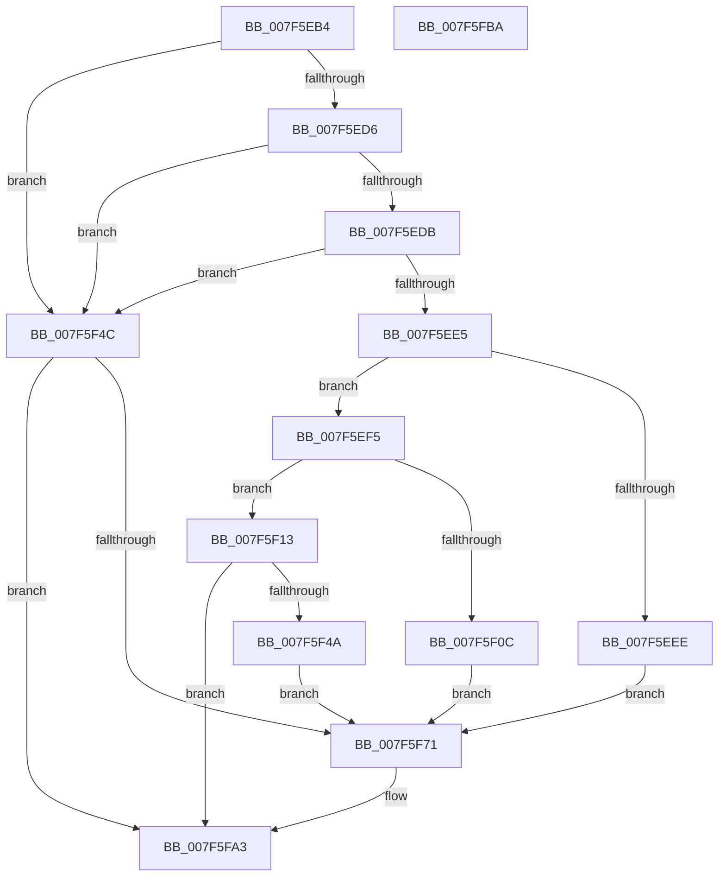

# CmpHiveCachePopulateHiveEntry

- RVA: `0x007F5EB4`–`0x007F5FBB` (길이 `263` bytes)
- VA: `0x00000001407F5EB4`
- 실행 섹션: `PAGE`
- PDB 이름 있음: `예`; PDB Function 태그: `아니요`
- unwind 정보 RVA: `0x00066400`
- 디코드: `67`개 명령, `263/263` bytes 표시
- 미해석 바이트: `0` (있으면 어셈블리에 `.byte`로 보존)

> 이 문서는 커널 이미지의 기계어와 PDB 기호를 분석해 생성했습니다. 4번과 5번은 함수 원형과 자료형을 바이너리 사용 방식에서 추정한 C 해석이며 원본 소스 복구 결과는 아닙니다.

## 1. Dependencies

- 직접 호출 지점: **7**; 고유 호출 대상: **6**
- 직접 호출자로 확인된 함수: **1**
- RIP 상대 이미지 참조: **1**

### Outgoing calls
- `0x007F5EFF` → [CmSiAllocateMemory](../../text/49/CmSiAllocateMemory_function_00490C18.md) (function, `0x00490C18`)
- `0x007F5F3F` → [CmpCreateRegistryThread](../7E/CmpCreateRegistryThread_function_007E80D0.md) (function, `0x007E80D0`)
- `0x007F5F67` → [SetFailureLocation](../../text/46/SetFailureLocation_function_0046EF54.md) (function, `0x0046EF54`)
- `0x007F5F74` → [CmpHiveCacheEntryLockAcquire](CmpHiveCacheEntryLockAcquire_function_007F5CD8.md) (function, `0x007F5CD8`)
- `0x007F5F86` → [CmpHiveCacheEntryLockRelease](CmpHiveCacheEntryLockRelease_function_007F5D3C.md) (function, `0x007F5D3C`)
- `0x007F5F92` → [CmSiSetEvent](../../text/66/CmSiSetEvent_function_0066DE78.md) (function, `0x0066DE78`)
- `0x007F5F9E` → [CmSiSetEvent](../../text/66/CmSiSetEvent_function_0066DE78.md) (function, `0x0066DE78`)

### Direct callers
- [CmpMachineHiveCachePopulateEntry](../7E/CmpMachineHiveCachePopulateEntry_function_007E8E88.md) at `0x007E8EEC`

### Static image references
- `0x007F5F25` → RVA `0x007F5FD0` (`CmpHiveCachePopulateHiveEntryThread`; read)

## 2. Other-region calls and transfers

- 다른 실행 섹션으로 향하는 call: **4**
  - `0x007F5EFF` → [CmSiAllocateMemory](../../text/49/CmSiAllocateMemory_function_00490C18.md) (`PAGE` → `.text`)
  - `0x007F5F67` → [SetFailureLocation](../../text/46/SetFailureLocation_function_0046EF54.md) (`PAGE` → `.text`)
  - `0x007F5F92` → [CmSiSetEvent](../../text/66/CmSiSetEvent_function_0066DE78.md) (`PAGE` → `.text`)
  - `0x007F5F9E` → [CmSiSetEvent](../../text/66/CmSiSetEvent_function_0066DE78.md) (`PAGE` → `.text`)
- 별도 외부 분기/꼬리 이동을 확인하지 못했습니다.

## 3. Assembly (complete function range)

```asm
007F5EB4  48 89 5C 24 08                  mov qword ptr [rsp + 8], rbx
007F5EB9  48 89 6C 24 10                  mov qword ptr [rsp + 0x10], rbp
007F5EBE  48 89 74 24 18                  mov qword ptr [rsp + 0x18], rsi
007F5EC3  57                              push rdi
007F5EC4  48 83 EC 30                     sub rsp, 0x30
007F5EC8  41 8B E8                        mov ebp, r8d
007F5ECB  48 8B F2                        mov rsi, rdx
007F5ECE  48 8B D9                        mov rbx, rcx
007F5ED1  48 85 C9                        test rcx, rcx
007F5ED4  74 76                           je 0x1407f5f4c
007F5ED6  48 85 D2                        test rdx, rdx
007F5ED9  74 71                           je 0x1407f5f4c
007F5EDB  48 8B 7C 24 60                  mov rdi, qword ptr [rsp + 0x60]
007F5EE0  48 85 FF                        test rdi, rdi
007F5EE3  74 67                           je 0x1407f5f4c
007F5EE5  83 B9 50 01 00 00 01            cmp dword ptr [rcx + 0x150], 1
007F5EEC  75 07                           jne 0x1407f5ef5
007F5EEE  BF 02 00 00 C0                  mov edi, 0xc0000002
007F5EF3  EB 7C                           jmp 0x1407f5f71
007F5EF5  BA 43 4D 31 43                  mov edx, 0x43314d43
007F5EFA  B9 28 00 00 00                  mov ecx, 0x28
007F5EFF  E8 14 AD C9 FF                  call 0x140490c18
007F5F04  4C 8B C8                        mov r9, rax
007F5F07  48 85 C0                        test rax, rax
007F5F0A  75 07                           jne 0x1407f5f13
007F5F0C  BF 17 00 00 C0                  mov edi, 0xc0000017
007F5F11  EB 5E                           jmp 0x1407f5f71
007F5F13  48 89 78 18                     mov qword ptr [rax + 0x18], rdi
007F5F17  48 8D 8B 68 01 00 00            lea rcx, [rbx + 0x168]
007F5F1E  C7 40 14 01 00 59 01            mov dword ptr [rax + 0x14], 0x1590001
007F5F25  4C 8D 05 A4 00 00 00            lea r8, [rip + 0xa4]
007F5F2C  89 68 10                        mov dword ptr [rax + 0x10], ebp
007F5F2F  48 89 70 08                     mov qword ptr [rax + 8], rsi
007F5F33  48 8B 44 24 68                  mov rax, qword ptr [rsp + 0x68]
007F5F38  49 89 41 20                     mov qword ptr [r9 + 0x20], rax
007F5F3C  49 89 19                        mov qword ptr [r9], rbx
007F5F3F  E8 8C 21 FF FF                  call 0x1407e80d0
007F5F44  8B F8                           mov edi, eax
007F5F46  85 C0                           test eax, eax
007F5F48  79 59                           jns 0x1407f5fa3
007F5F4A  EB 25                           jmp 0x1407f5f71
007F5F4C  48 8B 4C 24 68                  mov rcx, qword ptr [rsp + 0x68]
007F5F51  33 D2                           xor edx, edx
007F5F53  BF 0D 00 00 C0                  mov edi, 0xc000000d
007F5F58  C7 44 24 20 10 00 00 00         mov dword ptr [rsp + 0x20], 0x10
007F5F60  44 8B CF                        mov r9d, edi
007F5F63  44 8D 42 29                     lea r8d, [rdx + 0x29]
007F5F67  E8 E8 8F C7 FF                  call 0x14046ef54
007F5F6C  48 85 DB                        test rbx, rbx
007F5F6F  74 32                           je 0x1407f5fa3
007F5F71  48 8B CB                        mov rcx, rbx
007F5F74  E8 5F FD FF FF                  call 0x1407f5cd8
007F5F79  48 8B CB                        mov rcx, rbx
007F5F7C  C7 83 A8 00 00 00 03 00 00 00   mov dword ptr [rbx + 0xa8], 3
007F5F86  E8 B1 FD FF FF                  call 0x1407f5d3c
007F5F8B  48 8D 8B 10 01 00 00            lea rcx, [rbx + 0x110]
007F5F92  E8 E1 7E E7 FF                  call 0x14066de78
007F5F97  48 8D 8B 20 01 00 00            lea rcx, [rbx + 0x120]
007F5F9E  E8 D5 7E E7 FF                  call 0x14066de78
007F5FA3  48 8B 5C 24 40                  mov rbx, qword ptr [rsp + 0x40]
007F5FA8  8B C7                           mov eax, edi
007F5FAA  48 8B 6C 24 48                  mov rbp, qword ptr [rsp + 0x48]
007F5FAF  48 8B 74 24 50                  mov rsi, qword ptr [rsp + 0x50]
007F5FB4  48 83 C4 30                     add rsp, 0x30
007F5FB8  5F                              pop rdi
007F5FB9  C3                              ret
007F5FBA  CC                              int3
```

## 4. C-style interpretation (structured pseudocode)

```c
__int64 __fastcall CmpHiveCachePopulateHiveEntry(__int64 a1, __int64 a2, int a3, __int64 a4, __int64 a5, __int64 a6)
{
    __int64 result;
    __int64 v_rsp;
    unsigned int v_stack_m18;
    unsigned __int64 v_stack_p10;
    unsigned __int64 v_stack_p18;
    unsigned __int64 v_stack_p8;

    v_stack_p8 = v_rbx;
    v_stack_p10 = v_rbp;
    v_stack_p18 = v_rsi;
    v_rsp = (v_rsp) - (48);
    if (a1 == 0) goto loc_007F5F4C;
    if (a2 == 0) goto loc_007F5F4C;
    if (a5 == 0) goto loc_007F5F4C;
    if ((*(unsigned int *)(a1 + 336)) != 1) goto loc_007F5EF5;
    goto loc_007F5F71;
loc_007F5EF5:
    result = CmSiAllocateMemory(40, (unsigned int)(0x43314D43ULL), a3, a4);
    if (result != 0) goto loc_007F5F13;
    goto loc_007F5F71;
loc_007F5F13:
    *(unsigned __int64 *)(result + 24) = (unsigned int)(0xC0000017ULL);
    *(unsigned int *)(result + 20) = 0x1590001ULL;
    *(unsigned int *)(result + 16) = (unsigned int)((unsigned int)(a3));
    *(unsigned __int64 *)(result + 8) = a2;
    *(unsigned __int64 *)(result + 32) = a6;
    *(unsigned __int64 *)(result) = a1;
    result = CmpCreateRegistryThread(a1 + 360, (unsigned int)(0x43314D43ULL), v_rip + 164, result);
    if (!sign_flag) goto loc_007F5FA3;
    goto loc_007F5F71;
loc_007F5F4C:
    a2 = 0;
    v_stack_m18 = 16;
    result = SetFailureLocation(a6, a2, a2 + 41, (unsigned int)((unsigned int)((unsigned int)(0xC000000DULL))));
    if (a1 != 0) {
        a1 = a1;
        result = CmpHiveCacheEntryLockAcquire(a1, a2, a2 + 41, (unsigned int)((unsigned int)((unsigned int)(0xC000000DULL))));
        a1 = a1;
        *(unsigned int *)(a1 + 168) = 3;
        result = CmpHiveCacheEntryLockRelease(a1, a2, a2 + 41, (unsigned int)((unsigned int)((unsigned int)(0xC000000DULL))));
        a1 = a1 + 272;
        result = CmSiSetEvent(a1, a2, a2 + 41, (unsigned int)((unsigned int)((unsigned int)(0xC000000DULL))));
        a1 = a1 + 288;
        result = CmSiSetEvent(a1, a2, a2 + 41, (unsigned int)((unsigned int)((unsigned int)(0xC000000DULL))));
    }
    v_rsp = (v_rsp) + (48);
    return (unsigned int)((unsigned int)((unsigned int)(0xC000000DULL)));
}
```

## 5. (Beta) C Style

```c
int64_t CmpHiveCachePopulateHiveEntry(void *Arg1, int64_t Arg2, int32_t Arg3, int64_t Arg4, int64_t Arg5, int64_t Arg6)
{
    uint8_t *arg1 = (uint8_t *)Arg1;

    int64_t result;
    int64_t local_rsp;
    uint32_t v_stack_m18;
    uint64_t v_stack_p10;
    uint64_t v_stack_p18;
    uint64_t v_stack_p8;

    v_stack_p8 = local_rbx;
    v_stack_p10 = local_rbp;
    v_stack_p18 = local_rsi;
    local_rsp = (local_rsp) - (48);
    if (Arg1 == NULL) goto loc_007F5F4C;
    if (Arg2 == 0) goto loc_007F5F4C;
    if (Arg5 == 0) goto loc_007F5F4C;
    if ((*(uint32_t *)(arg1 + 0x150)) != 1) goto loc_007F5EF5;
    goto loc_007F5F71;
loc_007F5EF5:
    result = CmSiAllocateMemory(40, (uint32_t)(0x43314D43ULL), Arg3, Arg4);
    if (result != 0) goto loc_007F5F13;
    goto loc_007F5F71;
loc_007F5F13:
    *(uint64_t *)(result + 0x18) = (uint32_t)(0xC0000017ULL);
    *(uint32_t *)(result + 0x14) = 0x1590001ULL;
    *(uint32_t *)(result + 0x10) = (uint32_t)((uint32_t)(Arg3));
    *(uint64_t *)(result + 0x8) = Arg2;
    *(uint64_t *)(result + 0x20) = Arg6;
    *(void **)(result) = Arg1;
    result = CmpCreateRegistryThread(Arg1 + 360, (uint32_t)(0x43314D43ULL), v_rip + 164, result);
    if (!sign_flag) goto loc_007F5FA3;
    goto loc_007F5F71;
loc_007F5F4C:
    Arg2 = 0;
    v_stack_m18 = 16;
    result = SetFailureLocation(Arg6, Arg2, Arg2 + 41, (uint32_t)((uint32_t)((uint32_t)(0xC000000DULL))));
    if (Arg1 != NULL) {
        Arg1 = Arg1;
        result = CmpHiveCacheEntryLockAcquire(Arg1, Arg2, Arg2 + 41, (uint32_t)((uint32_t)((uint32_t)(0xC000000DULL))));
        Arg1 = Arg1;
        *(uint32_t *)(arg1 + 0xA8) = 3;
        result = CmpHiveCacheEntryLockRelease(Arg1, Arg2, Arg2 + 41, (uint32_t)((uint32_t)((uint32_t)(0xC000000DULL))));
        Arg1 = Arg1 + 272;
        result = CmSiSetEvent(Arg1, Arg2, Arg2 + 41, (uint32_t)((uint32_t)((uint32_t)(0xC000000DULL))));
        Arg1 = Arg1 + 288;
        result = CmSiSetEvent(Arg1, Arg2, Arg2 + 41, (uint32_t)((uint32_t)((uint32_t)(0xC000000DULL))));
    }
    local_rsp = (local_rsp) + (48);
    return (uint32_t)((uint32_t)((uint32_t)(0xC000000DULL)));
}
```

### 관측된 메모리 오프셋

구조체 형식이 확인되지 않은 접근은 인자 기준의 오프셋으로만 기록했습니다.

| 기준 인자 | 오프셋 표현 | 폭 (bit) | 접근 |
|---|---:|---:|---|
| `Arg1` | `+ 0x168` | `64` | `R` |

## 6. Execution-region graph

[열기: 2D/3D 그래프와 함수 탐색 컨트롤 패널](../../../control-panel.html?section=page&rva=0x007F5EB4&view=graph)

- 2D 그래프는 위에서 아래로 흐르고, 3D 그래프는 빈 공간을 드래그해 회전합니다. Shift+드래그는 이동, 휠은 확대·축소, 함수 노드 선택은 대상 보고서 이동입니다.

### Static fallback


