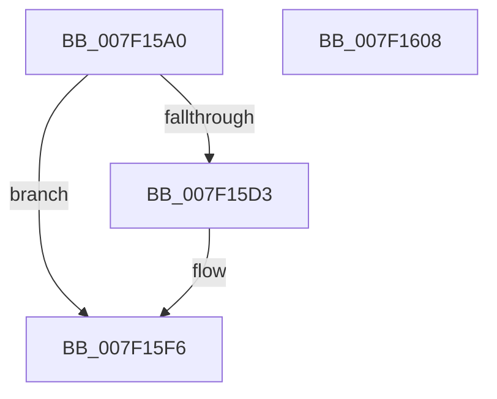

# CmpInvalidateAllHigherLayerKcbsPostCallback

- RVA: `0x007F15A0`–`0x007F1609` (길이 `105` bytes)
- VA: `0x00000001407F15A0`
- 실행 섹션: `PAGE`
- PDB 이름 있음: `예`; PDB Function 태그: `아니요`
- unwind 정보 RVA: `0x000794E0`
- 디코드: `32`개 명령, `105/105` bytes 표시
- 미해석 바이트: `0` (있으면 어셈블리에 `.byte`로 보존)

> 이 문서는 커널 이미지의 기계어와 PDB 기호를 분석해 생성했습니다. 4번과 5번은 함수 원형과 자료형을 바이너리 사용 방식에서 추정한 C 해석이며 원본 소스 복구 결과는 아닙니다.

## 1. Dependencies

- 직접 호출 지점: **4**; 고유 호출 대상: **4**
- 직접 호출자로 확인된 함수: **0**
- RIP 상대 이미지 참조: **0**

### Outgoing calls
- `0x007F15C7` → [CmpInvalidateSubtree](../7E/CmpInvalidateSubtree_function_007EAEC0.md) (function, `0x007EAEC0`)
- `0x007F15D9` → [CmpMarkKeyUnbacked](../9B/CmpMarkKeyUnbacked_function_009B3C4C.md) (function, `0x009B3C4C`)
- `0x007F15E9` → [CmpFlushNotifiesOnKeyBodyList](../9B/CmpFlushNotifiesOnKeyBodyList_function_009B3594.md) (function, `0x009B3594`)
- `0x007F15F1` → [CmpDiscardKcb](../9B/CmpDiscardKcb_function_009B2F34.md) (function, `0x009B2F34`)

### Direct callers
- 이 함수 시작 RVA로 연결되는 직접 call은 확인되지 않았습니다. 간접 호출은 완전히 역산할 수 없습니다.

### Static image references
- 디코드된 RIP-relative 메모리 참조가 없습니다.

## 2. Other-region calls and transfers

- 다른 실행 섹션으로 향하는 call: **0**
- 별도 외부 분기/꼬리 이동을 확인하지 못했습니다.

## 3. Assembly (complete function range)

```asm
007F15A0  48 89 5C 24 08                  mov qword ptr [rsp + 8], rbx
007F15A5  48 89 74 24 10                  mov qword ptr [rsp + 0x10], rsi
007F15AA  57                              push rdi
007F15AB  48 83 EC 30                     sub rsp, 0x30
007F15AF  48 83 64 24 20 00               and qword ptr [rsp + 0x20], 0
007F15B5  49 8B F8                        mov rdi, r8
007F15B8  45 8B 40 04                     mov r8d, dword ptr [r8 + 4]
007F15BC  48 8B F2                        mov rsi, rdx
007F15BF  4C 8B CA                        mov r9, rdx
007F15C2  48 8B D9                        mov rbx, rcx
007F15C5  8B 17                           mov edx, dword ptr [rdi]
007F15C7  E8 F4 98 FF FF                  call 0x1407eaec0
007F15CC  8B 47 04                        mov eax, dword ptr [rdi + 4]
007F15CF  A8 02                           test al, 2
007F15D1  74 23                           je 0x1407f15f6
007F15D3  48 8B D6                        mov rdx, rsi
007F15D6  48 8B CB                        mov rcx, rbx
007F15D9  E8 6E 26 1C 00                  call 0x1409b3c4c
007F15DE  8B 17                           mov edx, dword ptr [rdi]
007F15E0  41 B1 01                        mov r9b, 1
007F15E3  4C 8B C6                        mov r8, rsi
007F15E6  48 8B CB                        mov rcx, rbx
007F15E9  E8 A6 1F 1C 00                  call 0x1409b3594
007F15EE  48 8B CB                        mov rcx, rbx
007F15F1  E8 3E 19 1C 00                  call 0x1409b2f34
007F15F6  48 8B 5C 24 40                  mov rbx, qword ptr [rsp + 0x40]
007F15FB  33 C0                           xor eax, eax
007F15FD  48 8B 74 24 48                  mov rsi, qword ptr [rsp + 0x48]
007F1602  48 83 C4 30                     add rsp, 0x30
007F1606  5F                              pop rdi
007F1607  C3                              ret
007F1608  CC                              int3
```

## 4. C-style interpretation (structured pseudocode)

```c
__int64 __fastcall CmpInvalidateAllHigherLayerKcbsPostCallback(__int64 a1, __int64 a2, __int64 a3)
{
    __int64 result;
    __int64 v_rsp;
    unsigned __int64 v_stack_m18;
    unsigned __int64 v_stack_p10;
    unsigned __int64 v_stack_p8;

    v_stack_p8 = v_rbx;
    v_stack_p10 = v_rsi;
    v_rsp = (v_rsp) - (48);
    result = CmpInvalidateSubtree(a1, (unsigned int)(*(unsigned int *)(a3)), (unsigned int)(*(unsigned int *)(a3 + 4)), a2);
    result = (unsigned int)(*(unsigned int *)(a3 + 4));
    if ((((unsigned __int8)((unsigned int)(*(unsigned int *)(a3 + 4)))) & (2)) != 0) {
        a2 = a2;
        a1 = a1;
        result = CmpMarkKeyUnbacked(a1, a2, (unsigned int)(*(unsigned int *)(a3 + 4)), a2);
        a2 = *(unsigned int *)(a3);
        a4 = 1;
        a3 = a2;
        a1 = a1;
        result = CmpFlushNotifiesOnKeyBodyList(a1, a2, a3, a4);
        a1 = a1;
        result = CmpDiscardKcb(a1, a2, a3, a4);
    }
    result = 0;
    v_rsp = (v_rsp) + (48);
    return result;
}
```

## 5. (Beta) C Style

```c
int64_t CmpInvalidateAllHigherLayerKcbsPostCallback(int64_t Arg1, int64_t Arg2, void *Arg3)
{
    uint8_t *arg3 = (uint8_t *)Arg3;

    int64_t result;
    int64_t local_rsp;
    uint64_t v_stack_m18;
    uint64_t v_stack_p10;
    uint64_t v_stack_p8;

    v_stack_p8 = local_rbx;
    v_stack_p10 = local_rsi;
    local_rsp = (local_rsp) - (48);
    result = CmpInvalidateSubtree(Arg1, (uint32_t)(*(uint32_t *)(arg3)), (uint32_t)(*(uint32_t *)(arg3 + 0x4)), Arg2);
    result = (uint32_t)(*(uint32_t *)(arg3 + 0x4));
    if ((((uint8_t)((uint32_t)(*(uint32_t *)(arg3 + 0x4)))) & (2)) != 0) {
        Arg2 = Arg2;
        Arg1 = Arg1;
        result = CmpMarkKeyUnbacked(Arg1, Arg2, (uint32_t)(*(uint32_t *)(arg3 + 0x4)), Arg2);
        Arg2 = *(uint32_t *)(arg3);
        a4 = 1;
        Arg3 = Arg2;
        Arg1 = Arg1;
        result = CmpFlushNotifiesOnKeyBodyList(Arg1, Arg2, Arg3, a4);
        Arg1 = Arg1;
        result = CmpDiscardKcb(Arg1, Arg2, Arg3, a4);
    }
    result = 0;
    local_rsp = (local_rsp) + (48);
    return result;
}
```

### 관측된 메모리 오프셋

구조체 형식이 확인되지 않은 접근은 인자 기준의 오프셋으로만 기록했습니다.

| 기준 인자 | 오프셋 표현 | 폭 (bit) | 접근 |
|---|---:|---:|---|
| `Arg3` | `+ 0x0` | `32` | `R` |
| `Arg3` | `+ 0x4` | `32` | `R` |

## 6. Execution-region graph

[열기: 2D/3D 그래프와 함수 탐색 컨트롤 패널](../../../control-panel.html?section=page&rva=0x007F15A0&view=graph)

- 2D 그래프는 위에서 아래로 흐르고, 3D 그래프는 빈 공간을 드래그해 회전합니다. Shift+드래그는 이동, 휠은 확대·축소, 함수 노드 선택은 대상 보고서 이동입니다.

### Static fallback


