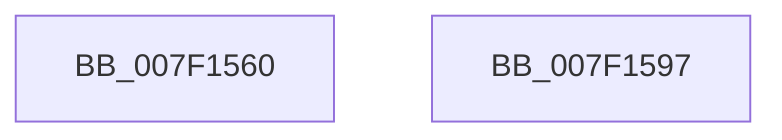

# CmpInvalidateAllHigherLayerKcbs

- RVA: `0x007F1560`–`0x007F1598` (길이 `56` bytes)
- VA: `0x00000001407F1560`
- 실행 섹션: `PAGE`
- PDB 이름 있음: `예`; PDB Function 태그: `아니요`
- unwind 정보 RVA: `0x0005CC98`
- 디코드: `14`개 명령, `56/56` bytes 표시
- 미해석 바이트: `0` (있으면 어셈블리에 `.byte`로 보존)

> 이 문서는 커널 이미지의 기계어와 PDB 기호를 분석해 생성했습니다. 4번과 5번은 함수 원형과 자료형을 바이너리 사용 방식에서 추정한 C 해석이며 원본 소스 복구 결과는 아닙니다.

## 1. Dependencies

- 직접 호출 지점: **1**; 고유 호출 대상: **1**
- 직접 호출자로 확인된 함수: **4**
- RIP 상대 이미지 참조: **2**

### Outgoing calls
- `0x007F158D` → [CmpEnumerateAllHigherLayerKcbs](../A5/CmpEnumerateAllHigherLayerKcbs_function_00A55234.md) (function, `0x00A55234`)

### Direct callers
- [CmpSaveBootControlSet](../7D/CmpSaveBootControlSet_function_007DC744.md) at `0x007DCAA6`
- [CmRestoreKey](../7D/CmRestoreKey_function_007DCF04.md) at `0x007DD4D9`
- [CmRenameKey](../7E/CmRenameKey_function_007E8F48.md) at `0x007E9724`
- [CmRenameKey](../7E/CmRenameKey_function_007E8F48.md) at `0x007E977C`
- [sub_00B1787E](../B1/Unknown_function_00B1787E.md) at `0x00B178CE`

### Static image references
- `0x007F1572` → RVA `0x0070BAD0` (`CmpCleanUpHigherLayerKcbCachesPreCallback`; read)
- `0x007F1581` → RVA `0x007F15A0` (`CmpInvalidateAllHigherLayerKcbsPostCallback`; read)

## 2. Other-region calls and transfers

- 다른 실행 섹션으로 향하는 call: **0**
- 별도 외부 분기/꼬리 이동을 확인하지 못했습니다.

## 3. Assembly (complete function range)

```asm
007F1560  48 8B C4                        mov rax, rsp
007F1563  48 83 EC 58                     sub rsp, 0x58
007F1567  C6 40 D8 01                     mov byte ptr [rax - 0x28], 1
007F156B  C6 40 D0 01                     mov byte ptr [rax - 0x30], 1
007F156F  89 50 E8                        mov dword ptr [rax - 0x18], edx
007F1572  48 8D 15 57 A5 F1 FF            lea rdx, [rip - 0xe5aa9]
007F1579  44 89 40 EC                     mov dword ptr [rax - 0x14], r8d
007F157D  48 8D 40 E8                     lea rax, [rax - 0x18]
007F1581  4C 8D 05 18 00 00 00            lea r8, [rip + 0x18]
007F1588  48 89 44 24 20                  mov qword ptr [rsp + 0x20], rax
007F158D  E8 A2 3C 26 00                  call 0x140a55234
007F1592  48 83 C4 58                     add rsp, 0x58
007F1596  C3                              ret
007F1597  CC                              int3
```

## 4. C-style interpretation (structured pseudocode)

```c
__int64 __fastcall CmpInvalidateAllHigherLayerKcbs(__int64 a1, int a2, int a3)
{
    __int64 result;
    __int64 v_rsp;
    unsigned __int64 v_stack_m38;

    v_rsp = (v_rsp) - (88);
    *(unsigned __int8 *)(v_rsp - 40) = 1;
    *(unsigned __int8 *)(v_rsp - 48) = 1;
    *(unsigned int *)(v_rsp - 24) = a2;
    *(unsigned int *)(v_rsp - 20) = a3;
    v_stack_m38 = v_rsp - 24;
    result = CmpEnumerateAllHigherLayerKcbs(a1, v_rip - 940713, v_rip + 24, a4);
    v_rsp = (v_rsp) + (88);
    return result;
}
```

## 5. (Beta) C Style

```c
int64_t CmpInvalidateAllHigherLayerKcbs(int64_t Arg1, int32_t Arg2, int32_t Arg3)
{
    int64_t result;
    int64_t local_rsp;
    uint64_t v_stack_m38;

    local_rsp = (local_rsp) - (88);
    *(uint8_t *)(local_rsp - 0x28) = 1;
    *(uint8_t *)(local_rsp - 0x30) = 1;
    *(uint32_t *)(local_rsp - 0x18) = Arg2;
    *(uint32_t *)(local_rsp - 0x14) = Arg3;
    v_stack_m38 = local_rsp - 24;
    result = CmpEnumerateAllHigherLayerKcbs(Arg1, v_rip - 940713, v_rip + 24, a4);
    local_rsp = (local_rsp) + (88);
    return result;
}
```

## 6. Execution-region graph

[열기: 2D/3D 그래프와 함수 탐색 컨트롤 패널](../../../control-panel.html?section=page&rva=0x007F1560&view=graph)

- 2D 그래프는 위에서 아래로 흐르고, 3D 그래프는 빈 공간을 드래그해 회전합니다. Shift+드래그는 이동, 휠은 확대·축소, 함수 노드 선택은 대상 보고서 이동입니다.

### Static fallback


