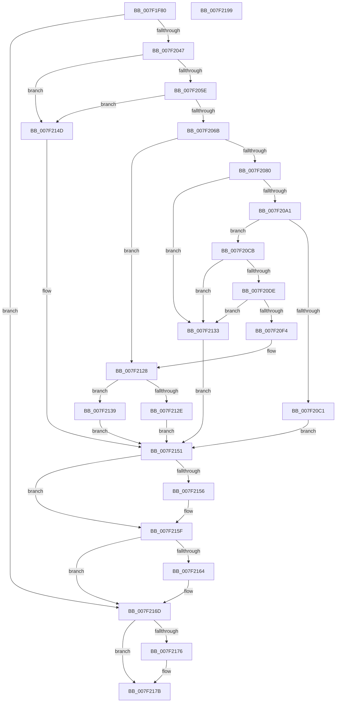

# CmpIsFileInSystemConfig

- RVA: `0x007F1F80`–`0x007F219A` (길이 `538` bytes)
- VA: `0x00000001407F1F80`
- 실행 섹션: `PAGE`
- PDB 이름 있음: `예`; PDB Function 태그: `아니요`
- unwind 정보 RVA: `0x000D72F0`
- 디코드: `138`개 명령, `538/538` bytes 표시
- 미해석 바이트: `0` (있으면 어셈블리에 `.byte`로 보존)

> 이 문서는 커널 이미지의 기계어와 PDB 기호를 분석해 생성했습니다. 4번과 5번은 함수 원형과 자료형을 바이너리 사용 방식에서 추정한 C 해석이며 원본 소스 복구 결과는 아닙니다.

## 1. Dependencies

- 직접 호출 지점: **11**; 고유 호출 대상: **9**
- 직접 호출자로 확인된 함수: **2**
- RIP 상대 이미지 참조: **2**

### Outgoing calls
- `0x007F2038` → [ZwCreateFile](../../text/6A/ZwCreateFile_function_006ADB70.md) (function, `0x006ADB70`)
- `0x007F204F` → [CmpQueryNameString](../9B/CmpQueryNameString_function_009BA2AC.md) (function, `0x009BA2AC`)
- `0x007F2092` → [RtlUShortAdd](../../text/47/RtlUShortAdd_function_00474F70.md) (function, `0x00474F70`)
- `0x007F20B0` → [ExAllocatePool2](../../poolcode/B8/ExAllocatePool2_function_00B820F0.md) (function, `0x00B820F0`)
- `0x007F20D3` → [RtlUnicodeStringCat](../../text/3E/RtlUnicodeStringCat_function_003E6030.md) (function, `0x003E6030`)
- `0x007F20E9` → [RtlUnicodeStringCatString](../../text/41/RtlUnicodeStringCatString_function_0041CD30.md) (function, `0x0041CD30`)
- `0x007F20F8` → [RtlFreeAnsiString](../9C/RtlFreeAnsiString_function_009C0800.md) (function, `0x009C0800`)
- `0x007F2143` → [RtlPrefixUnicodeString](../8F/RtlPrefixUnicodeString_function_008F4F70.md) (function, `0x008F4F70`)
- `0x007F215A` → [RtlFreeAnsiString](../9C/RtlFreeAnsiString_function_009C0800.md) (function, `0x009C0800`)
- `0x007F2168` → [RtlFreeAnsiString](../9C/RtlFreeAnsiString_function_009C0800.md) (function, `0x009C0800`)
- `0x007F2176` → [ZwClose](../../text/6A/ZwClose_function_006AD2B0.md) (function, `0x006AD2B0`)

### Direct callers
- [CmpStartRMLog](CmpStartRMLog_function_007F0AFC.md) at `0x007F0CBA`
- [CmpInitCmRM](../87/CmpInitCmRM_function_0087C700.md) at `0x0087CBBE`

### Static image references
- `0x007F1FAE` → RVA `0x00B097B0` (` ?? ::NNGAKEGL::`string'`; read)
- `0x007F20DE` → RVA `0x00AFC990` (` ?? ::NNGAKEGL::`string'`; read)

## 2. Other-region calls and transfers

- 다른 실행 섹션으로 향하는 call: **6**
  - `0x007F2038` → [ZwCreateFile](../../text/6A/ZwCreateFile_function_006ADB70.md) (`PAGE` → `.text`)
  - `0x007F2092` → [RtlUShortAdd](../../text/47/RtlUShortAdd_function_00474F70.md) (`PAGE` → `.text`)
  - `0x007F20B0` → [ExAllocatePool2](../../poolcode/B8/ExAllocatePool2_function_00B820F0.md) (`PAGE` → `POOLCODE`)
  - `0x007F20D3` → [RtlUnicodeStringCat](../../text/3E/RtlUnicodeStringCat_function_003E6030.md) (`PAGE` → `.text`)
  - `0x007F20E9` → [RtlUnicodeStringCatString](../../text/41/RtlUnicodeStringCatString_function_0041CD30.md) (`PAGE` → `.text`)
  - `0x007F2176` → [ZwClose](../../text/6A/ZwClose_function_006AD2B0.md) (`PAGE` → `.text`)
- 별도 외부 분기/꼬리 이동을 확인하지 못했습니다.

## 3. Assembly (complete function range)

```asm
007F1F80  48 89 5C 24 08                  mov qword ptr [rsp + 8], rbx
007F1F85  48 89 74 24 18                  mov qword ptr [rsp + 0x18], rsi
007F1F8A  55                              push rbp
007F1F8B  57                              push rdi
007F1F8C  41 54                           push r12
007F1F8E  41 56                           push r14
007F1F90  41 57                           push r15
007F1F92  48 8D 6C 24 C9                  lea rbp, [rsp - 0x37]
007F1F97  48 81 EC D0 00 00 00            sub rsp, 0xd0
007F1F9E  45 33 E4                        xor r12d, r12d
007F1FA1  48 C7 45 07 30 00 00 00         mov qword ptr [rbp + 7], 0x30
007F1FA9  44 89 64 24 50                  mov dword ptr [rsp + 0x50], r12d
007F1FAE  48 8D 05 FB 77 31 00            lea rax, [rip + 0x3177fb]
007F1FB5  4C 89 64 24 48                  mov qword ptr [rsp + 0x48], r12
007F1FBA  4C 8D 4D F7                     lea r9, [rbp - 9]
007F1FBE  C7 44 24 40 01 00 00 00         mov dword ptr [rsp + 0x40], 1
007F1FC6  4C 8D 45 07                     lea r8, [rbp + 7]
007F1FCA  C7 44 24 38 01 00 00 00         mov dword ptr [rsp + 0x38], 1
007F1FD2  0F 57 C0                        xorps xmm0, xmm0
007F1FD5  4C 8B F2                        mov r14, rdx
007F1FD8  44 88 22                        mov byte ptr [rdx], r12b
007F1FDB  48 89 45 EF                     mov qword ptr [rbp - 0x11], rax
007F1FDF  BA 80 00 00 00                  mov edx, 0x80
007F1FE4  C7 44 24 30 07 00 00 00         mov dword ptr [rsp + 0x30], 7
007F1FEC  48 8D 45 E7                     lea rax, [rbp - 0x19]
007F1FF0  4C 8B F9                        mov r15, rcx
007F1FF3  89 54 24 28                     mov dword ptr [rsp + 0x28], edx
007F1FF7  48 8D 4D 6F                     lea rcx, [rbp + 0x6f]
007F1FFB  4C 89 64 24 20                  mov qword ptr [rsp + 0x20], r12
007F2000  4C 89 65 6F                     mov qword ptr [rbp + 0x6f], r12
007F2004  41 8B FC                        mov edi, r12d
007F2007  48 C7 45 1F 40 02 00 00         mov qword ptr [rbp + 0x1f], 0x240
007F200F  0F 11 45 F7                     movups xmmword ptr [rbp - 9], xmm0
007F2013  4C 89 65 C7                     mov qword ptr [rbp - 0x39], r12
007F2017  4C 89 65 CF                     mov qword ptr [rbp - 0x31], r12
007F201B  4C 89 65 D7                     mov qword ptr [rbp - 0x29], r12
007F201F  4C 89 65 DF                     mov qword ptr [rbp - 0x21], r12
007F2023  48 C7 45 E7 38 00 3A 00         mov qword ptr [rbp - 0x19], 0x3a0038
007F202B  4C 89 65 0F                     mov qword ptr [rbp + 0xf], r12
007F202F  48 89 45 17                     mov qword ptr [rbp + 0x17], rax
007F2033  F3 0F 7F 45 27                  movdqu xmmword ptr [rbp + 0x27], xmm0
007F2038  E8 33 BB EB FF                  call 0x1406adb70
007F203D  8B D8                           mov ebx, eax
007F203F  85 C0                           test eax, eax
007F2041  0F 88 26 01 00 00               js 0x1407f216d
007F2047  48 8B 4D 6F                     mov rcx, qword ptr [rbp + 0x6f]
007F204B  48 8D 55 C7                     lea rdx, [rbp - 0x39]
007F204F  E8 58 82 1C 00                  call 0x1409ba2ac
007F2054  8B D8                           mov ebx, eax
007F2056  85 C0                           test eax, eax
007F2058  0F 88 EF 00 00 00               js 0x1407f214d
007F205E  0F B7 4D C7                     movzx ecx, word ptr [rbp - 0x39]
007F2062  66 85 C9                        test cx, cx
007F2065  0F 84 E2 00 00 00               je 0x1407f214d
007F206B  48 8B 75 CF                     mov rsi, qword ptr [rbp - 0x31]
007F206F  8B C1                           mov eax, ecx
007F2071  48 D1 E8                        shr rax, 1
007F2074  66 83 7C 46 FE 5C               cmp word ptr [rsi + rax*2 - 2], 0x5c
007F207A  0F 84 A8 00 00 00               je 0x1407f2128
007F2080  0F B7 4D C9                     movzx ecx, word ptr [rbp - 0x37]
007F2084  41 8D 54 24 02                  lea edx, [r12 + 2]
007F2089  4C 8D 45 D9                     lea r8, [rbp - 0x27]
007F208D  66 44 89 65 D7                  mov word ptr [rbp - 0x29], r12w
007F2092  E8 D9 2E C8 FF                  call 0x140474f70
007F2097  8B D8                           mov ebx, eax
007F2099  85 C0                           test eax, eax
007F209B  0F 88 92 00 00 00               js 0x1407f2133
007F20A1  0F B7 55 D9                     movzx edx, word ptr [rbp - 0x27]
007F20A5  B9 00 01 00 00                  mov ecx, 0x100
007F20AA  41 B8 53 74 72 67               mov r8d, 0x67727453
007F20B0  E8 3B 00 39 00                  call 0x140b820f0
007F20B5  48 89 45 DF                     mov qword ptr [rbp - 0x21], rax
007F20B9  48 8B F8                        mov rdi, rax
007F20BC  48 85 C0                        test rax, rax
007F20BF  75 0A                           jne 0x1407f20cb
007F20C1  BB 17 00 00 C0                  mov ebx, 0xc0000017
007F20C6  E9 86 00 00 00                  jmp 0x1407f2151
007F20CB  48 8D 55 C7                     lea rdx, [rbp - 0x39]
007F20CF  48 8D 4D D7                     lea rcx, [rbp - 0x29]
007F20D3  E8 58 3F BF FF                  call 0x1403e6030
007F20D8  8B D8                           mov ebx, eax
007F20DA  85 C0                           test eax, eax
007F20DC  78 55                           js 0x1407f2133
007F20DE  48 8D 15 AB A8 30 00            lea rdx, [rip + 0x30a8ab]
007F20E5  48 8D 4D D7                     lea rcx, [rbp - 0x29]
007F20E9  E8 42 AC C2 FF                  call 0x14041cd30
007F20EE  8B D8                           mov ebx, eax
007F20F0  85 C0                           test eax, eax
007F20F2  78 3F                           js 0x1407f2133
007F20F4  48 8D 4D C7                     lea rcx, [rbp - 0x39]
007F20F8  E8 03 E7 1C 00                  call 0x1409c0800
007F20FD  0F 28 4D D7                     movaps xmm1, xmmword ptr [rbp - 0x29]
007F2101  0F 57 D2                        xorps xmm2, xmm2
007F2104  66 0F 6F C1                     movdqa xmm0, xmm1
007F2108  0F 29 55 D7                     movaps xmmword ptr [rbp - 0x29], xmm2
007F210C  66 0F 73 D8 08                  psrldq xmm0, 8
007F2111  66 0F 73 DA 08                  psrldq xmm2, 8
007F2116  66 48 0F 7E C6                  movq rsi, xmm0
007F211B  0F 29 4D C7                     movaps xmmword ptr [rbp - 0x39], xmm1
007F211F  66 48 0F 7E D7                  movq rdi, xmm2
007F2124  66 0F 7E C9                     movd ecx, xmm1
007F2128  66 41 39 0F                     cmp word ptr [r15], cx
007F212C  77 0B                           ja 0x1407f2139
007F212E  45 88 26                        mov byte ptr [r14], r12b
007F2131  EB 1E                           jmp 0x1407f2151
007F2133  48 8B 7D DF                     mov rdi, qword ptr [rbp - 0x21]
007F2137  EB 18                           jmp 0x1407f2151
007F2139  41 B0 01                        mov r8b, 1
007F213C  48 8D 4D C7                     lea rcx, [rbp - 0x39]
007F2140  49 8B D7                        mov rdx, r15
007F2143  E8 28 2E 10 00                  call 0x1408f4f70
007F2148  41 88 06                        mov byte ptr [r14], al
007F214B  EB 04                           jmp 0x1407f2151
007F214D  48 8B 75 CF                     mov rsi, qword ptr [rbp - 0x31]
007F2151  48 85 F6                        test rsi, rsi
007F2154  74 09                           je 0x1407f215f
007F2156  48 8D 4D C7                     lea rcx, [rbp - 0x39]
007F215A  E8 A1 E6 1C 00                  call 0x1409c0800
007F215F  48 85 FF                        test rdi, rdi
007F2162  74 09                           je 0x1407f216d
007F2164  48 8D 4D D7                     lea rcx, [rbp - 0x29]
007F2168  E8 93 E6 1C 00                  call 0x1409c0800
007F216D  48 8B 4D 6F                     mov rcx, qword ptr [rbp + 0x6f]
007F2171  48 85 C9                        test rcx, rcx
007F2174  74 05                           je 0x1407f217b
007F2176  E8 35 B1 EB FF                  call 0x1406ad2b0
007F217B  4C 8D 9C 24 D0 00 00 00         lea r11, [rsp + 0xd0]
007F2183  8B C3                           mov eax, ebx
007F2185  49 8B 5B 30                     mov rbx, qword ptr [r11 + 0x30]
007F2189  49 8B 73 40                     mov rsi, qword ptr [r11 + 0x40]
007F218D  49 8B E3                        mov rsp, r11
007F2190  41 5F                           pop r15
007F2192  41 5E                           pop r14
007F2194  41 5C                           pop r12
007F2196  5F                              pop rdi
007F2197  5D                              pop rbp
007F2198  C3                              ret
007F2199  CC                              int3
```

## 4. C-style interpretation (structured pseudocode)

```c
__int64 __fastcall CmpIsFileInSystemConfig(__int64 a1, __int64 a2)
{
    __int64 result;
    __int64 v_r12;
    __int64 v_rsp;
    unsigned __int64 v_stack_m28;
    unsigned __int64 v_stack_m38;
    unsigned __int64 v_stack_m40;
    unsigned __int64 v_stack_m48;
    unsigned __int64 v_stack_m50;
    unsigned __int64 v_stack_m58;
    unsigned __int64 v_stack_m5F;
    unsigned __int64 v_stack_m68;
    unsigned __int64 v_stack_m70;
    unsigned __int64 v_stack_m78;
    unsigned __int64 v_stack_m80;
    unsigned __int64 v_stack_m86;
    unsigned __int64 v_stack_m88;
    unsigned __int64 v_stack_m90;
    unsigned __int16 v_stack_m96;
    unsigned __int64 v_stack_m98;
    unsigned int v_stack_mA8;
    unsigned __int64 v_stack_mB0;
    unsigned int v_stack_mB8;
    unsigned int v_stack_mC0;
    unsigned int v_stack_mC8;
    unsigned int v_stack_mD0;
    unsigned __int64 v_stack_mD8;
    unsigned __int64 v_stack_p10;
    unsigned __int64 v_stack_p18;
    unsigned __int64 v_stack_p8;

    v_stack_p8 = v_rbx;
    v_stack_p18 = v_rsi;
    v_rsp = (v_rsp) - (208);
    v_r12 = 0;
    v_stack_m58 = 48;
    v_stack_mA8 = 0;
    v_stack_mB0 = 0;
    v_stack_mB8 = 1;
    v_stack_mC0 = 1;
    *(unsigned __int8 *)(a2) = 0;
    v_stack_m70 = v_rip + 3241979;
    v_stack_mC8 = 7;
    v_stack_mD0 = 128;
    v_stack_mD8 = 0;
    v_stack_p10 = 0;
    v_stack_m40 = 576;
    v_stack_m68 = v_xmm0;
    v_stack_m98 = 0;
    v_stack_m90 = 0;
    v_stack_m88 = 0;
    v_stack_m80 = 0;
    v_stack_m78 = 0x3A0038ULL;
    v_stack_m50 = 0;
    v_stack_m48 = v_stack_m78;
    v_stack_m38 = v_xmm0;
    result = ZwCreateFile(v_stack_p10, 128, v_stack_m58, v_stack_m68);
    if (sign_flag) goto loc_007F216D;
    result = CmpQueryNameString(v_stack_p10, v_stack_m98, v_stack_m58, v_stack_m68);
    if (sign_flag) goto loc_007F214D;
    if ((unsigned __int16)(v_stack_m98) == 0) goto loc_007F214D;
    result = ((unsigned int)((unsigned int)(v_stack_m98))) >> (1);
    if ((*(unsigned __int16 *)(v_stack_m90 + result * 2 - 2)) == 92) goto loc_007F2128;
    v_stack_m88 = 0;
    result = RtlUShortAdd(v_stack_m96, v_r12 + 2, v_stack_m86, v_stack_m68);
    if (sign_flag) goto loc_007F2133;
    result = ExAllocatePool2(256, v_stack_m86, (unsigned int)(0x67727453ULL), v_stack_m68);
    v_stack_m80 = result;
    if (result != 0) goto loc_007F20CB;
    goto loc_007F2151;
loc_007F20CB:
    result = RtlUnicodeStringCat(v_stack_m88, v_stack_m98, (unsigned int)(0x67727453ULL), v_stack_m68);
    if (sign_flag) goto loc_007F2133;
    result = RtlUnicodeStringCatString(v_stack_m88, v_rip + 3188907, (unsigned int)(0x67727453ULL), v_stack_m68);
    if (sign_flag) goto loc_007F2133;
    result = RtlFreeAnsiString(v_stack_m98, v_rip + 3188907, (unsigned int)(0x67727453ULL), v_stack_m68);
    v_stack_m88 = v_xmm2;
    v_stack_m98 = v_xmm1;
loc_007F2128:
    if ((*(unsigned __int16 *)(a1)) > ((unsigned __int16)(v_stack_m98))) goto loc_007F2139;
    *(unsigned __int8 *)(a2) = 0;
    goto loc_007F2151;
loc_007F2133:
    goto loc_007F2151;
loc_007F2139:
    result = RtlPrefixUnicodeString(v_stack_m98, a1, 1, v_stack_m68);
    *(unsigned __int8 *)(a2) = (unsigned __int8)(result);
    goto loc_007F2151;
loc_007F214D:
loc_007F2151:
    if (v_stack_m90 != 0) {
        a1 = v_stack_m98;
        result = RtlFreeAnsiString(a1, a1, 1, v_stack_m68);
    }
    if (v_stack_m80 != 0) {
        a1 = v_stack_m88;
        result = RtlFreeAnsiString(a1, a1, 1, v_stack_m68);
    }
    if (v_stack_p10 != 0) {
        result = ZwClose(v_stack_p10, a1, 1, v_stack_m68);
    }
    return (unsigned int)((unsigned int)((unsigned int)((unsigned int)(result))));
}
```

## 5. (Beta) C Style

```c
int64_t CmpIsFileInSystemConfig(void *Arg1, void *Arg2)
{
    uint8_t *arg1 = (uint8_t *)Arg1;
    uint8_t *arg2 = (uint8_t *)Arg2;

    int64_t result;
    int64_t local_r12;
    int64_t local_rsp;
    uint64_t v_stack_m28;
    uint64_t v_stack_m38;
    uint64_t v_stack_m40;
    uint64_t v_stack_m48;
    uint64_t v_stack_m50;
    uint64_t v_stack_m58;
    uint64_t v_stack_m5F;
    uint64_t v_stack_m68;
    uint64_t v_stack_m70;
    uint64_t v_stack_m78;
    uint64_t v_stack_m80;
    uint64_t v_stack_m86;
    uint64_t v_stack_m88;
    uint64_t v_stack_m90;
    uint16_t v_stack_m96;
    uint64_t v_stack_m98;
    uint32_t v_stack_mA8;
    uint64_t v_stack_mB0;
    uint32_t v_stack_mB8;
    uint32_t v_stack_mC0;
    uint32_t v_stack_mC8;
    uint32_t v_stack_mD0;
    uint64_t v_stack_mD8;
    uint64_t v_stack_p10;
    uint64_t v_stack_p18;
    uint64_t v_stack_p8;

    v_stack_p8 = local_rbx;
    v_stack_p18 = local_rsi;
    local_rsp = (local_rsp) - (208);
    local_r12 = 0;
    v_stack_m58 = 48;
    v_stack_mA8 = 0;
    v_stack_mB0 = 0;
    v_stack_mB8 = 1;
    v_stack_mC0 = 1;
    *(uint8_t *)(arg2) = 0;
    v_stack_m70 = v_rip + 3241979;
    v_stack_mC8 = 7;
    v_stack_mD0 = 128;
    v_stack_mD8 = 0;
    v_stack_p10 = 0;
    v_stack_m40 = 576;
    v_stack_m68 = v_xmm0;
    v_stack_m98 = 0;
    v_stack_m90 = 0;
    v_stack_m88 = 0;
    v_stack_m80 = 0;
    v_stack_m78 = 0x3A0038ULL;
    v_stack_m50 = 0;
    v_stack_m48 = v_stack_m78;
    v_stack_m38 = v_xmm0;
    result = ZwCreateFile(v_stack_p10, 128, v_stack_m58, v_stack_m68);
    if (sign_flag) goto loc_007F216D;
    result = CmpQueryNameString(v_stack_p10, v_stack_m98, v_stack_m58, v_stack_m68);
    if (sign_flag) goto loc_007F214D;
    if ((uint16_t)(v_stack_m98) == 0) goto loc_007F214D;
    result = ((uint32_t)((uint32_t)(v_stack_m98))) >> (1);
    if ((*(uint16_t *)(v_stack_m90 + result * 2 - 0x2)) == 92) goto loc_007F2128;
    v_stack_m88 = 0;
    result = RtlUShortAdd(v_stack_m96, local_r12 + 2, v_stack_m86, v_stack_m68);
    if (sign_flag) goto loc_007F2133;
    result = ExAllocatePool2(256, v_stack_m86, (uint32_t)(0x67727453ULL), v_stack_m68);
    v_stack_m80 = result;
    if (result != 0) goto loc_007F20CB;
    goto loc_007F2151;
loc_007F20CB:
    result = RtlUnicodeStringCat(v_stack_m88, v_stack_m98, (uint32_t)(0x67727453ULL), v_stack_m68);
    if (sign_flag) goto loc_007F2133;
    result = RtlUnicodeStringCatString(v_stack_m88, v_rip + 3188907, (uint32_t)(0x67727453ULL), v_stack_m68);
    if (sign_flag) goto loc_007F2133;
    result = RtlFreeAnsiString(v_stack_m98, v_rip + 3188907, (uint32_t)(0x67727453ULL), v_stack_m68);
    v_stack_m88 = v_xmm2;
    v_stack_m98 = v_xmm1;
loc_007F2128:
    if ((*(uint16_t *)(arg1)) > ((uint16_t)(v_stack_m98))) goto loc_007F2139;
    *(uint8_t *)(arg2) = 0;
    goto loc_007F2151;
loc_007F2133:
    goto loc_007F2151;
loc_007F2139:
    result = RtlPrefixUnicodeString(v_stack_m98, Arg1, 1, v_stack_m68);
    *(uint8_t *)(arg2) = (uint8_t)(result);
    goto loc_007F2151;
loc_007F214D:
loc_007F2151:
    if (v_stack_m90 != 0) {
        Arg1 = v_stack_m98;
        result = RtlFreeAnsiString(Arg1, Arg1, 1, v_stack_m68);
    }
    if (v_stack_m80 != 0) {
        Arg1 = v_stack_m88;
        result = RtlFreeAnsiString(Arg1, Arg1, 1, v_stack_m68);
    }
    if (v_stack_p10 != 0) {
        result = ZwClose(v_stack_p10, Arg1, 1, v_stack_m68);
    }
    return (uint32_t)((uint32_t)((uint32_t)((uint32_t)(result))));
}
```

### 관측된 메모리 오프셋

구조체 형식이 확인되지 않은 접근은 인자 기준의 오프셋으로만 기록했습니다.

| 기준 인자 | 오프셋 표현 | 폭 (bit) | 접근 |
|---|---:|---:|---|
| `Arg1` | `+ 0x0` | `16` | `R` |
| `Arg2` | `+ 0x0` | `8` | `W` |

## 6. Execution-region graph

[열기: 2D/3D 그래프와 함수 탐색 컨트롤 패널](../../../control-panel.html?section=page&rva=0x007F1F80&view=graph)

- 2D 그래프는 위에서 아래로 흐르고, 3D 그래프는 빈 공간을 드래그해 회전합니다. Shift+드래그는 이동, 휠은 확대·축소, 함수 노드 선택은 대상 보고서 이동입니다.

### Static fallback


