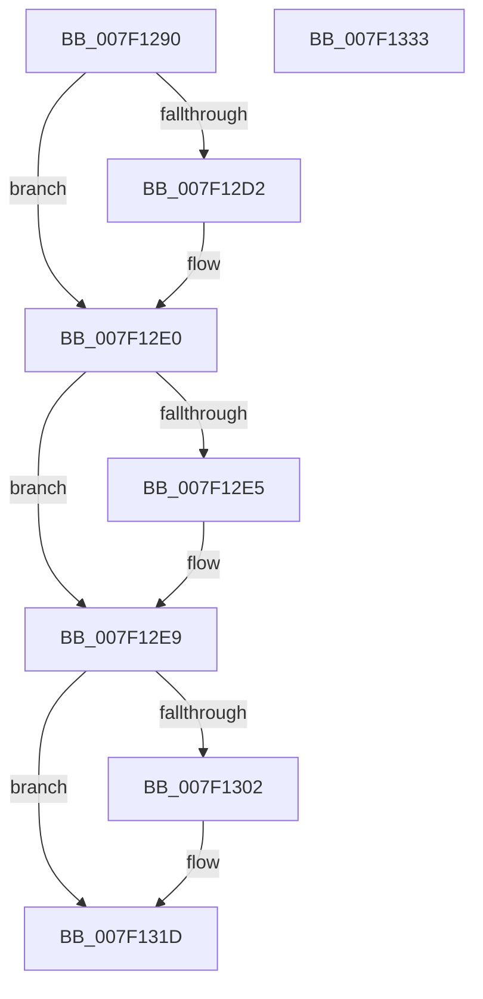

# CmpLockHashEntryByIndexExclusive

- RVA: `0x007F1290`–`0x007F1334` (길이 `164` bytes)
- VA: `0x00000001407F1290`
- 실행 섹션: `PAGE`
- PDB 이름 있음: `예`; PDB Function 태그: `아니요`
- unwind 정보 RVA: `0x0009B270`
- 디코드: `44`개 명령, `164/164` bytes 표시
- 미해석 바이트: `0` (있으면 어셈블리에 `.byte`로 보존)

> 이 문서는 커널 이미지의 기계어와 PDB 기호를 분석해 생성했습니다. 4번과 5번은 함수 원형과 자료형을 바이너리 사용 방식에서 추정한 C 해석이며 원본 소스 복구 결과는 아닙니다.

## 1. Dependencies

- 직접 호출 지점: **4**; 고유 호출 대상: **4**
- 직접 호출자로 확인된 함수: **2**
- RIP 상대 이미지 참조: **0**

### Outgoing calls
- `0x007F12C2` → [KeAbPreAcquire](../../text/21/KeAbPreAcquire_function_00210230.md) (function, `0x00210230`)
- `0x007F12DB` → [ExfAcquirePushLockExclusiveEx](../../text/20/ExfAcquirePushLockExclusiveEx_function_0020FC90.md) (function, `0x0020FC90`)
- `0x007F12F9` → [CmpReferenceHive](../84/CmpReferenceHive_function_0084FCF0.md) (function, `0x0084FCF0`)
- `0x007F1317` → [KeBugCheckEx](../../text/4F/KeBugCheckEx_function_004FD660.md) (function, `0x004FD660`)

### Direct callers
- [CmpDoParseKey](../85/CmpDoParseKey_function_0085F750.md) at `0x0086052D`
- [CmpSearchKeyControlBlockTreeEx](../A6/CmpSearchKeyControlBlockTreeEx_function_00A65548.md) at `0x00A656B8`

### Static image references
- 디코드된 RIP-relative 메모리 참조가 없습니다.

## 2. Other-region calls and transfers

- 다른 실행 섹션으로 향하는 call: **3**
  - `0x007F12C2` → [KeAbPreAcquire](../../text/21/KeAbPreAcquire_function_00210230.md) (`PAGE` → `.text`)
  - `0x007F12DB` → [ExfAcquirePushLockExclusiveEx](../../text/20/ExfAcquirePushLockExclusiveEx_function_0020FC90.md) (`PAGE` → `.text`)
  - `0x007F1317` → [KeBugCheckEx](../../text/4F/KeBugCheckEx_function_004FD660.md) (`PAGE` → `.text`)
- 별도 외부 분기/꼬리 이동을 확인하지 못했습니다.

## 3. Assembly (complete function range)

```asm
007F1290  48 89 5C 24 08                  mov qword ptr [rsp + 8], rbx
007F1295  48 89 74 24 10                  mov qword ptr [rsp + 0x10], rsi
007F129A  48 89 7C 24 18                  mov qword ptr [rsp + 0x18], rdi
007F129F  41 56                           push r14
007F12A1  48 83 EC 30                     sub rsp, 0x30
007F12A5  4C 8B 81 70 06 00 00            mov r8, qword ptr [rcx + 0x670]
007F12AC  48 8B F1                        mov rsi, rcx
007F12AF  44 8B F2                        mov r14d, edx
007F12B2  33 D2                           xor edx, edx
007F12B4  4B 8D 04 76                     lea rax, [r14 + r14*2]
007F12B8  49 8D 1C C0                     lea rbx, [r8 + rax*8]
007F12BC  45 33 C0                        xor r8d, r8d
007F12BF  48 8B CB                        mov rcx, rbx
007F12C2  E8 69 EF A1 FF                  call 0x140210230
007F12C7  F0 48 0F BA 2B 00               lock bts qword ptr [rbx], 0
007F12CD  48 8B F8                        mov rdi, rax
007F12D0  73 0E                           jae 0x1407f12e0
007F12D2  4C 8B C3                        mov r8, rbx
007F12D5  48 8B D0                        mov rdx, rax
007F12D8  48 8B CB                        mov rcx, rbx
007F12DB  E8 B0 E9 A1 FF                  call 0x14020fc90
007F12E0  48 85 FF                        test rdi, rdi
007F12E3  74 04                           je 0x1407f12e9
007F12E5  C6 47 0A 01                     mov byte ptr [rdi + 0xa], 1
007F12E9  65 48 8B 04 25 88 01 00 00      mov rax, qword ptr gs:[0x188]
007F12F2  48 8B CE                        mov rcx, rsi
007F12F5  48 89 43 08                     mov qword ptr [rbx + 8], rax
007F12F9  E8 F2 E9 05 00                  call 0x14084fcf0
007F12FE  84 C0                           test al, al
007F1300  75 1B                           jne 0x1407f131d
007F1302  41 B9 0B 00 00 00               mov r9d, 0xb
007F1308  4C 89 74 24 20                  mov qword ptr [rsp + 0x20], r14
007F130D  4C 8B C6                        mov r8, rsi
007F1310  41 8D 51 0C                     lea edx, [r9 + 0xc]
007F1314  8D 4A 3A                        lea ecx, [rdx + 0x3a]
007F1317  E8 44 C3 D0 FF                  call 0x1404fd660
007F131C  CC                              int3
007F131D  48 8B 5C 24 40                  mov rbx, qword ptr [rsp + 0x40]
007F1322  48 8B 74 24 48                  mov rsi, qword ptr [rsp + 0x48]
007F1327  48 8B 7C 24 50                  mov rdi, qword ptr [rsp + 0x50]
007F132C  48 83 C4 30                     add rsp, 0x30
007F1330  41 5E                           pop r14
007F1332  C3                              ret
007F1333  CC                              int3
```

## 4. C-style interpretation (structured pseudocode)

```c
__int64 __fastcall CmpLockHashEntryByIndexExclusive(__int64 a1, int a2)
{
    __int64 result;
    __int64 v_rsp;
    unsigned __int64 v_stack_m18;
    unsigned __int64 v_stack_p10;
    unsigned __int64 v_stack_p18;
    unsigned __int64 v_stack_p8;

    v_stack_p8 = v_rbx;
    v_stack_p10 = v_rsi;
    v_stack_p18 = v_rdi;
    v_rsp = (v_rsp) - (48);
    a2 = 0;
    a3 = 0;
    result = KeAbPreAcquire(*(unsigned __int64 *)(a1 + 1648) + (unsigned int)(a2) + (unsigned int)(a2) * 2 * 8, a2, a3, a4);
    if (!(condition_is_above_or_equal)) {
        a3 = *(unsigned __int64 *)(a1 + 1648) + (unsigned int)(a2) + (unsigned int)(a2) * 2 * 8;
        a2 = result;
        a1 = *(unsigned __int64 *)(a1 + 1648) + (unsigned int)(a2) + (unsigned int)(a2) * 2 * 8;
        result = ExfAcquirePushLockExclusiveEx(a1, a2, a3, a4);
    }
    if (result != 0) {
        *(unsigned __int8 *)(result + 10) = 1;
    }
    *(unsigned __int64 *)(*(unsigned __int64 *)(a1 + 1648) + (unsigned int)(a2) + (unsigned int)(a2) * 2 * 8 + 8) = *(unsigned __int64 *)(gs_base + (0 + 392));
    result = CmpReferenceHive(a1, a2, a3, a4);
    if ((unsigned __int8)(result) == 0) {
        a4 = 11;
        v_stack_m18 = (unsigned int)(a2);
        a3 = a1;
        a2 = a4 + 12;
        a1 = a2 + 58;
        result = KeBugCheckEx(a1, a2, a3, a4);
    }
    v_rsp = (v_rsp) + (48);
    return result;
}
```

## 5. (Beta) C Style

```c
int64_t CmpLockHashEntryByIndexExclusive(void *Arg1, void *Arg2)
{
    uint8_t *arg1 = (uint8_t *)Arg1;
    uint8_t *arg2 = (uint8_t *)Arg2;

    int64_t result;
    int64_t local_rsp;
    uint64_t v_stack_m18;
    uint64_t v_stack_p10;
    uint64_t v_stack_p18;
    uint64_t v_stack_p8;

    v_stack_p8 = local_rbx;
    v_stack_p10 = local_rsi;
    v_stack_p18 = local_rdi;
    local_rsp = (local_rsp) - (48);
    Arg2 = 0;
    a3 = 0;
    result = KeAbPreAcquire(*(uint64_t *)(arg1 + 0x670) + (uint32_t)(Arg2) + (uint32_t)(Arg2) * 2 * 8, Arg2, a3, a4);
    if (!(condition_is_above_or_equal)) {
        a3 = *(uint64_t *)(arg1 + 0x670) + (uint32_t)(Arg2) + (uint32_t)(Arg2) * 2 * 8;
        Arg2 = result;
        Arg1 = *(uint64_t *)(arg1 + 0x670) + (uint32_t)(Arg2) + (uint32_t)(Arg2) * 2 * 8;
        result = ExfAcquirePushLockExclusiveEx(Arg1, Arg2, a3, a4);
    }
    if (result != 0) {
        *(uint8_t *)(result + 0xA) = 1;
    }
    *(uint64_t *)(*(uint64_t *)(arg1 + 0x670) + (uint32_t)(arg2) + (uint32_t)(arg2) * 2 * 8 + 0x8) = *(uint64_t *)(gs_base + (0 + 0x188));
    result = CmpReferenceHive(Arg1, Arg2, a3, a4);
    if ((uint8_t)(result) == 0) {
        a4 = 11;
        v_stack_m18 = (uint32_t)(Arg2);
        a3 = Arg1;
        Arg2 = a4 + 12;
        Arg1 = Arg2 + 58;
        result = KeBugCheckEx(Arg1, Arg2, a3, a4);
    }
    local_rsp = (local_rsp) + (48);
    return result;
}
```

### 관측된 메모리 오프셋

구조체 형식이 확인되지 않은 접근은 인자 기준의 오프셋으로만 기록했습니다.

| 기준 인자 | 오프셋 표현 | 폭 (bit) | 접근 |
|---|---:|---:|---|
| `Arg1` | `+ 0x670` | `64` | `R` |
| `Arg2` | `+ 0x0 + r14*2` | `64` | `R` |

## 6. Execution-region graph

[열기: 2D/3D 그래프와 함수 탐색 컨트롤 패널](../../../control-panel.html?section=page&rva=0x007F1290&view=graph)

- 2D 그래프는 위에서 아래로 흐르고, 3D 그래프는 빈 공간을 드래그해 회전합니다. Shift+드래그는 이동, 휠은 확대·축소, 함수 노드 선택은 대상 보고서 이동입니다.

### Static fallback


