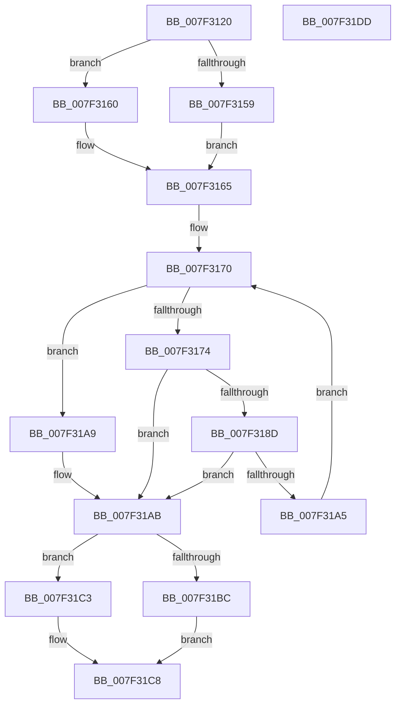

# CmpMarkAllChildrenDirty

- RVA: `0x007F3120`–`0x007F31DE` (길이 `190` bytes)
- VA: `0x00000001407F3120`
- 실행 섹션: `PAGE`
- PDB 이름 있음: `예`; PDB Function 태그: `아니요`
- unwind 정보 RVA: `0x000C38DC`
- 디코드: `60`개 명령, `190/190` bytes 표시
- 미해석 바이트: `0` (있으면 어셈블리에 `.byte`로 보존)

> 이 문서는 커널 이미지의 기계어와 PDB 기호를 분석해 생성했습니다. 4번과 5번은 함수 원형과 자료형을 바이너리 사용 방식에서 추정한 C 해석이며 원본 소스 복구 결과는 아닙니다.

## 1. Dependencies

- 직접 호출 지점: **7**; 고유 호출 대상: **7**
- 직접 호출자로 확인된 함수: **1**
- RIP 상대 이미지 참조: **0**

### Outgoing calls
- `0x007F3143` → [HvpGetCellContextInitialize](../85/HvpGetCellContextInitialize_function_00855F10.md) (function, `0x00855F10`)
- `0x007F3159` → [HvpGetCellFlat](../85/HvpGetCellFlat_function_00854C60.md) (function, `0x00854C60`)
- `0x007F3160` → [HvpGetCellPaged](../85/HvpGetCellPaged_function_00854CB0.md) (function, `0x00854CB0`)
- `0x007F3182` → [CmpFindSubKeyByNumber](../85/CmpFindSubKeyByNumber_function_0085C930.md) (function, `0x0085C930`)
- `0x007F319A` → [HvpMarkCellDirty](../85/HvpMarkCellDirty_function_00858080.md) (function, `0x00858080`)
- `0x007F31BC` → [HvpReleaseCellFlat](../85/HvpReleaseCellFlat_function_0085CC20.md) (function, `0x0085CC20`)
- `0x007F31C3` → [HvpReleaseCellPaged](../85/HvpReleaseCellPaged_function_00855F40.md) (function, `0x00855F40`)

### Direct callers
- [CmRenameKey](../7E/CmRenameKey_function_007E8F48.md) at `0x007E99FC`

### Static image references
- 디코드된 RIP-relative 메모리 참조가 없습니다.

## 2. Other-region calls and transfers

- 다른 실행 섹션으로 향하는 call: **0**
- 별도 외부 분기/꼬리 이동을 확인하지 못했습니다.

## 3. Assembly (complete function range)

```asm
007F3120  48 8B C4                        mov rax, rsp
007F3123  48 89 58 10                     mov qword ptr [rax + 0x10], rbx
007F3127  48 89 68 20                     mov qword ptr [rax + 0x20], rbp
007F312B  56                              push rsi
007F312C  57                              push rdi
007F312D  41 56                           push r14
007F312F  48 83 EC 20                     sub rsp, 0x20
007F3133  83 60 08 00                     and dword ptr [rax + 8], 0
007F3137  48 8B D9                        mov rbx, rcx
007F313A  48 83 60 18 00                  and qword ptr [rax + 0x18], 0
007F313F  48 8D 48 18                     lea rcx, [rax + 0x18]
007F3143  E8 C8 2D 06 00                  call 0x140855f10
007F3148  F6 83 8C 00 00 00 01            test byte ptr [rbx + 0x8c], 1
007F314F  4C 8D 44 24 50                  lea r8, [rsp + 0x50]
007F3154  48 8B CB                        mov rcx, rbx
007F3157  74 07                           je 0x1407f3160
007F3159  E8 02 1B 06 00                  call 0x140854c60
007F315E  EB 05                           jmp 0x1407f3165
007F3160  E8 4B 1B 06 00                  call 0x140854cb0
007F3165  8B 68 18                        mov ebp, dword ptr [rax + 0x18]
007F3168  4C 8B F0                        mov r14, rax
007F316B  03 68 14                        add ebp, dword ptr [rax + 0x14]
007F316E  33 F6                           xor esi, esi
007F3170  3B F5                           cmp esi, ebp
007F3172  73 35                           jae 0x1407f31a9
007F3174  4C 8D 4C 24 40                  lea r9, [rsp + 0x40]
007F3179  44 8B C6                        mov r8d, esi
007F317C  49 8B D6                        mov rdx, r14
007F317F  48 8B CB                        mov rcx, rbx
007F3182  E8 A9 97 06 00                  call 0x14085c930
007F3187  8B F8                           mov edi, eax
007F3189  85 C0                           test eax, eax
007F318B  78 1E                           js 0x1407f31ab
007F318D  8B 54 24 40                     mov edx, dword ptr [rsp + 0x40]
007F3191  45 33 C9                        xor r9d, r9d
007F3194  45 33 C0                        xor r8d, r8d
007F3197  48 8B CB                        mov rcx, rbx
007F319A  E8 E1 4E 06 00                  call 0x140858080
007F319F  8B F8                           mov edi, eax
007F31A1  85 C0                           test eax, eax
007F31A3  78 06                           js 0x1407f31ab
007F31A5  FF C6                           inc esi
007F31A7  EB C7                           jmp 0x1407f3170
007F31A9  33 FF                           xor edi, edi
007F31AB  F6 83 8C 00 00 00 01            test byte ptr [rbx + 0x8c], 1
007F31B2  48 8D 54 24 50                  lea rdx, [rsp + 0x50]
007F31B7  48 8B CB                        mov rcx, rbx
007F31BA  74 07                           je 0x1407f31c3
007F31BC  E8 5F 9A 06 00                  call 0x14085cc20
007F31C1  EB 05                           jmp 0x1407f31c8
007F31C3  E8 78 2D 06 00                  call 0x140855f40
007F31C8  48 8B 5C 24 48                  mov rbx, qword ptr [rsp + 0x48]
007F31CD  8B C7                           mov eax, edi
007F31CF  48 8B 6C 24 58                  mov rbp, qword ptr [rsp + 0x58]
007F31D4  48 83 C4 20                     add rsp, 0x20
007F31D8  41 5E                           pop r14
007F31DA  5F                              pop rdi
007F31DB  5E                              pop rsi
007F31DC  C3                              ret
007F31DD  CC                              int3
```

## 4. C-style interpretation (structured pseudocode)

```c
__int64 __fastcall CmpMarkAllChildrenDirty(__int64 a1)
{
    __int64 result;
    __int64 v_rbp;
    __int64 v_rdi;
    __int64 v_rsi;
    __int64 v_rsp;
    unsigned __int64 v_stack_p10;
    unsigned __int64 v_stack_p18;
    unsigned __int64 v_stack_p20;
    unsigned __int64 v_stack_p8;

    *(unsigned __int64 *)(v_rsp + 16) = v_rbx;
    *(unsigned __int64 *)(v_rsp + 32) = v_rbp;
    v_rsp = (v_rsp) - (32);
    result = HvpGetCellContextInitialize(v_rsp + 24, a2, a3, a4);
    if (((*(unsigned __int8 *)(a1 + 140)) & (1)) == 0) goto loc_007F3160;
    result = HvpGetCellFlat(a1, a2, v_stack_p18, a4);
    goto loc_007F3165;
loc_007F3160:
    result = HvpGetCellPaged(a1, a2, v_stack_p18, a4);
loc_007F3165:
    v_rbp = (unsigned int)(((unsigned int)(*(unsigned int *)(result + 24))) + (*(unsigned int *)(result + 20)));
    v_rsi = 0;
loc_007F3170:
    if (0 >= ((unsigned int)(v_rbp))) goto loc_007F31A9;
    result = CmpFindSubKeyByNumber(a1, result, 0, v_stack_p8);
    if (sign_flag) goto loc_007F31AB;
    a4 = 0;
    a3 = 0;
    result = HvpMarkCellDirty(a1, (unsigned int)(v_stack_p8), a3, a4);
    if (sign_flag) goto loc_007F31AB;
    v_rsi = (unsigned int)((v_rsi) + 1);
    goto loc_007F3170;
loc_007F31A9:
    v_rdi = 0;
loc_007F31AB:
    if (((*(unsigned __int8 *)(a1 + 140)) & (1)) == 0) goto loc_007F31C3;
    result = HvpReleaseCellFlat(a1, v_stack_p18, a3, a4);
    goto loc_007F31C8;
loc_007F31C3:
    result = HvpReleaseCellPaged(a1, v_stack_p18, a3, a4);
loc_007F31C8:
    v_rsp = (v_rsp) + (32);
    return 0;
}
```

## 5. (Beta) C Style

```c
int64_t CmpMarkAllChildrenDirty(void *Arg1)
{
    uint8_t *arg1 = (uint8_t *)Arg1;

    int64_t result;
    int64_t local_rbp;
    int64_t local_rdi;
    int64_t local_rsi;
    int64_t local_rsp;
    uint64_t v_stack_p10;
    uint64_t v_stack_p18;
    uint64_t v_stack_p20;
    uint64_t v_stack_p8;

    *(uint64_t *)(local_rsp + 0x10) = local_rbx;
    *(uint64_t *)(local_rsp + 0x20) = local_rbp;
    local_rsp = (local_rsp) - (32);
    result = HvpGetCellContextInitialize(local_rsp + 24, a2, a3, a4);
    if (((*(uint8_t *)(arg1 + 0x8C)) & (1)) == 0) goto loc_007F3160;
    result = HvpGetCellFlat(Arg1, a2, v_stack_p18, a4);
    goto loc_007F3165;
loc_007F3160:
    result = HvpGetCellPaged(Arg1, a2, v_stack_p18, a4);
loc_007F3165:
    local_rbp = (uint32_t)(((uint32_t)(*(uint32_t *)(result + 0x18))) + (*(uint32_t *)(result + 0x14)));
    local_rsi = 0;
loc_007F3170:
    if (0 >= ((uint32_t)(local_rbp))) goto loc_007F31A9;
    result = CmpFindSubKeyByNumber(Arg1, result, 0, v_stack_p8);
    if (sign_flag) goto loc_007F31AB;
    a4 = 0;
    a3 = 0;
    result = HvpMarkCellDirty(Arg1, (uint32_t)(v_stack_p8), a3, a4);
    if (sign_flag) goto loc_007F31AB;
    local_rsi = (uint32_t)((local_rsi) + 1);
    goto loc_007F3170;
loc_007F31A9:
    local_rdi = 0;
loc_007F31AB:
    if (((*(uint8_t *)(arg1 + 0x8C)) & (1)) == 0) goto loc_007F31C3;
    result = HvpReleaseCellFlat(Arg1, v_stack_p18, a3, a4);
    goto loc_007F31C8;
loc_007F31C3:
    result = HvpReleaseCellPaged(Arg1, v_stack_p18, a3, a4);
loc_007F31C8:
    local_rsp = (local_rsp) + (32);
    return 0;
}
```

### 관측된 메모리 오프셋

구조체 형식이 확인되지 않은 접근은 인자 기준의 오프셋으로만 기록했습니다.

| 기준 인자 | 오프셋 표현 | 폭 (bit) | 접근 |
|---|---:|---:|---|
| `Arg1` | `+ 0x8C` | `8` | `R` |

## 6. Execution-region graph

[열기: 2D/3D 그래프와 함수 탐색 컨트롤 패널](../../../control-panel.html?section=page&rva=0x007F3120&view=graph)

- 2D 그래프는 위에서 아래로 흐르고, 3D 그래프는 빈 공간을 드래그해 회전합니다. Shift+드래그는 이동, 휠은 확대·축소, 함수 노드 선택은 대상 보고서 이동입니다.

### Static fallback


