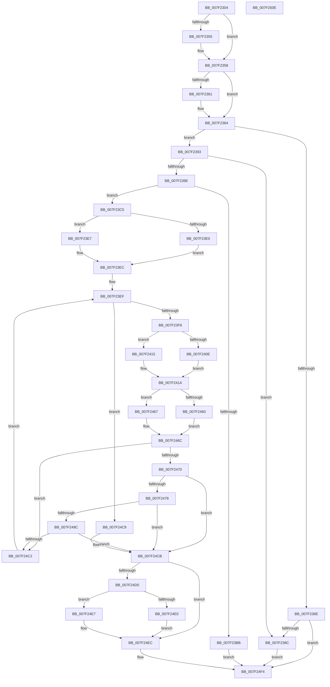

# CmpMergeKeyValues

- RVA: `0x007F2304`–`0x007F250F` (길이 `523` bytes)
- VA: `0x00000001407F2304`
- 실행 섹션: `PAGE`
- PDB 이름 있음: `예`; PDB Function 태그: `아니요`
- unwind 정보 RVA: `0x000D7348`
- 디코드: `153`개 명령, `523/523` bytes 표시
- 미해석 바이트: `0` (있으면 어셈블리에 `.byte`로 보존)

> 이 문서는 커널 이미지의 기계어와 PDB 기호를 분석해 생성했습니다. 4번과 5번은 함수 원형과 자료형을 바이너리 사용 방식에서 추정한 C 해석이며 원본 소스 복구 결과는 아닙니다.

## 1. Dependencies

- 직접 호출 지점: **15**; 고유 호출 대상: **11**
- 직접 호출자로 확인된 함수: **2**
- RIP 상대 이미지 참조: **0**

### Outgoing calls
- `0x007F237D` → [CmpSyncKeyValues](CmpSyncKeyValues_function_007F2DF4.md) (function, `0x007F2DF4`)
- `0x007F23AE` → [CmpAllocatePool](../../text/3C/CmpAllocatePool_function_003CD504.md) (function, `0x003CD504`)
- `0x007F23E0` → [HvpGetCellFlat](../85/HvpGetCellFlat_function_00854C60.md) (function, `0x00854C60`)
- `0x007F23E7` → [HvpGetCellPaged](../85/HvpGetCellPaged_function_00854CB0.md) (function, `0x00854CB0`)
- `0x007F240E` → [HvpGetCellFlat](../85/HvpGetCellFlat_function_00854C60.md) (function, `0x00854C60`)
- `0x007F2415` → [HvpGetCellPaged](../85/HvpGetCellPaged_function_00854CB0.md) (function, `0x00854CB0`)
- `0x007F2424` → [CmpInitializeValueNameString](../A0/CmpInitializeValueNameString_function_00A0F644.md) (function, `0x00A0F644`)
- `0x007F2449` → [CmpFindNameInListWithStatus](../84/CmpFindNameInListWithStatus_function_00846B80.md) (function, `0x00846B80`)
- `0x007F2460` → [HvpReleaseCellFlat](../85/HvpReleaseCellFlat_function_0085CC20.md) (function, `0x0085CC20`)
- `0x007F2467` → [HvpReleaseCellPaged](../85/HvpReleaseCellPaged_function_00855F40.md) (function, `0x00855F40`)
- `0x007F2491` → [CmpCopyValue](../85/CmpCopyValue_function_0085B798.md) (function, `0x0085B798`)
- `0x007F24B7` → [CmpAddValueToListEx](../85/CmpAddValueToListEx_function_0085B460.md) (function, `0x0085B460`)
- `0x007F24E0` → [HvpReleaseCellFlat](../85/HvpReleaseCellFlat_function_0085CC20.md) (function, `0x0085CC20`)
- `0x007F24E7` → [HvpReleaseCellPaged](../85/HvpReleaseCellPaged_function_00855F40.md) (function, `0x00855F40`)
- `0x007F24EF` → [CmSiFreeMemory](../../text/47/CmSiFreeMemory_function_00475D80.md) (function, `0x00475D80`)

### Direct callers
- [CmSaveMergedKeys](../7D/CmSaveMergedKeys_function_007DE040.md) at `0x007DE356`
- [sub_00B16DFE](../B1/Unknown_function_00B16DFE.md) at `0x00B16E17`

### Static image references
- 디코드된 RIP-relative 메모리 참조가 없습니다.

## 2. Other-region calls and transfers

- 다른 실행 섹션으로 향하는 call: **2**
  - `0x007F23AE` → [CmpAllocatePool](../../text/3C/CmpAllocatePool_function_003CD504.md) (`PAGE` → `.text`)
  - `0x007F24EF` → [CmSiFreeMemory](../../text/47/CmSiFreeMemory_function_00475D80.md) (`PAGE` → `.text`)
- 별도 외부 분기/꼬리 이동을 확인하지 못했습니다.

## 3. Assembly (complete function range)

```asm
007F2304  48 89 5C 24 08                  mov qword ptr [rsp + 8], rbx
007F2309  4C 89 4C 24 20                  mov qword ptr [rsp + 0x20], r9
007F230E  89 54 24 10                     mov dword ptr [rsp + 0x10], edx
007F2312  55                              push rbp
007F2313  56                              push rsi
007F2314  57                              push rdi
007F2315  41 54                           push r12
007F2317  41 55                           push r13
007F2319  41 56                           push r14
007F231B  41 57                           push r15
007F231D  48 8B EC                        mov rbp, rsp
007F2320  48 83 EC 70                     sub rsp, 0x70
007F2324  48 8B 45 68                     mov rax, qword ptr [rbp + 0x68]
007F2328  33 F6                           xor esi, esi
007F232A  48 8B F9                        mov rdi, rcx
007F232D  89 75 E4                        mov dword ptr [rbp - 0x1c], esi
007F2330  83 C9 FF                        or ecx, 0xffffffff
007F2333  89 75 50                        mov dword ptr [rbp + 0x50], esi
007F2336  89 4D E0                        mov dword ptr [rbp - 0x20], ecx
007F2339  0F 57 C0                        xorps xmm0, xmm0
007F233C  89 4D D8                        mov dword ptr [rbp - 0x28], ecx
007F233F  49 8B D8                        mov rbx, r8
007F2342  41 8B 48 3C                     mov ecx, dword ptr [r8 + 0x3c]
007F2346  89 75 48                        mov dword ptr [rbp + 0x48], esi
007F2349  89 75 DC                        mov dword ptr [rbp - 0x24], esi
007F234C  0F 11 45 E8                     movups xmmword ptr [rbp - 0x18], xmm0
007F2350  39 48 3C                        cmp dword ptr [rax + 0x3c], ecx
007F2353  73 03                           jae 0x1407f2358
007F2355  89 48 3C                        mov dword ptr [rax + 0x3c], ecx
007F2358  41 8B 48 40                     mov ecx, dword ptr [r8 + 0x40]
007F235C  39 48 40                        cmp dword ptr [rax + 0x40], ecx
007F235F  73 03                           jae 0x1407f2364
007F2361  89 48 40                        mov dword ptr [rax + 0x40], ecx
007F2364  4C 8D 68 24                     lea r13, [rax + 0x24]
007F2368  41 39 75 00                     cmp dword ptr [r13], esi
007F236C  75 25                           jne 0x1407f2393
007F236E  48 89 44 24 28                  mov qword ptr [rsp + 0x28], rax
007F2373  48 8B CF                        mov rcx, rdi
007F2376  8B 45 60                        mov eax, dword ptr [rbp + 0x60]
007F2379  89 44 24 20                     mov dword ptr [rsp + 0x20], eax
007F237D  E8 72 0A 00 00                  call 0x1407f2df4
007F2382  8B D8                           mov ebx, eax
007F2384  85 C0                           test eax, eax
007F2386  0F 88 68 01 00 00               js 0x1407f24f4
007F238C  8B DE                           mov ebx, esi
007F238E  E9 61 01 00 00                  jmp 0x1407f24f4
007F2393  41 8B 40 24                     mov eax, dword ptr [r8 + 0x24]
007F2397  89 45 68                        mov dword ptr [rbp + 0x68], eax
007F239A  85 C0                           test eax, eax
007F239C  74 EE                           je 0x1407f238c
007F239E  BA FF 7F 00 00                  mov edx, 0x7fff
007F23A3  B9 00 01 00 00                  mov ecx, 0x100
007F23A8  41 B8 43 4D 20 20               mov r8d, 0x20204d43
007F23AE  E8 51 B1 BD FF                  call 0x1403cd504
007F23B3  4C 8B E0                        mov r12, rax
007F23B6  48 85 C0                        test rax, rax
007F23B9  75 0A                           jne 0x1407f23c5
007F23BB  BB 9A 00 00 C0                  mov ebx, 0xc000009a
007F23C0  E9 2F 01 00 00                  jmp 0x1407f24f4
007F23C5  44 8B 7D 60                     mov r15d, dword ptr [rbp + 0x60]
007F23C9  4C 8D 45 E0                     lea r8, [rbp - 0x20]
007F23CD  8B 53 28                        mov edx, dword ptr [rbx + 0x28]
007F23D0  48 8B CF                        mov rcx, rdi
007F23D3  41 C1 EF 1F                     shr r15d, 0x1f
007F23D7  F6 87 8C 00 00 00 01            test byte ptr [rdi + 0x8c], 1
007F23DE  74 07                           je 0x1407f23e7
007F23E0  E8 7B 28 06 00                  call 0x140854c60
007F23E5  EB 05                           jmp 0x1407f23ec
007F23E7  E8 C4 28 06 00                  call 0x140854cb0
007F23EC  4C 8B F0                        mov r14, rax
007F23EF  3B 75 68                        cmp esi, dword ptr [rbp + 0x68]
007F23F2  0F 83 D1 00 00 00               jae 0x1407f24c9
007F23F8  F6 87 8C 00 00 00 01            test byte ptr [rdi + 0x8c], 1
007F23FF  4C 8D 45 D8                     lea r8, [rbp - 0x28]
007F2403  8B C6                           mov eax, esi
007F2405  48 8B CF                        mov rcx, rdi
007F2408  41 8B 14 86                     mov edx, dword ptr [r14 + rax*4]
007F240C  74 07                           je 0x1407f2415
007F240E  E8 4D 28 06 00                  call 0x140854c60
007F2413  EB 05                           jmp 0x1407f241a
007F2415  E8 96 28 06 00                  call 0x140854cb0
007F241A  4D 8B C4                        mov r8, r12
007F241D  48 8D 55 E8                     lea rdx, [rbp - 0x18]
007F2421  48 8B C8                        mov rcx, rax
007F2424  E8 1B D2 21 00                  call 0x140a0f644
007F2429  48 8B 4D 58                     mov rcx, qword ptr [rbp + 0x58]
007F242D  48 8D 45 D0                     lea rax, [rbp - 0x30]
007F2431  48 89 44 24 28                  mov qword ptr [rsp + 0x28], rax
007F2436  4C 8D 45 E8                     lea r8, [rbp - 0x18]
007F243A  48 8D 45 48                     lea rax, [rbp + 0x48]
007F243E  45 33 C9                        xor r9d, r9d
007F2441  49 8B D5                        mov rdx, r13
007F2444  48 89 44 24 20                  mov qword ptr [rsp + 0x20], rax
007F2449  E8 32 47 05 00                  call 0x140846b80
007F244E  F6 87 8C 00 00 00 01            test byte ptr [rdi + 0x8c], 1
007F2455  48 8D 55 D8                     lea rdx, [rbp - 0x28]
007F2459  8B D8                           mov ebx, eax
007F245B  48 8B CF                        mov rcx, rdi
007F245E  74 07                           je 0x1407f2467
007F2460  E8 BB A7 06 00                  call 0x14085cc20
007F2465  EB 05                           jmp 0x1407f246c
007F2467  E8 D4 3A 06 00                  call 0x140855f40
007F246C  85 DB                           test ebx, ebx
007F246E  79 52                           jns 0x1407f24c2
007F2470  81 FB 34 00 00 C0               cmp ebx, 0xc0000034
007F2476  75 53                           jne 0x1407f24cb
007F2478  4C 8B 45 58                     mov r8, qword ptr [rbp + 0x58]
007F247C  48 8D 45 50                     lea rax, [rbp + 0x50]
007F2480  8B D6                           mov edx, esi
007F2482  45 8B CF                        mov r9d, r15d
007F2485  48 8B CF                        mov rcx, rdi
007F2488  48 89 44 24 20                  mov qword ptr [rsp + 0x20], rax
007F248D  41 8B 14 96                     mov edx, dword ptr [r14 + rdx*4]
007F2491  E8 02 93 06 00                  call 0x14085b798
007F2496  8B D8                           mov ebx, eax
007F2498  85 C0                           test eax, eax
007F249A  78 2F                           js 0x1407f24cb
007F249C  44 8B 45 48                     mov r8d, dword ptr [rbp + 0x48]
007F24A0  45 8B CF                        mov r9d, r15d
007F24A3  8B 55 50                        mov edx, dword ptr [rbp + 0x50]
007F24A6  48 8B 4D 58                     mov rcx, qword ptr [rbp + 0x58]
007F24AA  C7 44 24 28 01 00 00 00         mov dword ptr [rsp + 0x28], 1
007F24B2  4C 89 6C 24 20                  mov qword ptr [rsp + 0x20], r13
007F24B7  E8 A4 8F 06 00                  call 0x14085b460
007F24BC  8B D8                           mov ebx, eax
007F24BE  85 C0                           test eax, eax
007F24C0  78 09                           js 0x1407f24cb
007F24C2  FF C6                           inc esi
007F24C4  E9 26 FF FF FF                  jmp 0x1407f23ef
007F24C9  33 DB                           xor ebx, ebx
007F24CB  4D 85 F6                        test r14, r14
007F24CE  74 1C                           je 0x1407f24ec
007F24D0  F6 87 8C 00 00 00 01            test byte ptr [rdi + 0x8c], 1
007F24D7  48 8D 55 E0                     lea rdx, [rbp - 0x20]
007F24DB  48 8B CF                        mov rcx, rdi
007F24DE  74 07                           je 0x1407f24e7
007F24E0  E8 3B A7 06 00                  call 0x14085cc20
007F24E5  EB 05                           jmp 0x1407f24ec
007F24E7  E8 54 3A 06 00                  call 0x140855f40
007F24EC  49 8B CC                        mov rcx, r12
007F24EF  E8 8C 38 C8 FF                  call 0x140475d80
007F24F4  8B C3                           mov eax, ebx
007F24F6  48 8B 9C 24 B0 00 00 00         mov rbx, qword ptr [rsp + 0xb0]
007F24FE  48 83 C4 70                     add rsp, 0x70
007F2502  41 5F                           pop r15
007F2504  41 5E                           pop r14
007F2506  41 5D                           pop r13
007F2508  41 5C                           pop r12
007F250A  5F                              pop rdi
007F250B  5E                              pop rsi
007F250C  5D                              pop rbp
007F250D  C3                              ret
007F250E  CC                              int3
```

## 4. C-style interpretation (structured pseudocode)

```c
__int64 __fastcall CmpMergeKeyValues(__int64 a1, int a2, __int64 a3, __int64 a4, unsigned int a5, unsigned int a6)
{
    __int64 result;
    __int64 v_r15;
    __int64 v_rbx;
    __int64 v_rsi;
    __int64 v_rsp;
    unsigned __int64 v_stack_m50;
    unsigned int v_stack_m54;
    unsigned int v_stack_m58;
    unsigned int v_stack_m5C;
    unsigned int v_stack_m60;
    unsigned __int64 v_stack_m68;
    unsigned __int64 v_stack_m80;
    unsigned int v_stack_m88;
    unsigned int v_stack_p10;
    unsigned int v_stack_p18;
    unsigned __int64 v_stack_p20;
    unsigned int v_stack_p30;
    unsigned __int64 v_stack_p8;

    v_stack_p8 = v_rbx;
    v_stack_p20 = a4;
    v_stack_p10 = a2;
    v_rsp = (v_rsp) - (112);
    v_rsi = 0;
    v_stack_m54 = 0;
    a1 = (unsigned int)((a1) | (0xFFFFFFFFULL));
    v_stack_p18 = 0;
    v_stack_m58 = (unsigned int)(a1);
    v_stack_m60 = (unsigned int)(a1);
    v_stack_p10 = 0;
    v_stack_m5C = 0;
    v_stack_m50 = v_xmm0;
    if ((*(unsigned int *)(a6 + 60)) < ((unsigned int)((unsigned int)(*(unsigned int *)(a3 + 60))))) {
        *(unsigned int *)(a6 + 60) = (unsigned int)((unsigned int)(*(unsigned int *)(a3 + 60)));
    }
    if ((*(unsigned int *)(a6 + 64)) < ((unsigned int)((unsigned int)(*(unsigned int *)(a3 + 64))))) {
        *(unsigned int *)(a6 + 64) = (unsigned int)((unsigned int)(*(unsigned int *)(a3 + 64)));
    }
    if ((*(unsigned int *)(a6 + 36)) != 0) goto loc_007F2393;
    v_stack_m80 = a6;
    v_stack_m88 = (unsigned int)((unsigned int)(a5));
    result = CmpSyncKeyValues(a1, a2, a3, a4);
    if (sign_flag) goto loc_007F24F4;
loc_007F238C:
    goto loc_007F24F4;
loc_007F2393:
    v_stack_p30 = (unsigned int)((unsigned int)(*(unsigned int *)(a3 + 36)));
    if ((unsigned int)((unsigned int)(*(unsigned int *)(a3 + 36))) == 0) goto loc_007F238C;
    result = CmpAllocatePool(256, (unsigned int)(0x7FFFULL), (unsigned int)(0x20204D43ULL), a4);
    if (result != 0) goto loc_007F23C5;
    goto loc_007F24F4;
loc_007F23C5:
    v_r15 = (unsigned int)(((unsigned int)(a5)) >> (31));
    if (((*(unsigned __int8 *)(a1 + 140)) & (1)) == 0) goto loc_007F23E7;
    result = HvpGetCellFlat(a1, (unsigned int)(*(unsigned int *)((unsigned int)(0xC000009AULL) + 40)), v_stack_m58, a4);
    goto loc_007F23EC;
loc_007F23E7:
    result = HvpGetCellPaged(a1, (unsigned int)(*(unsigned int *)((unsigned int)(0xC000009AULL) + 40)), v_stack_m58, a4);
loc_007F23EC:
loc_007F23EF:
    if (0 >= a6) goto loc_007F24C9;
    if (((*(unsigned __int8 *)(a1 + 140)) & (1)) == 0) goto loc_007F2415;
    result = HvpGetCellFlat(a1, (unsigned int)(*(unsigned int *)(result + 0 * 4)), v_stack_m60, a4);
    goto loc_007F241A;
loc_007F2415:
    result = HvpGetCellPaged(a1, (unsigned int)(*(unsigned int *)(result + 0 * 4)), v_stack_m60, a4);
loc_007F241A:
    result = CmpInitializeValueNameString(result, v_stack_m50, result, a4);
    v_stack_m80 = v_stack_m68;
    a4 = 0;
    v_stack_m88 = v_stack_p10;
    result = CmpFindNameInListWithStatus(v_stack_p20, a6 + 36, v_stack_m50, a4);
    if (((*(unsigned __int8 *)(a1 + 140)) & (1)) == 0) goto loc_007F2467;
    result = HvpReleaseCellFlat(a1, v_stack_m60, v_stack_m50, a4);
    goto loc_007F246C;
loc_007F2467:
    result = HvpReleaseCellPaged(a1, v_stack_m60, v_stack_m50, a4);
loc_007F246C:
    if (!sign_flag) goto loc_007F24C2;
    if (((unsigned int)((unsigned int)((unsigned int)(result)))) != 0xC0000034ULL) goto loc_007F24CB;
    v_stack_m88 = v_stack_p18;
    result = CmpCopyValue(a1, (unsigned int)(*(unsigned int *)(result + 0 * 4)), v_stack_p20, (unsigned int)((unsigned int)(v_r15)));
    if (sign_flag) goto loc_007F24CB;
    v_stack_m80 = 1;
    v_stack_m88 = a6 + 36;
    result = CmpAddValueToListEx(v_stack_p20, (unsigned int)(v_stack_p18), (unsigned int)(v_stack_p10), (unsigned int)((unsigned int)(v_r15)));
    if (sign_flag) goto loc_007F24CB;
loc_007F24C2:
    v_rsi = (unsigned int)((v_rsi) + 1);
    goto loc_007F23EF;
loc_007F24C9:
    v_rbx = 0;
loc_007F24CB:
    if (result == 0) goto loc_007F24EC;
    if (((*(unsigned __int8 *)(a1 + 140)) & (1)) == 0) goto loc_007F24E7;
    result = HvpReleaseCellFlat(a1, v_stack_m58, (unsigned int)(v_stack_p10), (unsigned int)((unsigned int)(v_r15)));
    goto loc_007F24EC;
loc_007F24E7:
    result = HvpReleaseCellPaged(a1, v_stack_m58, (unsigned int)(v_stack_p10), (unsigned int)((unsigned int)(v_r15)));
loc_007F24EC:
    result = CmSiFreeMemory(result, v_stack_m58, (unsigned int)(v_stack_p10), (unsigned int)((unsigned int)(v_r15)));
loc_007F24F4:
    v_rsp = (v_rsp) + (112);
    return 0;
}
```

## 5. (Beta) C Style

```c
int64_t CmpMergeKeyValues(void *Arg1, int32_t Arg2, void *Arg3, int64_t Arg4, uint32_t Arg5, void *Arg6)
{
    uint8_t *arg1 = (uint8_t *)Arg1;
    uint8_t *arg3 = (uint8_t *)Arg3;
    uint8_t *arg6 = (uint8_t *)Arg6;

    int64_t result;
    int64_t local_r15;
    int64_t local_rbx;
    int64_t local_rsi;
    int64_t local_rsp;
    uint64_t v_stack_m50;
    uint32_t v_stack_m54;
    uint32_t v_stack_m58;
    uint32_t v_stack_m5C;
    uint32_t v_stack_m60;
    uint64_t v_stack_m68;
    uint64_t v_stack_m80;
    uint32_t v_stack_m88;
    uint32_t v_stack_p10;
    uint32_t v_stack_p18;
    uint64_t v_stack_p20;
    uint32_t v_stack_p30;
    uint64_t v_stack_p8;

    v_stack_p8 = local_rbx;
    v_stack_p20 = Arg4;
    v_stack_p10 = Arg2;
    local_rsp = (local_rsp) - (112);
    local_rsi = 0;
    v_stack_m54 = 0;
    Arg1 = (uint32_t)((Arg1) | (0xFFFFFFFFULL));
    v_stack_p18 = 0;
    v_stack_m58 = (uint32_t)(Arg1);
    v_stack_m60 = (uint32_t)(Arg1);
    v_stack_p10 = 0;
    v_stack_m5C = 0;
    v_stack_m50 = v_xmm0;
    if ((*(uint32_t *)(arg6 + 0x3C)) < ((uint32_t)((uint32_t)(*(uint32_t *)(arg3 + 0x3C))))) {
        *(uint32_t *)(arg6 + 0x3C) = (uint32_t)((uint32_t)(*(uint32_t *)(arg3 + 0x3C)));
    }
    if ((*(uint32_t *)(arg6 + 0x40)) < ((uint32_t)((uint32_t)(*(uint32_t *)(arg3 + 0x40))))) {
        *(uint32_t *)(arg6 + 0x40) = (uint32_t)((uint32_t)(*(uint32_t *)(arg3 + 0x40)));
    }
    if ((*(uint32_t *)(arg6 + 0x24)) != 0) goto loc_007F2393;
    v_stack_m80 = Arg6;
    v_stack_m88 = (uint32_t)((uint32_t)(Arg5));
    result = CmpSyncKeyValues(Arg1, Arg2, Arg3, Arg4);
    if (sign_flag) goto loc_007F24F4;
loc_007F238C:
    goto loc_007F24F4;
loc_007F2393:
    v_stack_p30 = (uint32_t)((uint32_t)(*(uint32_t *)(arg3 + 0x24)));
    if ((uint32_t)((uint32_t)(*(uint32_t *)(arg3 + 0x24))) == 0) goto loc_007F238C;
    result = CmpAllocatePool(256, (uint32_t)(0x7FFFULL), (uint32_t)(0x20204D43ULL), Arg4);
    if (result != 0) goto loc_007F23C5;
    goto loc_007F24F4;
loc_007F23C5:
    local_r15 = (uint32_t)(((uint32_t)(Arg5)) >> (31));
    if (((*(uint8_t *)(arg1 + 0x8C)) & (1)) == 0) goto loc_007F23E7;
    result = HvpGetCellFlat(Arg1, (uint32_t)(*(uint32_t *)((uint32_t)(0xC000009AULL) + 0x28)), v_stack_m58, Arg4);
    goto loc_007F23EC;
loc_007F23E7:
    result = HvpGetCellPaged(Arg1, (uint32_t)(*(uint32_t *)((uint32_t)(0xC000009AULL) + 0x28)), v_stack_m58, Arg4);
loc_007F23EC:
loc_007F23EF:
    if (0 >= Arg6) goto loc_007F24C9;
    if (((*(uint8_t *)(arg1 + 0x8C)) & (1)) == 0) goto loc_007F2415;
    result = HvpGetCellFlat(Arg1, (uint32_t)(*(uint32_t *)(result + 0x0 * 4)), v_stack_m60, Arg4);
    goto loc_007F241A;
loc_007F2415:
    result = HvpGetCellPaged(Arg1, (uint32_t)(*(uint32_t *)(result + 0x0 * 4)), v_stack_m60, Arg4);
loc_007F241A:
    result = CmpInitializeValueNameString(result, v_stack_m50, result, Arg4);
    v_stack_m80 = v_stack_m68;
    Arg4 = 0;
    v_stack_m88 = v_stack_p10;
    result = CmpFindNameInListWithStatus(v_stack_p20, Arg6 + 36, v_stack_m50, Arg4);
    if (((*(uint8_t *)(arg1 + 0x8C)) & (1)) == 0) goto loc_007F2467;
    result = HvpReleaseCellFlat(Arg1, v_stack_m60, v_stack_m50, Arg4);
    goto loc_007F246C;
loc_007F2467:
    result = HvpReleaseCellPaged(Arg1, v_stack_m60, v_stack_m50, Arg4);
loc_007F246C:
    if (!sign_flag) goto loc_007F24C2;
    if (((uint32_t)((uint32_t)((uint32_t)(result)))) != 0xC0000034ULL) goto loc_007F24CB;
    v_stack_m88 = v_stack_p18;
    result = CmpCopyValue(Arg1, (uint32_t)(*(uint32_t *)(result + 0x0 * 4)), v_stack_p20, (uint32_t)((uint32_t)(local_r15)));
    if (sign_flag) goto loc_007F24CB;
    v_stack_m80 = 1;
    v_stack_m88 = Arg6 + 36;
    result = CmpAddValueToListEx(v_stack_p20, (uint32_t)(v_stack_p18), (uint32_t)(v_stack_p10), (uint32_t)((uint32_t)(local_r15)));
    if (sign_flag) goto loc_007F24CB;
loc_007F24C2:
    local_rsi = (uint32_t)((local_rsi) + 1);
    goto loc_007F23EF;
loc_007F24C9:
    local_rbx = 0;
loc_007F24CB:
    if (result == 0) goto loc_007F24EC;
    if (((*(uint8_t *)(arg1 + 0x8C)) & (1)) == 0) goto loc_007F24E7;
    result = HvpReleaseCellFlat(Arg1, v_stack_m58, (uint32_t)(v_stack_p10), (uint32_t)((uint32_t)(local_r15)));
    goto loc_007F24EC;
loc_007F24E7:
    result = HvpReleaseCellPaged(Arg1, v_stack_m58, (uint32_t)(v_stack_p10), (uint32_t)((uint32_t)(local_r15)));
loc_007F24EC:
    result = CmSiFreeMemory(result, v_stack_m58, (uint32_t)(v_stack_p10), (uint32_t)((uint32_t)(local_r15)));
loc_007F24F4:
    local_rsp = (local_rsp) + (112);
    return 0;
}
```

### 관측된 메모리 오프셋

구조체 형식이 확인되지 않은 접근은 인자 기준의 오프셋으로만 기록했습니다.

| 기준 인자 | 오프셋 표현 | 폭 (bit) | 접근 |
|---|---:|---:|---|
| `Arg1` | `+ 0x8C` | `8` | `R` |
| `Arg3` | `+ 0x24` | `32` | `R` |
| `Arg3` | `+ 0x28` | `32` | `R` |
| `Arg3` | `+ 0x3C` | `32` | `R` |
| `Arg3` | `+ 0x40` | `32` | `R` |
| `Arg6` | `+ 0x0` | `32` | `R` |
| `Arg6` | `+ 0x24` | `64` | `R` |
| `Arg6` | `+ 0x3C` | `32` | `R` |
| `Arg6` | `+ 0x3C` | `32` | `W` |
| `Arg6` | `+ 0x40` | `32` | `R` |
| `Arg6` | `+ 0x40` | `32` | `W` |

## 6. Execution-region graph

[열기: 2D/3D 그래프와 함수 탐색 컨트롤 패널](../../../control-panel.html?section=page&rva=0x007F2304&view=graph)

- 2D 그래프는 위에서 아래로 흐르고, 3D 그래프는 빈 공간을 드래그해 회전합니다. Shift+드래그는 이동, 휠은 확대·축소, 함수 노드 선택은 대상 보고서 이동입니다.

### Static fallback


