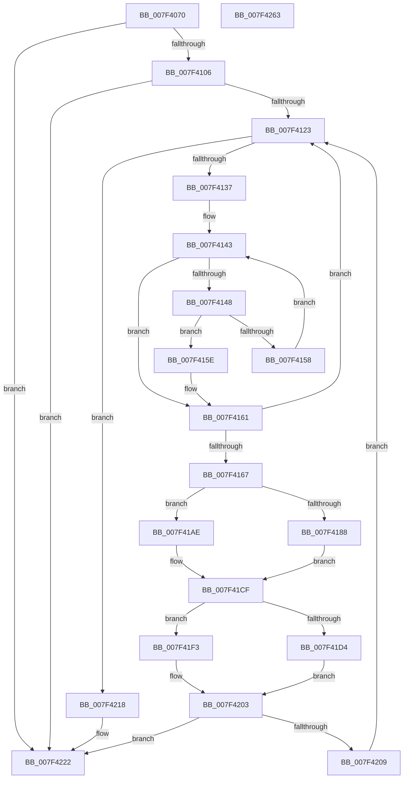

# CmpPartialPromoteSubkeys

- RVA: `0x007F4070`–`0x007F4264` (길이 `500` bytes)
- VA: `0x00000001407F4070`
- 실행 섹션: `PAGE`
- PDB 이름 있음: `예`; PDB Function 태그: `아니요`
- unwind 정보 RVA: `0x000D73F8`
- 디코드: `131`개 명령, `500/500` bytes 표시
- 미해석 바이트: `0` (있으면 어셈블리에 `.byte`로 보존)

> 이 문서는 커널 이미지의 기계어와 PDB 기호를 분석해 생성했습니다. 4번과 5번은 함수 원형과 자료형을 바이너리 사용 방식에서 추정한 C 해석이며 원본 소스 복구 결과는 아닙니다.

## 1. Dependencies

- 직접 호출 지점: **18**; 고유 호출 대상: **18**
- 직접 호출자로 확인된 함수: **1**
- RIP 상대 이미지 참조: **1**

### Outgoing calls
- `0x007F40B2` → [memset](../../text/6C/memset_function_006C6C40.md) (function, `0x006C6C40`)
- `0x007F40C4` → [CmpKeyEnumStackInitialize](../94/CmpKeyEnumStackInitialize_function_00946D38.md) (function, `0x00946D38`)
- `0x007F40E7` → [CmpGetKcbAtLayerHeight](../94/CmpGetKcbAtLayerHeight_function_00949210.md) (function, `0x00949210`)
- `0x007F40F4` → [CmpStartKcbStack](../94/CmpStartKcbStack_function_009451F0.md) (function, `0x009451F0`)
- `0x007F4114` → [CmpKeyEnumStackStartFromKcbStack](../94/CmpKeyEnumStackStartFromKcbStack_function_00944F18.md) (function, `0x00944F18`)
- `0x007F4128` → [CmpKeyEnumStackAdvance](../94/CmpKeyEnumStackAdvance_function_0094668C.md) (function, `0x0094668C`)
- `0x007F414D` → [CmpKeyNodeStackGetEntryAtLayerHeight](../94/CmpKeyNodeStackGetEntryAtLayerHeight_function_00946ABC.md) (function, `0x00946ABC`)
- `0x007F418D` → [CmpHashCompressedComponent](../85/CmpHashCompressedComponent_function_0085E420.md) (function, `0x0085E420`)
- `0x007F41A7` → [CmpFindKcbInHashEntryByCompressedName](../AB/CmpFindKcbInHashEntryByCompressedName_function_00ABC800.md) (function, `0x00ABC800`)
- `0x007F41B3` → [CmpHashUnicodeComponent](../84/CmpHashUnicodeComponent_function_0084AC24.md) (function, `0x0084AC24`)
- `0x007F41CA` → [CmpFindKcbInHashEntryByName](../94/CmpFindKcbInHashEntryByName_function_0094D7A0.md) (function, `0x0094D7A0`)
- `0x007F41DC` → [CmpPopulateKcbStack](../84/CmpPopulateKcbStack_function_00842550.md) (function, `0x00842550`)
- `0x007F41EC` → [CmpPromoteSingleKeyFromKcbStacks](../94/CmpPromoteSingleKeyFromKcbStacks_function_009446E8.md) (function, `0x009446E8`)
- `0x007F41FE` → [CmpPromoteSingleKeyFromParentKcbAndChildKeyNode](CmpPromoteSingleKeyFromParentKcbAndChildKeyNode_function_007F426C.md) (function, `0x007F426C`)
- `0x007F420E` → [CmpKeyEnumStackNotifyPromotion](../94/CmpKeyEnumStackNotifyPromotion_function_00944CE8.md) (function, `0x00944CE8`)
- `0x007F4227` → [CmpCleanupKcbStack](../94/CmpCleanupKcbStack_function_009470A0.md) (function, `0x009470A0`)
- `0x007F4231` → [CmpKeyEnumStackCleanup](../94/CmpKeyEnumStackCleanup_function_00946868.md) (function, `0x00946868`)
- `0x007F4242` → [_security_check_cookie](../../text/6A/_security_check_cookie_function_006AC640.md) (function, `0x006AC640`)

### Direct callers
- [CmpSetKeySecurity](../94/CmpSetKeySecurity_function_0094A124.md) at `0x0094A637`

### Static image references
- `0x007F4091` → RVA `0x00E0A740` (`.data`; read)

## 2. Other-region calls and transfers

- 다른 실행 섹션으로 향하는 call: **2**
  - `0x007F40B2` → [memset](../../text/6C/memset_function_006C6C40.md) (`PAGE` → `.text`)
  - `0x007F4242` → [_security_check_cookie](../../text/6A/_security_check_cookie_function_006AC640.md) (`PAGE` → `.text`)
- 별도 외부 분기/꼬리 이동을 확인하지 못했습니다.

## 3. Assembly (complete function range)

```asm
007F4070  48 89 5C 24 10                  mov qword ptr [rsp + 0x10], rbx
007F4075  48 89 74 24 18                  mov qword ptr [rsp + 0x18], rsi
007F407A  55                              push rbp
007F407B  57                              push rdi
007F407C  41 54                           push r12
007F407E  41 56                           push r14
007F4080  41 57                           push r15
007F4082  48 8D AC 24 30 FF FF FF         lea rbp, [rsp - 0xd0]
007F408A  48 81 EC D0 01 00 00            sub rsp, 0x1d0
007F4091  48 8B 05 A8 66 61 00            mov rax, qword ptr [rip + 0x6166a8]
007F4098  48 33 C4                        xor rax, rsp
007F409B  48 89 85 C0 00 00 00            mov qword ptr [rbp + 0xc0], rax
007F40A2  48 8B F1                        mov rsi, rcx
007F40A5  33 D2                           xor edx, edx
007F40A7  48 8D 4C 24 60                  lea rcx, [rsp + 0x60]
007F40AC  41 B8 60 01 00 00               mov r8d, 0x160
007F40B2  E8 89 2B ED FF                  call 0x1406c6c40
007F40B7  0F 57 C0                        xorps xmm0, xmm0
007F40BA  48 8D 4C 24 60                  lea rcx, [rsp + 0x60]
007F40BF  0F 11 44 24 30                  movups xmmword ptr [rsp + 0x30], xmm0
007F40C4  E8 6F 2C 15 00                  call 0x140946d38
007F40C9  0F B7 56 02                     movzx edx, word ptr [rsi + 2]
007F40CD  0F 57 C0                        xorps xmm0, xmm0
007F40D0  41 83 CC FF                     or r12d, 0xffffffff
007F40D4  48 8B CE                        mov rcx, rsi
007F40D7  0F 11 44 24 40                  movups xmmword ptr [rsp + 0x40], xmm0
007F40DC  66 44 89 64 24 42               mov word ptr [rsp + 0x42], r12w
007F40E2  0F 11 44 24 50                  movups xmmword ptr [rsp + 0x50], xmm0
007F40E7  E8 24 51 15 00                  call 0x140949210
007F40EC  48 8D 4C 24 40                  lea rcx, [rsp + 0x40]
007F40F1  48 8B F8                        mov rdi, rax
007F40F4  E8 F7 10 15 00                  call 0x1409451f0
007F40F9  45 33 FF                        xor r15d, r15d
007F40FC  8B D8                           mov ebx, eax
007F40FE  85 C0                           test eax, eax
007F4100  0F 88 1C 01 00 00               js 0x1407f4222
007F4106  45 33 C9                        xor r9d, r9d
007F4109  48 8D 4C 24 60                  lea rcx, [rsp + 0x60]
007F410E  45 33 C0                        xor r8d, r8d
007F4111  48 8B D6                        mov rdx, rsi
007F4114  E8 FF 0D 15 00                  call 0x140944f18
007F4119  8B D8                           mov ebx, eax
007F411B  85 C0                           test eax, eax
007F411D  0F 88 FF 00 00 00               js 0x1407f4222
007F4123  48 8D 4C 24 60                  lea rcx, [rsp + 0x60]
007F4128  E8 5F 25 15 00                  call 0x14094668c
007F412D  8B D8                           mov ebx, eax
007F412F  85 C0                           test eax, eax
007F4131  0F 88 E1 00 00 00               js 0x1407f4218
007F4137  44 0F B7 4F 42                  movzx r9d, word ptr [rdi + 0x42]
007F413C  4D 8B D7                        mov r10, r15
007F413F  41 0F B7 D1                     movzx edx, r9w
007F4143  66 85 D2                        test dx, dx
007F4146  78 19                           js 0x1407f4161
007F4148  48 8D 4C 24 68                  lea rcx, [rsp + 0x68]
007F414D  E8 6A 29 15 00                  call 0x140946abc
007F4152  4C 39 78 10                     cmp qword ptr [rax + 0x10], r15
007F4156  75 06                           jne 0x1407f415e
007F4158  66 41 03 D4                     add dx, r12w
007F415C  EB E5                           jmp 0x1407f4143
007F415E  4C 8B D0                        mov r10, rax
007F4161  66 41 3B D1                     cmp dx, r9w
007F4165  74 BC                           je 0x1407f4123
007F4167  49 8B 42 10                     mov rax, qword ptr [r10 + 0x10]
007F416B  F6 40 02 20                     test byte ptr [rax + 2], 0x20
007F416F  4C 8D 70 4C                     lea r14, [rax + 0x4c]
007F4173  0F B7 58 48                     movzx ebx, word ptr [rax + 0x48]
007F4177  4C 89 74 24 38                  mov qword ptr [rsp + 0x38], r14
007F417C  66 89 5C 24 30                  mov word ptr [rsp + 0x30], bx
007F4181  66 89 5C 24 32                  mov word ptr [rsp + 0x32], bx
007F4186  74 26                           je 0x1407f41ae
007F4188  8B D3                           mov edx, ebx
007F418A  49 8B CE                        mov rcx, r14
007F418D  E8 8E A2 06 00                  call 0x14085e420
007F4192  6B 57 10 25                     imul edx, dword ptr [rdi + 0x10], 0x25
007F4196  4D 8B CE                        mov r9, r14
007F4199  48 8B 4F 20                     mov rcx, qword ptr [rdi + 0x20]
007F419D  4C 8B C7                        mov r8, rdi
007F41A0  66 89 5C 24 20                  mov word ptr [rsp + 0x20], bx
007F41A5  03 D0                           add edx, eax
007F41A7  E8 54 86 2C 00                  call 0x140abc800
007F41AC  EB 21                           jmp 0x1407f41cf
007F41AE  48 8D 4C 24 30                  lea rcx, [rsp + 0x30]
007F41B3  E8 6C 6A 05 00                  call 0x14084ac24
007F41B8  6B 57 10 25                     imul edx, dword ptr [rdi + 0x10], 0x25
007F41BC  4C 8D 4C 24 30                  lea r9, [rsp + 0x30]
007F41C1  48 8B 4F 20                     mov rcx, qword ptr [rdi + 0x20]
007F41C5  4C 8B C7                        mov r8, rdi
007F41C8  03 D0                           add edx, eax
007F41CA  E8 D1 95 15 00                  call 0x14094d7a0
007F41CF  48 85 C0                        test rax, rax
007F41D2  74 1F                           je 0x1407f41f3
007F41D4  48 8B D0                        mov rdx, rax
007F41D7  48 8D 4C 24 40                  lea rcx, [rsp + 0x40]
007F41DC  E8 6F E3 04 00                  call 0x140842550
007F41E1  45 33 C0                        xor r8d, r8d
007F41E4  48 8D 54 24 40                  lea rdx, [rsp + 0x40]
007F41E9  48 8B CE                        mov rcx, rsi
007F41EC  E8 F7 04 15 00                  call 0x1409446e8
007F41F1  EB 10                           jmp 0x1407f4203
007F41F3  45 33 C0                        xor r8d, r8d
007F41F6  48 8D 54 24 68                  lea rdx, [rsp + 0x68]
007F41FB  48 8B CE                        mov rcx, rsi
007F41FE  E8 69 00 00 00                  call 0x1407f426c
007F4203  8B D8                           mov ebx, eax
007F4205  85 C0                           test eax, eax
007F4207  78 19                           js 0x1407f4222
007F4209  48 8D 4C 24 60                  lea rcx, [rsp + 0x60]
007F420E  E8 D5 0A 15 00                  call 0x140944ce8
007F4213  E9 0B FF FF FF                  jmp 0x1407f4123
007F4218  81 FB 1A 00 00 80               cmp ebx, 0x8000001a
007F421E  41 0F 44 DF                     cmove ebx, r15d
007F4222  48 8D 4C 24 40                  lea rcx, [rsp + 0x40]
007F4227  E8 74 2E 15 00                  call 0x1409470a0
007F422C  48 8D 4C 24 60                  lea rcx, [rsp + 0x60]
007F4231  E8 32 26 15 00                  call 0x140946868
007F4236  8B C3                           mov eax, ebx
007F4238  48 8B 8D C0 00 00 00            mov rcx, qword ptr [rbp + 0xc0]
007F423F  48 33 CC                        xor rcx, rsp
007F4242  E8 F9 83 EB FF                  call 0x1406ac640
007F4247  4C 8D 9C 24 D0 01 00 00         lea r11, [rsp + 0x1d0]
007F424F  49 8B 5B 38                     mov rbx, qword ptr [r11 + 0x38]
007F4253  49 8B 73 40                     mov rsi, qword ptr [r11 + 0x40]
007F4257  49 8B E3                        mov rsp, r11
007F425A  41 5F                           pop r15
007F425C  41 5E                           pop r14
007F425E  41 5C                           pop r12
007F4260  5F                              pop rdi
007F4261  5D                              pop rbp
007F4262  C3                              ret
007F4263  CC                              int3
```

## 4. C-style interpretation (structured pseudocode)

```c
__int64 __fastcall CmpPartialPromoteSubkeys(__int64 a1, int a2, __int64 a3, int a4)
{
    __int64 result;
    __int64 v_r12;
    __int64 v_r15;
    __int64 v_rbx;
    __int64 v_rsp;
    unsigned __int64 v_stack_m190;
    unsigned __int64 v_stack_m198;
    unsigned __int64 v_stack_m1A8;
    unsigned __int16 v_stack_m1B6;
    unsigned __int64 v_stack_m1B8;
    unsigned __int64 v_stack_m1C0;
    unsigned __int16 v_stack_m1C6;
    unsigned __int64 v_stack_m1C8;
    unsigned __int16 v_stack_m1D8;
    unsigned __int64 v_stack_m28;
    unsigned __int64 v_stack_m38;
    unsigned __int64 v_stack_mF8;
    unsigned __int64 v_stack_p10;
    unsigned __int64 v_stack_p18;

    v_stack_p10 = v_rbx;
    v_stack_p18 = v_rsi;
    v_rsp = (v_rsp) - (464);
    result = (*(unsigned __int64 *)(v_rip + 6383272)) ^ (v_rsp);
    v_stack_m38 = result;
    a2 = 0;
    result = memset(v_stack_m198, a2, 352, a4);
    v_stack_m1C8 = v_xmm0;
    result = CmpKeyEnumStackInitialize(v_stack_m198, a2, 352, a4);
    v_r12 = (unsigned int)((v_r12) | (0xFFFFFFFFULL));
    v_stack_m1B8 = v_xmm0;
    v_stack_m1B6 = (unsigned __int16)(v_r12);
    v_stack_m1A8 = v_xmm0;
    result = CmpGetKcbAtLayerHeight(a1, *(unsigned __int16 *)(a1 + 2), 352, a4);
    result = CmpStartKcbStack(v_stack_m1B8, *(unsigned __int16 *)(a1 + 2), 352, a4);
    v_r15 = 0;
    if (sign_flag) goto loc_007F4222;
    a4 = 0;
    a3 = 0;
    result = CmpKeyEnumStackStartFromKcbStack(v_stack_m198, a1, a3, a4);
    if (sign_flag) goto loc_007F4222;
loc_007F4123:
    result = CmpKeyEnumStackAdvance(v_stack_m198, a1, a3, a4);
    if (sign_flag) goto loc_007F4218;
loc_007F4143:
    if (sign_flag) goto loc_007F4161;
    result = CmpKeyNodeStackGetEntryAtLayerHeight(v_stack_m190, (unsigned __int16)(*(unsigned __int16 *)(result + 66)), a3, *(unsigned __int16 *)(result + 66));
    if ((*(unsigned __int64 *)(result + 16)) != 0) goto loc_007F415E;
    a2 = (unsigned __int16)(((unsigned __int16)(*(unsigned __int16 *)(result + 66))) + ((unsigned __int16)(v_r12)));
    goto loc_007F4143;
loc_007F415E:
loc_007F4161:
    if (((unsigned __int16)(a2)) == ((unsigned __int16)(*(unsigned __int16 *)(result + 66)))) goto loc_007F4123;
    v_stack_m1C0 = *(unsigned __int64 *)(result + 16) + 76;
    v_stack_m1C8 = (unsigned __int16)(*(unsigned __int16 *)(*(unsigned __int64 *)(result + 16) + 72));
    v_stack_m1C6 = (unsigned __int16)(*(unsigned __int16 *)(*(unsigned __int64 *)(result + 16) + 72));
    if (((*(unsigned __int8 *)(*(unsigned __int64 *)(result + 16) + 2)) & (32)) == 0) goto loc_007F41AE;
    result = CmpHashCompressedComponent(*(unsigned __int64 *)(result + 16) + 76, (unsigned int)((unsigned int)(*(unsigned __int16 *)(*(unsigned __int64 *)(result + 16) + 72))), a3, *(unsigned __int16 *)(result + 66));
    a2 = (unsigned int)(((unsigned int)((unsigned int)(*(unsigned __int16 *)(*(unsigned __int64 *)(result + 16) + 72)))) * (*(unsigned int *)(result + 16)));
    v_stack_m1D8 = (unsigned __int16)(*(unsigned __int16 *)(*(unsigned __int64 *)(result + 16) + 72));
    a2 = (unsigned int)((a2) + ((unsigned int)(result)));
    result = CmpFindKcbInHashEntryByCompressedName(*(unsigned __int64 *)(result + 32), a2, result, *(unsigned __int64 *)(result + 16) + 76);
    goto loc_007F41CF;
loc_007F41AE:
    result = CmpHashUnicodeComponent(v_stack_m1C8, a2, result, *(unsigned __int64 *)(result + 16) + 76);
    a2 = (unsigned int)((a2) * (*(unsigned int *)(result + 16)));
    a2 = (unsigned int)((a2) + ((unsigned int)(result)));
    result = CmpFindKcbInHashEntryByName(*(unsigned __int64 *)(result + 32), a2, result, v_stack_m1C8);
loc_007F41CF:
    if (result == 0) goto loc_007F41F3;
    result = CmpPopulateKcbStack(v_stack_m1B8, result, result, v_stack_m1C8);
    a3 = 0;
    result = CmpPromoteSingleKeyFromKcbStacks(a1, v_stack_m1B8, a3, v_stack_m1C8);
    goto loc_007F4203;
loc_007F41F3:
    a3 = 0;
    result = CmpPromoteSingleKeyFromParentKcbAndChildKeyNode(a1, v_stack_m190, a3, v_stack_m1C8);
loc_007F4203:
    if (sign_flag) goto loc_007F4222;
    result = CmpKeyEnumStackNotifyPromotion(v_stack_m198, v_stack_m190, a3, v_stack_m1C8);
    goto loc_007F4123;
loc_007F4218:
    v_rbx = (unsigned int)((unsigned int)(result));
    if (((unsigned int)((unsigned int)((unsigned int)(result)))) == 0x8000001AULL) { v_rbx = 0; }
loc_007F4222:
    result = CmpCleanupKcbStack(v_stack_m1B8, v_stack_m190, a3, v_stack_m1C8);
    result = CmpKeyEnumStackCleanup(v_stack_m198, v_stack_m190, a3, v_stack_m1C8);
    a1 = (v_stack_m38) ^ (v_rsp);
    result = _security_check_cookie(a1, v_stack_m190, a3, v_stack_m1C8);
    return result;
}
```

## 5. (Beta) C Style

```c
int64_t CmpPartialPromoteSubkeys(void *Arg1, int32_t Arg2, int64_t Arg3, int32_t Arg4)
{
    uint8_t *arg1 = (uint8_t *)Arg1;

    int64_t result;
    int64_t local_r12;
    int64_t local_r15;
    int64_t local_rbx;
    int64_t local_rsp;
    uint64_t v_stack_m190;
    uint64_t v_stack_m198;
    uint64_t v_stack_m1A8;
    uint16_t v_stack_m1B6;
    uint64_t v_stack_m1B8;
    uint64_t v_stack_m1C0;
    uint16_t v_stack_m1C6;
    uint64_t v_stack_m1C8;
    uint16_t v_stack_m1D8;
    uint64_t v_stack_m28;
    uint64_t v_stack_m38;
    uint64_t v_stack_mF8;
    uint64_t v_stack_p10;
    uint64_t v_stack_p18;

    v_stack_p10 = local_rbx;
    v_stack_p18 = local_rsi;
    local_rsp = (local_rsp) - (464);
    result = (*(uint64_t *)(v_rip + 0x6166A8)) ^ (local_rsp);
    v_stack_m38 = result;
    Arg2 = 0;
    result = memset(v_stack_m198, Arg2, 352, Arg4);
    v_stack_m1C8 = v_xmm0;
    result = CmpKeyEnumStackInitialize(v_stack_m198, Arg2, 352, Arg4);
    local_r12 = (uint32_t)((local_r12) | (0xFFFFFFFFULL));
    v_stack_m1B8 = v_xmm0;
    v_stack_m1B6 = (uint16_t)(local_r12);
    v_stack_m1A8 = v_xmm0;
    result = CmpGetKcbAtLayerHeight(Arg1, *(uint16_t *)(arg1 + 0x2), 352, Arg4);
    result = CmpStartKcbStack(v_stack_m1B8, *(uint16_t *)(arg1 + 0x2), 352, Arg4);
    local_r15 = 0;
    if (sign_flag) goto loc_007F4222;
    Arg4 = 0;
    Arg3 = 0;
    result = CmpKeyEnumStackStartFromKcbStack(v_stack_m198, Arg1, Arg3, Arg4);
    if (sign_flag) goto loc_007F4222;
loc_007F4123:
    result = CmpKeyEnumStackAdvance(v_stack_m198, Arg1, Arg3, Arg4);
    if (sign_flag) goto loc_007F4218;
loc_007F4143:
    if (sign_flag) goto loc_007F4161;
    result = CmpKeyNodeStackGetEntryAtLayerHeight(v_stack_m190, (uint16_t)(*(uint16_t *)(result + 0x42)), Arg3, *(uint16_t *)(result + 0x42));
    if ((*(uint64_t *)(result + 0x10)) != 0) goto loc_007F415E;
    Arg2 = (uint16_t)(((uint16_t)(*(uint16_t *)(result + 0x42))) + ((uint16_t)(local_r12)));
    goto loc_007F4143;
loc_007F415E:
loc_007F4161:
    if (((uint16_t)(Arg2)) == ((uint16_t)(*(uint16_t *)(result + 0x42)))) goto loc_007F4123;
    v_stack_m1C0 = *(uint64_t *)(result + 0x10) + 76;
    v_stack_m1C8 = (uint16_t)(*(uint16_t *)(*(uint64_t *)(result + 0x10) + 0x48));
    v_stack_m1C6 = (uint16_t)(*(uint16_t *)(*(uint64_t *)(result + 0x10) + 0x48));
    if (((*(uint8_t *)(*(uint64_t *)(result + 0x10) + 0x2)) & (32)) == 0) goto loc_007F41AE;
    result = CmpHashCompressedComponent(*(uint64_t *)(result + 0x10) + 76, (uint32_t)((uint32_t)(*(uint16_t *)(*(uint64_t *)(result + 0x10) + 0x48))), Arg3, *(uint16_t *)(result + 0x42));
    Arg2 = (uint32_t)(((uint32_t)((uint32_t)(*(uint16_t *)(*(uint64_t *)(result + 0x10) + 0x48)))) * (*(uint32_t *)(result + 0x10)));
    v_stack_m1D8 = (uint16_t)(*(uint16_t *)(*(uint64_t *)(result + 0x10) + 0x48));
    Arg2 = (uint32_t)((Arg2) + ((uint32_t)(result)));
    result = CmpFindKcbInHashEntryByCompressedName(*(uint64_t *)(result + 0x20), Arg2, result, *(uint64_t *)(result + 0x10) + 76);
    goto loc_007F41CF;
loc_007F41AE:
    result = CmpHashUnicodeComponent(v_stack_m1C8, Arg2, result, *(uint64_t *)(result + 0x10) + 76);
    Arg2 = (uint32_t)((Arg2) * (*(uint32_t *)(result + 0x10)));
    Arg2 = (uint32_t)((Arg2) + ((uint32_t)(result)));
    result = CmpFindKcbInHashEntryByName(*(uint64_t *)(result + 0x20), Arg2, result, v_stack_m1C8);
loc_007F41CF:
    if (result == 0) goto loc_007F41F3;
    result = CmpPopulateKcbStack(v_stack_m1B8, result, result, v_stack_m1C8);
    Arg3 = 0;
    result = CmpPromoteSingleKeyFromKcbStacks(Arg1, v_stack_m1B8, Arg3, v_stack_m1C8);
    goto loc_007F4203;
loc_007F41F3:
    Arg3 = 0;
    result = CmpPromoteSingleKeyFromParentKcbAndChildKeyNode(Arg1, v_stack_m190, Arg3, v_stack_m1C8);
loc_007F4203:
    if (sign_flag) goto loc_007F4222;
    result = CmpKeyEnumStackNotifyPromotion(v_stack_m198, v_stack_m190, Arg3, v_stack_m1C8);
    goto loc_007F4123;
loc_007F4218:
    local_rbx = (uint32_t)((uint32_t)(result));
    if (((uint32_t)((uint32_t)((uint32_t)(result)))) == 0x8000001AULL) { local_rbx = 0; }
loc_007F4222:
    result = CmpCleanupKcbStack(v_stack_m1B8, v_stack_m190, Arg3, v_stack_m1C8);
    result = CmpKeyEnumStackCleanup(v_stack_m198, v_stack_m190, Arg3, v_stack_m1C8);
    Arg1 = (v_stack_m38) ^ (local_rsp);
    result = _security_check_cookie(Arg1, v_stack_m190, Arg3, v_stack_m1C8);
    return result;
}
```

### 관측된 메모리 오프셋

구조체 형식이 확인되지 않은 접근은 인자 기준의 오프셋으로만 기록했습니다.

| 기준 인자 | 오프셋 표현 | 폭 (bit) | 접근 |
|---|---:|---:|---|
| `Arg1` | `+ 0x2` | `16` | `R` |

## 6. Execution-region graph

[열기: 2D/3D 그래프와 함수 탐색 컨트롤 패널](../../../control-panel.html?section=page&rva=0x007F4070&view=graph)

- 2D 그래프는 위에서 아래로 흐르고, 3D 그래프는 빈 공간을 드래그해 회전합니다. Shift+드래그는 이동, 휠은 확대·축소, 함수 노드 선택은 대상 보고서 이동입니다.

### Static fallback


