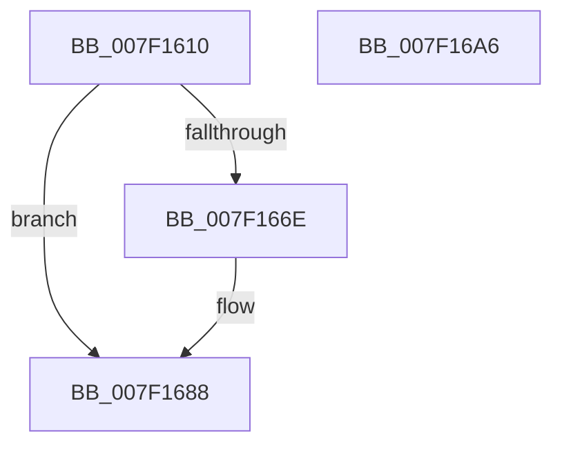

# CmpPrepareDiscardAndReplaceKcbAndUnbackedHigherLayers

- RVA: `0x007F1610`–`0x007F16A7` (길이 `151` bytes)
- VA: `0x00000001407F1610`
- 실행 섹션: `PAGE`
- PDB 이름 있음: `예`; PDB Function 태그: `아니요`
- unwind 정보 RVA: `0x0007F83C`
- 디코드: `42`개 명령, `151/151` bytes 표시
- 미해석 바이트: `0` (있으면 어셈블리에 `.byte`로 보존)

> 이 문서는 커널 이미지의 기계어와 PDB 기호를 분석해 생성했습니다. 4번과 5번은 함수 원형과 자료형을 바이너리 사용 방식에서 추정한 C 해석이며 원본 소스 복구 결과는 아닙니다.

## 1. Dependencies

- 직접 호출 지점: **4**; 고유 호출 대상: **4**
- 직접 호출자로 확인된 함수: **3**
- RIP 상대 이미지 참조: **2**

### Outgoing calls
- `0x007F1631` → [CmpInitializeDelayDerefContext](../../text/42/CmpInitializeDelayDerefContext_function_0042A7F0.md) (function, `0x0042A7F0`)
- `0x007F1662` → [CmpEnumerateAllHigherLayerKcbs](../A5/CmpEnumerateAllHigherLayerKcbs_function_00A55234.md) (function, `0x00A55234`)
- `0x007F1679` → [CmpPrepareDiscardReplacePost](CmpPrepareDiscardReplacePost_function_007F16B0.md) (function, `0x007F16B0`)
- `0x007F168F` → [CmpDrainDelayDerefContext](../../text/41/CmpDrainDelayDerefContext_function_0041B9A0.md) (function, `0x0041B9A0`)

### Direct callers
- [sub_006ED542](../../text/6E/Unknown_function_006ED542.md) at `0x006ED54C`
- [sub_00B16440](../B1/Unknown_function_00B16440.md) at `0x00B164EB`
- [sub_00B3D5B8](../B3/Unknown_function_00B3D5B8.md) at `0x00B3D60A`

### Static image references
- `0x007F1644` → RVA `0x007F16B0` (`CmpPrepareDiscardReplacePost`; read)
- `0x007F165B` → RVA `0x007F14F0` (`CmpCleanupDiscardReplacePre`; read)

## 2. Other-region calls and transfers

- 다른 실행 섹션으로 향하는 call: **2**
  - `0x007F1631` → [CmpInitializeDelayDerefContext](../../text/42/CmpInitializeDelayDerefContext_function_0042A7F0.md) (`PAGE` → `.text`)
  - `0x007F168F` → [CmpDrainDelayDerefContext](../../text/41/CmpDrainDelayDerefContext_function_0041B9A0.md) (`PAGE` → `.text`)
- 별도 외부 분기/꼬리 이동을 확인하지 못했습니다.

## 3. Assembly (complete function range)

```asm
007F1610  48 8B C4                        mov rax, rsp
007F1613  48 89 58 08                     mov qword ptr [rax + 8], rbx
007F1617  48 89 70 10                     mov qword ptr [rax + 0x10], rsi
007F161B  57                              push rdi
007F161C  48 83 EC 50                     sub rsp, 0x50
007F1620  48 8B F1                        mov rsi, rcx
007F1623  0F 57 C0                        xorps xmm0, xmm0
007F1626  48 8D 48 E8                     lea rcx, [rax - 0x18]
007F162A  48 8B FA                        mov rdi, rdx
007F162D  0F 11 40 E8                     movups xmmword ptr [rax - 0x18], xmm0
007F1631  E8 BA 91 C3 FF                  call 0x14042a7f0
007F1636  83 62 08 00                     and dword ptr [rdx + 8], 0
007F163A  4C 8D 4C 24 40                  lea r9, [rsp + 0x40]
007F163F  C6 44 24 30 00                  mov byte ptr [rsp + 0x30], 0
007F1644  4C 8D 05 65 00 00 00            lea r8, [rip + 0x65]
007F164B  48 89 32                        mov qword ptr [rdx], rsi
007F164E  48 8B CE                        mov rcx, rsi
007F1651  C6 44 24 28 01                  mov byte ptr [rsp + 0x28], 1
007F1656  48 89 54 24 20                  mov qword ptr [rsp + 0x20], rdx
007F165B  48 8D 15 8E FE FF FF            lea rdx, [rip - 0x172]
007F1662  E8 CD 3B 26 00                  call 0x140a55234
007F1667  8B 5F 08                        mov ebx, dword ptr [rdi + 8]
007F166A  85 DB                           test ebx, ebx
007F166C  78 1A                           js 0x1407f1688
007F166E  4C 8B C7                        mov r8, rdi
007F1671  48 8D 54 24 40                  lea rdx, [rsp + 0x40]
007F1676  48 8B CE                        mov rcx, rsi
007F1679  E8 32 00 00 00                  call 0x1407f16b0
007F167E  8B 4F 08                        mov ecx, dword ptr [rdi + 8]
007F1681  33 DB                           xor ebx, ebx
007F1683  85 C9                           test ecx, ecx
007F1685  0F 48 D9                        cmovs ebx, ecx
007F1688  33 D2                           xor edx, edx
007F168A  48 8D 4C 24 40                  lea rcx, [rsp + 0x40]
007F168F  E8 0C A3 C2 FF                  call 0x14041b9a0
007F1694  48 8B 74 24 68                  mov rsi, qword ptr [rsp + 0x68]
007F1699  8B C3                           mov eax, ebx
007F169B  48 8B 5C 24 60                  mov rbx, qword ptr [rsp + 0x60]
007F16A0  48 83 C4 50                     add rsp, 0x50
007F16A4  5F                              pop rdi
007F16A5  C3                              ret
007F16A6  CC                              int3
```

## 4. C-style interpretation (structured pseudocode)

```c
__int64 __fastcall CmpPrepareDiscardAndReplaceKcbAndUnbackedHigherLayers(__int64 a1, __int64 a2)
{
    __int64 result;
    __int64 v_rbx;
    __int64 v_rsp;
    unsigned __int64 v_stack_m18;
    unsigned __int8 v_stack_m28;
    unsigned __int8 v_stack_m30;
    unsigned __int64 v_stack_m38;
    unsigned __int64 v_stack_p10;
    unsigned __int64 v_stack_p8;

    *(unsigned __int64 *)(v_rsp + 8) = v_rbx;
    *(unsigned __int64 *)(v_rsp + 16) = v_rsi;
    v_rsp = (v_rsp) - (80);
    *(unsigned __int64 *)(v_rsp - 24) = v_xmm0;
    result = CmpInitializeDelayDerefContext(v_rsp - 24, a2, a3, a4);
    v_stack_m28 = 0;
    *(unsigned __int64 *)(a2) = a1;
    v_stack_m30 = 1;
    v_stack_m38 = a2;
    result = CmpEnumerateAllHigherLayerKcbs(a1, v_rip - 370, v_rip + 101, v_stack_m18);
    v_rbx = (unsigned int)(*(unsigned int *)(a2 + 8));
    if (!(sign_flag)) {
        a3 = a2;
        a2 = v_stack_m18;
        a1 = a1;
        result = CmpPrepareDiscardReplacePost(a1, a2, a3, v_stack_m18);
        a1 = *(unsigned int *)(a2 + 8);
        v_rbx = 0;
        if (sign_flag) { v_rbx = (unsigned int)(a1); }
    }
    a2 = 0;
    result = CmpDrainDelayDerefContext(v_stack_m18, a2, a3, v_stack_m18);
    v_rsp = (v_rsp) + (80);
    return (unsigned int)((unsigned int)(v_rbx));
}
```

## 5. (Beta) C Style

```c
int64_t CmpPrepareDiscardAndReplaceKcbAndUnbackedHigherLayers(int64_t Arg1, void *Arg2)
{
    uint8_t *arg2 = (uint8_t *)Arg2;

    int64_t result;
    int64_t local_rbx;
    int64_t local_rsp;
    uint64_t v_stack_m18;
    uint8_t v_stack_m28;
    uint8_t v_stack_m30;
    uint64_t v_stack_m38;
    uint64_t v_stack_p10;
    uint64_t v_stack_p8;

    *(uint64_t *)(local_rsp + 0x8) = local_rbx;
    *(uint64_t *)(local_rsp + 0x10) = local_rsi;
    local_rsp = (local_rsp) - (80);
    *(uint64_t *)(local_rsp - 0x18) = v_xmm0;
    result = CmpInitializeDelayDerefContext(local_rsp - 24, Arg2, a3, a4);
    v_stack_m28 = 0;
    *(uint64_t *)(arg2) = Arg1;
    v_stack_m30 = 1;
    v_stack_m38 = Arg2;
    result = CmpEnumerateAllHigherLayerKcbs(Arg1, v_rip - 370, v_rip + 101, v_stack_m18);
    local_rbx = (uint32_t)(*(uint32_t *)(arg2 + 0x8));
    if (!(sign_flag)) {
        a3 = Arg2;
        Arg2 = v_stack_m18;
        Arg1 = Arg1;
        result = CmpPrepareDiscardReplacePost(Arg1, Arg2, a3, v_stack_m18);
        Arg1 = *(uint32_t *)(arg2 + 0x8);
        local_rbx = 0;
        if (sign_flag) { local_rbx = (uint32_t)(Arg1); }
    }
    Arg2 = 0;
    result = CmpDrainDelayDerefContext(v_stack_m18, Arg2, a3, v_stack_m18);
    local_rsp = (local_rsp) + (80);
    return (uint32_t)((uint32_t)(local_rbx));
}
```

### 관측된 메모리 오프셋

구조체 형식이 확인되지 않은 접근은 인자 기준의 오프셋으로만 기록했습니다.

| 기준 인자 | 오프셋 표현 | 폭 (bit) | 접근 |
|---|---:|---:|---|
| `Arg2` | `+ 0x8` | `32` | `R` |

## 6. Execution-region graph

[열기: 2D/3D 그래프와 함수 탐색 컨트롤 패널](../../../control-panel.html?section=page&rva=0x007F1610&view=graph)

- 2D 그래프는 위에서 아래로 흐르고, 3D 그래프는 빈 공간을 드래그해 회전합니다. Shift+드래그는 이동, 휠은 확대·축소, 함수 노드 선택은 대상 보고서 이동입니다.

### Static fallback


