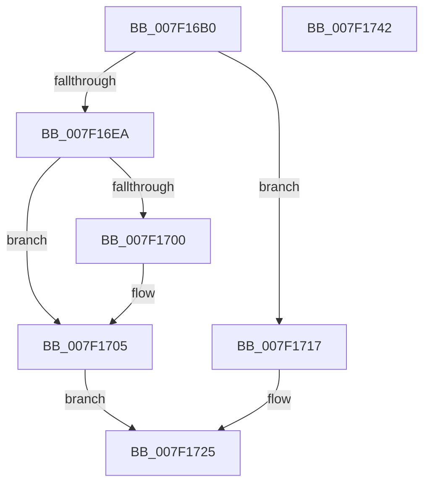

# CmpPrepareDiscardReplacePost

- RVA: `0x007F16B0`–`0x007F1743` (길이 `147` bytes)
- VA: `0x00000001407F16B0`
- 실행 섹션: `PAGE`
- PDB 이름 있음: `예`; PDB Function 태그: `아니요`
- unwind 정보 RVA: `0x000BD140`
- 디코드: `48`개 명령, `147/147` bytes 표시
- 미해석 바이트: `0` (있으면 어셈블리에 `.byte`로 보존)

> 이 문서는 커널 이미지의 기계어와 PDB 기호를 분석해 생성했습니다. 4번과 5번은 함수 원형과 자료형을 바이너리 사용 방식에서 추정한 C 해석이며 원본 소스 복구 결과는 아닙니다.

## 1. Dependencies

- 직접 호출 지점: **3**; 고유 호출 대상: **3**
- 직접 호출자로 확인된 함수: **1**
- RIP 상대 이미지 참조: **0**

### Outgoing calls
- `0x007F16D2` → [CmpReferenceKeyControlBlock](../85/CmpReferenceKeyControlBlock_function_0085D370.md) (function, `0x0085D370`)
- `0x007F16DF` → [CmpCloneToUnbackedKcb](../7E/CmpCloneToUnbackedKcb_function_007EA9A8.md) (function, `0x007EA9A8`)
- `0x007F1720` → [CmpDereferenceKeyControlBlockWithLock](../86/CmpDereferenceKeyControlBlockWithLock_function_00862B60.md) (function, `0x00862B60`)

### Direct callers
- [CmpPrepareDiscardAndReplaceKcbAndUnbackedHigherLayers](CmpPrepareDiscardAndReplaceKcbAndUnbackedHigherLayers_function_007F1610.md) at `0x007F1679`

### Static image references
- 디코드된 RIP-relative 메모리 참조가 없습니다.

## 2. Other-region calls and transfers

- 다른 실행 섹션으로 향하는 call: **0**
- 별도 외부 분기/꼬리 이동을 확인하지 못했습니다.

## 3. Assembly (complete function range)

```asm
007F16B0  48 89 5C 24 08                  mov qword ptr [rsp + 8], rbx
007F16B5  48 89 6C 24 10                  mov qword ptr [rsp + 0x10], rbp
007F16BA  56                              push rsi
007F16BB  57                              push rdi
007F16BC  41 56                           push r14
007F16BE  48 83 EC 20                     sub rsp, 0x20
007F16C2  33 DB                           xor ebx, ebx
007F16C4  49 8B F0                        mov rsi, r8
007F16C7  48 89 5C 24 50                  mov qword ptr [rsp + 0x50], rbx
007F16CC  4C 8B F2                        mov r14, rdx
007F16CF  48 8B E9                        mov rbp, rcx
007F16D2  E8 99 BC 06 00                  call 0x14085d370
007F16D7  48 8D 54 24 50                  lea rdx, [rsp + 0x50]
007F16DC  48 8B CD                        mov rcx, rbp
007F16DF  E8 C4 92 FF FF                  call 0x1407ea9a8
007F16E4  8B F8                           mov edi, eax
007F16E6  85 C0                           test eax, eax
007F16E8  78 2D                           js 0x1407f1717
007F16EA  48 8B 44 24 50                  mov rax, qword ptr [rsp + 0x50]
007F16EF  48 8D 4E 10                     lea rcx, [rsi + 0x10]
007F16F3  48 8B 51 08                     mov rdx, qword ptr [rcx + 8]
007F16F7  48 83 C0 78                     add rax, 0x78
007F16FB  48 39 0A                        cmp qword ptr [rdx], rcx
007F16FE  74 05                           je 0x1407f1705
007F1700  8D 4B 03                        lea ecx, [rbx + 3]
007F1703  CD 29                           int 0x29
007F1705  48 89 08                        mov qword ptr [rax], rcx
007F1708  8B FB                           mov edi, ebx
007F170A  48 89 50 08                     mov qword ptr [rax + 8], rdx
007F170E  48 89 02                        mov qword ptr [rdx], rax
007F1711  48 89 41 08                     mov qword ptr [rcx + 8], rax
007F1715  EB 0E                           jmp 0x1407f1725
007F1717  45 33 C0                        xor r8d, r8d
007F171A  49 8B D6                        mov rdx, r14
007F171D  48 8B CD                        mov rcx, rbp
007F1720  E8 3B 14 07 00                  call 0x140862b60
007F1725  48 8B 6C 24 48                  mov rbp, qword ptr [rsp + 0x48]
007F172A  85 FF                           test edi, edi
007F172C  89 7E 08                        mov dword ptr [rsi + 8], edi
007F172F  0F 98 C3                        sets bl
007F1732  8B C3                           mov eax, ebx
007F1734  48 8B 5C 24 40                  mov rbx, qword ptr [rsp + 0x40]
007F1739  48 83 C4 20                     add rsp, 0x20
007F173D  41 5E                           pop r14
007F173F  5F                              pop rdi
007F1740  5E                              pop rsi
007F1741  C3                              ret
007F1742  CC                              int3
```

## 4. C-style interpretation (structured pseudocode)

```c
__int64 __fastcall CmpPrepareDiscardReplacePost(__int64 a1, __int64 a2, __int64 a3)
{
    __int64 result;
    __int64 v_rbx;
    __int64 v_rsp;
    unsigned __int64 v_stack_p10;
    unsigned __int64 v_stack_p18;
    unsigned __int64 v_stack_p8;

    v_stack_p8 = v_rbx;
    v_stack_p10 = v_rbp;
    v_rsp = (v_rsp) - (32);
    v_rbx = 0;
    v_stack_p18 = 0;
    result = CmpReferenceKeyControlBlock(a1, a2, a3, a4);
    result = CmpCloneToUnbackedKcb(a1, v_stack_p18, a3, a4);
    if (sign_flag) goto loc_007F1717;
    result = (v_stack_p18) + (120);
    if ((*(unsigned __int64 *)(*(unsigned __int64 *)(a3 + 16 + 8))) != (a3 + 16)) {
        a1 = v_rbx + 3;
    }
    *(unsigned __int64 *)(result) = a1;
    *(unsigned __int64 *)(result + 8) = *(unsigned __int64 *)(a3 + 16 + 8);
    *(unsigned __int64 *)(*(unsigned __int64 *)(a3 + 16 + 8)) = result;
    *(unsigned __int64 *)(a1 + 8) = result;
    goto loc_007F1725;
loc_007F1717:
    a3 = 0;
    result = CmpDereferenceKeyControlBlockWithLock(a1, a2, a3, a4);
loc_007F1725:
    *(unsigned int *)(a3 + 8) = 0;
    v_rbx = (sign_flag) ? 1 : 0;
    v_rsp = (v_rsp) + (32);
    return (unsigned int)((unsigned int)(v_rbx));
}
```

## 5. (Beta) C Style

```c
int64_t CmpPrepareDiscardReplacePost(int64_t Arg1, int64_t Arg2, void *Arg3)
{
    uint8_t *arg3 = (uint8_t *)Arg3;

    int64_t result;
    int64_t local_rbx;
    int64_t local_rsp;
    uint64_t v_stack_p10;
    uint64_t v_stack_p18;
    uint64_t v_stack_p8;

    v_stack_p8 = local_rbx;
    v_stack_p10 = local_rbp;
    local_rsp = (local_rsp) - (32);
    local_rbx = 0;
    v_stack_p18 = 0;
    result = CmpReferenceKeyControlBlock(Arg1, Arg2, Arg3, a4);
    result = CmpCloneToUnbackedKcb(Arg1, v_stack_p18, Arg3, a4);
    if (sign_flag) goto loc_007F1717;
    result = (v_stack_p18) + (120);
    if ((*(uint64_t *)(*(uint64_t *)(arg3 + 0x10 + 0x8))) != (Arg3 + 16)) {
        Arg1 = local_rbx + 3;
    }
    *(uint64_t *)(result) = Arg1;
    *(uint64_t *)(result + 0x8) = *(uint64_t *)(arg3 + 0x10 + 0x8);
    *(uint64_t *)(*(uint64_t *)(arg3 + 0x10 + 0x8)) = result;
    *(uint64_t *)(Arg1 + 0x8) = result;
    goto loc_007F1725;
loc_007F1717:
    Arg3 = 0;
    result = CmpDereferenceKeyControlBlockWithLock(Arg1, Arg2, Arg3, a4);
loc_007F1725:
    *(uint32_t *)(arg3 + 0x8) = 0;
    local_rbx = (sign_flag) ? 1 : 0;
    local_rsp = (local_rsp) + (32);
    return (uint32_t)((uint32_t)(local_rbx));
}
```

### 관측된 메모리 오프셋

구조체 형식이 확인되지 않은 접근은 인자 기준의 오프셋으로만 기록했습니다.

| 기준 인자 | 오프셋 표현 | 폭 (bit) | 접근 |
|---|---:|---:|---|
| `Arg3` | `+ 0x8` | `32` | `W` |
| `Arg3` | `+ 0x8` | `64` | `R` |
| `Arg3` | `+ 0x10` | `64` | `R` |

## 6. Execution-region graph

[열기: 2D/3D 그래프와 함수 탐색 컨트롤 패널](../../../control-panel.html?section=page&rva=0x007F16B0&view=graph)

- 2D 그래프는 위에서 아래로 흐르고, 3D 그래프는 빈 공간을 드래그해 회전합니다. Shift+드래그는 이동, 휠은 확대·축소, 함수 노드 선택은 대상 보고서 이동입니다.

### Static fallback


