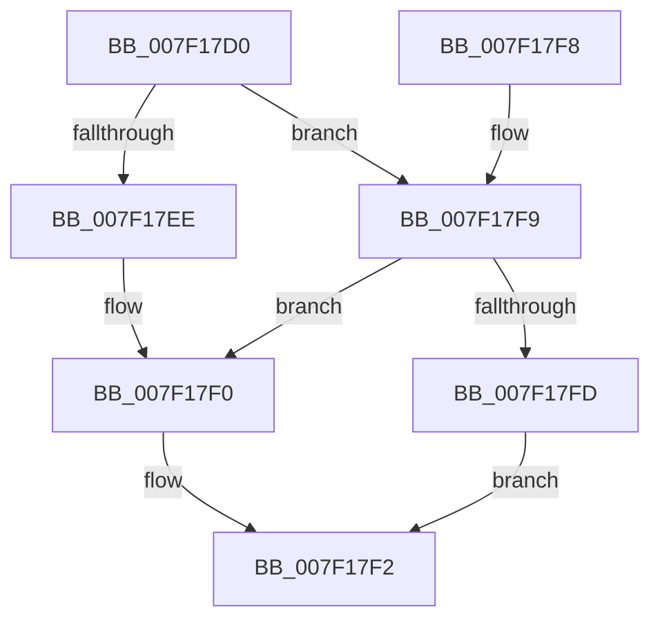

# CmpPrepareToInvalidateAllHigherLayerKcbsPostCallback

- RVA: `0x007F17D0`–`0x007F1806` (길이 `54` bytes)
- VA: `0x00000001407F17D0`
- 실행 섹션: `PAGE`
- PDB 이름 있음: `예`; PDB Function 태그: `아니요`
- unwind 정보 RVA: `0x0006AD84`
- 디코드: `20`개 명령, `54/54` bytes 표시
- 미해석 바이트: `0` (있으면 어셈블리에 `.byte`로 보존)

> 이 문서는 커널 이미지의 기계어와 PDB 기호를 분석해 생성했습니다. 4번과 5번은 함수 원형과 자료형을 바이너리 사용 방식에서 추정한 C 해석이며 원본 소스 복구 결과는 아닙니다.

## 1. Dependencies

- 직접 호출 지점: **1**; 고유 호출 대상: **1**
- 직접 호출자로 확인된 함수: **0**
- RIP 상대 이미지 참조: **0**

### Outgoing calls
- `0x007F17E0` → [CmpPrepareForSubtreeInvalidation](../9B/CmpPrepareForSubtreeInvalidation_function_009B01B0.md) (function, `0x009B01B0`)

### Direct callers
- 이 함수 시작 RVA로 연결되는 직접 call은 확인되지 않았습니다. 간접 호출은 완전히 역산할 수 없습니다.

### Static image references
- 디코드된 RIP-relative 메모리 참조가 없습니다.

## 2. Other-region calls and transfers

- 다른 실행 섹션으로 향하는 call: **0**
- 별도 외부 분기/꼬리 이동을 확인하지 못했습니다.

## 3. Assembly (complete function range)

```asm
007F17D0  40 53                           push rbx
007F17D2  48 83 EC 20                     sub rsp, 0x20
007F17D6  49 8B D8                        mov rbx, r8
007F17D9  4D 8B 40 08                     mov r8, qword ptr [r8 + 8]
007F17DD  8B 53 10                        mov edx, dword ptr [rbx + 0x10]
007F17E0  E8 CB E9 1B 00                  call 0x1409b01b0
007F17E5  B9 2D 02 00 C0                  mov ecx, 0xc000022d
007F17EA  3B C1                           cmp eax, ecx
007F17EC  75 0B                           jne 0x1407f17f9
007F17EE  89 0B                           mov dword ptr [rbx], ecx
007F17F0  33 C0                           xor eax, eax
007F17F2  48 83 C4 20                     add rsp, 0x20
007F17F6  5B                              pop rbx
007F17F7  C3                              ret
007F17F8  CC                              int3
007F17F9  85 C0                           test eax, eax
007F17FB  79 F3                           jns 0x1407f17f0
007F17FD  89 03                           mov dword ptr [rbx], eax
007F17FF  B8 01 00 00 00                  mov eax, 1
007F1804  EB EC                           jmp 0x1407f17f2
```

## 4. C-style interpretation (structured pseudocode)

```c
__int64 __fastcall CmpPrepareToInvalidateAllHigherLayerKcbsPostCallback(__int64 a1, __int64 a2, __int64 a3)
{
    __int64 result;
    __int64 v_rsp;

    v_rsp = (v_rsp) - (32);
    result = CmpPrepareForSubtreeInvalidation(a1, (unsigned int)(*(unsigned int *)(a3 + 16)), *(unsigned __int64 *)(a3 + 8), a4);
    if (((unsigned int)(result)) != ((unsigned int)((unsigned int)(0xC000022DULL)))) goto loc_007F17F9;
    *(unsigned int *)(a3) = (unsigned int)((unsigned int)(0xC000022DULL));
loc_007F17F0:
    result = 0;
loc_007F17F2:
    v_rsp = (v_rsp) + (32);
    return result;
loc_007F17F9:
    if (!sign_flag) goto loc_007F17F0;
    *(unsigned int *)(a3) = 0;
    goto loc_007F17F2;
}
```

## 5. (Beta) C Style

```c
int64_t CmpPrepareToInvalidateAllHigherLayerKcbsPostCallback(int64_t Arg1, int64_t Arg2, void *Arg3)
{
    uint8_t *arg3 = (uint8_t *)Arg3;

    int64_t result;
    int64_t local_rsp;

    local_rsp = (local_rsp) - (32);
    result = CmpPrepareForSubtreeInvalidation(Arg1, (uint32_t)(*(uint32_t *)(arg3 + 0x10)), *(uint64_t *)(arg3 + 0x8), a4);
    if (((uint32_t)(result)) != ((uint32_t)((uint32_t)(0xC000022DULL)))) goto loc_007F17F9;
    *(uint32_t *)(arg3) = (uint32_t)((uint32_t)(0xC000022DULL));
loc_007F17F0:
    result = 0;
loc_007F17F2:
    local_rsp = (local_rsp) + (32);
    return result;
loc_007F17F9:
    if (!sign_flag) goto loc_007F17F0;
    *(uint32_t *)(arg3) = 0;
    goto loc_007F17F2;
}
```

### 관측된 메모리 오프셋

구조체 형식이 확인되지 않은 접근은 인자 기준의 오프셋으로만 기록했습니다.

| 기준 인자 | 오프셋 표현 | 폭 (bit) | 접근 |
|---|---:|---:|---|
| `Arg3` | `+ 0x0` | `32` | `W` |
| `Arg3` | `+ 0x8` | `64` | `R` |
| `Arg3` | `+ 0x10` | `32` | `R` |

## 6. Execution-region graph

[열기: 2D/3D 그래프와 함수 탐색 컨트롤 패널](../../../control-panel.html?section=page&rva=0x007F17D0&view=graph)

- 2D 그래프는 위에서 아래로 흐르고, 3D 그래프는 빈 공간을 드래그해 회전합니다. Shift+드래그는 이동, 휠은 확대·축소, 함수 노드 선택은 대상 보고서 이동입니다.

### Static fallback


