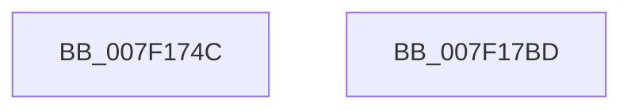

# CmpPrepareToInvalidateAllHigherLayerKcbs

- RVA: `0x007F174C`–`0x007F17BE` (길이 `114` bytes)
- VA: `0x00000001407F174C`
- 실행 섹션: `PAGE`
- PDB 이름 있음: `예`; PDB Function 태그: `아니요`
- unwind 정보 RVA: `0x000BCD28`
- 디코드: `27`개 명령, `114/114` bytes 표시
- 미해석 바이트: `0` (있으면 어셈블리에 `.byte`로 보존)

> 이 문서는 커널 이미지의 기계어와 PDB 기호를 분석해 생성했습니다. 4번과 5번은 함수 원형과 자료형을 바이너리 사용 방식에서 추정한 C 해석이며 원본 소스 복구 결과는 아닙니다.

## 1. Dependencies

- 직접 호출 지점: **3**; 고유 호출 대상: **3**
- 직접 호출자로 확인된 함수: **4**
- RIP 상대 이미지 참조: **2**

### Outgoing calls
- `0x007F1774` → [CmpInitializeDelayDerefContext](../../text/42/CmpInitializeDelayDerefContext_function_0042A7F0.md) (function, `0x0042A7F0`)
- `0x007F17A3` → [CmpEnumerateAllHigherLayerKcbs](../A5/CmpEnumerateAllHigherLayerKcbs_function_00A55234.md) (function, `0x00A55234`)
- `0x007F17AF` → [CmpDrainDelayDerefContext](../../text/41/CmpDrainDelayDerefContext_function_0041B9A0.md) (function, `0x0041B9A0`)

### Direct callers
- [CmpSaveBootControlSet](../7D/CmpSaveBootControlSet_function_007DC744.md) at `0x007DC9F8`
- [CmRestoreKey](../7D/CmRestoreKey_function_007DCF04.md) at `0x007DD42F`
- [CmRenameKey](../7E/CmRenameKey_function_007E8F48.md) at `0x007E9370`
- [CmRenameKey](../7E/CmRenameKey_function_007E8F48.md) at `0x007E9587`
- [sub_00B1787E](../B1/Unknown_function_00B1787E.md) at `0x00B1789D`

### Static image references
- `0x007F1792` → RVA `0x007F17D0` (`CmpPrepareToInvalidateAllHigherLayerKcbsPostCallback`; read)
- `0x007F179C` → RVA `0x0070BAD0` (`CmpCleanUpHigherLayerKcbCachesPreCallback`; read)

## 2. Other-region calls and transfers

- 다른 실행 섹션으로 향하는 call: **2**
  - `0x007F1774` → [CmpInitializeDelayDerefContext](../../text/42/CmpInitializeDelayDerefContext_function_0042A7F0.md) (`PAGE` → `.text`)
  - `0x007F17AF` → [CmpDrainDelayDerefContext](../../text/41/CmpDrainDelayDerefContext_function_0041B9A0.md) (`PAGE` → `.text`)
- 별도 외부 분기/꼬리 이동을 확인하지 못했습니다.

## 3. Assembly (complete function range)

```asm
007F174C  48 83 EC 78                     sub rsp, 0x78
007F1750  48 8B C1                        mov rax, rcx
007F1753  4C 89 44 24 58                  mov qword ptr [rsp + 0x58], r8
007F1758  33 C9                           xor ecx, ecx
007F175A  89 54 24 60                     mov dword ptr [rsp + 0x60], edx
007F175E  48 89 4C 24 50                  mov qword ptr [rsp + 0x50], rcx
007F1763  0F 57 C0                        xorps xmm0, xmm0
007F1766  89 4C 24 64                     mov dword ptr [rsp + 0x64], ecx
007F176A  48 8D 4C 24 40                  lea rcx, [rsp + 0x40]
007F176F  0F 11 44 24 40                  movups xmmword ptr [rsp + 0x40], xmm0
007F1774  E8 77 90 C3 FF                  call 0x14042a7f0
007F1779  C6 44 24 30 01                  mov byte ptr [rsp + 0x30], 1
007F177E  48 8D 4C 24 50                  lea rcx, [rsp + 0x50]
007F1783  C6 44 24 28 01                  mov byte ptr [rsp + 0x28], 1
007F1788  4C 8D 4C 24 40                  lea r9, [rsp + 0x40]
007F178D  48 89 4C 24 20                  mov qword ptr [rsp + 0x20], rcx
007F1792  4C 8D 05 37 00 00 00            lea r8, [rip + 0x37]
007F1799  48 8B C8                        mov rcx, rax
007F179C  48 8D 15 2D A3 F1 FF            lea rdx, [rip - 0xe5cd3]
007F17A3  E8 8C 3A 26 00                  call 0x140a55234
007F17A8  33 D2                           xor edx, edx
007F17AA  48 8D 4C 24 40                  lea rcx, [rsp + 0x40]
007F17AF  E8 EC A1 C2 FF                  call 0x14041b9a0
007F17B4  8B 44 24 50                     mov eax, dword ptr [rsp + 0x50]
007F17B8  48 83 C4 78                     add rsp, 0x78
007F17BC  C3                              ret
007F17BD  CC                              int3
```

## 4. C-style interpretation (structured pseudocode)

```c
__int64 __fastcall CmpPrepareToInvalidateAllHigherLayerKcbs(__int64 a1, int a2, __int64 a3)
{
    __int64 result;
    __int64 v_rsp;
    unsigned int v_stack_m14;
    unsigned int v_stack_m18;
    unsigned __int64 v_stack_m20;
    unsigned __int64 v_stack_m28;
    unsigned __int64 v_stack_m38;
    unsigned __int8 v_stack_m48;
    unsigned __int8 v_stack_m50;
    unsigned __int64 v_stack_m58;

    v_rsp = (v_rsp) - (120);
    v_stack_m20 = a3;
    a1 = 0;
    v_stack_m18 = a2;
    v_stack_m28 = 0;
    v_stack_m14 = 0;
    v_stack_m38 = v_xmm0;
    result = CmpInitializeDelayDerefContext(v_stack_m38, a2, a3, a4);
    v_stack_m48 = 1;
    v_stack_m50 = 1;
    v_stack_m58 = v_stack_m28;
    result = CmpEnumerateAllHigherLayerKcbs(result, v_rip - 941267, v_rip + 55, v_stack_m38);
    a2 = 0;
    result = CmpDrainDelayDerefContext(v_stack_m38, a2, v_rip + 55, v_stack_m38);
    v_rsp = (v_rsp) + (120);
    return (unsigned int)(v_stack_m28);
}
```

## 5. (Beta) C Style

```c
int64_t CmpPrepareToInvalidateAllHigherLayerKcbs(int64_t Arg1, int32_t Arg2, int64_t Arg3)
{
    int64_t result;
    int64_t local_rsp;
    uint32_t v_stack_m14;
    uint32_t v_stack_m18;
    uint64_t v_stack_m20;
    uint64_t v_stack_m28;
    uint64_t v_stack_m38;
    uint8_t v_stack_m48;
    uint8_t v_stack_m50;
    uint64_t v_stack_m58;

    local_rsp = (local_rsp) - (120);
    v_stack_m20 = Arg3;
    Arg1 = 0;
    v_stack_m18 = Arg2;
    v_stack_m28 = 0;
    v_stack_m14 = 0;
    v_stack_m38 = v_xmm0;
    result = CmpInitializeDelayDerefContext(v_stack_m38, Arg2, Arg3, a4);
    v_stack_m48 = 1;
    v_stack_m50 = 1;
    v_stack_m58 = v_stack_m28;
    result = CmpEnumerateAllHigherLayerKcbs(result, v_rip - 941267, v_rip + 55, v_stack_m38);
    Arg2 = 0;
    result = CmpDrainDelayDerefContext(v_stack_m38, Arg2, v_rip + 55, v_stack_m38);
    local_rsp = (local_rsp) + (120);
    return (uint32_t)(v_stack_m28);
}
```

## 6. Execution-region graph

[열기: 2D/3D 그래프와 함수 탐색 컨트롤 패널](../../../control-panel.html?section=page&rva=0x007F174C&view=graph)

- 2D 그래프는 위에서 아래로 흐르고, 3D 그래프는 빈 공간을 드래그해 회전합니다. Shift+드래그는 이동, 휠은 확대·축소, 함수 노드 선택은 대상 보고서 이동입니다.

### Static fallback


