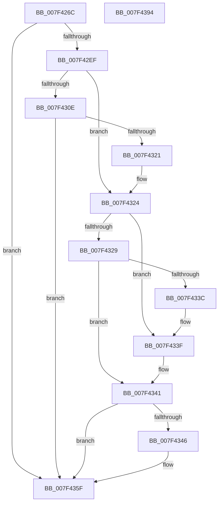

# CmpPromoteSingleKeyFromParentKcbAndChildKeyNode

- RVA: `0x007F426C`–`0x007F4395` (길이 `297` bytes)
- VA: `0x00000001407F426C`
- 실행 섹션: `PAGE`
- PDB 이름 있음: `예`; PDB Function 태그: `아니요`
- unwind 정보 RVA: `0x000D73D4`
- 디코드: `86`개 명령, `297/297` bytes 표시
- 미해석 바이트: `0` (있으면 어셈블리에 `.byte`로 보존)

> 이 문서는 커널 이미지의 기계어와 PDB 기호를 분석해 생성했습니다. 4번과 5번은 함수 원형과 자료형을 바이너리 사용 방식에서 추정한 C 해석이며 원본 소스 복구 결과는 아닙니다.

## 1. Dependencies

- 직접 호출 지점: **11**; 고유 호출 대상: **10**
- 직접 호출자로 확인된 함수: **2**
- RIP 상대 이미지 참조: **1**

### Outgoing calls
- `0x007F42B3` → [memset](../../text/6C/memset_function_006C6C40.md) (function, `0x006C6C40`)
- `0x007F42C0` → [CmpInitializeKeyNodeStack](../94/CmpInitializeKeyNodeStack_function_00946804.md) (function, `0x00946804`)
- `0x007F42D1` → [CmpGetKcbAtLayerHeight](../94/CmpGetKcbAtLayerHeight_function_00949210.md) (function, `0x00949210`)
- `0x007F42E4` → [CmpStartKeyNodeStackFromKcbStack](../94/CmpStartKeyNodeStackFromKcbStack_function_00945254.md) (function, `0x00945254`)
- `0x007F42F8` → [CmpKeyNodeStackGetEntryAtLayerHeight](../94/CmpKeyNodeStackGetEntryAtLayerHeight_function_00946ABC.md) (function, `0x00946ABC`)
- `0x007F4303` → [CmpKeyNodeStackGetEntryAtLayerHeight](../94/CmpKeyNodeStackGetEntryAtLayerHeight_function_00946ABC.md) (function, `0x00946ABC`)
- `0x007F4316` → [CmpPartialPromoteSingleKeyFromKeyNodeStacks](../94/CmpPartialPromoteSingleKeyFromKeyNodeStacks_function_00945808.md) (function, `0x00945808`)
- `0x007F4331` → [CmpFullPromoteSingleKeyFromKeyNodeStacks](../8B/CmpFullPromoteSingleKeyFromKeyNodeStacks_function_008B1A40.md) (function, `0x008B1A40`)
- `0x007F435A` → [CmpRebuildKcbCacheFromNode](../84/CmpRebuildKcbCacheFromNode_function_0084C5A8.md) (function, `0x0084C5A8`)
- `0x007F4364` → [CmpCleanupKeyNodeStack](../94/CmpCleanupKeyNodeStack_function_00946A5C.md) (function, `0x00946A5C`)
- `0x007F4373` → [_security_check_cookie](../../text/6A/_security_check_cookie_function_006AC640.md) (function, `0x006AC640`)

### Direct callers
- [CmpPartialPromoteSubkeys](CmpPartialPromoteSubkeys_function_007F4070.md) at `0x007F41FE`
- [CmpPromoteSubtree](../94/CmpPromoteSubtree_function_00944D60.md) at `0x00944F08`

### Static image references
- `0x007F4285` → RVA `0x00E0A740` (`.data`; read)

## 2. Other-region calls and transfers

- 다른 실행 섹션으로 향하는 call: **2**
  - `0x007F42B3` → [memset](../../text/6C/memset_function_006C6C40.md) (`PAGE` → `.text`)
  - `0x007F4373` → [_security_check_cookie](../../text/6A/_security_check_cookie_function_006AC640.md) (`PAGE` → `.text`)
- 별도 외부 분기/꼬리 이동을 확인하지 못했습니다.

## 3. Assembly (complete function range)

```asm
007F426C  48 89 5C 24 18                  mov qword ptr [rsp + 0x18], rbx
007F4271  48 89 6C 24 20                  mov qword ptr [rsp + 0x20], rbp
007F4276  56                              push rsi
007F4277  57                              push rdi
007F4278  41 54                           push r12
007F427A  41 56                           push r14
007F427C  41 57                           push r15
007F427E  48 81 EC 80 00 00 00            sub rsp, 0x80
007F4285  48 8B 05 B4 64 61 00            mov rax, qword ptr [rip + 0x6164b4]
007F428C  48 33 C4                        xor rax, rsp
007F428F  48 89 44 24 70                  mov qword ptr [rsp + 0x70], rax
007F4294  33 C0                           xor eax, eax
007F4296  45 8A E0                        mov r12b, r8b
007F4299  48 8B EA                        mov rbp, rdx
007F429C  89 44 24 22                     mov dword ptr [rsp + 0x22], eax
007F42A0  48 8B D9                        mov rbx, rcx
007F42A3  66 89 44 24 26                  mov word ptr [rsp + 0x26], ax
007F42A8  33 D2                           xor edx, edx
007F42AA  48 8D 4C 24 20                  lea rcx, [rsp + 0x20]
007F42AF  44 8D 40 4A                     lea r8d, [rax + 0x4a]
007F42B3  E8 88 29 ED FF                  call 0x1406c6c40
007F42B8  48 8D 4C 24 20                  lea rcx, [rsp + 0x20]
007F42BD  40 32 FF                        xor dil, dil
007F42C0  E8 3F 25 15 00                  call 0x140946804
007F42C5  44 0F B7 73 02                  movzx r14d, word ptr [rbx + 2]
007F42CA  48 8B CB                        mov rcx, rbx
007F42CD  41 0F B7 D6                     movzx edx, r14w
007F42D1  E8 3A 4F 15 00                  call 0x140949210
007F42D6  48 8D 4C 24 20                  lea rcx, [rsp + 0x20]
007F42DB  45 33 C0                        xor r8d, r8d
007F42DE  48 8B D3                        mov rdx, rbx
007F42E1  48 8B F0                        mov rsi, rax
007F42E4  E8 6B 0F 15 00                  call 0x140945254
007F42E9  8B D8                           mov ebx, eax
007F42EB  85 C0                           test eax, eax
007F42ED  78 70                           js 0x1407f435f
007F42EF  41 0F B7 D6                     movzx edx, r14w
007F42F3  48 8D 4C 24 20                  lea rcx, [rsp + 0x20]
007F42F8  E8 BF 27 15 00                  call 0x140946abc
007F42FD  48 8B CD                        mov rcx, rbp
007F4300  4C 8B F8                        mov r15, rax
007F4303  E8 B4 27 15 00                  call 0x140946abc
007F4308  83 78 08 FF                     cmp dword ptr [rax + 8], -1
007F430C  75 16                           jne 0x1407f4324
007F430E  48 8B D5                        mov rdx, rbp
007F4311  48 8D 4C 24 20                  lea rcx, [rsp + 0x20]
007F4316  E8 ED 14 15 00                  call 0x140945808
007F431B  8B D8                           mov ebx, eax
007F431D  85 C0                           test eax, eax
007F431F  78 3E                           js 0x1407f435f
007F4321  40 B7 01                        mov dil, 1
007F4324  45 84 E4                        test r12b, r12b
007F4327  74 16                           je 0x1407f433f
007F4329  48 8B D5                        mov rdx, rbp
007F432C  48 8D 4C 24 20                  lea rcx, [rsp + 0x20]
007F4331  E8 0A D7 0B 00                  call 0x1408b1a40
007F4336  8B D8                           mov ebx, eax
007F4338  85 C0                           test eax, eax
007F433A  78 05                           js 0x1407f4341
007F433C  40 B7 01                        mov dil, 1
007F433F  33 DB                           xor ebx, ebx
007F4341  40 84 FF                        test dil, dil
007F4344  74 19                           je 0x1407f435f
007F4346  48 FF 86 30 01 00 00            inc qword ptr [rsi + 0x130]
007F434D  45 33 C9                        xor r9d, r9d
007F4350  49 8B 57 10                     mov rdx, qword ptr [r15 + 0x10]
007F4354  45 33 C0                        xor r8d, r8d
007F4357  48 8B CE                        mov rcx, rsi
007F435A  E8 49 82 05 00                  call 0x14084c5a8
007F435F  48 8D 4C 24 20                  lea rcx, [rsp + 0x20]
007F4364  E8 F3 26 15 00                  call 0x140946a5c
007F4369  8B C3                           mov eax, ebx
007F436B  48 8B 4C 24 70                  mov rcx, qword ptr [rsp + 0x70]
007F4370  48 33 CC                        xor rcx, rsp
007F4373  E8 C8 82 EB FF                  call 0x1406ac640
007F4378  4C 8D 9C 24 80 00 00 00         lea r11, [rsp + 0x80]
007F4380  49 8B 5B 40                     mov rbx, qword ptr [r11 + 0x40]
007F4384  49 8B 6B 48                     mov rbp, qword ptr [r11 + 0x48]
007F4388  49 8B E3                        mov rsp, r11
007F438B  41 5F                           pop r15
007F438D  41 5E                           pop r14
007F438F  41 5C                           pop r12
007F4391  5F                              pop rdi
007F4392  5E                              pop rsi
007F4393  C3                              ret
007F4394  CC                              int3
```

## 4. C-style interpretation (structured pseudocode)

```c
__int64 __fastcall CmpPromoteSingleKeyFromParentKcbAndChildKeyNode(__int64 a1, __int64 a2, unsigned __int8 a3, int a4)
{
    __int64 result;
    __int64 v_rbx;
    __int64 v_rdi;
    __int64 v_rsp;
    unsigned __int64 v_stack_m28;
    unsigned __int64 v_stack_m38;
    unsigned __int16 v_stack_m82;
    unsigned int v_stack_m86;
    unsigned __int64 v_stack_m88;
    unsigned __int64 v_stack_p18;
    unsigned __int64 v_stack_p20;

    v_stack_p18 = v_rbx;
    v_stack_p20 = v_rbp;
    v_rsp = (v_rsp) - (128);
    result = (*(unsigned __int64 *)(v_rip + 6382772)) ^ (v_rsp);
    v_stack_m38 = result;
    result = 0;
    v_stack_m86 = 0;
    v_stack_m82 = 0;
    a2 = 0;
    result = memset(v_stack_m88, a2, result + 74, a4);
    v_rdi = 0;
    result = CmpInitializeKeyNodeStack(v_stack_m88, a2, result + 74, a4);
    result = CmpGetKcbAtLayerHeight(a1, (unsigned __int16)(*(unsigned __int16 *)(a1 + 2)), result + 74, a4);
    a3 = 0;
    result = CmpStartKeyNodeStackFromKcbStack(v_stack_m88, a1, a3, a4);
    if (sign_flag) goto loc_007F435F;
    result = CmpKeyNodeStackGetEntryAtLayerHeight(v_stack_m88, (unsigned __int16)(*(unsigned __int16 *)(a1 + 2)), a3, a4);
    result = CmpKeyNodeStackGetEntryAtLayerHeight(0, (unsigned __int16)(*(unsigned __int16 *)(a1 + 2)), a3, a4);
    if ((*(unsigned int *)(result + 8)) != -1) goto loc_007F4324;
    result = CmpPartialPromoteSingleKeyFromKeyNodeStacks(v_stack_m88, 0, a3, a4);
    if (sign_flag) goto loc_007F435F;
loc_007F4324:
    if (0 == 0) goto loc_007F433F;
    result = CmpFullPromoteSingleKeyFromKeyNodeStacks(v_stack_m88, 0, a3, a4);
    if (sign_flag) goto loc_007F4341;
loc_007F433F:
    v_rbx = 0;
loc_007F4341:
    if (1 != 0) {
        a4 = 0;
        a2 = *(unsigned __int64 *)(result + 16);
        a3 = 0;
        a1 = result;
        result = CmpRebuildKcbCacheFromNode(a1, a2, a3, a4);
    }
    result = CmpCleanupKeyNodeStack(v_stack_m88, a2, a3, a4);
    a1 = (v_stack_m38) ^ (v_rsp);
    result = _security_check_cookie(a1, a2, a3, a4);
    return result;
}
```

## 5. (Beta) C Style

```c
int64_t CmpPromoteSingleKeyFromParentKcbAndChildKeyNode(void *Arg1, int64_t Arg2, uint8_t Arg3, int32_t Arg4)
{
    uint8_t *arg1 = (uint8_t *)Arg1;

    int64_t result;
    int64_t local_rbx;
    int64_t local_rdi;
    int64_t local_rsp;
    uint64_t v_stack_m28;
    uint64_t v_stack_m38;
    uint16_t v_stack_m82;
    uint32_t v_stack_m86;
    uint64_t v_stack_m88;
    uint64_t v_stack_p18;
    uint64_t v_stack_p20;

    v_stack_p18 = local_rbx;
    v_stack_p20 = local_rbp;
    local_rsp = (local_rsp) - (128);
    result = (*(uint64_t *)(v_rip + 0x6164B4)) ^ (local_rsp);
    v_stack_m38 = result;
    result = 0;
    v_stack_m86 = 0;
    v_stack_m82 = 0;
    Arg2 = 0;
    result = memset(v_stack_m88, Arg2, result + 74, Arg4);
    local_rdi = 0;
    result = CmpInitializeKeyNodeStack(v_stack_m88, Arg2, result + 74, Arg4);
    result = CmpGetKcbAtLayerHeight(Arg1, (uint16_t)(*(uint16_t *)(arg1 + 0x2)), result + 74, Arg4);
    Arg3 = 0;
    result = CmpStartKeyNodeStackFromKcbStack(v_stack_m88, Arg1, Arg3, Arg4);
    if (sign_flag) goto loc_007F435F;
    result = CmpKeyNodeStackGetEntryAtLayerHeight(v_stack_m88, (uint16_t)(*(uint16_t *)(arg1 + 0x2)), Arg3, Arg4);
    result = CmpKeyNodeStackGetEntryAtLayerHeight(0, (uint16_t)(*(uint16_t *)(arg1 + 0x2)), Arg3, Arg4);
    if ((*(uint32_t *)(result + 0x8)) != -1) goto loc_007F4324;
    result = CmpPartialPromoteSingleKeyFromKeyNodeStacks(v_stack_m88, 0, Arg3, Arg4);
    if (sign_flag) goto loc_007F435F;
loc_007F4324:
    if (0 == 0) goto loc_007F433F;
    result = CmpFullPromoteSingleKeyFromKeyNodeStacks(v_stack_m88, 0, Arg3, Arg4);
    if (sign_flag) goto loc_007F4341;
loc_007F433F:
    local_rbx = 0;
loc_007F4341:
    if (1 != 0) {
        Arg4 = 0;
        Arg2 = *(uint64_t *)(result + 0x10);
        Arg3 = 0;
        Arg1 = result;
        result = CmpRebuildKcbCacheFromNode(Arg1, Arg2, Arg3, Arg4);
    }
    result = CmpCleanupKeyNodeStack(v_stack_m88, Arg2, Arg3, Arg4);
    Arg1 = (v_stack_m38) ^ (local_rsp);
    result = _security_check_cookie(Arg1, Arg2, Arg3, Arg4);
    return result;
}
```

### 관측된 메모리 오프셋

구조체 형식이 확인되지 않은 접근은 인자 기준의 오프셋으로만 기록했습니다.

| 기준 인자 | 오프셋 표현 | 폭 (bit) | 접근 |
|---|---:|---:|---|
| `Arg1` | `+ 0x2` | `16` | `R` |

## 6. Execution-region graph

[열기: 2D/3D 그래프와 함수 탐색 컨트롤 패널](../../../control-panel.html?section=page&rva=0x007F426C&view=graph)

- 2D 그래프는 위에서 아래로 흐르고, 3D 그래프는 빈 공간을 드래그해 회전합니다. Shift+드래그는 이동, 휠은 확대·축소, 함수 노드 선택은 대상 보고서 이동입니다.

### Static fallback


