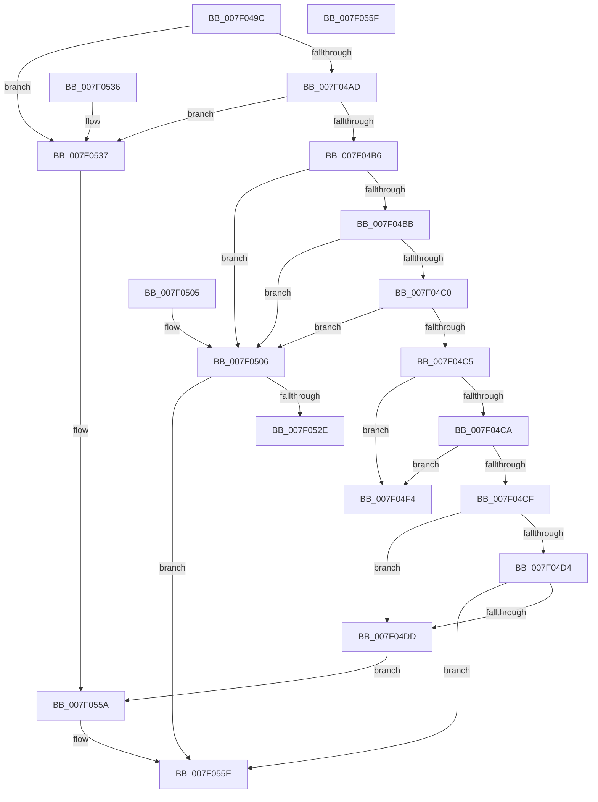

# CmpRealignLogBuffers

- RVA: `0x007F049C`–`0x007F0560` (길이 `196` bytes)
- VA: `0x00000001407F049C`
- 실행 섹션: `PAGE`
- PDB 이름 있음: `예`; PDB Function 태그: `아니요`
- unwind 정보 RVA: `0x000DB714`
- 디코드: `59`개 명령, `196/196` bytes 표시
- 미해석 바이트: `0` (있으면 어셈블리에 `.byte`로 보존)

> 이 문서는 커널 이미지의 기계어와 PDB 기호를 분석해 생성했습니다. 4번과 5번은 함수 원형과 자료형을 바이너리 사용 방식에서 추정한 C 해석이며 원본 소스 복구 결과는 아닙니다.

## 1. Dependencies

- 직접 호출 지점: **0**; 고유 호출 대상: **0**
- 직접 호출자로 확인된 함수: **1**
- RIP 상대 이미지 참조: **0**

### Outgoing calls
- 직접 디코드된 call 명령이 없습니다.

### Direct callers
- [CmpRmReDoPhase](CmpRmReDoPhase_function_007F0794.md) at `0x007F08C6`

### Static image references
- 디코드된 RIP-relative 메모리 참조가 없습니다.

## 2. Other-region calls and transfers

- 다른 실행 섹션으로 향하는 call: **0**
- 별도 외부 분기/꼬리 이동을 확인하지 못했습니다.

## 3. Assembly (complete function range)

```asm
007F049C  8B 51 0C                        mov edx, dword ptr [rcx + 0xc]
007F049F  4C 8B C1                        mov r8, rcx
007F04A2  8B C2                           mov eax, edx
007F04A4  83 E8 01                        sub eax, 1
007F04A7  0F 84 8A 00 00 00               je 0x1407f0537
007F04AD  83 E8 01                        sub eax, 1
007F04B0  0F 84 81 00 00 00               je 0x1407f0537
007F04B6  83 E8 01                        sub eax, 1
007F04B9  74 4B                           je 0x1407f0506
007F04BB  83 E8 01                        sub eax, 1
007F04BE  74 46                           je 0x1407f0506
007F04C0  83 E8 01                        sub eax, 1
007F04C3  74 41                           je 0x1407f0506
007F04C5  83 E8 01                        sub eax, 1
007F04C8  74 2A                           je 0x1407f04f4
007F04CA  83 E8 01                        sub eax, 1
007F04CD  74 25                           je 0x1407f04f4
007F04CF  83 E8 01                        sub eax, 1
007F04D2  74 09                           je 0x1407f04dd
007F04D4  83 F8 02                        cmp eax, 2
007F04D7  0F 85 81 00 00 00               jne 0x1407f055e
007F04DD  41 0F B7 40 20                  movzx eax, word ptr [r8 + 0x20]
007F04E2  48 83 C1 40                     add rcx, 0x40
007F04E6  66 41 89 40 22                  mov word ptr [r8 + 0x22], ax
007F04EB  48 03 C1                        add rax, rcx
007F04EE  49 89 40 38                     mov qword ptr [r8 + 0x38], rax
007F04F2  EB 66                           jmp 0x1407f055a
007F04F4  48 8D 41 38                     lea rax, [rcx + 0x38]
007F04F8  48 89 41 28                     mov qword ptr [rcx + 0x28], rax
007F04FC  0F B7 41 20                     movzx eax, word ptr [rcx + 0x20]
007F0500  66 89 41 22                     mov word ptr [rcx + 0x22], ax
007F0504  C3                              ret
007F0505  CC                              int3
007F0506  41 0F B7 40 20                  movzx eax, word ptr [r8 + 0x20]
007F050B  48 83 C1 50                     add rcx, 0x50
007F050F  49 89 48 28                     mov qword ptr [r8 + 0x28], rcx
007F0513  48 03 C8                        add rcx, rax
007F0516  66 41 89 40 22                  mov word ptr [r8 + 0x22], ax
007F051B  41 0F B7 40 30                  movzx eax, word ptr [r8 + 0x30]
007F0520  66 41 89 40 32                  mov word ptr [r8 + 0x32], ax
007F0525  49 89 48 38                     mov qword ptr [r8 + 0x38], rcx
007F0529  83 FA 05                        cmp edx, 5
007F052C  74 30                           je 0x1407f055e
007F052E  48 03 C1                        add rax, rcx
007F0531  49 89 40 48                     mov qword ptr [r8 + 0x48], rax
007F0535  C3                              ret
007F0536  CC                              int3
007F0537  41 0F B7 50 20                  movzx edx, word ptr [r8 + 0x20]
007F053C  48 83 C1 40                     add rcx, 0x40
007F0540  66 41 89 50 22                  mov word ptr [r8 + 0x22], dx
007F0545  48 8D 04 11                     lea rax, [rcx + rdx]
007F0549  49 89 40 38                     mov qword ptr [r8 + 0x38], rax
007F054D  41 8B 40 04                     mov eax, dword ptr [r8 + 4]
007F0551  2B C2                           sub eax, edx
007F0553  83 E8 40                        sub eax, 0x40
007F0556  41 89 40 34                     mov dword ptr [r8 + 0x34], eax
007F055A  49 89 48 28                     mov qword ptr [r8 + 0x28], rcx
007F055E  C3                              ret
007F055F  CC                              int3
```

## 4. C-style interpretation (structured pseudocode)

```c
__int64 __fastcall CmpRealignLogBuffers(__int64 a1)
{
    __int64 result;

    result = (unsigned int)(((unsigned int)((unsigned int)((unsigned int)(*(unsigned int *)(a1 + 12))))) - (1));
    if (condition_is_equal) goto loc_007F0537;
    result = (unsigned int)((result) - (1));
    if (condition_is_equal) goto loc_007F0537;
    result = (unsigned int)((result) - (1));
    if (condition_is_equal) goto loc_007F0506;
    result = (unsigned int)((result) - (1));
    if (condition_is_equal) goto loc_007F0506;
    result = (unsigned int)((result) - (1));
    if (condition_is_equal) goto loc_007F0506;
    result = (unsigned int)((result) - (1));
    if (condition_is_equal) goto loc_007F04F4;
    result = (unsigned int)((result) - (1));
    if (condition_is_equal) goto loc_007F04F4;
    result = (unsigned int)((result) - (1));
    if (condition_is_equal) goto loc_007F04DD;
    if (((unsigned int)(result)) != 2) goto loc_007F055E;
loc_007F04DD:
    a1 = (a1) + (64);
    *(unsigned __int16 *)(a1 + 34) = (unsigned __int16)(*(unsigned __int16 *)(a1 + 32));
    result = (*(unsigned __int16 *)(a1 + 32)) + (a1);
    *(unsigned __int64 *)(a1 + 56) = result;
    goto loc_007F055A;
loc_007F04F4:
    *(unsigned __int64 *)(a1 + 40) = a1 + 56;
    *(unsigned __int16 *)(a1 + 34) = (unsigned __int16)(*(unsigned __int16 *)(a1 + 32));
    return *(unsigned __int16 *)(a1 + 32);
loc_007F0506:
    a1 = (a1) + (80);
    *(unsigned __int64 *)(a1 + 40) = a1;
    a1 = (a1) + (*(unsigned __int16 *)(a1 + 32));
    *(unsigned __int16 *)(a1 + 34) = (unsigned __int16)(*(unsigned __int16 *)(a1 + 32));
    *(unsigned __int16 *)(a1 + 50) = (unsigned __int16)(*(unsigned __int16 *)(a1 + 48));
    *(unsigned __int64 *)(a1 + 56) = a1;
    if (((unsigned int)((unsigned int)(*(unsigned int *)(a1 + 12)))) == 5) goto loc_007F055E;
    result = (*(unsigned __int16 *)(a1 + 48)) + (a1);
    *(unsigned __int64 *)(a1 + 72) = result;
    return result;
loc_007F0537:
    a1 = (a1) + (64);
    *(unsigned __int16 *)(a1 + 34) = (unsigned __int16)(*(unsigned __int16 *)(a1 + 32));
    *(unsigned __int64 *)(a1 + 56) = a1 + *(unsigned __int16 *)(a1 + 32) * 1;
    result = (unsigned int)(((unsigned int)(*(unsigned int *)(a1 + 4))) - ((unsigned int)(*(unsigned __int16 *)(a1 + 32))));
    result = (unsigned int)((result) - (64));
    *(unsigned int *)(a1 + 52) = (unsigned int)(result);
loc_007F055A:
    *(unsigned __int64 *)(a1 + 40) = a1;
loc_007F055E:
    return result;
}
```

## 5. (Beta) C Style

```c
int64_t CmpRealignLogBuffers(void *Arg1)
{
    uint8_t *arg1 = (uint8_t *)Arg1;

    int64_t result;

    result = (uint32_t)(((uint32_t)((uint32_t)((uint32_t)(*(uint32_t *)(arg1 + 0xC))))) - (1));
    if (condition_is_equal) goto loc_007F0537;
    result = (uint32_t)((result) - (1));
    if (condition_is_equal) goto loc_007F0537;
    result = (uint32_t)((result) - (1));
    if (condition_is_equal) goto loc_007F0506;
    result = (uint32_t)((result) - (1));
    if (condition_is_equal) goto loc_007F0506;
    result = (uint32_t)((result) - (1));
    if (condition_is_equal) goto loc_007F0506;
    result = (uint32_t)((result) - (1));
    if (condition_is_equal) goto loc_007F04F4;
    result = (uint32_t)((result) - (1));
    if (condition_is_equal) goto loc_007F04F4;
    result = (uint32_t)((result) - (1));
    if (condition_is_equal) goto loc_007F04DD;
    if (((uint32_t)(result)) != 2) goto loc_007F055E;
loc_007F04DD:
    Arg1 = (Arg1) + (64);
    *(uint16_t *)(arg1 + 0x22) = (uint16_t)(*(uint16_t *)(arg1 + 0x20));
    result = (*(uint16_t *)(arg1 + 0x20)) + (Arg1);
    *(uint64_t *)(arg1 + 0x38) = result;
    goto loc_007F055A;
loc_007F04F4:
    *(void **)(arg1 + 0x28) = Arg1 + 56;
    *(uint16_t *)(arg1 + 0x22) = (uint16_t)(*(uint16_t *)(arg1 + 0x20));
    return *(uint16_t *)(arg1 + 0x20);
loc_007F0506:
    Arg1 = (Arg1) + (80);
    *(void **)(arg1 + 0x28) = Arg1;
    Arg1 = (Arg1) + (*(uint16_t *)(arg1 + 0x20));
    *(uint16_t *)(arg1 + 0x22) = (uint16_t)(*(uint16_t *)(arg1 + 0x20));
    *(uint16_t *)(arg1 + 0x32) = (uint16_t)(*(uint16_t *)(arg1 + 0x30));
    *(void **)(arg1 + 0x38) = Arg1;
    if (((uint32_t)((uint32_t)(*(uint32_t *)(arg1 + 0xC)))) == 5) goto loc_007F055E;
    result = (*(uint16_t *)(arg1 + 0x30)) + (Arg1);
    *(uint64_t *)(arg1 + 0x48) = result;
    return result;
loc_007F0537:
    Arg1 = (Arg1) + (64);
    *(uint16_t *)(arg1 + 0x22) = (uint16_t)(*(uint16_t *)(arg1 + 0x20));
    *(void **)(arg1 + 0x38) = Arg1 + *(uint16_t *)(arg1 + 0x20) * 1;
    result = (uint32_t)(((uint32_t)(*(uint32_t *)(arg1 + 0x4))) - ((uint32_t)(*(uint16_t *)(arg1 + 0x20))));
    result = (uint32_t)((result) - (64));
    *(uint32_t *)(arg1 + 0x34) = (uint32_t)(result);
loc_007F055A:
    *(void **)(arg1 + 0x28) = Arg1;
loc_007F055E:
    return result;
}
```

### 관측된 메모리 오프셋

구조체 형식이 확인되지 않은 접근은 인자 기준의 오프셋으로만 기록했습니다.

| 기준 인자 | 오프셋 표현 | 폭 (bit) | 접근 |
|---|---:|---:|---|
| `Arg1` | `+ 0x0 + rdx*1` | `64` | `R` |
| `Arg1` | `+ 0x4` | `32` | `R` |
| `Arg1` | `+ 0xC` | `32` | `R` |
| `Arg1` | `+ 0x20` | `16` | `R` |
| `Arg1` | `+ 0x22` | `16` | `W` |
| `Arg1` | `+ 0x28` | `64` | `W` |
| `Arg1` | `+ 0x30` | `16` | `R` |
| `Arg1` | `+ 0x32` | `16` | `W` |
| `Arg1` | `+ 0x34` | `32` | `W` |
| `Arg1` | `+ 0x38` | `64` | `R` |
| `Arg1` | `+ 0x38` | `64` | `W` |
| `Arg1` | `+ 0x48` | `64` | `W` |

## 6. Execution-region graph

[열기: 2D/3D 그래프와 함수 탐색 컨트롤 패널](../../../control-panel.html?section=page&rva=0x007F049C&view=graph)

- 2D 그래프는 위에서 아래로 흐르고, 3D 그래프는 빈 공간을 드래그해 회전합니다. Shift+드래그는 이동, 휠은 확대·축소, 함수 노드 선택은 대상 보고서 이동입니다.

### Static fallback


