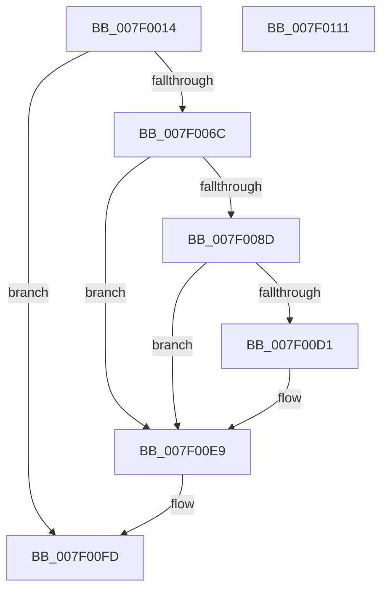

# CmpRecoverEnlistment

- RVA: `0x007F0014`–`0x007F0112` (길이 `254` bytes)
- VA: `0x00000001407F0014`
- 실행 섹션: `PAGE`
- PDB 이름 있음: `예`; PDB Function 태그: `아니요`
- unwind 정보 RVA: `0x000D70FC`
- 디코드: `69`개 명령, `254/254` bytes 표시
- 미해석 바이트: `0` (있으면 어셈블리에 `.byte`로 보존)

> 이 문서는 커널 이미지의 기계어와 PDB 기호를 분석해 생성했습니다. 4번과 5번은 함수 원형과 자료형을 바이너리 사용 방식에서 추정한 C 해석이며 원본 소스 복구 결과는 아닙니다.

## 1. Dependencies

- 직접 호출 지점: **7**; 고유 호출 대상: **6**
- 직접 호출자로 확인된 함수: **1**
- RIP 상대 이미지 참조: **0**

### Outgoing calls
- `0x007F005F` → [RtlStringFromGUIDEx](../91/RtlStringFromGUIDEx_function_00915450.md) (function, `0x00915450`)
- `0x007F0082` → [CmpTransSearchAddTransFromRm](../A6/CmpTransSearchAddTransFromRm_function_00A6023C.md) (function, `0x00A6023C`)
- `0x007F00C6` → [ZwOpenEnlistment](../../text/6A/ZwOpenEnlistment_function_006AF5D0.md) (function, `0x006AF5D0`)
- `0x007F00D9` → [ZwRecoverEnlistment](../../text/6A/ZwRecoverEnlistment_function_006AFFF0.md) (function, `0x006AFFF0`)
- `0x007F00E4` → [ZwClose](../../text/6A/ZwClose_function_006AD2B0.md) (function, `0x006AD2B0`)
- `0x007F00ED` → [RtlFreeAnsiString](../9C/RtlFreeAnsiString_function_009C0800.md) (function, `0x009C0800`)
- `0x007F00F6` → [RtlFreeAnsiString](../9C/RtlFreeAnsiString_function_009C0800.md) (function, `0x009C0800`)

### Direct callers
- [CmKtmNotification](../9B/CmKtmNotification_function_009B1950.md) at `0x009B1CFD`

### Static image references
- 디코드된 RIP-relative 메모리 참조가 없습니다.

## 2. Other-region calls and transfers

- 다른 실행 섹션으로 향하는 call: **3**
  - `0x007F00C6` → [ZwOpenEnlistment](../../text/6A/ZwOpenEnlistment_function_006AF5D0.md) (`PAGE` → `.text`)
  - `0x007F00D9` → [ZwRecoverEnlistment](../../text/6A/ZwRecoverEnlistment_function_006AFFF0.md) (`PAGE` → `.text`)
  - `0x007F00E4` → [ZwClose](../../text/6A/ZwClose_function_006AD2B0.md) (`PAGE` → `.text`)
- 별도 외부 분기/꼬리 이동을 확인하지 못했습니다.

## 3. Assembly (complete function range)

```asm
007F0014  48 89 74 24 08                  mov qword ptr [rsp + 8], rsi
007F0019  55                              push rbp
007F001A  57                              push rdi
007F001B  41 56                           push r14
007F001D  48 8B EC                        mov rbp, rsp
007F0020  48 81 EC 80 00 00 00            sub rsp, 0x80
007F0027  48 83 65 38 00                  and qword ptr [rbp + 0x38], 0
007F002C  48 8D 55 B0                     lea rdx, [rbp - 0x50]
007F0030  0F 57 C0                        xorps xmm0, xmm0
007F0033  33 C0                           xor eax, eax
007F0035  48 21 45 30                     and qword ptr [rbp + 0x30], rax
007F0039  49 8B F0                        mov rsi, r8
007F003C  4C 8B F1                        mov r14, rcx
007F003F  48 89 45 F0                     mov qword ptr [rbp - 0x10], rax
007F0043  0F 57 C9                        xorps xmm1, xmm1
007F0046  89 45 F8                        mov dword ptr [rbp - 8], eax
007F0049  48 8B CE                        mov rcx, rsi
007F004C  41 B0 01                        mov r8b, 1
007F004F  0F 11 45 B0                     movups xmmword ptr [rbp - 0x50], xmm0
007F0053  0F 11 4D C0                     movups xmmword ptr [rbp - 0x40], xmm1
007F0057  0F 11 45 D0                     movups xmmword ptr [rbp - 0x30], xmm0
007F005B  0F 11 45 E0                     movups xmmword ptr [rbp - 0x20], xmm0
007F005F  E8 EC 53 12 00                  call 0x140915450
007F0064  85 C0                           test eax, eax
007F0066  0F 88 91 00 00 00               js 0x1407f00fd
007F006C  33 D2                           xor edx, edx
007F006E  48 8D 45 38                     lea rax, [rbp + 0x38]
007F0072  4C 8D 46 10                     lea r8, [rsi + 0x10]
007F0076  48 89 44 24 20                  mov qword ptr [rsp + 0x20], rax
007F007B  49 8B CE                        mov rcx, r14
007F007E  44 8D 4A 01                     lea r9d, [rdx + 1]
007F0082  E8 B5 01 27 00                  call 0x140a6023c
007F0087  8B F8                           mov edi, eax
007F0089  85 C0                           test eax, eax
007F008B  78 5C                           js 0x1407f00e9
007F008D  4D 8B 46 30                     mov r8, qword ptr [r14 + 0x30]
007F0091  48 8D 45 D0                     lea rax, [rbp - 0x30]
007F0095  48 83 65 D8 00                  and qword ptr [rbp - 0x28], 0
007F009A  48 8D 4D 30                     lea rcx, [rbp + 0x30]
007F009E  48 83 65 E0 00                  and qword ptr [rbp - 0x20], 0
007F00A3  0F 57 C0                        xorps xmm0, xmm0
007F00A6  4C 8B CE                        mov r9, rsi
007F00A9  48 89 44 24 20                  mov qword ptr [rsp + 0x20], rax
007F00AE  BA 1F 00 0F 00                  mov edx, 0xf001f
007F00B3  C7 45 D0 30 00 00 00            mov dword ptr [rbp - 0x30], 0x30
007F00BA  F3 0F 7F 45 F0                  movdqu xmmword ptr [rbp - 0x10], xmm0
007F00BF  C7 45 E8 40 02 00 00            mov dword ptr [rbp - 0x18], 0x240
007F00C6  E8 05 F5 EB FF                  call 0x1406af5d0
007F00CB  8B F8                           mov edi, eax
007F00CD  85 C0                           test eax, eax
007F00CF  78 18                           js 0x1407f00e9
007F00D1  48 8B 55 38                     mov rdx, qword ptr [rbp + 0x38]
007F00D5  48 8B 4D 30                     mov rcx, qword ptr [rbp + 0x30]
007F00D9  E8 12 FF EB FF                  call 0x1406afff0
007F00DE  48 8B 4D 30                     mov rcx, qword ptr [rbp + 0x30]
007F00E2  8B F8                           mov edi, eax
007F00E4  E8 C7 D1 EB FF                  call 0x1406ad2b0
007F00E9  48 8D 4D C0                     lea rcx, [rbp - 0x40]
007F00ED  E8 0E 07 1D 00                  call 0x1409c0800
007F00F2  48 8D 4D B0                     lea rcx, [rbp - 0x50]
007F00F6  E8 05 07 1D 00                  call 0x1409c0800
007F00FB  8B C7                           mov eax, edi
007F00FD  48 8B B4 24 A0 00 00 00         mov rsi, qword ptr [rsp + 0xa0]
007F0105  48 81 C4 80 00 00 00            add rsp, 0x80
007F010C  41 5E                           pop r14
007F010E  5F                              pop rdi
007F010F  5D                              pop rbp
007F0110  C3                              ret
007F0111  CC                              int3
```

## 4. C-style interpretation (structured pseudocode)

```c
__int64 __fastcall CmpRecoverEnlistment(__int64 a1, __int64 a2, __int64 a3)
{
    __int64 result;
    __int64 v_rdi;
    __int64 v_rsp;
    unsigned int v_stack_m20;
    unsigned __int64 v_stack_m28;
    unsigned int v_stack_m30;
    unsigned __int64 v_stack_m38;
    unsigned __int64 v_stack_m40;
    unsigned __int64 v_stack_m48;
    unsigned __int64 v_stack_m58;
    unsigned __int64 v_stack_m68;
    unsigned __int64 v_stack_m78;
    unsigned __int64 v_stack_p18;
    unsigned __int64 v_stack_p20;
    unsigned __int64 v_stack_p8;

    v_stack_p8 = v_rsi;
    v_rsp = (v_rsp) - (128);
    result = 0;
    v_stack_m28 = 0;
    v_stack_m20 = 0;
    v_stack_m68 = v_xmm0;
    v_stack_m58 = v_xmm1;
    v_stack_m48 = v_xmm0;
    v_stack_m38 = v_xmm0;
    result = RtlStringFromGUIDEx(a3, v_stack_m68, 1, a4);
    if (sign_flag) goto loc_007F00FD;
    a2 = 0;
    v_stack_m78 = v_stack_p20;
    result = CmpTransSearchAddTransFromRm(a1, a2, a3 + 16, a2 + 1);
    if (sign_flag) goto loc_007F00E9;
    v_stack_m78 = v_stack_m48;
    v_stack_m48 = 48;
    v_stack_m28 = v_xmm0;
    v_stack_m30 = 576;
    result = ZwOpenEnlistment(v_stack_p18, (unsigned int)(0xF001FULL), *(unsigned __int64 *)(a1 + 48), a3);
    v_rdi = (unsigned int)((unsigned int)(result));
    if (!(sign_flag)) {
        a2 = v_stack_p20;
        a1 = v_stack_p18;
        result = ZwRecoverEnlistment(a1, a2, *(unsigned __int64 *)(a1 + 48), a3);
        a1 = v_stack_p18;
        v_rdi = (unsigned int)(result);
        result = ZwClose(a1, a2, *(unsigned __int64 *)(a1 + 48), a3);
    }
    result = RtlFreeAnsiString(v_stack_m58, a2, *(unsigned __int64 *)(a1 + 48), a3);
    result = RtlFreeAnsiString(v_stack_m68, a2, *(unsigned __int64 *)(a1 + 48), a3);
loc_007F00FD:
    v_rsp = (v_rsp) + (128);
    return (unsigned int)((unsigned int)(v_rdi));
}
```

## 5. (Beta) C Style

```c
int64_t CmpRecoverEnlistment(void *Arg1, int64_t Arg2, void *Arg3)
{
    uint8_t *arg1 = (uint8_t *)Arg1;
    uint8_t *arg3 = (uint8_t *)Arg3;

    int64_t result;
    int64_t local_rdi;
    int64_t local_rsp;
    uint32_t v_stack_m20;
    uint64_t v_stack_m28;
    uint32_t v_stack_m30;
    uint64_t v_stack_m38;
    uint64_t v_stack_m40;
    uint64_t v_stack_m48;
    uint64_t v_stack_m58;
    uint64_t v_stack_m68;
    uint64_t v_stack_m78;
    uint64_t v_stack_p18;
    uint64_t v_stack_p20;
    uint64_t v_stack_p8;

    v_stack_p8 = local_rsi;
    local_rsp = (local_rsp) - (128);
    result = 0;
    v_stack_m28 = 0;
    v_stack_m20 = 0;
    v_stack_m68 = v_xmm0;
    v_stack_m58 = v_xmm1;
    v_stack_m48 = v_xmm0;
    v_stack_m38 = v_xmm0;
    result = RtlStringFromGUIDEx(Arg3, v_stack_m68, 1, a4);
    if (sign_flag) goto loc_007F00FD;
    Arg2 = 0;
    v_stack_m78 = v_stack_p20;
    result = CmpTransSearchAddTransFromRm(Arg1, Arg2, Arg3 + 16, Arg2 + 1);
    if (sign_flag) goto loc_007F00E9;
    v_stack_m78 = v_stack_m48;
    v_stack_m48 = 48;
    v_stack_m28 = v_xmm0;
    v_stack_m30 = 576;
    result = ZwOpenEnlistment(v_stack_p18, (uint32_t)(0xF001FULL), *(uint64_t *)(arg1 + 0x30), Arg3);
    local_rdi = (uint32_t)((uint32_t)(result));
    if (!(sign_flag)) {
        Arg2 = v_stack_p20;
        Arg1 = v_stack_p18;
        result = ZwRecoverEnlistment(Arg1, Arg2, *(uint64_t *)(arg1 + 0x30), Arg3);
        Arg1 = v_stack_p18;
        local_rdi = (uint32_t)(result);
        result = ZwClose(Arg1, Arg2, *(uint64_t *)(arg1 + 0x30), Arg3);
    }
    result = RtlFreeAnsiString(v_stack_m58, Arg2, *(uint64_t *)(arg1 + 0x30), Arg3);
    result = RtlFreeAnsiString(v_stack_m68, Arg2, *(uint64_t *)(arg1 + 0x30), Arg3);
loc_007F00FD:
    local_rsp = (local_rsp) + (128);
    return (uint32_t)((uint32_t)(local_rdi));
}
```

### 관측된 메모리 오프셋

구조체 형식이 확인되지 않은 접근은 인자 기준의 오프셋으로만 기록했습니다.

| 기준 인자 | 오프셋 표현 | 폭 (bit) | 접근 |
|---|---:|---:|---|
| `Arg1` | `+ 0x30` | `64` | `R` |
| `Arg3` | `+ 0x10` | `64` | `R` |

## 6. Execution-region graph

[열기: 2D/3D 그래프와 함수 탐색 컨트롤 패널](../../../control-panel.html?section=page&rva=0x007F0014&view=graph)

- 2D 그래프는 위에서 아래로 흐르고, 3D 그래프는 빈 공간을 드래그해 회전합니다. Shift+드래그는 이동, 휠은 확대·축소, 함수 노드 선택은 대상 보고서 이동입니다.

### Static fallback


