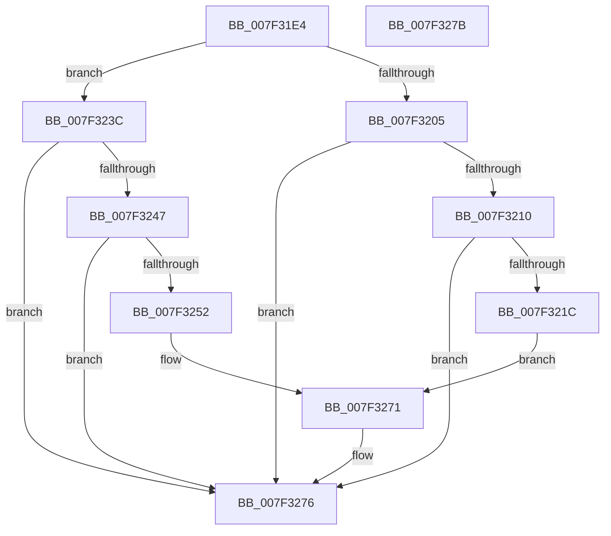

# CmpRemoveCellFromIndex

- RVA: `0x007F31E4`–`0x007F327C` (길이 `152` bytes)
- VA: `0x00000001407F31E4`
- 실행 섹션: `PAGE`
- PDB 이름 있음: `예`; PDB Function 태그: `아니요`
- unwind 정보 RVA: `0x0005C788`
- 디코드: `42`개 명령, `152/152` bytes 표시
- 미해석 바이트: `0` (있으면 어셈블리에 `.byte`로 보존)

> 이 문서는 커널 이미지의 기계어와 PDB 기호를 분석해 생성했습니다. 4번과 5번은 함수 원형과 자료형을 바이너리 사용 방식에서 추정한 C 해석이며 원본 소스 복구 결과는 아닙니다.

## 1. Dependencies

- 직접 호출 지점: **1**; 고유 호출 대상: **1**
- 직접 호출자로 확인된 함수: **1**
- RIP 상대 이미지 참조: **0**

### Outgoing calls
- `0x007F3271` → [memcpy](../../text/6C/memcpy_function_006C6840.md) (function, `0x006C6840`)

### Direct callers
- [CmpRemoveSubKeyCellNoCellRef](CmpRemoveSubKeyCellNoCellRef_function_007F3284.md) at `0x007F344C`
- [CmpRemoveSubKeyCellNoCellRef](CmpRemoveSubKeyCellNoCellRef_function_007F3284.md) at `0x007F3466`
- [CmpRemoveSubKeyCellNoCellRef](CmpRemoveSubKeyCellNoCellRef_function_007F3284.md) at `0x007F350F`

### Static image references
- 디코드된 RIP-relative 메모리 참조가 없습니다.

## 2. Other-region calls and transfers

- 다른 실행 섹션으로 향하는 call: **1**
  - `0x007F3271` → [memcpy](../../text/6C/memcpy_function_006C6840.md) (`PAGE` → `.text`)
- 별도 외부 분기/꼬리 이동을 확인하지 못했습니다.

## 3. Assembly (complete function range)

```asm
007F31E4  48 83 EC 28                     sub rsp, 0x28
007F31E8  4C 8B C9                        mov r9, rcx
007F31EB  44 0F B7 D2                     movzx r10d, dx
007F31EF  B9 6C 66 00 00                  mov ecx, 0x666c
007F31F4  41 0F B7 01                     movzx eax, word ptr [r9]
007F31F8  66 2B C1                        sub ax, cx
007F31FB  B9 FF FD 00 00                  mov ecx, 0xfdff
007F3200  66 85 C1                        test cx, ax
007F3203  74 37                           je 0x1407f323c
007F3205  45 0F B7 41 02                  movzx r8d, word ptr [r9 + 2]
007F320A  66 45 3B D0                     cmp r10w, r8w
007F320E  73 66                           jae 0x1407f3276
007F3210  66 41 83 E8 01                  sub r8w, 1
007F3215  66 45 89 41 02                  mov word ptr [r9 + 2], r8w
007F321A  74 5A                           je 0x1407f3276
007F321C  45 0F B7 C0                     movzx r8d, r8w
007F3220  41 8D 4A 01                     lea ecx, [r10 + 1]
007F3224  48 FF C1                        inc rcx
007F3227  4D 2B C2                        sub r8, r10
007F322A  49 C1 E0 02                     shl r8, 2
007F322E  49 8D 14 89                     lea rdx, [r9 + rcx*4]
007F3232  49 83 C1 04                     add r9, 4
007F3236  4B 8D 0C 91                     lea rcx, [r9 + r10*4]
007F323A  EB 35                           jmp 0x1407f3271
007F323C  41 0F B7 51 02                  movzx edx, word ptr [r9 + 2]
007F3241  66 44 3B D2                     cmp r10w, dx
007F3245  73 2F                           jae 0x1407f3276
007F3247  66 83 EA 01                     sub dx, 1
007F324B  66 41 89 51 02                  mov word ptr [r9 + 2], dx
007F3250  74 24                           je 0x1407f3276
007F3252  44 0F B7 C2                     movzx r8d, dx
007F3256  41 8D 42 01                     lea eax, [r10 + 1]
007F325A  4D 2B C2                        sub r8, r10
007F325D  49 8D 51 04                     lea rdx, [r9 + 4]
007F3261  49 8D 49 04                     lea rcx, [r9 + 4]
007F3265  49 C1 E0 03                     shl r8, 3
007F3269  48 8D 14 C2                     lea rdx, [rdx + rax*8]
007F326D  4A 8D 0C D1                     lea rcx, [rcx + r10*8]
007F3271  E8 CA 35 ED FF                  call 0x1406c6840
007F3276  48 83 C4 28                     add rsp, 0x28
007F327A  C3                              ret
007F327B  CC                              int3
```

## 4. C-style interpretation (structured pseudocode)

```c
__int64 __fastcall CmpRemoveCellFromIndex(__int64 a1, unsigned __int16 a2)
{
    __int64 result;
    __int64 v_rsp;

    v_rsp = (v_rsp) - (40);
    result = (unsigned __int16)((*(unsigned __int16 *)(a1)) - ((unsigned __int16)((unsigned int)(0x666CULL))));
    if ((((unsigned __int16)((unsigned int)(0xFDFFULL))) & ((unsigned __int16)(result))) == 0) goto loc_007F323C;
    if (a2 >= ((unsigned __int16)(*(unsigned __int16 *)(a1 + 2)))) goto loc_007F3276;
    a3 = (unsigned __int16)((*(unsigned __int16 *)(a1 + 2)) - (1));
    *(unsigned __int16 *)(a1 + 2) = (unsigned __int16)(a3);
    if (condition_is_equal) goto loc_007F3276;
    a1 = (a2 + 1) + 1;
    a3 = ((unsigned __int16)(a3)) - (a2);
    a3 = (a3) << (2);
    a4 = (a1) + (4);
    goto loc_007F3271;
loc_007F323C:
    if (a2 >= ((unsigned __int16)(*(unsigned __int16 *)(a4 + 2)))) goto loc_007F3276;
    a2 = (unsigned __int16)((*(unsigned __int16 *)(a4 + 2)) - (1));
    *(unsigned __int16 *)(a4 + 2) = a2;
    if (condition_is_equal) goto loc_007F3276;
    a3 = (a2) - (a2);
    a3 = (a3) << (3);
loc_007F3271:
    result = memcpy(a4 + 4 + a2 * 8, a4 + 4 + a2 + 1 * 8, a3, a4);
loc_007F3276:
    v_rsp = (v_rsp) + (40);
    return result;
}
```

## 5. (Beta) C Style

```c
int64_t CmpRemoveCellFromIndex(void *Arg1, uint16_t Arg2)
{
    uint8_t *arg1 = (uint8_t *)Arg1;

    int64_t result;
    int64_t local_rsp;

    local_rsp = (local_rsp) - (40);
    result = (uint16_t)((*(uint16_t *)(arg1)) - ((uint16_t)((uint32_t)(0x666CULL))));
    if ((((uint16_t)((uint32_t)(0xFDFFULL))) & ((uint16_t)(result))) == 0) goto loc_007F323C;
    if (Arg2 >= ((uint16_t)(*(uint16_t *)(arg1 + 0x2)))) goto loc_007F3276;
    a3 = (uint16_t)((*(uint16_t *)(arg1 + 0x2)) - (1));
    *(uint16_t *)(arg1 + 0x2) = (uint16_t)(a3);
    if (condition_is_equal) goto loc_007F3276;
    Arg1 = (Arg2 + 1) + 1;
    a3 = ((uint16_t)(a3)) - (Arg2);
    a3 = (a3) << (2);
    a4 = (Arg1) + (4);
    goto loc_007F3271;
loc_007F323C:
    if (Arg2 >= ((uint16_t)(*(uint16_t *)(a4 + 0x2)))) goto loc_007F3276;
    Arg2 = (uint16_t)((*(uint16_t *)(a4 + 0x2)) - (1));
    *(uint16_t *)(a4 + 0x2) = Arg2;
    if (condition_is_equal) goto loc_007F3276;
    a3 = (Arg2) - (Arg2);
    a3 = (a3) << (3);
loc_007F3271:
    result = memcpy(a4 + 4 + Arg2 * 8, a4 + 4 + Arg2 + 1 * 8, a3, a4);
loc_007F3276:
    local_rsp = (local_rsp) + (40);
    return result;
}
```

### 관측된 메모리 오프셋

구조체 형식이 확인되지 않은 접근은 인자 기준의 오프셋으로만 기록했습니다.

| 기준 인자 | 오프셋 표현 | 폭 (bit) | 접근 |
|---|---:|---:|---|
| `Arg1` | `+ 0x0` | `16` | `R` |
| `Arg1` | `+ 0x0 + r10*4` | `64` | `R` |
| `Arg1` | `+ 0x0 + r10*8` | `64` | `R` |
| `Arg1` | `+ 0x0 + rax*8` | `64` | `R` |
| `Arg1` | `+ 0x0 + rcx*4` | `64` | `R` |
| `Arg1` | `+ 0x2` | `16` | `R` |
| `Arg1` | `+ 0x2` | `16` | `W` |
| `Arg1` | `+ 0x4` | `64` | `R` |

## 6. Execution-region graph

[열기: 2D/3D 그래프와 함수 탐색 컨트롤 패널](../../../control-panel.html?section=page&rva=0x007F31E4&view=graph)

- 2D 그래프는 위에서 아래로 흐르고, 3D 그래프는 빈 공간을 드래그해 회전합니다. Shift+드래그는 이동, 휠은 확대·축소, 함수 노드 선택은 대상 보고서 이동입니다.

### Static fallback


