# CmpRemoveSubKeyCellNoCellRef

- RVA: `0x007F3284`–`0x007F35B0` (길이 `812` bytes)
- VA: `0x00000001407F3284`
- 실행 섹션: `PAGE`
- PDB 이름 있음: `예`; PDB Function 태그: `아니요`
- unwind 정보 RVA: `0x000C5BB4`
- 디코드: `229`개 명령, `812/812` bytes 표시
- 미해석 바이트: `0` (있으면 어셈블리에 `.byte`로 보존)

> 이 문서는 커널 이미지의 기계어와 PDB 기호를 분석해 생성했습니다. 4번과 5번은 함수 원형과 자료형을 바이너리 사용 방식에서 추정한 C 해석이며 원본 소스 복구 결과는 아닙니다.

## 1. Dependencies

- 직접 호출 지점: **30**; 고유 호출 대상: **8**
- 직접 호출자로 확인된 함수: **1**
- RIP 상대 이미지 참조: **0**

### Outgoing calls
- `0x007F32DB` → [HvpGetCellFlat](../85/HvpGetCellFlat_function_00854C60.md) (function, `0x00854C60`)
- `0x007F32E2` → [HvpGetCellPaged](../85/HvpGetCellPaged_function_00854CB0.md) (function, `0x00854CB0`)
- `0x007F32F5` → [HvpMarkCellDirty](../85/HvpMarkCellDirty_function_00858080.md) (function, `0x00858080`)
- `0x007F331B` → [HvpGetCellFlat](../85/HvpGetCellFlat_function_00854C60.md) (function, `0x00854C60`)
- `0x007F3322` → [HvpGetCellPaged](../85/HvpGetCellPaged_function_00854CB0.md) (function, `0x00854CB0`)
- `0x007F3362` → [HvpReleaseCellFlat](../85/HvpReleaseCellFlat_function_0085CC20.md) (function, `0x0085CC20`)
- `0x007F3369` → [HvpReleaseCellPaged](../85/HvpReleaseCellPaged_function_00855F40.md) (function, `0x00855F40`)
- `0x007F3388` → [HvpGetCellFlat](../85/HvpGetCellFlat_function_00854C60.md) (function, `0x00854C60`)
- `0x007F338F` → [HvpGetCellPaged](../85/HvpGetCellPaged_function_00854CB0.md) (function, `0x00854CB0`)
- `0x007F33A1` → [CmpFindCellInIndex](CmpFindCellInIndex_function_007F30C8.md) (function, `0x007F30C8`)
- `0x007F33CB` → [HvpMarkCellDirty](../85/HvpMarkCellDirty_function_00858080.md) (function, `0x00858080`)
- `0x007F33ED` → [HvpMarkCellDirty](../85/HvpMarkCellDirty_function_00858080.md) (function, `0x00858080`)
- `0x007F33FE` → [CmpFindCellInIndex](CmpFindCellInIndex_function_007F30C8.md) (function, `0x007F30C8`)
- `0x007F3436` → [HvpReleaseCellFlat](../85/HvpReleaseCellFlat_function_0085CC20.md) (function, `0x0085CC20`)
- `0x007F344C` → [CmpRemoveCellFromIndex](CmpRemoveCellFromIndex_function_007F31E4.md) (function, `0x007F31E4`)
- `0x007F3466` → [CmpRemoveCellFromIndex](CmpRemoveCellFromIndex_function_007F31E4.md) (function, `0x007F31E4`)
- `0x007F3480` → [HvpReleaseCellFlat](../85/HvpReleaseCellFlat_function_0085CC20.md) (function, `0x0085CC20`)
- `0x007F3487` → [HvpReleaseCellPaged](../85/HvpReleaseCellPaged_function_00855F40.md) (function, `0x00855F40`)
- `0x007F3499` → [HvFreeCell](../85/HvFreeCell_function_0085A72C.md) (function, `0x0085A72C`)
- `0x007F34B9` → [HvpReleaseCellFlat](../85/HvpReleaseCellFlat_function_0085CC20.md) (function, `0x0085CC20`)
- `0x007F34C0` → [HvpReleaseCellPaged](../85/HvpReleaseCellPaged_function_00855F40.md) (function, `0x00855F40`)
- `0x007F34CE` → [HvFreeCell](../85/HvFreeCell_function_0085A72C.md) (function, `0x0085A72C`)
- `0x007F34DB` → [CmpFindCellInIndex](CmpFindCellInIndex_function_007F30C8.md) (function, `0x007F30C8`)
- `0x007F34FD` → [HvpMarkCellDirty](../85/HvpMarkCellDirty_function_00858080.md) (function, `0x00858080`)
- `0x007F350F` → [CmpRemoveCellFromIndex](CmpRemoveCellFromIndex_function_007F31E4.md) (function, `0x007F31E4`)
- `0x007F3549` → [HvpReleaseCellPaged](../85/HvpReleaseCellPaged_function_00855F40.md) (function, `0x00855F40`)
- `0x007F3568` → [HvpReleaseCellFlat](../85/HvpReleaseCellFlat_function_0085CC20.md) (function, `0x0085CC20`)
- `0x007F356F` → [HvpReleaseCellPaged](../85/HvpReleaseCellPaged_function_00855F40.md) (function, `0x00855F40`)
- `0x007F3589` → [HvpReleaseCellFlat](../85/HvpReleaseCellFlat_function_0085CC20.md) (function, `0x0085CC20`)
- `0x007F3590` → [HvpReleaseCellPaged](../85/HvpReleaseCellPaged_function_00855F40.md) (function, `0x00855F40`)

### Direct callers
- [sub_00B28CFC](../B2/Unknown_function_00B28CFC.md) at `0x00B28D75`

### Static image references
- 디코드된 RIP-relative 메모리 참조가 없습니다.

## 2. Other-region calls and transfers

- 다른 실행 섹션으로 향하는 call: **0**
- 별도 외부 분기/꼬리 이동을 확인하지 못했습니다.

## 3. Assembly (complete function range)

```asm
007F3284  48 89 5C 24 10                  mov qword ptr [rsp + 0x10], rbx
007F3289  44 89 44 24 18                  mov dword ptr [rsp + 0x18], r8d
007F328E  55                              push rbp
007F328F  56                              push rsi
007F3290  57                              push rdi
007F3291  41 54                           push r12
007F3293  41 55                           push r13
007F3295  41 56                           push r14
007F3297  41 57                           push r15
007F3299  48 8B EC                        mov rbp, rsp
007F329C  48 83 EC 50                     sub rsp, 0x50
007F32A0  45 33 ED                        xor r13d, r13d
007F32A3  48 8B D9                        mov rbx, rcx
007F32A6  83 C9 FF                        or ecx, 0xffffffff
007F32A9  44 89 6D EC                     mov dword ptr [rbp - 0x14], r13d
007F32AD  45 8B F8                        mov r15d, r8d
007F32B0  89 4D E8                        mov dword ptr [rbp - 0x18], ecx
007F32B3  89 4D E0                        mov dword ptr [rbp - 0x20], ecx
007F32B6  4C 8D 45 E8                     lea r8, [rbp - 0x18]
007F32BA  41 8D 75 01                     lea esi, [r13 + 1]
007F32BE  89 4D D8                        mov dword ptr [rbp - 0x28], ecx
007F32C1  8B FA                           mov edi, edx
007F32C3  44 89 6D E4                     mov dword ptr [rbp - 0x1c], r13d
007F32C7  48 8B CB                        mov rcx, rbx
007F32CA  4C 89 6D F0                     mov qword ptr [rbp - 0x10], r13
007F32CE  44 89 6D DC                     mov dword ptr [rbp - 0x24], r13d
007F32D2  40 84 B3 8C 00 00 00            test byte ptr [rbx + 0x8c], sil
007F32D9  74 07                           je 0x1407f32e2
007F32DB  E8 80 19 06 00                  call 0x140854c60
007F32E0  EB 05                           jmp 0x1407f32e7
007F32E2  E8 C9 19 06 00                  call 0x140854cb0
007F32E7  45 33 C9                        xor r9d, r9d
007F32EA  45 33 C0                        xor r8d, r8d
007F32ED  8B D7                           mov edx, edi
007F32EF  48 8B CB                        mov rcx, rbx
007F32F2  4C 8B F0                        mov r14, rax
007F32F5  E8 86 4D 06 00                  call 0x140858080
007F32FA  8B F8                           mov edi, eax
007F32FC  85 C0                           test eax, eax
007F32FE  0F 88 70 02 00 00               js 0x1407f3574
007F3304  4C 8D 45 E0                     lea r8, [rbp - 0x20]
007F3308  45 8B 66 1C                     mov r12d, dword ptr [r14 + 0x1c]
007F330C  41 8B D4                        mov edx, r12d
007F330F  48 8B CB                        mov rcx, rbx
007F3312  40 84 B3 8C 00 00 00            test byte ptr [rbx + 0x8c], sil
007F3319  74 07                           je 0x1407f3322
007F331B  E8 40 19 06 00                  call 0x140854c60
007F3320  EB 05                           jmp 0x1407f3327
007F3322  E8 89 19 06 00                  call 0x140854cb0
007F3327  48 8B F0                        mov rsi, rax
007F332A  B8 72 69 00 00                  mov eax, 0x6972
007F332F  66 39 06                        cmp word ptr [rsi], ax
007F3332  0F 85 9D 01 00 00               jne 0x1407f34d5
007F3338  0F B7 46 02                     movzx eax, word ptr [rsi + 2]
007F333C  41 8B FD                        mov edi, r13d
007F333F  66 89 45 40                     mov word ptr [rbp + 0x40], ax
007F3343  89 45 D0                        mov dword ptr [rbp - 0x30], eax
007F3346  3B F8                           cmp edi, eax
007F3348  0F 83 DD 01 00 00               jae 0x1407f352b
007F334E  85 FF                           test edi, edi
007F3350  74 1C                           je 0x1407f336e
007F3352  F6 83 8C 00 00 00 01            test byte ptr [rbx + 0x8c], 1
007F3359  48 8D 55 D8                     lea rdx, [rbp - 0x28]
007F335D  48 8B CB                        mov rcx, rbx
007F3360  74 07                           je 0x1407f3369
007F3362  E8 B9 98 06 00                  call 0x14085cc20
007F3367  EB 05                           jmp 0x1407f336e
007F3369  E8 D2 2B 06 00                  call 0x140855f40
007F336E  F6 83 8C 00 00 00 01            test byte ptr [rbx + 0x8c], 1
007F3375  4C 8D 45 D8                     lea r8, [rbp - 0x28]
007F3379  8B C7                           mov eax, edi
007F337B  48 8B CB                        mov rcx, rbx
007F337E  44 8B 7C 86 04                  mov r15d, dword ptr [rsi + rax*4 + 4]
007F3383  41 8B D7                        mov edx, r15d
007F3386  74 07                           je 0x1407f338f
007F3388  E8 D3 18 06 00                  call 0x140854c60
007F338D  EB 05                           jmp 0x1407f3394
007F338F  E8 1C 19 06 00                  call 0x140854cb0
007F3394  8B 55 50                        mov edx, dword ptr [rbp + 0x50]
007F3397  48 8B C8                        mov rcx, rax
007F339A  4C 8B E8                        mov r13, rax
007F339D  48 89 45 F0                     mov qword ptr [rbp - 0x10], rax
007F33A1  E8 22 FD FF FF                  call 0x1407f30c8
007F33A6  45 0F B7 6D 02                  movzx r13d, word ptr [r13 + 2]
007F33AB  66 89 45 58                     mov word ptr [rbp + 0x58], ax
007F33AF  66 41 3B C5                     cmp ax, r13w
007F33B3  72 0A                           jb 0x1407f33bf
007F33B5  8B 45 D0                        mov eax, dword ptr [rbp - 0x30]
007F33B8  FF C7                           inc edi
007F33BA  45 33 ED                        xor r13d, r13d
007F33BD  EB 87                           jmp 0x1407f3346
007F33BF  45 33 C9                        xor r9d, r9d
007F33C2  45 33 C0                        xor r8d, r8d
007F33C5  41 8B D7                        mov edx, r15d
007F33C8  48 8B CB                        mov rcx, rbx
007F33CB  E8 B0 4C 06 00                  call 0x140858080
007F33D0  8B F8                           mov edi, eax
007F33D2  85 C0                           test eax, eax
007F33D4  78 3B                           js 0x1407f3411
007F33D6  B8 01 00 00 00                  mov eax, 1
007F33DB  66 44 3B E8                     cmp r13w, ax
007F33DF  75 5F                           jne 0x1407f3440
007F33E1  45 33 C9                        xor r9d, r9d
007F33E4  45 33 C0                        xor r8d, r8d
007F33E7  41 8B D4                        mov edx, r12d
007F33EA  48 8B CB                        mov rcx, rbx
007F33ED  E8 8E 4C 06 00                  call 0x140858080
007F33F2  8B F8                           mov edi, eax
007F33F4  85 C0                           test eax, eax
007F33F6  78 19                           js 0x1407f3411
007F33F8  41 8B D7                        mov edx, r15d
007F33FB  48 8B CE                        mov rcx, rsi
007F33FE  E8 C5 FC FF FF                  call 0x1407f30c8
007F3403  0F B7 F8                        movzx edi, ax
007F3406  66 3B 46 02                     cmp ax, word ptr [rsi + 2]
007F340A  72 38                           jb 0x1407f3444
007F340C  BF 4C 01 00 C0                  mov edi, 0xc000014c
007F3411  45 33 ED                        xor r13d, r13d
007F3414  4C 39 6D F0                     cmp qword ptr [rbp - 0x10], r13
007F3418  0F 84 30 01 00 00               je 0x1407f354e
007F341E  B9 01 00 00 00                  mov ecx, 1
007F3423  48 8D 55 D8                     lea rdx, [rbp - 0x28]
007F3427  84 8B 8C 00 00 00               test byte ptr [rbx + 0x8c], cl
007F342D  48 8B CB                        mov rcx, rbx
007F3430  0F 84 13 01 00 00               je 0x1407f3549
007F3436  E8 E5 97 06 00                  call 0x14085cc20
007F343B  E9 0E 01 00 00                  jmp 0x1407f354e
007F3440  0F B7 7D 40                     movzx edi, word ptr [rbp + 0x40]
007F3444  0F B7 55 58                     movzx edx, word ptr [rbp + 0x58]
007F3448  48 8B 4D F0                     mov rcx, qword ptr [rbp - 0x10]
007F344C  E8 93 FD FF FF                  call 0x1407f31e4
007F3451  B8 01 00 00 00                  mov eax, 1
007F3456  66 44 3B E8                     cmp r13w, ax
007F345A  0F 85 C8 00 00 00               jne 0x1407f3528
007F3460  0F B7 D7                        movzx edx, di
007F3463  48 8B CE                        mov rcx, rsi
007F3466  E8 79 FD FF FF                  call 0x1407f31e4
007F346B  BF 01 00 00 00                  mov edi, 1
007F3470  48 8D 55 D8                     lea rdx, [rbp - 0x28]
007F3474  48 8B CB                        mov rcx, rbx
007F3477  40 84 BB 8C 00 00 00            test byte ptr [rbx + 0x8c], dil
007F347E  74 07                           je 0x1407f3487
007F3480  E8 9B 97 06 00                  call 0x14085cc20
007F3485  EB 05                           jmp 0x1407f348c
007F3487  E8 B4 2A 06 00                  call 0x140855f40
007F348C  45 33 ED                        xor r13d, r13d
007F348F  41 8B D7                        mov edx, r15d
007F3492  48 8B CB                        mov rcx, rbx
007F3495  4C 89 6D F0                     mov qword ptr [rbp - 0x10], r13
007F3499  E8 8E 72 06 00                  call 0x14085a72c
007F349E  66 44 39 6E 02                  cmp word ptr [rsi + 2], r13w
007F34A3  0F 85 82 00 00 00               jne 0x1407f352b
007F34A9  40 84 BB 8C 00 00 00            test byte ptr [rbx + 0x8c], dil
007F34B0  48 8B CB                        mov rcx, rbx
007F34B3  48 8D 55 E0                     lea rdx, [rbp - 0x20]
007F34B7  74 07                           je 0x1407f34c0
007F34B9  E8 62 97 06 00                  call 0x14085cc20
007F34BE  EB 05                           jmp 0x1407f34c5
007F34C0  E8 7B 2A 06 00                  call 0x140855f40
007F34C5  41 8B D4                        mov edx, r12d
007F34C8  48 8B CB                        mov rcx, rbx
007F34CB  49 8B F5                        mov rsi, r13
007F34CE  E8 59 72 06 00                  call 0x14085a72c
007F34D3  EB 56                           jmp 0x1407f352b
007F34D5  41 8B D7                        mov edx, r15d
007F34D8  48 8B CE                        mov rcx, rsi
007F34DB  E8 E8 FB FF FF                  call 0x1407f30c8
007F34E0  44 0F B7 F8                     movzx r15d, ax
007F34E4  66 3B 46 02                     cmp ax, word ptr [rsi + 2]
007F34E8  72 07                           jb 0x1407f34f1
007F34EA  BF 4C 01 00 C0                  mov edi, 0xc000014c
007F34EF  EB 5D                           jmp 0x1407f354e
007F34F1  45 33 C9                        xor r9d, r9d
007F34F4  45 33 C0                        xor r8d, r8d
007F34F7  41 8B D4                        mov edx, r12d
007F34FA  48 8B CB                        mov rcx, rbx
007F34FD  E8 7E 4B 06 00                  call 0x140858080
007F3502  8B F8                           mov edi, eax
007F3504  85 C0                           test eax, eax
007F3506  78 46                           js 0x1407f354e
007F3508  41 0F B7 D7                     movzx edx, r15w
007F350C  48 8B CE                        mov rcx, rsi
007F350F  E8 D0 FC FF FF                  call 0x1407f31e4
007F3514  66 44 39 6E 02                  cmp word ptr [rsi + 2], r13w
007F3519  75 10                           jne 0x1407f352b
007F351B  B9 01 00 00 00                  mov ecx, 1
007F3520  84 8B 8C 00 00 00               test byte ptr [rbx + 0x8c], cl
007F3526  EB 88                           jmp 0x1407f34b0
007F3528  45 33 ED                        xor r13d, r13d
007F352B  83 C8 FF                        or eax, 0xffffffff
007F352E  41 01 46 14                     add dword ptr [r14 + 0x14], eax
007F3532  75 0D                           jne 0x1407f3541
007F3534  41 89 46 1C                     mov dword ptr [r14 + 0x1c], eax
007F3538  66 45 89 6E 34                  mov word ptr [r14 + 0x34], r13w
007F353D  45 89 6E 38                     mov dword ptr [r14 + 0x38], r13d
007F3541  41 8B FD                        mov edi, r13d
007F3544  E9 CB FE FF FF                  jmp 0x1407f3414
007F3549  E8 F2 29 06 00                  call 0x140855f40
007F354E  48 85 F6                        test rsi, rsi
007F3551  BE 01 00 00 00                  mov esi, 1
007F3556  74 1C                           je 0x1407f3574
007F3558  48 8D 55 E0                     lea rdx, [rbp - 0x20]
007F355C  48 8B CB                        mov rcx, rbx
007F355F  40 84 B3 8C 00 00 00            test byte ptr [rbx + 0x8c], sil
007F3566  74 07                           je 0x1407f356f
007F3568  E8 B3 96 06 00                  call 0x14085cc20
007F356D  EB 05                           jmp 0x1407f3574
007F356F  E8 CC 29 06 00                  call 0x140855f40
007F3574  4D 85 F6                        test r14, r14
007F3577  74 1C                           je 0x1407f3595
007F3579  48 8D 55 E8                     lea rdx, [rbp - 0x18]
007F357D  48 8B CB                        mov rcx, rbx
007F3580  40 84 B3 8C 00 00 00            test byte ptr [rbx + 0x8c], sil
007F3587  74 07                           je 0x1407f3590
007F3589  E8 92 96 06 00                  call 0x14085cc20
007F358E  EB 05                           jmp 0x1407f3595
007F3590  E8 AB 29 06 00                  call 0x140855f40
007F3595  48 8B 9C 24 98 00 00 00         mov rbx, qword ptr [rsp + 0x98]
007F359D  8B C7                           mov eax, edi
007F359F  48 83 C4 50                     add rsp, 0x50
007F35A3  41 5F                           pop r15
007F35A5  41 5E                           pop r14
007F35A7  41 5D                           pop r13
007F35A9  41 5C                           pop r12
007F35AB  5F                              pop rdi
007F35AC  5E                              pop rsi
007F35AD  5D                              pop rbp
007F35AE  C3                              ret
007F35AF  CC                              int3
```

## 4. C-style interpretation (structured pseudocode)

```c
__int64 __fastcall CmpRemoveSubKeyCellNoCellRef(__int64 a1, int a2, int a3, int a4)
{
    __int64 result;
    __int64 v_r13;
    __int64 v_rdi;
    __int64 v_rsp;
    unsigned __int64 v_stack_m48;
    unsigned int v_stack_m4C;
    unsigned int v_stack_m50;
    unsigned int v_stack_m54;
    unsigned int v_stack_m58;
    unsigned int v_stack_m5C;
    unsigned int v_stack_m60;
    unsigned int v_stack_m68;
    unsigned __int64 v_stack_p10;
    unsigned int v_stack_p18;
    unsigned __int16 v_stack_p20;
    unsigned __int16 v_stack_p8;

    v_stack_p10 = v_rbx;
    v_stack_p18 = a3;
    v_rsp = (v_rsp) - (80);
    v_r13 = 0;
    a1 = (unsigned int)((a1) | (0xFFFFFFFFULL));
    v_stack_m4C = 0;
    v_stack_m50 = (unsigned int)(a1);
    v_stack_m58 = (unsigned int)(a1);
    v_stack_m60 = (unsigned int)(a1);
    v_stack_m54 = 0;
    v_stack_m48 = 0;
    v_stack_m5C = 0;
    if (((*(unsigned __int8 *)(a1 + 140)) & ((unsigned __int8)(v_r13 + 1))) == 0) goto loc_007F32E2;
    result = HvpGetCellFlat(a1, a2, v_stack_m50, a4);
    goto loc_007F32E7;
loc_007F32E2:
    result = HvpGetCellPaged(a1, a2, v_stack_m50, a4);
loc_007F32E7:
    a4 = 0;
    a3 = 0;
    result = HvpMarkCellDirty(a1, (unsigned int)((unsigned int)((unsigned int)(a2))), a3, a4);
    if (sign_flag) goto loc_007F3574;
    if (((*(unsigned __int8 *)(a1 + 140)) & ((unsigned __int8)(v_r13 + 1))) == 0) goto loc_007F3322;
    result = HvpGetCellFlat(a1, (unsigned int)((unsigned int)((unsigned int)(*(unsigned int *)(result + 28)))), v_stack_m58, a4);
    goto loc_007F3327;
loc_007F3322:
    result = HvpGetCellPaged(a1, (unsigned int)((unsigned int)((unsigned int)(*(unsigned int *)(result + 28)))), v_stack_m58, a4);
loc_007F3327:
    if ((*(unsigned __int16 *)(result)) != ((unsigned __int16)((unsigned int)(0x6972ULL)))) goto loc_007F34D5;
    v_stack_p8 = (unsigned __int16)(*(unsigned __int16 *)(result + 2));
    v_stack_m68 = (unsigned int)(*(unsigned __int16 *)(result + 2));
loc_007F3346:
    if (0 >= ((unsigned int)(*(unsigned __int16 *)(result + 2)))) goto loc_007F352B;
    if (0 == 0) goto loc_007F336E;
    if (((*(unsigned __int8 *)(a1 + 140)) & (1)) == 0) goto loc_007F3369;
    result = HvpReleaseCellFlat(a1, v_stack_m60, v_stack_m58, a4);
    goto loc_007F336E;
loc_007F3369:
    result = HvpReleaseCellPaged(a1, v_stack_m60, v_stack_m58, a4);
loc_007F336E:
    if (((*(unsigned __int8 *)(a1 + 140)) & (1)) == 0) goto loc_007F338F;
    result = HvpGetCellFlat(a1, (unsigned int)((unsigned int)((unsigned int)(*(unsigned int *)(result + 0 * 4 + 4)))), v_stack_m60, a4);
    goto loc_007F3394;
loc_007F338F:
    result = HvpGetCellPaged(a1, (unsigned int)((unsigned int)((unsigned int)(*(unsigned int *)(result + 0 * 4 + 4)))), v_stack_m60, a4);
loc_007F3394:
    v_stack_m48 = result;
    result = CmpFindCellInIndex(result, (unsigned int)(v_stack_p18), v_stack_m60, a4);
    v_stack_p20 = (unsigned __int16)(result);
    if (((unsigned __int16)(result)) < ((unsigned __int16)(*(unsigned __int16 *)(result + 2)))) goto loc_007F33BF;
    v_rdi = (unsigned int)((0) + 1);
    v_r13 = 0;
    goto loc_007F3346;
loc_007F33BF:
    a4 = 0;
    a3 = 0;
    result = HvpMarkCellDirty(a1, (unsigned int)((unsigned int)((unsigned int)(*(unsigned int *)(result + 0 * 4 + 4)))), a3, a4);
    if (sign_flag) goto loc_007F3411;
    if (0 != 1) goto loc_007F3440;
    a4 = 0;
    a3 = 0;
    result = HvpMarkCellDirty(a1, (unsigned int)((unsigned int)((unsigned int)(*(unsigned int *)(result + 28)))), a3, a4);
    if (sign_flag) goto loc_007F3411;
    result = CmpFindCellInIndex(result, (unsigned int)((unsigned int)((unsigned int)(*(unsigned int *)(result + 0 * 4 + 4)))), a3, a4);
    if (((unsigned __int16)(result)) < (*(unsigned __int16 *)(result + 2))) goto loc_007F3444;
loc_007F3411:
    v_r13 = 0;
loc_007F3414:
    if (v_stack_m48 == 0) goto loc_007F354E;
    if (((*(unsigned __int8 *)(a1 + 140)) & (1)) == 0) goto loc_007F3549;
    result = HvpReleaseCellFlat(a1, v_stack_m60, a3, a4);
    goto loc_007F354E;
loc_007F3440:
loc_007F3444:
    result = CmpRemoveCellFromIndex(v_stack_m48, v_stack_p20, a3, a4);
    if (0 != 1) goto loc_007F3528;
    result = CmpRemoveCellFromIndex(result, (unsigned __int16)(v_stack_p8), a3, a4);
    if (((*(unsigned __int8 *)(a1 + 140)) & (1)) == 0) goto loc_007F3487;
    result = HvpReleaseCellFlat(a1, v_stack_m60, a3, a4);
    goto loc_007F348C;
loc_007F3487:
    result = HvpReleaseCellPaged(a1, v_stack_m60, a3, a4);
loc_007F348C:
    v_r13 = 0;
    v_stack_m48 = 0;
    result = HvFreeCell(a1, (unsigned int)((unsigned int)((unsigned int)(*(unsigned int *)(result + 0 * 4 + 4)))), a3, a4);
    if ((*(unsigned __int16 *)(result + 2)) != 0) goto loc_007F352B;
loc_007F34B0:
    if (((*(unsigned __int8 *)(a1 + 140)) & (1)) == 0) goto loc_007F34C0;
    result = HvpReleaseCellFlat(a1, v_stack_m58, a3, a4);
    goto loc_007F34C5;
loc_007F34C0:
    result = HvpReleaseCellPaged(a1, v_stack_m58, a3, a4);
loc_007F34C5:
    result = HvFreeCell(a1, (unsigned int)((unsigned int)((unsigned int)(*(unsigned int *)(result + 28)))), a3, a4);
    goto loc_007F352B;
loc_007F34D5:
    result = CmpFindCellInIndex(0, (unsigned int)((unsigned int)((unsigned int)(*(unsigned int *)(result + 0 * 4 + 4)))), a3, a4);
    if (((unsigned __int16)(result)) < (*(unsigned __int16 *)(0 + 2))) goto loc_007F34F1;
    goto loc_007F354E;
loc_007F34F1:
    a4 = 0;
    a3 = 0;
    result = HvpMarkCellDirty(a1, (unsigned int)((unsigned int)((unsigned int)(*(unsigned int *)(result + 28)))), a3, a4);
    if (sign_flag) goto loc_007F354E;
    result = CmpRemoveCellFromIndex(0, (unsigned __int16)((unsigned __int16)(result)), a3, a4);
    if ((*(unsigned __int16 *)(0 + 2)) != 0) goto loc_007F352B;
    goto loc_007F34B0;
loc_007F3528:
    v_r13 = 0;
loc_007F352B:
    result = (unsigned int)((result) | (0xFFFFFFFFULL));
    if (!(condition_is_not_equal)) {
        *(unsigned int *)(result + 28) = (unsigned int)(result);
        *(unsigned __int16 *)(result + 52) = 0;
        *(unsigned int *)(result + 56) = 0;
    }
    goto loc_007F3414;
loc_007F3549:
    result = HvpReleaseCellPaged(1, (unsigned __int16)((unsigned __int16)(result)), a3, a4);
loc_007F354E:
    if (0 == 0) goto loc_007F3574;
    if (((*(unsigned __int8 *)(a1 + 140)) & (1)) == 0) goto loc_007F356F;
    result = HvpReleaseCellFlat(a1, v_stack_m58, a3, a4);
    goto loc_007F3574;
loc_007F356F:
    result = HvpReleaseCellPaged(a1, v_stack_m58, a3, a4);
loc_007F3574:
    if (result == 0) goto loc_007F3595;
    if (((*(unsigned __int8 *)(a1 + 140)) & (1)) == 0) goto loc_007F3590;
    result = HvpReleaseCellFlat(a1, v_stack_m50, a3, a4);
    goto loc_007F3595;
loc_007F3590:
    result = HvpReleaseCellPaged(a1, v_stack_m50, a3, a4);
loc_007F3595:
    v_rsp = (v_rsp) + (80);
    return 0;
}
```

## 5. (Beta) C Style

```c
int64_t CmpRemoveSubKeyCellNoCellRef(void *Arg1, int32_t Arg2, int32_t Arg3, int32_t Arg4)
{
    uint8_t *arg1 = (uint8_t *)Arg1;

    int64_t result;
    int64_t local_r13;
    int64_t local_rdi;
    int64_t local_rsp;
    uint64_t v_stack_m48;
    uint32_t v_stack_m4C;
    uint32_t v_stack_m50;
    uint32_t v_stack_m54;
    uint32_t v_stack_m58;
    uint32_t v_stack_m5C;
    uint32_t v_stack_m60;
    uint32_t v_stack_m68;
    uint64_t v_stack_p10;
    uint32_t v_stack_p18;
    uint16_t v_stack_p20;
    uint16_t v_stack_p8;

    v_stack_p10 = local_rbx;
    v_stack_p18 = Arg3;
    local_rsp = (local_rsp) - (80);
    local_r13 = 0;
    Arg1 = (uint32_t)((Arg1) | (0xFFFFFFFFULL));
    v_stack_m4C = 0;
    v_stack_m50 = (uint32_t)(Arg1);
    v_stack_m58 = (uint32_t)(Arg1);
    v_stack_m60 = (uint32_t)(Arg1);
    v_stack_m54 = 0;
    v_stack_m48 = 0;
    v_stack_m5C = 0;
    if (((*(uint8_t *)(arg1 + 0x8C)) & ((uint8_t)(local_r13 + 1))) == 0) goto loc_007F32E2;
    result = HvpGetCellFlat(Arg1, Arg2, v_stack_m50, Arg4);
    goto loc_007F32E7;
loc_007F32E2:
    result = HvpGetCellPaged(Arg1, Arg2, v_stack_m50, Arg4);
loc_007F32E7:
    Arg4 = 0;
    Arg3 = 0;
    result = HvpMarkCellDirty(Arg1, (uint32_t)((uint32_t)((uint32_t)(Arg2))), Arg3, Arg4);
    if (sign_flag) goto loc_007F3574;
    if (((*(uint8_t *)(arg1 + 0x8C)) & ((uint8_t)(local_r13 + 1))) == 0) goto loc_007F3322;
    result = HvpGetCellFlat(Arg1, (uint32_t)((uint32_t)((uint32_t)(*(uint32_t *)(result + 0x1C)))), v_stack_m58, Arg4);
    goto loc_007F3327;
loc_007F3322:
    result = HvpGetCellPaged(Arg1, (uint32_t)((uint32_t)((uint32_t)(*(uint32_t *)(result + 0x1C)))), v_stack_m58, Arg4);
loc_007F3327:
    if ((*(uint16_t *)(result)) != ((uint16_t)((uint32_t)(0x6972ULL)))) goto loc_007F34D5;
    v_stack_p8 = (uint16_t)(*(uint16_t *)(result + 0x2));
    v_stack_m68 = (uint32_t)(*(uint16_t *)(result + 0x2));
loc_007F3346:
    if (0 >= ((uint32_t)(*(uint16_t *)(result + 0x2)))) goto loc_007F352B;
    if (0 == 0) goto loc_007F336E;
    if (((*(uint8_t *)(arg1 + 0x8C)) & (1)) == 0) goto loc_007F3369;
    result = HvpReleaseCellFlat(Arg1, v_stack_m60, v_stack_m58, Arg4);
    goto loc_007F336E;
loc_007F3369:
    result = HvpReleaseCellPaged(Arg1, v_stack_m60, v_stack_m58, Arg4);
loc_007F336E:
    if (((*(uint8_t *)(arg1 + 0x8C)) & (1)) == 0) goto loc_007F338F;
    result = HvpGetCellFlat(Arg1, (uint32_t)((uint32_t)((uint32_t)(*(uint32_t *)(result + 0x0 * 4 + 0x4)))), v_stack_m60, Arg4);
    goto loc_007F3394;
loc_007F338F:
    result = HvpGetCellPaged(Arg1, (uint32_t)((uint32_t)((uint32_t)(*(uint32_t *)(result + 0x0 * 4 + 0x4)))), v_stack_m60, Arg4);
loc_007F3394:
    v_stack_m48 = result;
    result = CmpFindCellInIndex(result, (uint32_t)(v_stack_p18), v_stack_m60, Arg4);
    v_stack_p20 = (uint16_t)(result);
    if (((uint16_t)(result)) < ((uint16_t)(*(uint16_t *)(result + 0x2)))) goto loc_007F33BF;
    local_rdi = (uint32_t)((0) + 1);
    local_r13 = 0;
    goto loc_007F3346;
loc_007F33BF:
    Arg4 = 0;
    Arg3 = 0;
    result = HvpMarkCellDirty(Arg1, (uint32_t)((uint32_t)((uint32_t)(*(uint32_t *)(result + 0x0 * 4 + 0x4)))), Arg3, Arg4);
    if (sign_flag) goto loc_007F3411;
    if (0 != 1) goto loc_007F3440;
    Arg4 = 0;
    Arg3 = 0;
    result = HvpMarkCellDirty(Arg1, (uint32_t)((uint32_t)((uint32_t)(*(uint32_t *)(result + 0x1C)))), Arg3, Arg4);
    if (sign_flag) goto loc_007F3411;
    result = CmpFindCellInIndex(result, (uint32_t)((uint32_t)((uint32_t)(*(uint32_t *)(result + 0x0 * 4 + 0x4)))), Arg3, Arg4);
    if (((uint16_t)(result)) < (*(uint16_t *)(result + 0x2))) goto loc_007F3444;
loc_007F3411:
    local_r13 = 0;
loc_007F3414:
    if (v_stack_m48 == 0) goto loc_007F354E;
    if (((*(uint8_t *)(arg1 + 0x8C)) & (1)) == 0) goto loc_007F3549;
    result = HvpReleaseCellFlat(Arg1, v_stack_m60, Arg3, Arg4);
    goto loc_007F354E;
loc_007F3440:
loc_007F3444:
    result = CmpRemoveCellFromIndex(v_stack_m48, v_stack_p20, Arg3, Arg4);
    if (0 != 1) goto loc_007F3528;
    result = CmpRemoveCellFromIndex(result, (uint16_t)(v_stack_p8), Arg3, Arg4);
    if (((*(uint8_t *)(arg1 + 0x8C)) & (1)) == 0) goto loc_007F3487;
    result = HvpReleaseCellFlat(Arg1, v_stack_m60, Arg3, Arg4);
    goto loc_007F348C;
loc_007F3487:
    result = HvpReleaseCellPaged(Arg1, v_stack_m60, Arg3, Arg4);
loc_007F348C:
    local_r13 = 0;
    v_stack_m48 = 0;
    result = HvFreeCell(Arg1, (uint32_t)((uint32_t)((uint32_t)(*(uint32_t *)(result + 0x0 * 4 + 0x4)))), Arg3, Arg4);
    if ((*(uint16_t *)(result + 0x2)) != 0) goto loc_007F352B;
loc_007F34B0:
    if (((*(uint8_t *)(arg1 + 0x8C)) & (1)) == 0) goto loc_007F34C0;
    result = HvpReleaseCellFlat(Arg1, v_stack_m58, Arg3, Arg4);
    goto loc_007F34C5;
loc_007F34C0:
    result = HvpReleaseCellPaged(Arg1, v_stack_m58, Arg3, Arg4);
loc_007F34C5:
    result = HvFreeCell(Arg1, (uint32_t)((uint32_t)((uint32_t)(*(uint32_t *)(result + 0x1C)))), Arg3, Arg4);
    goto loc_007F352B;
loc_007F34D5:
    result = CmpFindCellInIndex(0, (uint32_t)((uint32_t)((uint32_t)(*(uint32_t *)(result + 0x0 * 4 + 0x4)))), Arg3, Arg4);
    if (((uint16_t)(result)) < (*(uint16_t *)(0 + 0x2))) goto loc_007F34F1;
    goto loc_007F354E;
loc_007F34F1:
    Arg4 = 0;
    Arg3 = 0;
    result = HvpMarkCellDirty(Arg1, (uint32_t)((uint32_t)((uint32_t)(*(uint32_t *)(result + 0x1C)))), Arg3, Arg4);
    if (sign_flag) goto loc_007F354E;
    result = CmpRemoveCellFromIndex(0, (uint16_t)((uint16_t)(result)), Arg3, Arg4);
    if ((*(uint16_t *)(0 + 0x2)) != 0) goto loc_007F352B;
    goto loc_007F34B0;
loc_007F3528:
    local_r13 = 0;
loc_007F352B:
    result = (uint32_t)((result) | (0xFFFFFFFFULL));
    if (!(condition_is_not_equal)) {
        *(uint32_t *)(result + 0x1C) = (uint32_t)(result);
        *(uint16_t *)(result + 0x34) = 0;
        *(uint32_t *)(result + 0x38) = 0;
    }
    goto loc_007F3414;
loc_007F3549:
    result = HvpReleaseCellPaged(1, (uint16_t)((uint16_t)(result)), Arg3, Arg4);
loc_007F354E:
    if (0 == 0) goto loc_007F3574;
    if (((*(uint8_t *)(arg1 + 0x8C)) & (1)) == 0) goto loc_007F356F;
    result = HvpReleaseCellFlat(Arg1, v_stack_m58, Arg3, Arg4);
    goto loc_007F3574;
loc_007F356F:
    result = HvpReleaseCellPaged(Arg1, v_stack_m58, Arg3, Arg4);
loc_007F3574:
    if (result == 0) goto loc_007F3595;
    if (((*(uint8_t *)(arg1 + 0x8C)) & (1)) == 0) goto loc_007F3590;
    result = HvpReleaseCellFlat(Arg1, v_stack_m50, Arg3, Arg4);
    goto loc_007F3595;
loc_007F3590:
    result = HvpReleaseCellPaged(Arg1, v_stack_m50, Arg3, Arg4);
loc_007F3595:
    local_rsp = (local_rsp) + (80);
    return 0;
}
```

### 관측된 메모리 오프셋

구조체 형식이 확인되지 않은 접근은 인자 기준의 오프셋으로만 기록했습니다.

| 기준 인자 | 오프셋 표현 | 폭 (bit) | 접근 |
|---|---:|---:|---|
| `Arg1` | `+ 0x8C` | `8` | `R` |

## 6. Execution-region graph

[열기: 2D/3D 그래프와 함수 탐색 컨트롤 패널](../../../control-panel.html?section=page&rva=0x007F3284&view=graph)

- 2D 그래프는 위에서 아래로 흐르고, 3D 그래프는 빈 공간을 드래그해 회전합니다. Shift+드래그는 이동, 휠은 확대·축소, 함수 노드 선택은 대상 보고서 이동입니다.

### Static fallback

```mermaid
flowchart TD
  bb_007F3284[BB_007F3284]
  bb_007F32DB[BB_007F32DB]
  bb_007F32E2[BB_007F32E2]
  bb_007F32E7[BB_007F32E7]
  bb_007F3304[BB_007F3304]
  bb_007F331B[BB_007F331B]
  bb_007F3322[BB_007F3322]
  bb_007F3327[BB_007F3327]
  bb_007F3338[BB_007F3338]
  bb_007F3346[BB_007F3346]
  bb_007F334E[BB_007F334E]
  bb_007F3352[BB_007F3352]
  bb_007F3362[BB_007F3362]
  bb_007F3369[BB_007F3369]
  bb_007F336E[BB_007F336E]
  bb_007F3388[BB_007F3388]
  bb_007F338F[BB_007F338F]
  bb_007F3394[BB_007F3394]
  bb_007F33B5[BB_007F33B5]
  bb_007F33BF[BB_007F33BF]
  bb_007F33D6[BB_007F33D6]
  bb_007F33E1[BB_007F33E1]
  bb_007F33F8[BB_007F33F8]
  bb_007F340C[BB_007F340C]
  bb_007F3411[BB_007F3411]
  bb_007F3414[BB_007F3414]
  bb_007F341E[BB_007F341E]
  bb_007F3436[BB_007F3436]
  bb_007F3440[BB_007F3440]
  bb_007F3444[BB_007F3444]
  bb_007F3460[BB_007F3460]
  bb_007F3480[BB_007F3480]
  bb_007F3487[BB_007F3487]
  bb_007F348C[BB_007F348C]
  bb_007F34A9[BB_007F34A9]
  bb_007F34B0[BB_007F34B0]
  bb_007F34B9[BB_007F34B9]
  bb_007F34C0[BB_007F34C0]
  bb_007F34C5[BB_007F34C5]
  bb_007F34D5[BB_007F34D5]
  bb_007F34EA[BB_007F34EA]
  bb_007F34F1[BB_007F34F1]
  bb_007F3508[BB_007F3508]
  bb_007F351B[BB_007F351B]
  bb_007F3528[BB_007F3528]
  bb_007F352B[BB_007F352B]
  bb_007F3534[BB_007F3534]
  bb_007F3541[BB_007F3541]
  bb_007F3549[BB_007F3549]
  bb_007F354E[BB_007F354E]
  bb_007F3558[BB_007F3558]
  bb_007F3568[BB_007F3568]
  bb_007F356F[BB_007F356F]
  bb_007F3574[BB_007F3574]
  bb_007F3579[BB_007F3579]
  bb_007F3589[BB_007F3589]
  bb_007F3590[BB_007F3590]
  bb_007F3595[BB_007F3595]
  bb_007F35AF[BB_007F35AF]
  bb_007F3284 -->|branch| bb_007F32E2
  bb_007F3284 -->|fallthrough| bb_007F32DB
  bb_007F32DB -->|branch| bb_007F32E7
  bb_007F32E2 -->|flow| bb_007F32E7
  bb_007F32E7 -->|branch| bb_007F3574
  bb_007F32E7 -->|fallthrough| bb_007F3304
  bb_007F3304 -->|branch| bb_007F3322
  bb_007F3304 -->|fallthrough| bb_007F331B
  bb_007F331B -->|branch| bb_007F3327
  bb_007F3322 -->|flow| bb_007F3327
  bb_007F3327 -->|branch| bb_007F34D5
  bb_007F3327 -->|fallthrough| bb_007F3338
  bb_007F3338 -->|flow| bb_007F3346
  bb_007F3346 -->|branch| bb_007F352B
  bb_007F3346 -->|fallthrough| bb_007F334E
  bb_007F334E -->|branch| bb_007F336E
  bb_007F334E -->|fallthrough| bb_007F3352
  bb_007F3352 -->|branch| bb_007F3369
  bb_007F3352 -->|fallthrough| bb_007F3362
  bb_007F3362 -->|branch| bb_007F336E
  bb_007F3369 -->|flow| bb_007F336E
  bb_007F336E -->|branch| bb_007F338F
  bb_007F336E -->|fallthrough| bb_007F3388
  bb_007F3388 -->|branch| bb_007F3394
  bb_007F338F -->|flow| bb_007F3394
  bb_007F3394 -->|branch| bb_007F33BF
  bb_007F3394 -->|fallthrough| bb_007F33B5
  bb_007F33B5 -->|branch| bb_007F3346
  bb_007F33BF -->|branch| bb_007F3411
  bb_007F33BF -->|fallthrough| bb_007F33D6
  bb_007F33D6 -->|branch| bb_007F3440
  bb_007F33D6 -->|fallthrough| bb_007F33E1
  bb_007F33E1 -->|branch| bb_007F3411
  bb_007F33E1 -->|fallthrough| bb_007F33F8
  bb_007F33F8 -->|branch| bb_007F3444
  bb_007F33F8 -->|fallthrough| bb_007F340C
  bb_007F340C -->|flow| bb_007F3411
  bb_007F3411 -->|flow| bb_007F3414
  bb_007F3414 -->|branch| bb_007F354E
  bb_007F3414 -->|fallthrough| bb_007F341E
  bb_007F341E -->|branch| bb_007F3549
  bb_007F341E -->|fallthrough| bb_007F3436
  bb_007F3436 -->|branch| bb_007F354E
  bb_007F3440 -->|flow| bb_007F3444
  bb_007F3444 -->|branch| bb_007F3528
  bb_007F3444 -->|fallthrough| bb_007F3460
  bb_007F3460 -->|branch| bb_007F3487
  bb_007F3460 -->|fallthrough| bb_007F3480
  bb_007F3480 -->|branch| bb_007F348C
  bb_007F3487 -->|flow| bb_007F348C
  bb_007F348C -->|branch| bb_007F352B
  bb_007F348C -->|fallthrough| bb_007F34A9
  bb_007F34A9 -->|flow| bb_007F34B0
  bb_007F34B0 -->|branch| bb_007F34C0
  bb_007F34B0 -->|fallthrough| bb_007F34B9
  bb_007F34B9 -->|branch| bb_007F34C5
  bb_007F34C0 -->|flow| bb_007F34C5
  bb_007F34C5 -->|branch| bb_007F352B
  bb_007F34D5 -->|branch| bb_007F34F1
  bb_007F34D5 -->|fallthrough| bb_007F34EA
  bb_007F34EA -->|branch| bb_007F354E
  bb_007F34F1 -->|branch| bb_007F354E
  bb_007F34F1 -->|fallthrough| bb_007F3508
  bb_007F3508 -->|branch| bb_007F352B
  bb_007F3508 -->|fallthrough| bb_007F351B
  bb_007F351B -->|branch| bb_007F34B0
  bb_007F3528 -->|flow| bb_007F352B
  bb_007F352B -->|branch| bb_007F3541
  bb_007F352B -->|fallthrough| bb_007F3534
  bb_007F3534 -->|flow| bb_007F3541
  bb_007F3541 -->|branch| bb_007F3414
  bb_007F3549 -->|flow| bb_007F354E
  bb_007F354E -->|branch| bb_007F3574
  bb_007F354E -->|fallthrough| bb_007F3558
  bb_007F3558 -->|branch| bb_007F356F
  bb_007F3558 -->|fallthrough| bb_007F3568
  bb_007F3568 -->|branch| bb_007F3574
  bb_007F356F -->|flow| bb_007F3574
  bb_007F3574 -->|branch| bb_007F3595
  bb_007F3574 -->|fallthrough| bb_007F3579
  bb_007F3579 -->|branch| bb_007F3590
  bb_007F3579 -->|fallthrough| bb_007F3589
  bb_007F3589 -->|branch| bb_007F3595
  bb_007F3590 -->|flow| bb_007F3595
```


