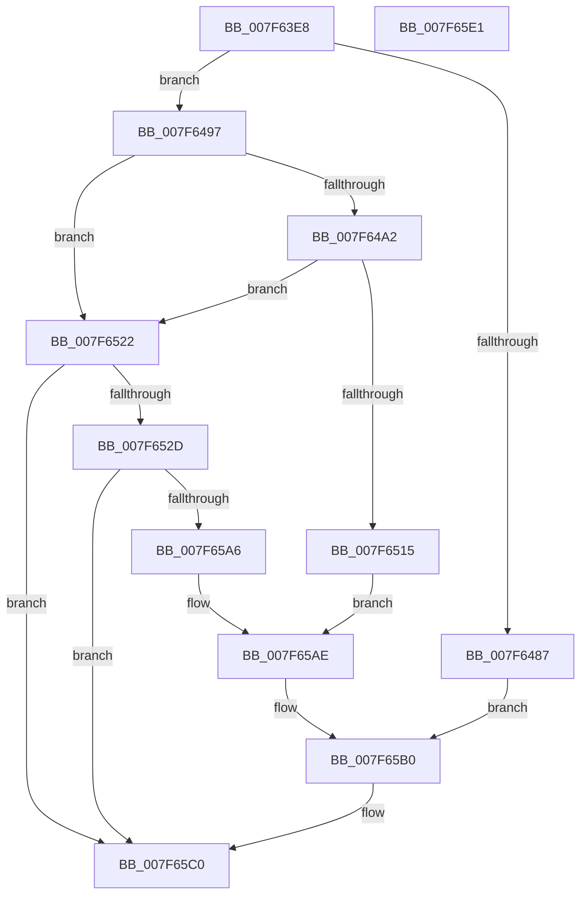

# CmpRequestOplockOnHiveFile

- RVA: `0x007F63E8`–`0x007F65E2` (길이 `506` bytes)
- VA: `0x00000001407F63E8`
- 실행 섹션: `PAGE`
- PDB 이름 있음: `예`; PDB Function 태그: `아니요`
- unwind 정보 RVA: `0x0007FF48`
- 디코드: `120`개 명령, `506/506` bytes 표시
- 미해석 바이트: `0` (있으면 어셈블리에 `.byte`로 보존)

> 이 문서는 커널 이미지의 기계어와 PDB 기호를 분석해 생성했습니다. 4번과 5번은 함수 원형과 자료형을 바이너리 사용 방식에서 추정한 C 해석이며 원본 소스 복구 결과는 아닙니다.

## 1. Dependencies

- 직접 호출 지점: **4**; 고유 호출 대상: **2**
- 직접 호출자로 확인된 함수: **1**
- RIP 상대 이미지 참조: **0**

### Outgoing calls
- `0x007F6479` → [ZwFsControlFile](../../text/6A/ZwFsControlFile_function_006AD7F0.md) (function, `0x006AD7F0`)
- `0x007F6507` → [ZwFsControlFile](../../text/6A/ZwFsControlFile_function_006AD7F0.md) (function, `0x006AD7F0`)
- `0x007F6598` → [ZwFsControlFile](../../text/6A/ZwFsControlFile_function_006AD7F0.md) (function, `0x006AD7F0`)
- `0x007F65BB` → [SetFailureLocation](../../text/46/SetFailureLocation_function_0046EF54.md) (function, `0x0046EF54`)

### Direct callers
- [CmpHiveCachePopulateHiveEntryThread](CmpHiveCachePopulateHiveEntryThread_function_007F5FD0.md) at `0x007F60FE`

### Static image references
- 디코드된 RIP-relative 메모리 참조가 없습니다.

## 2. Other-region calls and transfers

- 다른 실행 섹션으로 향하는 call: **4**
  - `0x007F6479` → [ZwFsControlFile](../../text/6A/ZwFsControlFile_function_006AD7F0.md) (`PAGE` → `.text`)
  - `0x007F6507` → [ZwFsControlFile](../../text/6A/ZwFsControlFile_function_006AD7F0.md) (`PAGE` → `.text`)
  - `0x007F6598` → [ZwFsControlFile](../../text/6A/ZwFsControlFile_function_006AD7F0.md) (`PAGE` → `.text`)
  - `0x007F65BB` → [SetFailureLocation](../../text/46/SetFailureLocation_function_0046EF54.md) (`PAGE` → `.text`)
- 별도 외부 분기/꼬리 이동을 확인하지 못했습니다.

## 3. Assembly (complete function range)

```asm
007F63E8  4C 8B DC                        mov r11, rsp
007F63EB  49 89 5B 08                     mov qword ptr [r11 + 8], rbx
007F63EF  49 89 6B 10                     mov qword ptr [r11 + 0x10], rbp
007F63F3  49 89 73 18                     mov qword ptr [r11 + 0x18], rsi
007F63F7  49 89 7B 20                     mov qword ptr [r11 + 0x20], rdi
007F63FB  41 54                           push r12
007F63FD  41 56                           push r14
007F63FF  41 57                           push r15
007F6401  48 83 EC 50                     sub rsp, 0x50
007F6405  4C 8D 4A 10                     lea r9, [rdx + 0x10]
007F6409  48 8B F1                        mov rsi, rcx
007F640C  33 C9                           xor ecx, ecx
007F640E  48 8D 42 1C                     lea rax, [rdx + 0x1c]
007F6412  49 89 09                        mov qword ptr [r9], rcx
007F6415  0F 57 C0                        xorps xmm0, xmm0
007F6418  0F 11 00                        movups xmmword ptr [rax], xmm0
007F641B  48 89 48 10                     mov qword ptr [rax + 0x10], rcx
007F641F  49 8B E8                        mov rbp, r8
007F6422  0F 11 02                        movups xmmword ptr [rdx], xmm0
007F6425  41 C7 01 01 00 0C 00            mov dword ptr [r9], 0xc0001
007F642C  44 8D 61 18                     lea r12d, [rcx + 0x18]
007F6430  45 89 63 E0                     mov dword ptr [r11 - 0x20], r12d
007F6434  44 8D 79 0C                     lea r15d, [rcx + 0xc]
007F6438  49 89 43 D8                     mov qword ptr [r11 - 0x28], rax
007F643C  44 8D 71 01                     lea r14d, [rcx + 1]
007F6440  45 89 71 08                     mov dword ptr [r9 + 8], r14d
007F6444  48 8B FA                        mov rdi, rdx
007F6447  41 C7 41 04 07 00 00 00         mov dword ptr [r9 + 4], 7
007F644F  45 33 C0                        xor r8d, r8d
007F6452  45 89 7B D0                     mov dword ptr [r11 - 0x30], r15d
007F6456  4D 89 4B C8                     mov qword ptr [r11 - 0x38], r9
007F645A  45 33 C9                        xor r9d, r9d
007F645D  C7 00 01 00 18 00               mov dword ptr [rax], 0x180001
007F6463  48 8B 0E                        mov rcx, qword ptr [rsi]
007F6466  C7 44 24 28 40 02 09 00         mov dword ptr [rsp + 0x28], 0x90240
007F646E  49 89 53 B8                     mov qword ptr [r11 - 0x48], rdx
007F6472  48 8B 92 D0 00 00 00            mov rdx, qword ptr [rdx + 0xd0]
007F6479  E8 72 73 EB FF                  call 0x1406ad7f0
007F647E  8B D8                           mov ebx, eax
007F6480  3D 03 01 00 00                  cmp eax, 0x103
007F6485  74 10                           je 0x1407f6497
007F6487  C7 44 24 20 10 00 00 00         mov dword ptr [rsp + 0x20], 0x10
007F648F  48 8B CD                        mov rcx, rbp
007F6492  E9 19 01 00 00                  jmp 0x1407f65b0
007F6497  48 83 7E 08 00                  cmp qword ptr [rsi + 8], 0
007F649C  0F 84 80 00 00 00               je 0x1407f6522
007F64A2  48 8D 4F 48                     lea rcx, [rdi + 0x48]
007F64A6  44 89 64 24 48                  mov dword ptr [rsp + 0x48], r12d
007F64AB  48 8D 47 54                     lea rax, [rdi + 0x54]
007F64AF  45 33 C0                        xor r8d, r8d
007F64B2  4C 89 01                        mov qword ptr [rcx], r8
007F64B5  48 8D 57 38                     lea rdx, [rdi + 0x38]
007F64B9  48 89 44 24 40                  mov qword ptr [rsp + 0x40], rax
007F64BE  0F 57 C0                        xorps xmm0, xmm0
007F64C1  0F 11 00                        movups xmmword ptr [rax], xmm0
007F64C4  4C 89 40 10                     mov qword ptr [rax + 0x10], r8
007F64C8  45 33 C9                        xor r9d, r9d
007F64CB  0F 11 02                        movups xmmword ptr [rdx], xmm0
007F64CE  C7 01 01 00 0C 00               mov dword ptr [rcx], 0xc0001
007F64D4  44 89 71 08                     mov dword ptr [rcx + 8], r14d
007F64D8  C7 41 04 07 00 00 00            mov dword ptr [rcx + 4], 7
007F64DF  44 89 7C 24 38                  mov dword ptr [rsp + 0x38], r15d
007F64E4  48 89 4C 24 30                  mov qword ptr [rsp + 0x30], rcx
007F64E9  C7 00 01 00 18 00               mov dword ptr [rax], 0x180001
007F64EF  48 8B 4E 08                     mov rcx, qword ptr [rsi + 8]
007F64F3  C7 44 24 28 40 02 09 00         mov dword ptr [rsp + 0x28], 0x90240
007F64FB  48 89 54 24 20                  mov qword ptr [rsp + 0x20], rdx
007F6500  48 8B 97 E0 00 00 00            mov rdx, qword ptr [rdi + 0xe0]
007F6507  E8 E4 72 EB FF                  call 0x1406ad7f0
007F650C  8B D8                           mov ebx, eax
007F650E  3D 03 01 00 00                  cmp eax, 0x103
007F6513  74 0D                           je 0x1407f6522
007F6515  C7 44 24 20 20 00 00 00         mov dword ptr [rsp + 0x20], 0x20
007F651D  E9 8C 00 00 00                  jmp 0x1407f65ae
007F6522  48 83 7E 10 00                  cmp qword ptr [rsi + 0x10], 0
007F6527  0F 84 93 00 00 00               je 0x1407f65c0
007F652D  48 8D 8F 80 00 00 00            lea rcx, [rdi + 0x80]
007F6534  44 89 64 24 48                  mov dword ptr [rsp + 0x48], r12d
007F6539  48 8D 87 8C 00 00 00            lea rax, [rdi + 0x8c]
007F6540  45 33 C0                        xor r8d, r8d
007F6543  4C 89 01                        mov qword ptr [rcx], r8
007F6546  48 8D 57 70                     lea rdx, [rdi + 0x70]
007F654A  48 89 44 24 40                  mov qword ptr [rsp + 0x40], rax
007F654F  0F 57 C0                        xorps xmm0, xmm0
007F6552  0F 11 00                        movups xmmword ptr [rax], xmm0
007F6555  4C 89 40 10                     mov qword ptr [rax + 0x10], r8
007F6559  45 33 C9                        xor r9d, r9d
007F655C  0F 11 02                        movups xmmword ptr [rdx], xmm0
007F655F  C7 01 01 00 0C 00               mov dword ptr [rcx], 0xc0001
007F6565  44 89 71 08                     mov dword ptr [rcx + 8], r14d
007F6569  C7 41 04 07 00 00 00            mov dword ptr [rcx + 4], 7
007F6570  44 89 7C 24 38                  mov dword ptr [rsp + 0x38], r15d
007F6575  48 89 4C 24 30                  mov qword ptr [rsp + 0x30], rcx
007F657A  C7 00 01 00 18 00               mov dword ptr [rax], 0x180001
007F6580  48 8B 4E 10                     mov rcx, qword ptr [rsi + 0x10]
007F6584  C7 44 24 28 40 02 09 00         mov dword ptr [rsp + 0x28], 0x90240
007F658C  48 89 54 24 20                  mov qword ptr [rsp + 0x20], rdx
007F6591  48 8B 97 F0 00 00 00            mov rdx, qword ptr [rdi + 0xf0]
007F6598  E8 53 72 EB FF                  call 0x1406ad7f0
007F659D  8B D8                           mov ebx, eax
007F659F  3D 03 01 00 00                  cmp eax, 0x103
007F65A4  74 1A                           je 0x1407f65c0
007F65A6  C7 44 24 20 30 00 00 00         mov dword ptr [rsp + 0x20], 0x30
007F65AE  33 C9                           xor ecx, ecx
007F65B0  44 8B C8                        mov r9d, eax
007F65B3  41 B8 2E 00 00 00               mov r8d, 0x2e
007F65B9  33 D2                           xor edx, edx
007F65BB  E8 94 89 C7 FF                  call 0x14046ef54
007F65C0  4C 8D 5C 24 50                  lea r11, [rsp + 0x50]
007F65C5  8B C3                           mov eax, ebx
007F65C7  49 8B 5B 20                     mov rbx, qword ptr [r11 + 0x20]
007F65CB  49 8B 6B 28                     mov rbp, qword ptr [r11 + 0x28]
007F65CF  49 8B 73 30                     mov rsi, qword ptr [r11 + 0x30]
007F65D3  49 8B 7B 38                     mov rdi, qword ptr [r11 + 0x38]
007F65D7  49 8B E3                        mov rsp, r11
007F65DA  41 5F                           pop r15
007F65DC  41 5E                           pop r14
007F65DE  41 5C                           pop r12
007F65E0  C3                              ret
007F65E1  CC                              int3
```

## 4. C-style interpretation (structured pseudocode)

```c
__int64 __fastcall CmpRequestOplockOnHiveFile(__int64 a1, __int64 a2, __int64 a3)
{
    __int64 result;
    __int64 v_rsp;
    unsigned __int64 v_stack_m18;
    unsigned int v_stack_m20;
    unsigned __int64 v_stack_m28;
    unsigned int v_stack_m30;
    unsigned __int64 v_stack_m38;
    unsigned int v_stack_m40;
    unsigned int v_stack_m48;

    *(unsigned __int64 *)(v_rsp + 8) = v_rbx;
    *(unsigned __int64 *)(v_rsp + 16) = v_rbp;
    *(unsigned __int64 *)(v_rsp + 24) = v_rsi;
    *(unsigned __int64 *)(v_rsp + 32) = v_rdi;
    v_rsp = (v_rsp) - (80);
    a1 = 0;
    *(unsigned __int64 *)(a2 + 16) = 0;
    *(unsigned __int64 *)(a2 + 28) = v_xmm0;
    *(unsigned __int64 *)(a2 + 28 + 16) = 0;
    *(unsigned __int64 *)(a2) = v_xmm0;
    *(unsigned int *)(a2 + 16) = 0xC0001ULL;
    *(unsigned int *)(v_rsp - 32) = (unsigned int)(a1 + 24);
    *(unsigned __int64 *)(v_rsp - 40) = a2 + 28;
    *(unsigned int *)(a2 + 16 + 8) = (unsigned int)(a1 + 1);
    *(unsigned int *)(a2 + 16 + 4) = 7;
    a3 = 0;
    *(unsigned int *)(v_rsp - 48) = (unsigned int)(a1 + 12);
    *(unsigned __int64 *)(v_rsp - 56) = a2 + 16;
    a4 = 0;
    *(unsigned int *)(a2 + 28) = 0x180001ULL;
    v_stack_m40 = 0x90240ULL;
    *(unsigned __int64 *)(v_rsp - 72) = a2;
    result = ZwFsControlFile(*(unsigned __int64 *)(a1), *(unsigned __int64 *)(a2 + 208), a3, a4);
    if (((unsigned int)(result)) == 259) goto loc_007F6497;
    v_stack_m48 = 16;
    goto loc_007F65B0;
loc_007F6497:
    if ((*(unsigned __int64 *)(a1 + 8)) == 0) goto loc_007F6522;
    v_stack_m20 = (unsigned int)(a1 + 24);
    a3 = 0;
    *(unsigned __int64 *)(a2 + 72) = 0;
    v_stack_m28 = a2 + 84;
    *(unsigned __int64 *)(a2 + 84) = v_xmm0;
    *(unsigned __int64 *)(a2 + 84 + 16) = 0;
    a4 = 0;
    *(unsigned __int64 *)(a2 + 56) = v_xmm0;
    *(unsigned int *)(a2 + 72) = 0xC0001ULL;
    *(unsigned int *)(a2 + 72 + 8) = (unsigned int)(a1 + 1);
    *(unsigned int *)(a2 + 72 + 4) = 7;
    v_stack_m30 = (unsigned int)(a1 + 12);
    v_stack_m38 = a2 + 72;
    *(unsigned int *)(a2 + 84) = 0x180001ULL;
    v_stack_m40 = 0x90240ULL;
    v_stack_m48 = a2 + 56;
    result = ZwFsControlFile(*(unsigned __int64 *)(a1 + 8), *(unsigned __int64 *)(a2 + 224), a3, a4);
    if (((unsigned int)(result)) == 259) goto loc_007F6522;
    v_stack_m48 = 32;
    goto loc_007F65AE;
loc_007F6522:
    if ((*(unsigned __int64 *)(a1 + 16)) == 0) goto loc_007F65C0;
    v_stack_m20 = (unsigned int)(a1 + 24);
    a3 = 0;
    *(unsigned __int64 *)(a2 + 128) = 0;
    v_stack_m28 = a2 + 140;
    *(unsigned __int64 *)(a2 + 140) = v_xmm0;
    *(unsigned __int64 *)(a2 + 140 + 16) = 0;
    a4 = 0;
    *(unsigned __int64 *)(a2 + 112) = v_xmm0;
    *(unsigned int *)(a2 + 128) = 0xC0001ULL;
    *(unsigned int *)(a2 + 128 + 8) = (unsigned int)(a1 + 1);
    *(unsigned int *)(a2 + 128 + 4) = 7;
    v_stack_m30 = (unsigned int)(a1 + 12);
    v_stack_m38 = a2 + 128;
    *(unsigned int *)(a2 + 140) = 0x180001ULL;
    v_stack_m40 = 0x90240ULL;
    v_stack_m48 = a2 + 112;
    result = ZwFsControlFile(*(unsigned __int64 *)(a1 + 16), *(unsigned __int64 *)(a2 + 240), a3, a4);
    if (((unsigned int)(result)) == 259) goto loc_007F65C0;
    v_stack_m48 = 48;
loc_007F65AE:
    a1 = 0;
loc_007F65B0:
    a2 = 0;
    result = SetFailureLocation(a1, a2, 46, (unsigned int)((unsigned int)(result)));
loc_007F65C0:
    return (unsigned int)((unsigned int)((unsigned int)((unsigned int)(result))));
}
```

## 5. (Beta) C Style

```c
int64_t CmpRequestOplockOnHiveFile(void *Arg1, void *Arg2, int64_t Arg3)
{
    uint8_t *arg1 = (uint8_t *)Arg1;
    uint8_t *arg2 = (uint8_t *)Arg2;

    int64_t result;
    int64_t local_rsp;
    uint64_t v_stack_m18;
    uint32_t v_stack_m20;
    uint64_t v_stack_m28;
    uint32_t v_stack_m30;
    uint64_t v_stack_m38;
    uint32_t v_stack_m40;
    uint32_t v_stack_m48;

    *(uint64_t *)(local_rsp + 0x8) = local_rbx;
    *(uint64_t *)(local_rsp + 0x10) = local_rbp;
    *(uint64_t *)(local_rsp + 0x18) = local_rsi;
    *(uint64_t *)(local_rsp + 0x20) = local_rdi;
    local_rsp = (local_rsp) - (80);
    Arg1 = 0;
    *(uint64_t *)(arg2 + 0x10) = 0;
    *(uint64_t *)(arg2 + 0x1C) = v_xmm0;
    *(uint64_t *)(arg2 + 0x1C + 0x10) = 0;
    *(uint64_t *)(arg2) = v_xmm0;
    *(uint32_t *)(arg2 + 0x10) = 0xC0001ULL;
    *(uint32_t *)(local_rsp - 0x20) = (uint32_t)(Arg1 + 24);
    *(void **)(local_rsp - 0x28) = Arg2 + 28;
    *(uint32_t *)(arg2 + 0x10 + 0x8) = (uint32_t)(Arg1 + 1);
    *(uint32_t *)(arg2 + 0x10 + 0x4) = 7;
    Arg3 = 0;
    *(uint32_t *)(local_rsp - 0x30) = (uint32_t)(Arg1 + 12);
    *(void **)(local_rsp - 0x38) = Arg2 + 16;
    a4 = 0;
    *(uint32_t *)(arg2 + 0x1C) = 0x180001ULL;
    v_stack_m40 = 0x90240ULL;
    *(void **)(local_rsp - 0x48) = Arg2;
    result = ZwFsControlFile(*(uint64_t *)(arg1), *(uint64_t *)(arg2 + 0xD0), Arg3, a4);
    if (((uint32_t)(result)) == 259) goto loc_007F6497;
    v_stack_m48 = 16;
    goto loc_007F65B0;
loc_007F6497:
    if ((*(uint64_t *)(arg1 + 0x8)) == 0) goto loc_007F6522;
    v_stack_m20 = (uint32_t)(Arg1 + 24);
    Arg3 = 0;
    *(uint64_t *)(arg2 + 0x48) = 0;
    v_stack_m28 = Arg2 + 84;
    *(uint64_t *)(arg2 + 0x54) = v_xmm0;
    *(uint64_t *)(arg2 + 0x54 + 0x10) = 0;
    a4 = 0;
    *(uint64_t *)(arg2 + 0x38) = v_xmm0;
    *(uint32_t *)(arg2 + 0x48) = 0xC0001ULL;
    *(uint32_t *)(arg2 + 0x48 + 0x8) = (uint32_t)(Arg1 + 1);
    *(uint32_t *)(arg2 + 0x48 + 0x4) = 7;
    v_stack_m30 = (uint32_t)(Arg1 + 12);
    v_stack_m38 = Arg2 + 72;
    *(uint32_t *)(arg2 + 0x54) = 0x180001ULL;
    v_stack_m40 = 0x90240ULL;
    v_stack_m48 = Arg2 + 56;
    result = ZwFsControlFile(*(uint64_t *)(arg1 + 0x8), *(uint64_t *)(arg2 + 0xE0), Arg3, a4);
    if (((uint32_t)(result)) == 259) goto loc_007F6522;
    v_stack_m48 = 32;
    goto loc_007F65AE;
loc_007F6522:
    if ((*(uint64_t *)(arg1 + 0x10)) == 0) goto loc_007F65C0;
    v_stack_m20 = (uint32_t)(Arg1 + 24);
    Arg3 = 0;
    *(uint64_t *)(arg2 + 0x80) = 0;
    v_stack_m28 = Arg2 + 140;
    *(uint64_t *)(arg2 + 0x8C) = v_xmm0;
    *(uint64_t *)(arg2 + 0x8C + 0x10) = 0;
    a4 = 0;
    *(uint64_t *)(arg2 + 0x70) = v_xmm0;
    *(uint32_t *)(arg2 + 0x80) = 0xC0001ULL;
    *(uint32_t *)(arg2 + 0x80 + 0x8) = (uint32_t)(Arg1 + 1);
    *(uint32_t *)(arg2 + 0x80 + 0x4) = 7;
    v_stack_m30 = (uint32_t)(Arg1 + 12);
    v_stack_m38 = Arg2 + 128;
    *(uint32_t *)(arg2 + 0x8C) = 0x180001ULL;
    v_stack_m40 = 0x90240ULL;
    v_stack_m48 = Arg2 + 112;
    result = ZwFsControlFile(*(uint64_t *)(arg1 + 0x10), *(uint64_t *)(arg2 + 0xF0), Arg3, a4);
    if (((uint32_t)(result)) == 259) goto loc_007F65C0;
    v_stack_m48 = 48;
loc_007F65AE:
    Arg1 = 0;
loc_007F65B0:
    Arg2 = 0;
    result = SetFailureLocation(Arg1, Arg2, 46, (uint32_t)((uint32_t)(result)));
loc_007F65C0:
    return (uint32_t)((uint32_t)((uint32_t)((uint32_t)(result))));
}
```

### 관측된 메모리 오프셋

구조체 형식이 확인되지 않은 접근은 인자 기준의 오프셋으로만 기록했습니다.

| 기준 인자 | 오프셋 표현 | 폭 (bit) | 접근 |
|---|---:|---:|---|
| `Arg1` | `+ 0x0` | `64` | `R` |
| `Arg1` | `+ 0x8` | `64` | `R` |
| `Arg1` | `+ 0x10` | `64` | `R` |
| `Arg2` | `+ 0x0` | `32` | `W` |
| `Arg2` | `+ 0x0` | `64` | `W` |
| `Arg2` | `+ 0x0` | `128` | `R` |
| `Arg2` | `+ 0x4` | `32` | `W` |
| `Arg2` | `+ 0x8` | `32` | `W` |
| `Arg2` | `+ 0x10` | `64` | `R` |
| `Arg2` | `+ 0x10` | `64` | `W` |
| `Arg2` | `+ 0x1C` | `64` | `R` |
| `Arg2` | `+ 0x38` | `64` | `R` |
| `Arg2` | `+ 0x48` | `64` | `R` |
| `Arg2` | `+ 0x54` | `64` | `R` |
| `Arg2` | `+ 0x70` | `64` | `R` |
| `Arg2` | `+ 0x80` | `64` | `R` |
| `Arg2` | `+ 0x8C` | `64` | `R` |
| `Arg2` | `+ 0xD0` | `64` | `R` |
| `Arg2` | `+ 0xE0` | `64` | `R` |
| `Arg2` | `+ 0xF0` | `64` | `R` |

## 6. Execution-region graph

[열기: 2D/3D 그래프와 함수 탐색 컨트롤 패널](../../../control-panel.html?section=page&rva=0x007F63E8&view=graph)

- 2D 그래프는 위에서 아래로 흐르고, 3D 그래프는 빈 공간을 드래그해 회전합니다. Shift+드래그는 이동, 휠은 확대·축소, 함수 노드 선택은 대상 보고서 이동입니다.

### Static fallback


