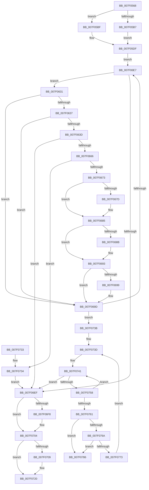

# CmpRmAnalysisPhase

- RVA: `0x007F0568`–`0x007F078D` (길이 `549` bytes)
- VA: `0x00000001407F0568`
- 실행 섹션: `PAGE`
- PDB 이름 있음: `예`; PDB Function 태그: `아니요`
- unwind 정보 RVA: `0x000D7168`
- 디코드: `152`개 명령, `549/549` bytes 표시
- 미해석 바이트: `0` (있으면 어셈블리에 `.byte`로 보존)

> 이 문서는 커널 이미지의 기계어와 PDB 기호를 분석해 생성했습니다. 4번과 5번은 함수 원형과 자료형을 바이너리 사용 방식에서 추정한 C 해석이며 원본 소스 복구 결과는 아닙니다.

## 1. Dependencies

- 직접 호출 지점: **6**; 고유 호출 대상: **6**
- 직접 호출자로 확인된 함수: **1**
- RIP 상대 이미지 참조: **3**

### Outgoing calls
- `0x007F061E` → `ext-ms-win-fs-clfs-l1-1-0.dll!ClfsReadLogRecord` (import, 간접 대상; import `ext-ms-win-fs-clfs-l1-1-0.dll!ClfsReadLogRecord`)
- `0x007F0657` → [CmpTransSearchAddTransFromRm](../A6/CmpTransSearchAddTransFromRm_function_00A6023C.md) (function, `0x00A6023C`)
- `0x007F06D2` → `ext-ms-win-fs-clfs-l1-1-0.dll!ClfsReadNextLogRecord` (import, 간접 대상; import `ext-ms-win-fs-clfs-l1-1-0.dll!ClfsReadNextLogRecord`)
- `0x007F06F8` → `ext-ms-win-fs-clfs-l1-1-0.dll!ClfsTerminateReadLog` (import, 간접 대상; import `ext-ms-win-fs-clfs-l1-1-0.dll!ClfsTerminateReadLog`)
- `0x007F074B` → [CmListGetNextElement](../../pagecmrc/BC/CmListGetNextElement_function_00BC9940.md) (function, `0x00BC9940`)
- `0x007F077F` → [ExFreePoolWithTag](../../poolcode/B8/ExFreePoolWithTag_function_00B82870.md) (function, `0x00B82870`)

### Direct callers
- [CmpStartRMLog](CmpStartRMLog_function_007F0AFC.md) at `0x007F0F33`

### Static image references
- `0x007F061E` → RVA `0x00151270` (`ext-ms-win-fs-clfs-l1-1-0.dll!ClfsReadLogRecord (IAT)`; read)
- `0x007F06D2` → RVA `0x001511D0` (`ext-ms-win-fs-clfs-l1-1-0.dll!ClfsReadNextLogRecord (IAT)`; read)
- `0x007F06F8` → RVA `0x001511D8` (`ext-ms-win-fs-clfs-l1-1-0.dll!ClfsTerminateReadLog (IAT)`; read)

## 2. Other-region calls and transfers

- 다른 실행 섹션으로 향하는 call: **2**
  - `0x007F074B` → [CmListGetNextElement](../../pagecmrc/BC/CmListGetNextElement_function_00BC9940.md) (`PAGE` → `PAGECMRC`)
  - `0x007F077F` → [ExFreePoolWithTag](../../poolcode/B8/ExFreePoolWithTag_function_00B82870.md) (`PAGE` → `POOLCODE`)
- 별도 외부 분기/꼬리 이동을 확인하지 못했습니다.

## 3. Assembly (complete function range)

```asm
007F0568  48 89 54 24 10                  mov qword ptr [rsp + 0x10], rdx
007F056D  55                              push rbp
007F056E  56                              push rsi
007F056F  57                              push rdi
007F0570  41 54                           push r12
007F0572  41 56                           push r14
007F0574  41 57                           push r15
007F0576  48 8D 6C 24 D1                  lea rbp, [rsp - 0x2f]
007F057B  48 81 EC 88 00 00 00            sub rsp, 0x88
007F0582  48 83 65 F7 00                  and qword ptr [rbp - 9], 0
007F0587  48 8D 79 10                     lea rdi, [rcx + 0x10]
007F058B  48 83 65 7F 00                  and qword ptr [rbp + 0x7f], 0
007F0590  4C 8B F1                        mov r14, rcx
007F0593  48 8B 0F                        mov rcx, qword ptr [rdi]
007F0596  83 65 77 00                     and dword ptr [rbp + 0x77], 0
007F059A  48 83 65 0F 00                  and qword ptr [rbp + 0xf], 0
007F059F  48 83 65 07 00                  and qword ptr [rbp + 7], 0
007F05A4  48 83 65 17 00                  and qword ptr [rbp + 0x17], 0
007F05A9  48 83 65 FF 00                  and qword ptr [rbp - 1], 0
007F05AE  C6 45 67 00                     mov byte ptr [rbp + 0x67], 0
007F05B2  48 3B CF                        cmp rcx, rdi
007F05B5  75 08                           jne 0x1407f05bf
007F05B7  45 33 FF                        xor r15d, r15d
007F05BA  45 33 E4                        xor r12d, r12d
007F05BD  EB 20                           jmp 0x1407f05df
007F05BF  49 8B 46 18                     mov rax, qword ptr [r14 + 0x18]
007F05C3  48 89 41 08                     mov qword ptr [rcx + 8], rax
007F05C7  49 8B 4E 18                     mov rcx, qword ptr [r14 + 0x18]
007F05CB  48 8B 07                        mov rax, qword ptr [rdi]
007F05CE  48 89 01                        mov qword ptr [rcx], rax
007F05D1  4C 8B 3F                        mov r15, qword ptr [rdi]
007F05D4  4D 8B 67 08                     mov r12, qword ptr [r15 + 8]
007F05D8  48 89 7F 08                     mov qword ptr [rdi + 8], rdi
007F05DC  48 89 3F                        mov qword ptr [rdi], rdi
007F05DF  49 8B 4E 60                     mov rcx, qword ptr [r14 + 0x60]
007F05E3  48 8D 45 F7                     lea rax, [rbp - 9]
007F05E7  48 89 44 24 40                  mov qword ptr [rsp + 0x40], rax
007F05EC  4C 8D 4D 7F                     lea r9, [rbp + 0x7f]
007F05F0  48 8D 45 07                     lea rax, [rbp + 7]
007F05F4  41 B8 03 00 00 00               mov r8d, 3
007F05FA  48 89 44 24 38                  mov qword ptr [rsp + 0x38], rax
007F05FF  48 8D 55 6F                     lea rdx, [rbp + 0x6f]
007F0603  48 8D 45 0F                     lea rax, [rbp + 0xf]
007F0607  48 89 44 24 30                  mov qword ptr [rsp + 0x30], rax
007F060C  48 8D 45 67                     lea rax, [rbp + 0x67]
007F0610  48 89 44 24 28                  mov qword ptr [rsp + 0x28], rax
007F0615  48 8D 45 77                     lea rax, [rbp + 0x77]
007F0619  48 89 44 24 20                  mov qword ptr [rsp + 0x20], rax
007F061E  48 FF 15 4B 0C 96 FF            call qword ptr [rip - 0x69f3b5]
007F0625  0F 1F 44 00 00                  nop dword ptr [rax + rax]
007F062A  8B F0                           mov esi, eax
007F062C  E9 B6 00 00 00                  jmp 0x1407f06e7
007F0631  F6 45 67 01                     test byte ptr [rbp + 0x67], 1
007F0635  74 66                           je 0x1407f069d
007F0637  83 7D 77 30                     cmp dword ptr [rbp + 0x77], 0x30
007F063B  72 60                           jb 0x1407f069d
007F063D  4C 8B 45 7F                     mov r8, qword ptr [rbp + 0x7f]
007F0641  48 8D 45 FF                     lea rax, [rbp - 1]
007F0645  33 D2                           xor edx, edx
007F0647  48 89 44 24 20                  mov qword ptr [rsp + 0x20], rax
007F064C  49 83 C0 10                     add r8, 0x10
007F0650  49 8B CE                        mov rcx, r14
007F0653  44 8D 4A 01                     lea r9d, [rdx + 1]
007F0657  E8 E0 FB 26 00                  call 0x140a6023c
007F065C  8B F0                           mov esi, eax
007F065E  85 C0                           test eax, eax
007F0660  0F 88 89 00 00 00               js 0x1407f06ef
007F0666  48 8B 45 FF                     mov rax, qword ptr [rbp - 1]
007F066A  48 85 C0                        test rax, rax
007F066D  0F 84 C1 00 00 00               je 0x1407f0734
007F0673  48 8B 4D 7F                     mov rcx, qword ptr [rbp + 0x7f]
007F0677  83 79 08 10                     cmp dword ptr [rcx + 8], 0x10
007F067B  75 08                           jne 0x1407f0685
007F067D  83 48 30 04                     or dword ptr [rax + 0x30], 4
007F0681  48 8B 4D 7F                     mov rcx, qword ptr [rbp + 0x7f]
007F0685  83 79 08 08                     cmp dword ptr [rcx + 8], 8
007F0689  75 08                           jne 0x1407f0693
007F068B  83 48 30 02                     or dword ptr [rax + 0x30], 2
007F068F  48 8B 4D 7F                     mov rcx, qword ptr [rbp + 0x7f]
007F0693  83 79 08 04                     cmp dword ptr [rcx + 8], 4
007F0697  75 04                           jne 0x1407f069d
007F0699  83 48 30 01                     or dword ptr [rax + 0x30], 1
007F069D  48 8B 4D F7                     mov rcx, qword ptr [rbp - 9]
007F06A1  48 8D 45 17                     lea rax, [rbp + 0x17]
007F06A5  48 89 44 24 38                  mov qword ptr [rsp + 0x38], rax
007F06AA  4C 8D 4D 67                     lea r9, [rbp + 0x67]
007F06AE  48 8D 45 07                     lea rax, [rbp + 7]
007F06B2  C6 45 67 01                     mov byte ptr [rbp + 0x67], 1
007F06B6  48 89 44 24 30                  mov qword ptr [rsp + 0x30], rax
007F06BB  4C 8D 45 77                     lea r8, [rbp + 0x77]
007F06BF  48 8D 45 0F                     lea rax, [rbp + 0xf]
007F06C3  48 89 44 24 28                  mov qword ptr [rsp + 0x28], rax
007F06C8  48 8D 55 7F                     lea rdx, [rbp + 0x7f]
007F06CC  48 83 64 24 20 00               and qword ptr [rsp + 0x20], 0
007F06D2  48 FF 15 F7 0A 96 FF            call qword ptr [rip - 0x69f509]
007F06D9  0F 1F 44 00 00                  nop dword ptr [rax + rax]
007F06DE  8B F0                           mov esi, eax
007F06E0  3D 11 00 00 C0                  cmp eax, 0xc0000011
007F06E5  74 54                           je 0x1407f073b
007F06E7  85 C0                           test eax, eax
007F06E9  0F 89 42 FF FF FF               jns 0x1407f0631
007F06EF  48 8B 4D F7                     mov rcx, qword ptr [rbp - 9]
007F06F3  48 85 C9                        test rcx, rcx
007F06F6  74 0C                           je 0x1407f0704
007F06F8  48 FF 15 D9 0A 96 FF            call qword ptr [rip - 0x69f527]
007F06FF  0F 1F 44 00 00                  nop dword ptr [rax + rax]
007F0704  4D 85 FF                        test r15, r15
007F0707  74 17                           je 0x1407f0720
007F0709  49 89 3C 24                     mov qword ptr [r12], rdi
007F070D  49 8B 46 18                     mov rax, qword ptr [r14 + 0x18]
007F0711  49 89 47 08                     mov qword ptr [r15 + 8], rax
007F0715  49 8B 46 18                     mov rax, qword ptr [r14 + 0x18]
007F0719  4C 89 38                        mov qword ptr [rax], r15
007F071C  4D 89 66 18                     mov qword ptr [r14 + 0x18], r12
007F0720  8B C6                           mov eax, esi
007F0722  48 81 C4 88 00 00 00            add rsp, 0x88
007F0729  41 5F                           pop r15
007F072B  41 5E                           pop r14
007F072D  41 5C                           pop r12
007F072F  5F                              pop rdi
007F0730  5E                              pop rsi
007F0731  5D                              pop rbp
007F0732  C3                              ret
007F0733  CC                              int3
007F0734  BE 02 00 19 C0                  mov esi, 0xc0190002
007F0739  EB B4                           jmp 0x1407f06ef
007F073B  33 F6                           xor esi, esi
007F073D  48 21 75 FF                     and qword ptr [rbp - 1], rsi
007F0741  45 33 C0                        xor r8d, r8d
007F0744  48 8D 55 FF                     lea rdx, [rbp - 1]
007F0748  48 8B CF                        mov rcx, rdi
007F074B  E8 F0 91 3D 00                  call 0x140bc9940
007F0750  48 8B C8                        mov rcx, rax
007F0753  48 85 C0                        test rax, rax
007F0756  74 97                           je 0x1407f06ef
007F0758  8B 40 30                        mov eax, dword ptr [rax + 0x30]
007F075B  24 07                           and al, 7
007F075D  3C 01                           cmp al, 1
007F075F  74 E0                           je 0x1407f0741
007F0761  48 8B 11                        mov rdx, qword ptr [rcx]
007F0764  48 39 4A 08                     cmp qword ptr [rdx + 8], rcx
007F0768  75 1C                           jne 0x1407f0786
007F076A  48 8B 41 08                     mov rax, qword ptr [rcx + 8]
007F076E  48 39 08                        cmp qword ptr [rax], rcx
007F0771  75 13                           jne 0x1407f0786
007F0773  48 89 10                        mov qword ptr [rax], rdx
007F0776  48 89 42 08                     mov qword ptr [rdx + 8], rax
007F077A  BA 43 4D 54 72                  mov edx, 0x72544d43
007F077F  E8 EC 20 39 00                  call 0x140b82870
007F0784  EB B7                           jmp 0x1407f073d
007F0786  B9 03 00 00 00                  mov ecx, 3
007F078B  CD 29                           int 0x29
```

## 4. C-style interpretation (structured pseudocode)

```c
__int64 __fastcall CmpRmAnalysisPhase(__int64 a1, __int64 a2)
{
    __int64 result;
    __int64 v_r12;
    __int64 v_r15;
    __int64 v_rsi;
    __int64 v_rsp;
    unsigned __int64 v_stack_m48;
    unsigned __int64 v_stack_m50;
    unsigned __int64 v_stack_m58;
    unsigned __int64 v_stack_m5F;
    unsigned __int64 v_stack_m60;
    unsigned __int64 v_stack_m68;
    unsigned __int64 v_stack_m78;
    unsigned __int64 v_stack_m80;
    unsigned __int64 v_stack_m88;
    unsigned __int64 v_stack_m90;
    unsigned __int64 v_stack_m98;
    unsigned __int64 v_stack_p10;
    unsigned int v_stack_p18;
    unsigned __int64 v_stack_p20;
    unsigned __int8 v_stack_p8;

    v_stack_p10 = a2;
    v_rsp = (v_rsp) - (136);
    v_stack_p8 = 0;
    if ((*(unsigned __int64 *)(a1 + 16)) != (a1 + 16)) goto loc_007F05BF;
    v_r15 = 0;
    v_r12 = 0;
    goto loc_007F05DF;
loc_007F05BF:
    *(unsigned __int64 *)(*(unsigned __int64 *)(a1 + 16) + 8) = *(unsigned __int64 *)(a1 + 24);
    *(unsigned __int64 *)(*(unsigned __int64 *)(a1 + 24)) = *(unsigned __int64 *)(a1 + 16);
    *(unsigned __int64 *)(a1 + 16 + 8) = a1 + 16;
    *(unsigned __int64 *)(a1 + 16) = a1 + 16;
loc_007F05DF:
    v_stack_m78 = v_stack_m68;
    v_stack_m80 = v_stack_m58;
    v_stack_m88 = v_stack_m50;
    v_stack_m90 = v_stack_p8;
    v_stack_m98 = v_stack_p18;
    result = ext_ms_win_fs_clfs_l1_1_0_dll_ClfsReadLogRecord(*(unsigned __int64 *)(a1 + 96), v_stack_p10, 3, v_stack_p20);
    goto loc_007F06E7;
loc_007F0631:
    if (((v_stack_p8) & (1)) == 0) goto loc_007F069D;
    if (v_stack_p18 < 48) goto loc_007F069D;
    a2 = 0;
    v_stack_m98 = v_stack_m60;
    a3 = (v_stack_p20) + (16);
    result = CmpTransSearchAddTransFromRm(a1, a2, a3, a2 + 1);
    if (sign_flag) goto loc_007F06EF;
    if (v_stack_m60 == 0) goto loc_007F0734;
    if ((*(unsigned int *)(v_stack_p20 + 8)) == 16) {
        a1 = v_stack_p20;
    }
    if ((*(unsigned int *)(a1 + 8)) == 8) {
        a1 = v_stack_p20;
    }
    if ((*(unsigned int *)(a1 + 8)) == 4) {
    }
    v_stack_m80 = v_stack_m48;
    v_stack_p8 = 1;
    v_stack_m88 = v_stack_m58;
    v_stack_m90 = v_stack_m50;
    result = ext_ms_win_fs_clfs_l1_1_0_dll_ClfsReadNextLogRecord(v_stack_m68, v_stack_p20, v_stack_p18, v_stack_p8);
    if (((unsigned int)(result)) == 0xC0000011ULL) goto loc_007F073B;
loc_007F06E7:
    if (!sign_flag) goto loc_007F0631;
loc_007F06EF:
    if (v_stack_m68 != 0) {
        result = ext_ms_win_fs_clfs_l1_1_0_dll_ClfsTerminateReadLog(v_stack_m68, v_stack_p20, v_stack_p18, v_stack_p8);
    }
    if (*(unsigned __int64 *)(a1 + 16) != 0) {
        *(unsigned __int64 *)(*(unsigned __int64 *)(*(unsigned __int64 *)(a1 + 16) + 8)) = a1 + 16;
        result = *(unsigned __int64 *)(a1 + 24);
        *(unsigned __int64 *)(*(unsigned __int64 *)(a1 + 16) + 8) = result;
        result = *(unsigned __int64 *)(a1 + 24);
        *(unsigned __int64 *)(result) = *(unsigned __int64 *)(a1 + 16);
        *(unsigned __int64 *)(a1 + 24) = *(unsigned __int64 *)(*(unsigned __int64 *)(a1 + 16) + 8);
    }
    v_rsp = (v_rsp) + (136);
    return (unsigned int)((unsigned int)((unsigned int)((unsigned int)(result))));
loc_007F0734:
    goto loc_007F06EF;
loc_007F073B:
    v_rsi = 0;
loc_007F073D:
loc_007F0741:
    a3 = 0;
    result = CmListGetNextElement(a1 + 16, v_stack_m60, a3, v_stack_p8);
    if (result == 0) goto loc_007F06EF;
    result = (unsigned __int8)(((unsigned int)(*(unsigned int *)(result + 48))) & (7));
    if (((unsigned __int8)(result)) == 1) goto loc_007F0741;
    if ((*(unsigned __int64 *)(*(unsigned __int64 *)(result) + 8)) != result) goto loc_007F0786;
    if ((*(unsigned __int64 *)(*(unsigned __int64 *)(result + 8))) != result) goto loc_007F0786;
    *(unsigned __int64 *)(*(unsigned __int64 *)(result + 8)) = *(unsigned __int64 *)(result);
    *(unsigned __int64 *)(*(unsigned __int64 *)(result) + 8) = *(unsigned __int64 *)(result + 8);
    result = ExFreePoolWithTag(result, (unsigned int)(0x72544D43ULL), a3, v_stack_p8);
    goto loc_007F073D;
loc_007F0786:
    return result;
}
```

## 5. (Beta) C Style

```c
int64_t CmpRmAnalysisPhase(void *Arg1, int64_t Arg2)
{
    uint8_t *arg1 = (uint8_t *)Arg1;

    int64_t result;
    int64_t local_r12;
    int64_t local_r15;
    int64_t local_rsi;
    int64_t local_rsp;
    uint64_t v_stack_m48;
    uint64_t v_stack_m50;
    uint64_t v_stack_m58;
    uint64_t v_stack_m5F;
    uint64_t v_stack_m60;
    uint64_t v_stack_m68;
    uint64_t v_stack_m78;
    uint64_t v_stack_m80;
    uint64_t v_stack_m88;
    uint64_t v_stack_m90;
    uint64_t v_stack_m98;
    uint64_t v_stack_p10;
    uint32_t v_stack_p18;
    uint64_t v_stack_p20;
    uint8_t v_stack_p8;

    v_stack_p10 = Arg2;
    local_rsp = (local_rsp) - (136);
    v_stack_p8 = 0;
    if ((*(uint64_t *)(arg1 + 0x10)) != (Arg1 + 16)) goto loc_007F05BF;
    local_r15 = 0;
    local_r12 = 0;
    goto loc_007F05DF;
loc_007F05BF:
    *(uint64_t *)(*(uint64_t *)(arg1 + 0x10) + 0x8) = *(uint64_t *)(arg1 + 0x18);
    *(uint64_t *)(*(uint64_t *)(arg1 + 0x18)) = *(uint64_t *)(arg1 + 0x10);
    *(void **)(arg1 + 0x10 + 0x8) = Arg1 + 16;
    *(void **)(arg1 + 0x10) = Arg1 + 16;
loc_007F05DF:
    v_stack_m78 = v_stack_m68;
    v_stack_m80 = v_stack_m58;
    v_stack_m88 = v_stack_m50;
    v_stack_m90 = v_stack_p8;
    v_stack_m98 = v_stack_p18;
    result = kernel_indirect_call(*(uint64_t *)(arg1 + 0x60), v_stack_p10, 3, v_stack_p20);
    goto loc_007F06E7;
loc_007F0631:
    if (((v_stack_p8) & (1)) == 0) goto loc_007F069D;
    if (v_stack_p18 < 48) goto loc_007F069D;
    Arg2 = 0;
    v_stack_m98 = v_stack_m60;
    a3 = (v_stack_p20) + (16);
    result = CmpTransSearchAddTransFromRm(Arg1, Arg2, a3, Arg2 + 1);
    if (sign_flag) goto loc_007F06EF;
    if (v_stack_m60 == 0) goto loc_007F0734;
    if ((*(uint32_t *)(v_stack_p20 + 0x8)) == 16) {
        Arg1 = v_stack_p20;
    }
    if ((*(uint32_t *)(arg1 + 0x8)) == 8) {
        Arg1 = v_stack_p20;
    }
    if ((*(uint32_t *)(arg1 + 0x8)) == 4) {
    }
    v_stack_m80 = v_stack_m48;
    v_stack_p8 = 1;
    v_stack_m88 = v_stack_m58;
    v_stack_m90 = v_stack_m50;
    result = kernel_indirect_call(v_stack_m68, v_stack_p20, v_stack_p18, v_stack_p8);
    if (((uint32_t)(result)) == 0xC0000011ULL) goto loc_007F073B;
loc_007F06E7:
    if (!sign_flag) goto loc_007F0631;
loc_007F06EF:
    if (v_stack_m68 != 0) {
        result = kernel_indirect_call(v_stack_m68, v_stack_p20, v_stack_p18, v_stack_p8);
    }
    if (*(uint64_t *)(arg1 + 0x10) != 0) {
        *(void **)(*(uint64_t *)(*(uint64_t *)(arg1 + 0x10) + 0x8)) = Arg1 + 16;
        result = *(uint64_t *)(arg1 + 0x18);
        *(uint64_t *)(*(uint64_t *)(arg1 + 0x10) + 0x8) = result;
        result = *(uint64_t *)(arg1 + 0x18);
        *(uint64_t *)(result) = *(uint64_t *)(arg1 + 0x10);
        *(uint64_t *)(arg1 + 0x18) = *(uint64_t *)(*(uint64_t *)(arg1 + 0x10) + 0x8);
    }
    local_rsp = (local_rsp) + (136);
    return (uint32_t)((uint32_t)((uint32_t)((uint32_t)(result))));
loc_007F0734:
    goto loc_007F06EF;
loc_007F073B:
    local_rsi = 0;
loc_007F073D:
loc_007F0741:
    a3 = 0;
    result = CmListGetNextElement(Arg1 + 16, v_stack_m60, a3, v_stack_p8);
    if (result == 0) goto loc_007F06EF;
    result = (uint8_t)(((uint32_t)(*(uint32_t *)(result + 0x30))) & (7));
    if (((uint8_t)(result)) == 1) goto loc_007F0741;
    if ((*(uint64_t *)(*(uint64_t *)(result) + 0x8)) != result) goto loc_007F0786;
    if ((*(uint64_t *)(*(uint64_t *)(result + 0x8))) != result) goto loc_007F0786;
    *(uint64_t *)(*(uint64_t *)(result + 0x8)) = *(uint64_t *)(result);
    *(uint64_t *)(*(uint64_t *)(result) + 0x8) = *(uint64_t *)(result + 0x8);
    result = ExFreePoolWithTag(result, (uint32_t)(0x72544D43ULL), a3, v_stack_p8);
    goto loc_007F073D;
loc_007F0786:
    return result;
}
```

### 관측된 메모리 오프셋

구조체 형식이 확인되지 않은 접근은 인자 기준의 오프셋으로만 기록했습니다.

| 기준 인자 | 오프셋 표현 | 폭 (bit) | 접근 |
|---|---:|---:|---|
| `Arg1` | `+ 0x0` | `64` | `R` |
| `Arg1` | `+ 0x0` | `64` | `W` |
| `Arg1` | `+ 0x8` | `64` | `W` |
| `Arg1` | `+ 0x10` | `64` | `R` |
| `Arg1` | `+ 0x18` | `64` | `R` |
| `Arg1` | `+ 0x18` | `64` | `W` |
| `Arg1` | `+ 0x60` | `64` | `R` |

## 6. Execution-region graph

[열기: 2D/3D 그래프와 함수 탐색 컨트롤 패널](../../../control-panel.html?section=page&rva=0x007F0568&view=graph)

- 2D 그래프는 위에서 아래로 흐르고, 3D 그래프는 빈 공간을 드래그해 회전합니다. Shift+드래그는 이동, 휠은 확대·축소, 함수 노드 선택은 대상 보고서 이동입니다.

### Static fallback


