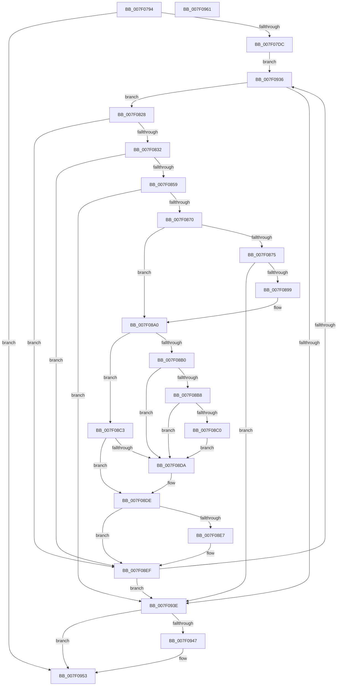

# CmpRmReDoPhase

- RVA: `0x007F0794`–`0x007F0962` (길이 `462` bytes)
- VA: `0x00000001407F0794`
- 실행 섹션: `PAGE`
- PDB 이름 있음: `예`; PDB Function 태그: `아니요`
- unwind 정보 RVA: `0x000D7134`
- 디코드: `125`개 명령, `462/462` bytes 표시
- 미해석 바이트: `0` (있으면 어셈블리에 `.byte`로 보존)

> 이 문서는 커널 이미지의 기계어와 PDB 기호를 분석해 생성했습니다. 4번과 5번은 함수 원형과 자료형을 바이너리 사용 방식에서 추정한 C 해석이며 원본 소스 복구 결과는 아닙니다.

## 1. Dependencies

- 직접 호출 지점: **9**; 고유 호출 대상: **9**
- 직접 호출자로 확인된 함수: **1**
- RIP 상대 이미지 참조: **5**

### Outgoing calls
- `0x007F0817` → `ext-ms-win-fs-clfs-l1-1-0.dll!ClfsReadLogRecord` (import, 간접 대상; import `ext-ms-win-fs-clfs-l1-1-0.dll!ClfsReadLogRecord`)
- `0x007F084C` → [CmpTransSearchAddTransFromRm](../A6/CmpTransSearchAddTransFromRm_function_00A6023C.md) (function, `0x00A6023C`)
- `0x007F088C` → [CmpDoReadTxRBigLogRecord](CmpDoReadTxRBigLogRecord_function_007F0338.md) (function, `0x007F0338`)
- `0x007F08A3` → [CmpVerifyLogRecord](CmpVerifyLogRecord_function_007F10DC.md) (function, `0x007F10DC`)
- `0x007F08C6` → [CmpRealignLogBuffers](CmpRealignLogBuffers_function_007F049C.md) (function, `0x007F049C`)
- `0x007F08D1` → [CmpDoReDoRecord](CmpDoReDoRecord_function_007F76B8.md) (function, `0x007F76B8`)
- `0x007F08EA` → [CmSiFreeMemory](../../text/47/CmSiFreeMemory_function_00475D80.md) (function, `0x00475D80`)
- `0x007F0923` → `ext-ms-win-fs-clfs-l1-1-0.dll!ClfsReadNextLogRecord` (import, 간접 대상; import `ext-ms-win-fs-clfs-l1-1-0.dll!ClfsReadNextLogRecord`)
- `0x007F0947` → `ext-ms-win-fs-clfs-l1-1-0.dll!ClfsTerminateReadLog` (import, 간접 대상; import `ext-ms-win-fs-clfs-l1-1-0.dll!ClfsTerminateReadLog`)

### Direct callers
- [CmpStartRMLog](CmpStartRMLog_function_007F0AFC.md) at `0x007F0F42`

### Static image references
- `0x007F0817` → RVA `0x00151270` (`ext-ms-win-fs-clfs-l1-1-0.dll!ClfsReadLogRecord (IAT)`; read)
- `0x007F08B0` → RVA `0x00F475F8` (`.data`; read)
- `0x007F08B8` → RVA `0x00F475DC` (`.data`; read)
- `0x007F0923` → RVA `0x001511D0` (`ext-ms-win-fs-clfs-l1-1-0.dll!ClfsReadNextLogRecord (IAT)`; read)
- `0x007F0947` → RVA `0x001511D8` (`ext-ms-win-fs-clfs-l1-1-0.dll!ClfsTerminateReadLog (IAT)`; read)

## 2. Other-region calls and transfers

- 다른 실행 섹션으로 향하는 call: **1**
  - `0x007F08EA` → [CmSiFreeMemory](../../text/47/CmSiFreeMemory_function_00475D80.md) (`PAGE` → `.text`)
- 별도 외부 분기/꼬리 이동을 확인하지 못했습니다.

## 3. Assembly (complete function range)

```asm
007F0794  4C 8B DC                        mov r11, rsp
007F0797  49 89 53 10                     mov qword ptr [r11 + 0x10], rdx
007F079B  55                              push rbp
007F079C  53                              push rbx
007F079D  56                              push rsi
007F079E  57                              push rdi
007F079F  41 56                           push r14
007F07A1  49 8D 6B A1                     lea rbp, [r11 - 0x5f]
007F07A5  48 81 EC 90 00 00 00            sub rsp, 0x90
007F07AC  33 DB                           xor ebx, ebx
007F07AE  48 8D 41 10                     lea rax, [rcx + 0x10]
007F07B2  4C 8B F1                        mov r14, rcx
007F07B5  48 89 5D FF                     mov qword ptr [rbp - 1], rbx
007F07B9  48 89 5D F7                     mov qword ptr [rbp - 9], rbx
007F07BD  89 5D 77                        mov dword ptr [rbp + 0x77], ebx
007F07C0  48 89 5D 1F                     mov qword ptr [rbp + 0x1f], rbx
007F07C4  48 89 5D 17                     mov qword ptr [rbp + 0x17], rbx
007F07C8  48 89 5D 27                     mov qword ptr [rbp + 0x27], rbx
007F07CC  88 5D 67                        mov byte ptr [rbp + 0x67], bl
007F07CF  48 89 5D 0F                     mov qword ptr [rbp + 0xf], rbx
007F07D3  48 39 00                        cmp qword ptr [rax], rax
007F07D6  0F 84 77 01 00 00               je 0x1407f0953
007F07DC  48 8B 49 60                     mov rcx, qword ptr [rcx + 0x60]
007F07E0  48 8D 45 FF                     lea rax, [rbp - 1]
007F07E4  49 89 43 88                     mov qword ptr [r11 - 0x78], rax
007F07E8  4C 8D 4D F7                     lea r9, [rbp - 9]
007F07EC  48 8D 45 17                     lea rax, [rbp + 0x17]
007F07F0  49 89 43 80                     mov qword ptr [r11 - 0x80], rax
007F07F4  44 8D 43 03                     lea r8d, [rbx + 3]
007F07F8  48 8D 45 1F                     lea rax, [rbp + 0x1f]
007F07FC  48 89 44 24 30                  mov qword ptr [rsp + 0x30], rax
007F0801  48 8D 55 6F                     lea rdx, [rbp + 0x6f]
007F0805  48 8D 45 67                     lea rax, [rbp + 0x67]
007F0809  48 89 44 24 28                  mov qword ptr [rsp + 0x28], rax
007F080E  48 8D 45 77                     lea rax, [rbp + 0x77]
007F0812  48 89 44 24 20                  mov qword ptr [rsp + 0x20], rax
007F0817  48 FF 15 52 0A 96 FF            call qword ptr [rip - 0x69f5ae]
007F081E  0F 1F 44 00 00                  nop dword ptr [rax + rax]
007F0823  E9 0E 01 00 00                  jmp 0x1407f0936
007F0828  F6 45 67 01                     test byte ptr [rbp + 0x67], 1
007F082C  0F 84 BD 00 00 00               je 0x1407f08ef
007F0832  4C 8B 45 F7                     mov r8, qword ptr [rbp - 9]
007F0836  48 8D 45 0F                     lea rax, [rbp + 0xf]
007F083A  49 83 C0 10                     add r8, 0x10
007F083E  48 89 44 24 20                  mov qword ptr [rsp + 0x20], rax
007F0843  45 33 C9                        xor r9d, r9d
007F0846  48 8B D3                        mov rdx, rbx
007F0849  49 8B CE                        mov rcx, r14
007F084C  E8 EB F9 26 00                  call 0x140a6023c
007F0851  85 C0                           test eax, eax
007F0853  0F 88 96 00 00 00               js 0x1407f08ef
007F0859  8B 55 77                        mov edx, dword ptr [rbp + 0x77]
007F085C  48 8B 7D F7                     mov rdi, qword ptr [rbp - 9]
007F0860  48 89 7D 07                     mov qword ptr [rbp + 7], rdi
007F0864  89 55 7F                        mov dword ptr [rbp + 0x7f], edx
007F0867  83 FA 30                        cmp edx, 0x30
007F086A  0F 82 CE 00 00 00               jb 0x1407f093e
007F0870  39 5F 0C                        cmp dword ptr [rdi + 0xc], ebx
007F0873  7D 2B                           jge 0x1407f08a0
007F0875  48 8B 4D FF                     mov rcx, qword ptr [rbp - 1]
007F0879  48 8D 45 7F                     lea rax, [rbp + 0x7f]
007F087D  44 8B C2                        mov r8d, edx
007F0880  48 89 44 24 20                  mov qword ptr [rsp + 0x20], rax
007F0885  48 8B D7                        mov rdx, rdi
007F0888  4C 8D 4D 07                     lea r9, [rbp + 7]
007F088C  E8 A7 FA FF FF                  call 0x1407f0338
007F0891  85 C0                           test eax, eax
007F0893  0F 88 A5 00 00 00               js 0x1407f093e
007F0899  48 8B 7D 07                     mov rdi, qword ptr [rbp + 7]
007F089D  8B 55 7F                        mov edx, dword ptr [rbp + 0x7f]
007F08A0  48 8B CF                        mov rcx, rdi
007F08A3  E8 34 08 00 00                  call 0x1407f10dc
007F08A8  48 8B 75 0F                     mov rsi, qword ptr [rbp + 0xf]
007F08AC  85 C0                           test eax, eax
007F08AE  79 13                           jns 0x1407f08c3
007F08B0  38 1D 42 6D 75 00               cmp byte ptr [rip + 0x756d42], bl
007F08B6  74 22                           je 0x1407f08da
007F08B8  38 1D 1E 6D 75 00               cmp byte ptr [rip + 0x756d1e], bl
007F08BE  75 1A                           jne 0x1407f08da
007F08C0  CC                              int3
007F08C1  EB 17                           jmp 0x1407f08da
007F08C3  48 8B CF                        mov rcx, rdi
007F08C6  E8 D1 FB FF FF                  call 0x1407f049c
007F08CB  48 8B D7                        mov rdx, rdi
007F08CE  48 8B CE                        mov rcx, rsi
007F08D1  E8 E2 6D 00 00                  call 0x1407f76b8
007F08D6  85 C0                           test eax, eax
007F08D8  79 04                           jns 0x1407f08de
007F08DA  83 4E 30 02                     or dword ptr [rsi + 0x30], 2
007F08DE  48 8B 45 F7                     mov rax, qword ptr [rbp - 9]
007F08E2  39 58 0C                        cmp dword ptr [rax + 0xc], ebx
007F08E5  7D 08                           jge 0x1407f08ef
007F08E7  48 8B CF                        mov rcx, rdi
007F08EA  E8 91 54 C8 FF                  call 0x140475d80
007F08EF  48 8B 4D FF                     mov rcx, qword ptr [rbp - 1]
007F08F3  48 8D 45 27                     lea rax, [rbp + 0x27]
007F08F7  48 89 44 24 38                  mov qword ptr [rsp + 0x38], rax
007F08FC  4C 8D 4D 67                     lea r9, [rbp + 0x67]
007F0900  48 8D 45 17                     lea rax, [rbp + 0x17]
007F0904  C6 45 67 01                     mov byte ptr [rbp + 0x67], 1
007F0908  48 89 44 24 30                  mov qword ptr [rsp + 0x30], rax
007F090D  4C 8D 45 77                     lea r8, [rbp + 0x77]
007F0911  48 8D 45 1F                     lea rax, [rbp + 0x1f]
007F0915  48 89 44 24 28                  mov qword ptr [rsp + 0x28], rax
007F091A  48 8D 55 F7                     lea rdx, [rbp - 9]
007F091E  48 89 5C 24 20                  mov qword ptr [rsp + 0x20], rbx
007F0923  48 FF 15 A6 08 96 FF            call qword ptr [rip - 0x69f75a]
007F092A  0F 1F 44 00 00                  nop dword ptr [rax + rax]
007F092F  3D 11 00 00 C0                  cmp eax, 0xc0000011
007F0934  74 08                           je 0x1407f093e
007F0936  85 C0                           test eax, eax
007F0938  0F 89 EA FE FF FF               jns 0x1407f0828
007F093E  48 8B 4D FF                     mov rcx, qword ptr [rbp - 1]
007F0942  48 85 C9                        test rcx, rcx
007F0945  74 0C                           je 0x1407f0953
007F0947  48 FF 15 8A 08 96 FF            call qword ptr [rip - 0x69f776]
007F094E  0F 1F 44 00 00                  nop dword ptr [rax + rax]
007F0953  48 81 C4 90 00 00 00            add rsp, 0x90
007F095A  41 5E                           pop r14
007F095C  5F                              pop rdi
007F095D  5E                              pop rsi
007F095E  5B                              pop rbx
007F095F  5D                              pop rbp
007F0960  C3                              ret
007F0961  CC                              int3
```

## 4. C-style interpretation (structured pseudocode)

```c
__int64 __fastcall CmpRmReDoPhase(__int64 a1, __int64 a2)
{
    __int64 result;
    __int64 v_rbx;
    __int64 v_rsp;
    unsigned __int64 v_stack_m80;
    unsigned __int64 v_stack_m88;
    unsigned __int64 v_stack_m90;
    unsigned __int64 v_stack_m98;

    *(unsigned __int64 *)(v_rsp + 16) = a2;
    v_rsp = (v_rsp) - (144);
    v_rbx = 0;
    *(unsigned __int64 *)(v_rsp - 95 - 1) = 0;
    *(unsigned __int64 *)(v_rsp - 95 - 9) = 0;
    *(unsigned int *)(v_rsp - 95 + 119) = 0;
    *(unsigned __int64 *)(v_rsp - 95 + 31) = 0;
    *(unsigned __int64 *)(v_rsp - 95 + 23) = 0;
    *(unsigned __int64 *)(v_rsp - 95 + 39) = 0;
    *(unsigned __int8 *)(v_rsp - 95 + 103) = 0;
    *(unsigned __int64 *)(v_rsp - 95 + 15) = 0;
    if ((*(unsigned __int64 *)(a1 + 16)) == (a1 + 16)) goto loc_007F0953;
    *(unsigned __int64 *)(v_rsp - 120) = v_rsp - 95 - 1;
    *(unsigned __int64 *)(v_rsp - 128) = v_rsp - 95 + 23;
    v_stack_m88 = v_rsp - 95 + 31;
    v_stack_m90 = v_rsp - 95 + 103;
    v_stack_m98 = v_rsp - 95 + 119;
    result = ext_ms_win_fs_clfs_l1_1_0_dll_ClfsReadLogRecord(*(unsigned __int64 *)(a1 + 96), v_rsp - 95 + 111, v_rbx + 3, v_rsp - 95 - 9);
    goto loc_007F0936;
loc_007F0828:
    if (((*(unsigned __int8 *)(v_rsp - 95 + 103)) & (1)) == 0) goto loc_007F08EF;
    a3 = (*(unsigned __int64 *)(v_rsp - 95 - 9)) + (16);
    v_stack_m98 = v_rsp - 95 + 15;
    a4 = 0;
    result = CmpTransSearchAddTransFromRm(a1, 0, a3, a4);
    if (sign_flag) goto loc_007F08EF;
    *(unsigned __int64 *)(v_rsp - 95 + 7) = *(unsigned __int64 *)(v_rsp - 95 - 9);
    *(unsigned int *)(v_rsp - 95 + 127) = (unsigned int)((unsigned int)(*(unsigned int *)(v_rsp - 95 + 119)));
    if (((unsigned int)((unsigned int)(*(unsigned int *)(v_rsp - 95 + 119)))) < 48) goto loc_007F093E;
    if ((*(unsigned int *)(*(unsigned __int64 *)(v_rsp - 95 - 9) + 12)) >= 0) goto loc_007F08A0;
    v_stack_m98 = v_rsp - 95 + 127;
    result = CmpDoReadTxRBigLogRecord(*(unsigned __int64 *)(v_rsp - 95 - 1), *(unsigned __int64 *)(v_rsp - 95 - 9), (unsigned int)((unsigned int)((unsigned int)(*(unsigned int *)(v_rsp - 95 + 119)))), v_rsp - 95 + 7);
    if (sign_flag) goto loc_007F093E;
loc_007F08A0:
    result = CmpVerifyLogRecord(*(unsigned __int64 *)(v_rsp - 95 + 7), (unsigned int)(*(unsigned int *)(v_rsp - 95 + 127)), (unsigned int)((unsigned int)((unsigned int)(*(unsigned int *)(v_rsp - 95 + 119)))), v_rsp - 95 + 7);
    if (!sign_flag) goto loc_007F08C3;
    if ((*(unsigned __int8 *)(v_rip + 7695682)) == 0) goto loc_007F08DA;
    if ((*(unsigned __int8 *)(v_rip + 7695646)) != 0) goto loc_007F08DA;
    goto loc_007F08DA;
loc_007F08C3:
    result = CmpRealignLogBuffers(*(unsigned __int64 *)(v_rsp - 95 + 7), (unsigned int)(*(unsigned int *)(v_rsp - 95 + 127)), (unsigned int)((unsigned int)((unsigned int)(*(unsigned int *)(v_rsp - 95 + 119)))), v_rsp - 95 + 7);
    result = CmpDoReDoRecord(*(unsigned __int64 *)(v_rsp - 95 + 15), *(unsigned __int64 *)(v_rsp - 95 + 7), (unsigned int)((unsigned int)((unsigned int)(*(unsigned int *)(v_rsp - 95 + 119)))), v_rsp - 95 + 7);
    if (sign_flag) {
    }
    result = *(unsigned __int64 *)(v_rsp - 95 - 9);
    if ((*(unsigned int *)(*(unsigned __int64 *)(v_rsp - 95 - 9) + 12)) < 0) {
        a1 = *(unsigned __int64 *)(v_rsp - 95 + 7);
        result = CmSiFreeMemory(a1, *(unsigned __int64 *)(v_rsp - 95 + 7), (unsigned int)((unsigned int)((unsigned int)(*(unsigned int *)(v_rsp - 95 + 119)))), v_rsp - 95 + 7);
    }
    v_stack_m80 = v_rsp - 95 + 39;
    *(unsigned __int8 *)(v_rsp - 95 + 103) = 1;
    v_stack_m88 = v_rsp - 95 + 23;
    v_stack_m90 = v_rsp - 95 + 31;
    v_stack_m98 = 0;
    result = ext_ms_win_fs_clfs_l1_1_0_dll_ClfsReadNextLogRecord(*(unsigned __int64 *)(v_rsp - 95 - 1), v_rsp - 95 - 9, v_rsp - 95 + 119, v_rsp - 95 + 103);
    if (((unsigned int)(result)) == 0xC0000011ULL) goto loc_007F093E;
loc_007F0936:
    if (!sign_flag) goto loc_007F0828;
loc_007F093E:
    if (*(unsigned __int64 *)(v_rsp - 95 - 1) != 0) {
        result = ext_ms_win_fs_clfs_l1_1_0_dll_ClfsTerminateReadLog(*(unsigned __int64 *)(v_rsp - 95 - 1), v_rsp - 95 - 9, v_rsp - 95 + 119, v_rsp - 95 + 103);
    }
    v_rsp = (v_rsp) + (144);
    return result;
}
```

## 5. (Beta) C Style

```c
int64_t CmpRmReDoPhase(void *Arg1, int64_t Arg2)
{
    uint8_t *arg1 = (uint8_t *)Arg1;

    int64_t result;
    int64_t local_rbx;
    int64_t local_rsp;
    uint64_t v_stack_m80;
    uint64_t v_stack_m88;
    uint64_t v_stack_m90;
    uint64_t v_stack_m98;

    *(uint64_t *)(local_rsp + 0x10) = Arg2;
    local_rsp = (local_rsp) - (144);
    local_rbx = 0;
    *(uint64_t *)(local_rsp - 0x5F - 0x1) = 0;
    *(uint64_t *)(local_rsp - 0x5F - 0x9) = 0;
    *(uint32_t *)(local_rsp - 0x5F + 0x77) = 0;
    *(uint64_t *)(local_rsp - 0x5F + 0x1F) = 0;
    *(uint64_t *)(local_rsp - 0x5F + 0x17) = 0;
    *(uint64_t *)(local_rsp - 0x5F + 0x27) = 0;
    *(uint8_t *)(local_rsp - 0x5F + 0x67) = 0;
    *(uint64_t *)(local_rsp - 0x5F + 0xF) = 0;
    if ((*(uint64_t *)(arg1 + 0x10)) == (Arg1 + 16)) goto loc_007F0953;
    *(uint64_t *)(local_rsp - 0x78) = local_rsp - 95 - 1;
    *(uint64_t *)(local_rsp - 0x80) = local_rsp - 95 + 23;
    v_stack_m88 = local_rsp - 95 + 31;
    v_stack_m90 = local_rsp - 95 + 103;
    v_stack_m98 = local_rsp - 95 + 119;
    result = kernel_indirect_call(*(uint64_t *)(arg1 + 0x60), local_rsp - 95 + 111, local_rbx + 3, local_rsp - 95 - 9);
    goto loc_007F0936;
loc_007F0828:
    if (((*(uint8_t *)(local_rsp - 0x5F + 0x67)) & (1)) == 0) goto loc_007F08EF;
    a3 = (*(uint64_t *)(local_rsp - 0x5F - 0x9)) + (16);
    v_stack_m98 = local_rsp - 95 + 15;
    a4 = 0;
    result = CmpTransSearchAddTransFromRm(Arg1, 0, a3, a4);
    if (sign_flag) goto loc_007F08EF;
    *(uint64_t *)(local_rsp - 0x5F + 0x7) = *(uint64_t *)(local_rsp - 0x5F - 0x9);
    *(uint32_t *)(local_rsp - 0x5F + 0x7F) = (uint32_t)((uint32_t)(*(uint32_t *)(local_rsp - 0x5F + 0x77)));
    if (((uint32_t)((uint32_t)(*(uint32_t *)(local_rsp - 0x5F + 0x77)))) < 48) goto loc_007F093E;
    if ((*(uint32_t *)(*(uint64_t *)(local_rsp - 0x5F - 0x9) + 0xC)) >= 0) goto loc_007F08A0;
    v_stack_m98 = local_rsp - 95 + 127;
    result = CmpDoReadTxRBigLogRecord(*(uint64_t *)(local_rsp - 0x5F - 0x1), *(uint64_t *)(local_rsp - 0x5F - 0x9), (uint32_t)((uint32_t)((uint32_t)(*(uint32_t *)(local_rsp - 0x5F + 0x77)))), local_rsp - 95 + 7);
    if (sign_flag) goto loc_007F093E;
loc_007F08A0:
    result = CmpVerifyLogRecord(*(uint64_t *)(local_rsp - 0x5F + 0x7), (uint32_t)(*(uint32_t *)(local_rsp - 0x5F + 0x7F)), (uint32_t)((uint32_t)((uint32_t)(*(uint32_t *)(local_rsp - 0x5F + 0x77)))), local_rsp - 95 + 7);
    if (!sign_flag) goto loc_007F08C3;
    if ((*(uint8_t *)(v_rip + 0x756D42)) == 0) goto loc_007F08DA;
    if ((*(uint8_t *)(v_rip + 0x756D1E)) != 0) goto loc_007F08DA;
    goto loc_007F08DA;
loc_007F08C3:
    result = CmpRealignLogBuffers(*(uint64_t *)(local_rsp - 0x5F + 0x7), (uint32_t)(*(uint32_t *)(local_rsp - 0x5F + 0x7F)), (uint32_t)((uint32_t)((uint32_t)(*(uint32_t *)(local_rsp - 0x5F + 0x77)))), local_rsp - 95 + 7);
    result = CmpDoReDoRecord(*(uint64_t *)(local_rsp - 0x5F + 0xF), *(uint64_t *)(local_rsp - 0x5F + 0x7), (uint32_t)((uint32_t)((uint32_t)(*(uint32_t *)(local_rsp - 0x5F + 0x77)))), local_rsp - 95 + 7);
    if (sign_flag) {
    }
    result = *(uint64_t *)(local_rsp - 0x5F - 0x9);
    if ((*(uint32_t *)(*(uint64_t *)(local_rsp - 0x5F - 0x9) + 0xC)) < 0) {
        Arg1 = *(uint64_t *)(local_rsp - 0x5F + 0x7);
        result = CmSiFreeMemory(Arg1, *(uint64_t *)(local_rsp - 0x5F + 0x7), (uint32_t)((uint32_t)((uint32_t)(*(uint32_t *)(local_rsp - 0x5F + 0x77)))), local_rsp - 95 + 7);
    }
    v_stack_m80 = local_rsp - 95 + 39;
    *(uint8_t *)(local_rsp - 0x5F + 0x67) = 1;
    v_stack_m88 = local_rsp - 95 + 23;
    v_stack_m90 = local_rsp - 95 + 31;
    v_stack_m98 = 0;
    result = kernel_indirect_call(*(uint64_t *)(local_rsp - 0x5F - 0x1), local_rsp - 95 - 9, local_rsp - 95 + 119, local_rsp - 95 + 103);
    if (((uint32_t)(result)) == 0xC0000011ULL) goto loc_007F093E;
loc_007F0936:
    if (!sign_flag) goto loc_007F0828;
loc_007F093E:
    if (*(uint64_t *)(local_rsp - 0x5F - 0x1) != 0) {
        result = kernel_indirect_call(*(uint64_t *)(local_rsp - 0x5F - 0x1), local_rsp - 95 - 9, local_rsp - 95 + 119, local_rsp - 95 + 103);
    }
    local_rsp = (local_rsp) + (144);
    return result;
}
```

### 관측된 메모리 오프셋

구조체 형식이 확인되지 않은 접근은 인자 기준의 오프셋으로만 기록했습니다.

| 기준 인자 | 오프셋 표현 | 폭 (bit) | 접근 |
|---|---:|---:|---|
| `Arg1` | `+ 0x0` | `64` | `R` |
| `Arg1` | `+ 0x10` | `64` | `R` |
| `Arg1` | `+ 0x60` | `64` | `R` |

## 6. Execution-region graph

[열기: 2D/3D 그래프와 함수 탐색 컨트롤 패널](../../../control-panel.html?section=page&rva=0x007F0794&view=graph)

- 2D 그래프는 위에서 아래로 흐르고, 3D 그래프는 빈 공간을 드래그해 회전합니다. Shift+드래그는 이동, 휠은 확대·축소, 함수 노드 선택은 대상 보고서 이동입니다.

### Static fallback


