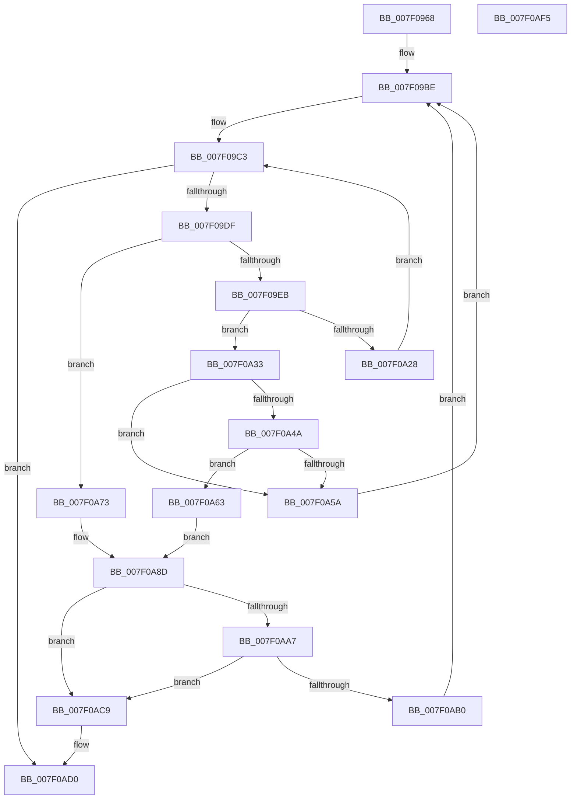

# CmpRmUnDoPhase

- RVA: `0x007F0968`–`0x007F0AF6` (길이 `398` bytes)
- VA: `0x00000001407F0968`
- 실행 섹션: `PAGE`
- PDB 이름 있음: `예`; PDB Function 태그: `아니요`
- unwind 정보 RVA: `0x000D7110`
- 디코드: `104`개 명령, `398/398` bytes 표시
- 미해석 바이트: `0` (있으면 어셈블리에 `.byte`로 보존)

> 이 문서는 커널 이미지의 기계어와 PDB 기호를 분석해 생성했습니다. 4번과 5번은 함수 원형과 자료형을 바이너리 사용 방식에서 추정한 C 해석이며 원본 소스 복구 결과는 아닙니다.

## 1. Dependencies

- 직접 호출 지점: **12**; 고유 호출 대상: **11**
- 직접 호출자로 확인된 함수: **1**
- RIP 상대 이미지 참조: **1**

### Outgoing calls
- `0x007F09CE` → [CmListGetNextElement](../../pagecmrc/BC/CmListGetNextElement_function_00BC9940.md) (function, `0x00BC9940`)
- `0x007F0A1F` → [ZwOpenTransaction](../../text/6A/ZwOpenTransaction_function_006AF850.md) (function, `0x006AF850`)
- `0x007F0A2C` → [ZwClose](../../text/6A/ZwClose_function_006AD2B0.md) (function, `0x006AD2B0`)
- `0x007F0A41` → [CmpTransMgrPrepare](../9B/CmpTransMgrPrepare_function_009B175C.md) (function, `0x009B175C`)
- `0x007F0A51` → [CmpTransMgrCommit](../9A/CmpTransMgrCommit_function_009AE8AC.md) (function, `0x009AE8AC`)
- `0x007F0A67` → [CmpAttachToRegistryProcess](../../pagecmrc/BC/CmpAttachToRegistryProcess_function_00BC98E0.md) (function, `0x00BC98E0`)
- `0x007F0A7A` → [CmpTransMgrRollback](../9B/CmpTransMgrRollback_function_009B1400.md) (function, `0x009B1400`)
- `0x007F0A83` → [CmpAttachToRegistryProcess](../../pagecmrc/BC/CmpAttachToRegistryProcess_function_00BC98E0.md) (function, `0x00BC98E0`)
- `0x007F0A90` → [CmpTransMgrFreeVolatileData](../87/CmpTransMgrFreeVolatileData_function_00874BDC.md) (function, `0x00874BDC`)
- `0x007F0A99` → [CmpDetachFromRegistryProcess](../../pagecmrc/BC/CmpDetachFromRegistryProcess_function_00BC9920.md) (function, `0x00BC9920`)
- `0x007F0ABF` → [ExFreePoolWithTag](../../poolcode/B8/ExFreePoolWithTag_function_00B82870.md) (function, `0x00B82870`)
- `0x007F0AD7` → [_security_check_cookie](../../text/6A/_security_check_cookie_function_006AC640.md) (function, `0x006AC640`)

### Direct callers
- [CmpStartRMLog](CmpStartRMLog_function_007F0AFC.md) at `0x007F0F4A`

### Static image references
- `0x007F0983` → RVA `0x00E0A740` (`.data`; read)

## 2. Other-region calls and transfers

- 다른 실행 섹션으로 향하는 call: **8**
  - `0x007F09CE` → [CmListGetNextElement](../../pagecmrc/BC/CmListGetNextElement_function_00BC9940.md) (`PAGE` → `PAGECMRC`)
  - `0x007F0A1F` → [ZwOpenTransaction](../../text/6A/ZwOpenTransaction_function_006AF850.md) (`PAGE` → `.text`)
  - `0x007F0A2C` → [ZwClose](../../text/6A/ZwClose_function_006AD2B0.md) (`PAGE` → `.text`)
  - `0x007F0A67` → [CmpAttachToRegistryProcess](../../pagecmrc/BC/CmpAttachToRegistryProcess_function_00BC98E0.md) (`PAGE` → `PAGECMRC`)
  - `0x007F0A83` → [CmpAttachToRegistryProcess](../../pagecmrc/BC/CmpAttachToRegistryProcess_function_00BC98E0.md) (`PAGE` → `PAGECMRC`)
  - `0x007F0A99` → [CmpDetachFromRegistryProcess](../../pagecmrc/BC/CmpDetachFromRegistryProcess_function_00BC9920.md) (`PAGE` → `PAGECMRC`)
  - `0x007F0ABF` → [ExFreePoolWithTag](../../poolcode/B8/ExFreePoolWithTag_function_00B82870.md) (`PAGE` → `POOLCODE`)
  - `0x007F0AD7` → [_security_check_cookie](../../text/6A/_security_check_cookie_function_006AC640.md) (`PAGE` → `.text`)
- 별도 외부 분기/꼬리 이동을 확인하지 못했습니다.

## 3. Assembly (complete function range)

```asm
007F0968  48 8B C4                        mov rax, rsp
007F096B  48 89 58 10                     mov qword ptr [rax + 0x10], rbx
007F096F  48 89 70 18                     mov qword ptr [rax + 0x18], rsi
007F0973  48 89 78 20                     mov qword ptr [rax + 0x20], rdi
007F0977  55                              push rbp
007F0978  48 8D 68 A1                     lea rbp, [rax - 0x5f]
007F097C  48 81 EC B0 00 00 00            sub rsp, 0xb0
007F0983  48 8B 05 B6 9D 61 00            mov rax, qword ptr [rip + 0x619db6]
007F098A  48 33 C4                        xor rax, rsp
007F098D  48 89 45 4F                     mov qword ptr [rbp + 0x4f], rax
007F0991  33 C0                           xor eax, eax
007F0993  0F 57 C0                        xorps xmm0, xmm0
007F0996  48 21 45 DF                     and qword ptr [rbp - 0x21], rax
007F099A  48 8B F9                        mov rdi, rcx
007F099D  21 45 DB                        and dword ptr [rbp - 0x25], eax
007F09A0  0F 11 45 EF                     movups xmmword ptr [rbp - 0x11], xmm0
007F09A4  48 89 45 0F                     mov qword ptr [rbp + 0xf], rax
007F09A8  0F 11 45 FF                     movups xmmword ptr [rbp - 1], xmm0
007F09AC  89 45 17                        mov dword ptr [rbp + 0x17], eax
007F09AF  88 45 D7                        mov byte ptr [rbp - 0x29], al
007F09B2  0F 11 45 1F                     movups xmmword ptr [rbp + 0x1f], xmm0
007F09B6  0F 11 45 2F                     movups xmmword ptr [rbp + 0x2f], xmm0
007F09BA  0F 11 45 3F                     movups xmmword ptr [rbp + 0x3f], xmm0
007F09BE  48 83 65 E7 00                  and qword ptr [rbp - 0x19], 0
007F09C3  45 33 C0                        xor r8d, r8d
007F09C6  48 8D 55 E7                     lea rdx, [rbp - 0x19]
007F09CA  48 8D 4F 10                     lea rcx, [rdi + 0x10]
007F09CE  E8 6D 8F 3D 00                  call 0x140bc9940
007F09D3  48 8B D8                        mov rbx, rax
007F09D6  48 85 C0                        test rax, rax
007F09D9  0F 84 F1 00 00 00               je 0x1407f0ad0
007F09DF  8B 48 30                        mov ecx, dword ptr [rax + 0x30]
007F09E2  F6 C1 02                        test cl, 2
007F09E5  0F 85 88 00 00 00               jne 0x1407f0a73
007F09EB  4C 21 45 F7                     and qword ptr [rbp - 9], r8
007F09EF  4C 8D 48 58                     lea r9, [rax + 0x58]
007F09F3  4C 21 45 FF                     and qword ptr [rbp - 1], r8
007F09F7  48 8D 4D DF                     lea rcx, [rbp - 0x21]
007F09FB  4C 21 44 24 20                  and qword ptr [rsp + 0x20], r8
007F0A00  0F 57 C0                        xorps xmm0, xmm0
007F0A03  4C 8D 45 EF                     lea r8, [rbp - 0x11]
007F0A07  C7 45 EF 30 00 00 00            mov dword ptr [rbp - 0x11], 0x30
007F0A0E  BA 3F 00 1F 00                  mov edx, 0x1f003f
007F0A13  C7 45 07 00 02 00 00            mov dword ptr [rbp + 7], 0x200
007F0A1A  F3 0F 7F 45 0F                  movdqu xmmword ptr [rbp + 0xf], xmm0
007F0A1F  E8 2C EE EB FF                  call 0x1406af850
007F0A24  85 C0                           test eax, eax
007F0A26  78 0B                           js 0x1407f0a33
007F0A28  48 8B 4D DF                     mov rcx, qword ptr [rbp - 0x21]
007F0A2C  E8 7F C8 EB FF                  call 0x1406ad2b0
007F0A31  EB 90                           jmp 0x1407f09c3
007F0A33  4C 8D 4D D7                     lea r9, [rbp - 0x29]
007F0A37  48 8B D3                        mov rdx, rbx
007F0A3A  4C 8D 45 DB                     lea r8, [rbp - 0x25]
007F0A3E  48 8B CF                        mov rcx, rdi
007F0A41  E8 16 0D 1C 00                  call 0x1409b175c
007F0A46  85 C0                           test eax, eax
007F0A48  78 10                           js 0x1407f0a5a
007F0A4A  4C 8D 45 DB                     lea r8, [rbp - 0x25]
007F0A4E  48 8B D3                        mov rdx, rbx
007F0A51  E8 56 DE 1B 00                  call 0x1409ae8ac
007F0A56  85 C0                           test eax, eax
007F0A58  79 09                           jns 0x1407f0a63
007F0A5A  83 4B 30 02                     or dword ptr [rbx + 0x30], 2
007F0A5E  E9 5B FF FF FF                  jmp 0x1407f09be
007F0A63  48 8D 4D 1F                     lea rcx, [rbp + 0x1f]
007F0A67  E8 74 8E 3D 00                  call 0x140bc98e0
007F0A6C  BA 04 00 00 00                  mov edx, 4
007F0A71  EB 1A                           jmp 0x1407f0a8d
007F0A73  48 8D 55 DB                     lea rdx, [rbp - 0x25]
007F0A77  48 8B CB                        mov rcx, rbx
007F0A7A  E8 81 09 1C 00                  call 0x1409b1400
007F0A7F  48 8D 4D 1F                     lea rcx, [rbp + 0x1f]
007F0A83  E8 58 8E 3D 00                  call 0x140bc98e0
007F0A88  BA 08 00 00 00                  mov edx, 8
007F0A8D  48 8B CB                        mov rcx, rbx
007F0A90  E8 47 41 08 00                  call 0x140874bdc
007F0A95  48 8D 4D 1F                     lea rcx, [rbp + 0x1f]
007F0A99  E8 82 8E 3D 00                  call 0x140bc9920
007F0A9E  48 8B 0B                        mov rcx, qword ptr [rbx]
007F0AA1  48 39 59 08                     cmp qword ptr [rcx + 8], rbx
007F0AA5  75 22                           jne 0x1407f0ac9
007F0AA7  48 8B 43 08                     mov rax, qword ptr [rbx + 8]
007F0AAB  48 39 18                        cmp qword ptr [rax], rbx
007F0AAE  75 19                           jne 0x1407f0ac9
007F0AB0  48 89 08                        mov qword ptr [rax], rcx
007F0AB3  BA 43 4D 54 72                  mov edx, 0x72544d43
007F0AB8  48 89 41 08                     mov qword ptr [rcx + 8], rax
007F0ABC  48 8B CB                        mov rcx, rbx
007F0ABF  E8 AC 1D 39 00                  call 0x140b82870
007F0AC4  E9 F5 FE FF FF                  jmp 0x1407f09be
007F0AC9  B9 03 00 00 00                  mov ecx, 3
007F0ACE  CD 29                           int 0x29
007F0AD0  48 8B 4D 4F                     mov rcx, qword ptr [rbp + 0x4f]
007F0AD4  48 33 CC                        xor rcx, rsp
007F0AD7  E8 64 BB EB FF                  call 0x1406ac640
007F0ADC  4C 8D 9C 24 B0 00 00 00         lea r11, [rsp + 0xb0]
007F0AE4  49 8B 5B 18                     mov rbx, qword ptr [r11 + 0x18]
007F0AE8  49 8B 73 20                     mov rsi, qword ptr [r11 + 0x20]
007F0AEC  49 8B 7B 28                     mov rdi, qword ptr [r11 + 0x28]
007F0AF0  49 8B E3                        mov rsp, r11
007F0AF3  5D                              pop rbp
007F0AF4  C3                              ret
007F0AF5  CC                              int3
```

## 4. C-style interpretation (structured pseudocode)

```c
__int64 __fastcall CmpRmUnDoPhase(__int64 a1, __int64 a2, int a3)
{
    __int64 result;
    __int64 v_rsp;
    unsigned __int64 v_stack_m8;
    unsigned __int64 v_stack_m98;

    *(unsigned __int64 *)(v_rsp + 16) = v_rbx;
    *(unsigned __int64 *)(v_rsp + 24) = v_rsi;
    *(unsigned __int64 *)(v_rsp + 32) = v_rdi;
    v_rsp = (v_rsp) - (176);
    result = (*(unsigned __int64 *)(v_rip + 6397366)) ^ (v_rsp);
    *(unsigned __int64 *)(v_rsp - 95 + 79) = result;
    result = 0;
    *(unsigned __int64 *)(v_rsp - 95 - 17) = v_xmm0;
    *(unsigned __int64 *)(v_rsp - 95 + 15) = 0;
    *(unsigned __int64 *)(v_rsp - 95 - 1) = v_xmm0;
    *(unsigned int *)(v_rsp - 95 + 23) = 0;
    *(unsigned __int8 *)(v_rsp - 95 - 41) = 0;
    *(unsigned __int64 *)(v_rsp - 95 + 31) = v_xmm0;
    *(unsigned __int64 *)(v_rsp - 95 + 47) = v_xmm0;
    *(unsigned __int64 *)(v_rsp - 95 + 63) = v_xmm0;
loc_007F09BE:
loc_007F09C3:
    a3 = 0;
    result = CmListGetNextElement(a1 + 16, v_rsp - 95 - 25, a3, a4);
    if (result == 0) goto loc_007F0AD0;
    if ((((unsigned __int8)((unsigned int)(*(unsigned int *)(result + 48)))) & (2)) != 0) goto loc_007F0A73;
    *(unsigned int *)(v_rsp - 95 - 17) = 48;
    *(unsigned int *)(v_rsp - 95 + 7) = 512;
    *(unsigned __int64 *)(v_rsp - 95 + 15) = v_xmm0;
    result = ZwOpenTransaction(v_rsp - 95 - 33, (unsigned int)(0x1F003FULL), v_rsp - 95 - 17, result + 88);
    if (sign_flag) goto loc_007F0A33;
    result = ZwClose(*(unsigned __int64 *)(v_rsp - 95 - 33), (unsigned int)(0x1F003FULL), v_rsp - 95 - 17, result + 88);
    goto loc_007F09C3;
loc_007F0A33:
    result = CmpTransMgrPrepare(a1, result, v_rsp - 95 - 37, v_rsp - 95 - 41);
    if (sign_flag) goto loc_007F0A5A;
    result = CmpTransMgrCommit(a1, result, v_rsp - 95 - 37, v_rsp - 95 - 41);
    if (!sign_flag) goto loc_007F0A63;
loc_007F0A5A:
    goto loc_007F09BE;
loc_007F0A63:
    result = CmpAttachToRegistryProcess(v_rsp - 95 + 31, result, v_rsp - 95 - 37, v_rsp - 95 - 41);
    goto loc_007F0A8D;
loc_007F0A73:
    result = CmpTransMgrRollback(result, v_rsp - 95 - 37, v_rsp - 95 - 37, v_rsp - 95 - 41);
    result = CmpAttachToRegistryProcess(v_rsp - 95 + 31, v_rsp - 95 - 37, v_rsp - 95 - 37, v_rsp - 95 - 41);
loc_007F0A8D:
    result = CmpTransMgrFreeVolatileData(result, 8, v_rsp - 95 - 37, v_rsp - 95 - 41);
    result = CmpDetachFromRegistryProcess(v_rsp - 95 + 31, 8, v_rsp - 95 - 37, v_rsp - 95 - 41);
    if ((*(unsigned __int64 *)(*(unsigned __int64 *)(result) + 8)) != result) goto loc_007F0AC9;
    if ((*(unsigned __int64 *)(*(unsigned __int64 *)(result + 8))) != result) goto loc_007F0AC9;
    *(unsigned __int64 *)(*(unsigned __int64 *)(result + 8)) = *(unsigned __int64 *)(result);
    *(unsigned __int64 *)(*(unsigned __int64 *)(result) + 8) = *(unsigned __int64 *)(result + 8);
    result = ExFreePoolWithTag(result, (unsigned int)(0x72544D43ULL), v_rsp - 95 - 37, v_rsp - 95 - 41);
    goto loc_007F09BE;
loc_007F0AC9:
loc_007F0AD0:
    a1 = (*(unsigned __int64 *)(v_rsp - 95 + 79)) ^ (v_rsp);
    result = _security_check_cookie(a1, (unsigned int)(0x72544D43ULL), v_rsp - 95 - 37, v_rsp - 95 - 41);
    return result;
}
```

## 5. (Beta) C Style

```c
int64_t CmpRmUnDoPhase(void *Arg1, int64_t Arg2, int32_t Arg3)
{
    uint8_t *arg1 = (uint8_t *)Arg1;

    int64_t result;
    int64_t local_rsp;
    uint64_t v_stack_m8;
    uint64_t v_stack_m98;

    *(uint64_t *)(local_rsp + 0x10) = local_rbx;
    *(uint64_t *)(local_rsp + 0x18) = local_rsi;
    *(uint64_t *)(local_rsp + 0x20) = local_rdi;
    local_rsp = (local_rsp) - (176);
    result = (*(uint64_t *)(v_rip + 0x619DB6)) ^ (local_rsp);
    *(uint64_t *)(local_rsp - 0x5F + 0x4F) = result;
    result = 0;
    *(uint64_t *)(local_rsp - 0x5F - 0x11) = v_xmm0;
    *(uint64_t *)(local_rsp - 0x5F + 0xF) = 0;
    *(uint64_t *)(local_rsp - 0x5F - 0x1) = v_xmm0;
    *(uint32_t *)(local_rsp - 0x5F + 0x17) = 0;
    *(uint8_t *)(local_rsp - 0x5F - 0x29) = 0;
    *(uint64_t *)(local_rsp - 0x5F + 0x1F) = v_xmm0;
    *(uint64_t *)(local_rsp - 0x5F + 0x2F) = v_xmm0;
    *(uint64_t *)(local_rsp - 0x5F + 0x3F) = v_xmm0;
loc_007F09BE:
loc_007F09C3:
    Arg3 = 0;
    result = CmListGetNextElement(Arg1 + 16, local_rsp - 95 - 25, Arg3, a4);
    if (result == 0) goto loc_007F0AD0;
    if ((((uint8_t)((uint32_t)(*(uint32_t *)(result + 0x30)))) & (2)) != 0) goto loc_007F0A73;
    *(uint32_t *)(local_rsp - 0x5F - 0x11) = 48;
    *(uint32_t *)(local_rsp - 0x5F + 0x7) = 512;
    *(uint64_t *)(local_rsp - 0x5F + 0xF) = v_xmm0;
    result = ZwOpenTransaction(local_rsp - 95 - 33, (uint32_t)(0x1F003FULL), local_rsp - 95 - 17, result + 88);
    if (sign_flag) goto loc_007F0A33;
    result = ZwClose(*(uint64_t *)(local_rsp - 0x5F - 0x21), (uint32_t)(0x1F003FULL), local_rsp - 95 - 17, result + 88);
    goto loc_007F09C3;
loc_007F0A33:
    result = CmpTransMgrPrepare(Arg1, result, local_rsp - 95 - 37, local_rsp - 95 - 41);
    if (sign_flag) goto loc_007F0A5A;
    result = CmpTransMgrCommit(Arg1, result, local_rsp - 95 - 37, local_rsp - 95 - 41);
    if (!sign_flag) goto loc_007F0A63;
loc_007F0A5A:
    goto loc_007F09BE;
loc_007F0A63:
    result = CmpAttachToRegistryProcess(local_rsp - 95 + 31, result, local_rsp - 95 - 37, local_rsp - 95 - 41);
    goto loc_007F0A8D;
loc_007F0A73:
    result = CmpTransMgrRollback(result, local_rsp - 95 - 37, local_rsp - 95 - 37, local_rsp - 95 - 41);
    result = CmpAttachToRegistryProcess(local_rsp - 95 + 31, local_rsp - 95 - 37, local_rsp - 95 - 37, local_rsp - 95 - 41);
loc_007F0A8D:
    result = CmpTransMgrFreeVolatileData(result, 8, local_rsp - 95 - 37, local_rsp - 95 - 41);
    result = CmpDetachFromRegistryProcess(local_rsp - 95 + 31, 8, local_rsp - 95 - 37, local_rsp - 95 - 41);
    if ((*(uint64_t *)(*(uint64_t *)(result) + 0x8)) != result) goto loc_007F0AC9;
    if ((*(uint64_t *)(*(uint64_t *)(result + 0x8))) != result) goto loc_007F0AC9;
    *(uint64_t *)(*(uint64_t *)(result + 0x8)) = *(uint64_t *)(result);
    *(uint64_t *)(*(uint64_t *)(result) + 0x8) = *(uint64_t *)(result + 0x8);
    result = ExFreePoolWithTag(result, (uint32_t)(0x72544D43ULL), local_rsp - 95 - 37, local_rsp - 95 - 41);
    goto loc_007F09BE;
loc_007F0AC9:
loc_007F0AD0:
    Arg1 = (*(uint64_t *)(local_rsp - 0x5F + 0x4F)) ^ (local_rsp);
    result = _security_check_cookie(Arg1, (uint32_t)(0x72544D43ULL), local_rsp - 95 - 37, local_rsp - 95 - 41);
    return result;
}
```

### 관측된 메모리 오프셋

구조체 형식이 확인되지 않은 접근은 인자 기준의 오프셋으로만 기록했습니다.

| 기준 인자 | 오프셋 표현 | 폭 (bit) | 접근 |
|---|---:|---:|---|
| `Arg1` | `+ 0x10` | `64` | `R` |

## 6. Execution-region graph

[열기: 2D/3D 그래프와 함수 탐색 컨트롤 패널](../../../control-panel.html?section=page&rva=0x007F0968&view=graph)

- 2D 그래프는 위에서 아래로 흐르고, 3D 그래프는 빈 공간을 드래그해 회전합니다. Shift+드래그는 이동, 휠은 확대·축소, 함수 노드 선택은 대상 보고서 이동입니다.

### Static fallback


