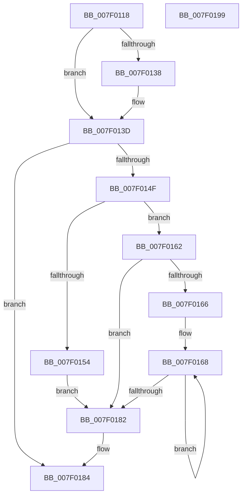

# CmpSnapshotTxOwnerArrayToRollbackPacket

- RVA: `0x007F0118`–`0x007F019A` (길이 `130` bytes)
- VA: `0x00000001407F0118`
- 실행 섹션: `PAGE`
- PDB 이름 있음: `예`; PDB Function 태그: `아니요`
- unwind 정보 RVA: `0x0005C954`
- 디코드: `42`개 명령, `130/130` bytes 표시
- 미해석 바이트: `0` (있으면 어셈블리에 `.byte`로 보존)

> 이 문서는 커널 이미지의 기계어와 PDB 기호를 분석해 생성했습니다. 4번과 5번은 함수 원형과 자료형을 바이너리 사용 방식에서 추정한 C 해석이며 원본 소스 복구 결과는 아닙니다.

## 1. Dependencies

- 직접 호출 지점: **3**; 고유 호출 대상: **2**
- 직접 호출자로 확인된 함수: **1**
- RIP 상대 이미지 참조: **0**

### Outgoing calls
- `0x007F0146` → [CmpReserveRollbackPacketSpace](../70/CmpReserveRollbackPacketSpace_function_00703A5C.md) (function, `0x00703A5C`)
- `0x007F015B` → [CmpAddUoWToRollbackPacket](../7E/CmpAddUoWToRollbackPacket_function_007EFE8C.md) (function, `0x007EFE8C`)
- `0x007F0173` → [CmpAddUoWToRollbackPacket](../7E/CmpAddUoWToRollbackPacket_function_007EFE8C.md) (function, `0x007EFE8C`)

### Direct callers
- [sub_00B2D7EA](../B2/Unknown_function_00B2D7EA.md) at `0x00B2D7ED`

### Static image references
- 디코드된 RIP-relative 메모리 참조가 없습니다.

## 2. Other-region calls and transfers

- 다른 실행 섹션으로 향하는 call: **0**
- 별도 외부 분기/꼬리 이동을 확인하지 못했습니다.

## 3. Assembly (complete function range)

```asm
007F0118  48 89 5C 24 08                  mov qword ptr [rsp + 8], rbx
007F011D  48 89 6C 24 10                  mov qword ptr [rsp + 0x10], rbp
007F0122  48 89 74 24 18                  mov qword ptr [rsp + 0x18], rsi
007F0127  57                              push rdi
007F0128  48 83 EC 20                     sub rsp, 0x20
007F012C  8B 19                           mov ebx, dword ptr [rcx]
007F012E  48 8B F2                        mov rsi, rdx
007F0131  48 8B F9                        mov rdi, rcx
007F0134  85 DB                           test ebx, ebx
007F0136  75 05                           jne 0x1407f013d
007F0138  8D 4B 05                        lea ecx, [rbx + 5]
007F013B  CD 29                           int 0x29
007F013D  0F BA F3 1F                     btr ebx, 0x1f
007F0141  48 8B CE                        mov rcx, rsi
007F0144  8B D3                           mov edx, ebx
007F0146  E8 11 39 F1 FF                  call 0x140703a5c
007F014B  85 C0                           test eax, eax
007F014D  78 35                           js 0x1407f0184
007F014F  83 FB 01                        cmp ebx, 1
007F0152  75 0E                           jne 0x1407f0162
007F0154  48 8B 57 08                     mov rdx, qword ptr [rdi + 8]
007F0158  48 8B CE                        mov rcx, rsi
007F015B  E8 2C FD FF FF                  call 0x1407efe8c
007F0160  EB 20                           jmp 0x1407f0182
007F0162  85 DB                           test ebx, ebx
007F0164  74 1C                           je 0x1407f0182
007F0166  33 ED                           xor ebp, ebp
007F0168  48 8B 57 08                     mov rdx, qword ptr [rdi + 8]
007F016C  48 8B CE                        mov rcx, rsi
007F016F  48 8B 14 2A                     mov rdx, qword ptr [rdx + rbp]
007F0173  E8 14 FD FF FF                  call 0x1407efe8c
007F0178  48 8D 6D 08                     lea rbp, [rbp + 8]
007F017C  48 83 EB 01                     sub rbx, 1
007F0180  75 E6                           jne 0x1407f0168
007F0182  33 C0                           xor eax, eax
007F0184  48 8B 5C 24 30                  mov rbx, qword ptr [rsp + 0x30]
007F0189  48 8B 6C 24 38                  mov rbp, qword ptr [rsp + 0x38]
007F018E  48 8B 74 24 40                  mov rsi, qword ptr [rsp + 0x40]
007F0193  48 83 C4 20                     add rsp, 0x20
007F0197  5F                              pop rdi
007F0198  C3                              ret
007F0199  CC                              int3
```

## 4. C-style interpretation (structured pseudocode)

```c
__int64 __fastcall CmpSnapshotTxOwnerArrayToRollbackPacket(__int64 a1, __int64 a2)
{
    __int64 result;
    __int64 v_rbp;
    __int64 v_rbx;
    __int64 v_rsp;
    unsigned __int64 v_stack_p10;
    unsigned __int64 v_stack_p18;
    unsigned __int64 v_stack_p8;

    v_stack_p8 = v_rbx;
    v_stack_p10 = v_rbp;
    v_stack_p18 = v_rsi;
    v_rsp = (v_rsp) - (32);
    if ((unsigned int)((unsigned int)(*(unsigned int *)(a1))) == 0) {
        a1 = (unsigned int)(*(unsigned int *)(a1)) + 5;
    }
    result = CmpReserveRollbackPacketSpace(a2, (unsigned int)((unsigned int)((unsigned int)(*(unsigned int *)(a1)))), a3, a4);
    if (sign_flag) goto loc_007F0184;
    if (((unsigned int)((unsigned int)(*(unsigned int *)(a1)))) != 1) goto loc_007F0162;
    result = CmpAddUoWToRollbackPacket(a2, *(unsigned __int64 *)(a1 + 8), a3, a4);
    goto loc_007F0182;
loc_007F0162:
    if ((unsigned int)((unsigned int)(*(unsigned int *)(a1))) == 0) goto loc_007F0182;
    v_rbp = 0;
loc_007F0168:
    result = CmpAddUoWToRollbackPacket(a2, *(unsigned __int64 *)(*(unsigned __int64 *)(a1 + 8) + v_rbp * 1), a3, a4);
    v_rbx = ((unsigned int)(*(unsigned int *)(a1))) - (1);
    if (condition_is_not_equal) goto loc_007F0168;
loc_007F0182:
    result = 0;
loc_007F0184:
    v_rsp = (v_rsp) + (32);
    return result;
}
```

## 5. (Beta) C Style

```c
int64_t CmpSnapshotTxOwnerArrayToRollbackPacket(void *Arg1, int64_t Arg2)
{
    uint8_t *arg1 = (uint8_t *)Arg1;

    int64_t result;
    int64_t local_rbp;
    int64_t local_rbx;
    int64_t local_rsp;
    uint64_t v_stack_p10;
    uint64_t v_stack_p18;
    uint64_t v_stack_p8;

    v_stack_p8 = local_rbx;
    v_stack_p10 = local_rbp;
    v_stack_p18 = local_rsi;
    local_rsp = (local_rsp) - (32);
    if ((uint32_t)((uint32_t)(*(uint32_t *)(arg1))) == 0) {
        Arg1 = (uint32_t)(*(uint32_t *)(arg1)) + 5;
    }
    result = CmpReserveRollbackPacketSpace(Arg2, (uint32_t)((uint32_t)((uint32_t)(*(uint32_t *)(arg1)))), a3, a4);
    if (sign_flag) goto loc_007F0184;
    if (((uint32_t)((uint32_t)(*(uint32_t *)(arg1)))) != 1) goto loc_007F0162;
    result = CmpAddUoWToRollbackPacket(Arg2, *(uint64_t *)(arg1 + 0x8), a3, a4);
    goto loc_007F0182;
loc_007F0162:
    if ((uint32_t)((uint32_t)(*(uint32_t *)(arg1))) == 0) goto loc_007F0182;
    local_rbp = 0;
loc_007F0168:
    result = CmpAddUoWToRollbackPacket(Arg2, *(uint64_t *)(*(uint64_t *)(arg1 + 0x8) + local_rbp * 1), a3, a4);
    local_rbx = ((uint32_t)(*(uint32_t *)(arg1))) - (1);
    if (condition_is_not_equal) goto loc_007F0168;
loc_007F0182:
    result = 0;
loc_007F0184:
    local_rsp = (local_rsp) + (32);
    return result;
}
```

### 관측된 메모리 오프셋

구조체 형식이 확인되지 않은 접근은 인자 기준의 오프셋으로만 기록했습니다.

| 기준 인자 | 오프셋 표현 | 폭 (bit) | 접근 |
|---|---:|---:|---|
| `Arg1` | `+ 0x0` | `32` | `R` |
| `Arg1` | `+ 0x8` | `64` | `R` |

## 6. Execution-region graph

[열기: 2D/3D 그래프와 함수 탐색 컨트롤 패널](../../../control-panel.html?section=page&rva=0x007F0118&view=graph)

- 2D 그래프는 위에서 아래로 흐르고, 3D 그래프는 빈 공간을 드래그해 회전합니다. Shift+드래그는 이동, 휠은 확대·축소, 함수 노드 선택은 대상 보고서 이동입니다.

### Static fallback


