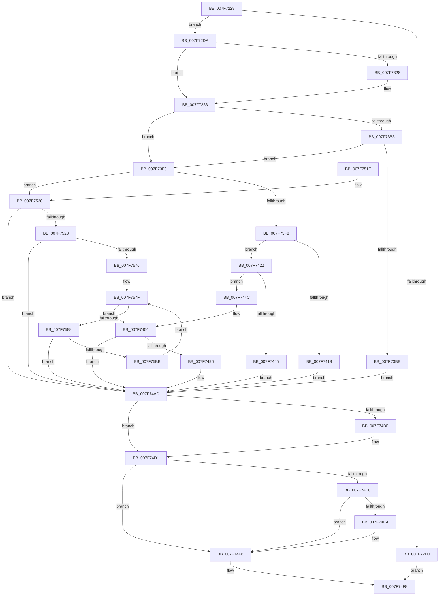

# CmpStartCLFSLog

- RVA: `0x007F7228`–`0x007F75BF` (길이 `919` bytes)
- VA: `0x00000001407F7228`
- 실행 섹션: `PAGE`
- PDB 이름 있음: `예`; PDB Function 태그: `아니요`
- unwind 정보 RVA: `0x000D756C`
- 디코드: `223`개 명령, `919/919` bytes 표시
- 미해석 바이트: `0` (있으면 어셈블리에 `.byte`로 보존)

> 이 문서는 커널 이미지의 기계어와 PDB 기호를 분석해 생성했습니다. 4번과 5번은 함수 원형과 자료형을 바이너리 사용 방식에서 추정한 C 해석이며 원본 소스 복구 결과는 아닙니다.

## 1. Dependencies

- 직접 호출 지점: **23**; 고유 호출 대상: **15**
- 직접 호출자로 확인된 함수: **1**
- RIP 상대 이미지 참조: **10**

### Outgoing calls
- `0x007F72C2` → [ExAllocatePool2](../../poolcode/B8/ExAllocatePool2_function_00B820F0.md) (function, `0x00B820F0`)
- `0x007F72ED` → [RtlAppendUnicodeStringToString](../../text/40/RtlAppendUnicodeStringToString_function_0040FA50.md) (function, `0x0040FA50`)
- `0x007F72F9` → [RtlAppendUnicodeStringToString](../../text/40/RtlAppendUnicodeStringToString_function_0040FA50.md) (function, `0x0040FA50`)
- `0x007F7305` → [RtlAppendUnicodeStringToString](../../text/40/RtlAppendUnicodeStringToString_function_0040FA50.md) (function, `0x0040FA50`)
- `0x007F7315` → [RtlAppendUnicodeStringToString](../../text/40/RtlAppendUnicodeStringToString_function_0040FA50.md) (function, `0x0040FA50`)
- `0x007F731F` → [Feature_CLFS_Signing__private_IsEnabledDeviceUsageNoInline](../../text/4F/Feature_CLFS_Signing__private_IsEnabledDeviceUsageNoInline_function_004F79EC.md) (function, `0x004F79EC`)
- `0x007F7349` → [PsDisableImpersonation](../9E/PsDisableImpersonation_function_009E89B0.md) (function, `0x009E89B0`)
- `0x007F735D` → [KeStackAttachProcess](../../text/21/KeStackAttachProcess_function_00216800.md) (function, `0x00216800`)
- `0x007F739A` → `ext-ms-win-fs-clfs-l1-1-0.dll!ClfsCreateLogFile` (import, 간접 대상; import `ext-ms-win-fs-clfs-l1-1-0.dll!ClfsCreateLogFile`)
- `0x007F73A8` → [Feature_CLFS_Signing__private_IsEnabledDeviceUsageNoInline](../../text/4F/Feature_CLFS_Signing__private_IsEnabledDeviceUsageNoInline_function_004F79EC.md) (function, `0x004F79EC`)
- `0x007F73E6` → [CmpDeleteCorruptedLogfile](CmpDeleteCorruptedLogfile_function_007F6C80.md) (function, `0x007F6C80`)
- `0x007F740B` → [ExAllocatePool2](../../poolcode/B8/ExAllocatePool2_function_00B820F0.md) (function, `0x00B820F0`)
- `0x007F742E` → `ext-ms-win-fs-clfs-l1-1-0.dll!ClfsGetLogFileInformation` (import, 간접 대상; import `ext-ms-win-fs-clfs-l1-1-0.dll!ClfsGetLogFileInformation`)
- `0x007F7445` → [ExFreePoolWithTag](../../poolcode/B8/ExFreePoolWithTag_function_00B82870.md) (function, `0x00B82870`)
- `0x007F744F` → [ExFreePoolWithTag](../../poolcode/B8/ExFreePoolWithTag_function_00B82870.md) (function, `0x00B82870`)
- `0x007F7484` → `ext-ms-win-fs-clfs-l1-1-0.dll!ClfsCreateMarshallingArea` (import, 간접 대상; import `ext-ms-win-fs-clfs-l1-1-0.dll!ClfsCreateMarshallingArea`)
- `0x007F74B3` → [KiUnstackDetachProcess](../../text/21/KiUnstackDetachProcess_function_00217D30.md) (function, `0x00217D30`)
- `0x007F74CC` → [PsRestoreImpersonation](../9E/PsRestoreImpersonation_function_009E6F10.md) (function, `0x009E6F10`)
- `0x007F74D7` → [ExFreePoolWithTag](../../poolcode/B8/ExFreePoolWithTag_function_00B82870.md) (function, `0x00B82870`)
- `0x007F74EA` → `ext-ms-win-fs-clfs-l1-1-0.dll!ClfsCloseLogFileObject` (import, 간접 대상; import `ext-ms-win-fs-clfs-l1-1-0.dll!ClfsCloseLogFileObject`)
- `0x007F74FF` → [_security_check_cookie](../../text/6A/_security_check_cookie_function_006AC640.md) (function, `0x006AC640`)
- `0x007F7560` → `ext-ms-win-fs-clfs-l1-1-0.dll!ClfsCreateLogFile` (import, 간접 대상; import `ext-ms-win-fs-clfs-l1-1-0.dll!ClfsCreateLogFile`)
- `0x007F75AC` → [CmpAddRemoveContainerToCLFSLog](CmpAddRemoveContainerToCLFSLog_function_007F69FC.md) (function, `0x007F69FC`)

### Direct callers
- [CmpStartRMLog](CmpStartRMLog_function_007F0AFC.md) at `0x007F0D23`

### Static image references
- `0x007F7244` → RVA `0x00E0A740` (`.data`; read)
- `0x007F72DE` → RVA `0x0000BEC0` (`.rdata`; read)
- `0x007F730A` → RVA `0x0000BE90` (`.rdata`; read)
- `0x007F734E` → RVA `0x00FC6AB0` (`ALMOSTRO`; read)
- `0x007F739A` → RVA `0x00151268` (`ext-ms-win-fs-clfs-l1-1-0.dll!ClfsCreateLogFile (IAT)`; read)
- `0x007F73BB` → RVA `0x00B09C70` (` ?? ::NNGAKEGL::`string'`; read)
- `0x007F73CE` → RVA `0x0000BEA0` (`.rdata`; read)
- `0x007F742E` → RVA `0x00151240` (`ext-ms-win-fs-clfs-l1-1-0.dll!ClfsGetLogFileInformation (IAT)`; read)
- `0x007F7484` → RVA `0x00151220` (`ext-ms-win-fs-clfs-l1-1-0.dll!ClfsCreateMarshallingArea (IAT)`; read)
- `0x007F74EA` → RVA `0x00151250` (`ext-ms-win-fs-clfs-l1-1-0.dll!ClfsCloseLogFileObject (IAT)`; read)

## 2. Other-region calls and transfers

- 다른 실행 섹션으로 향하는 call: **14**
  - `0x007F72C2` → [ExAllocatePool2](../../poolcode/B8/ExAllocatePool2_function_00B820F0.md) (`PAGE` → `POOLCODE`)
  - `0x007F72ED` → [RtlAppendUnicodeStringToString](../../text/40/RtlAppendUnicodeStringToString_function_0040FA50.md) (`PAGE` → `.text`)
  - `0x007F72F9` → [RtlAppendUnicodeStringToString](../../text/40/RtlAppendUnicodeStringToString_function_0040FA50.md) (`PAGE` → `.text`)
  - `0x007F7305` → [RtlAppendUnicodeStringToString](../../text/40/RtlAppendUnicodeStringToString_function_0040FA50.md) (`PAGE` → `.text`)
  - `0x007F7315` → [RtlAppendUnicodeStringToString](../../text/40/RtlAppendUnicodeStringToString_function_0040FA50.md) (`PAGE` → `.text`)
  - `0x007F731F` → [Feature_CLFS_Signing__private_IsEnabledDeviceUsageNoInline](../../text/4F/Feature_CLFS_Signing__private_IsEnabledDeviceUsageNoInline_function_004F79EC.md) (`PAGE` → `.text`)
  - `0x007F735D` → [KeStackAttachProcess](../../text/21/KeStackAttachProcess_function_00216800.md) (`PAGE` → `.text`)
  - `0x007F73A8` → [Feature_CLFS_Signing__private_IsEnabledDeviceUsageNoInline](../../text/4F/Feature_CLFS_Signing__private_IsEnabledDeviceUsageNoInline_function_004F79EC.md) (`PAGE` → `.text`)
  - `0x007F740B` → [ExAllocatePool2](../../poolcode/B8/ExAllocatePool2_function_00B820F0.md) (`PAGE` → `POOLCODE`)
  - `0x007F7445` → [ExFreePoolWithTag](../../poolcode/B8/ExFreePoolWithTag_function_00B82870.md) (`PAGE` → `POOLCODE`)
  - `0x007F744F` → [ExFreePoolWithTag](../../poolcode/B8/ExFreePoolWithTag_function_00B82870.md) (`PAGE` → `POOLCODE`)
  - `0x007F74B3` → [KiUnstackDetachProcess](../../text/21/KiUnstackDetachProcess_function_00217D30.md) (`PAGE` → `.text`)
  - `0x007F74D7` → [ExFreePoolWithTag](../../poolcode/B8/ExFreePoolWithTag_function_00B82870.md) (`PAGE` → `POOLCODE`)
  - `0x007F74FF` → [_security_check_cookie](../../text/6A/_security_check_cookie_function_006AC640.md) (`PAGE` → `.text`)
- 별도 외부 분기/꼬리 이동을 확인하지 못했습니다.

## 3. Assembly (complete function range)

```asm
007F7228  48 89 5C 24 18                  mov qword ptr [rsp + 0x18], rbx
007F722D  55                              push rbp
007F722E  56                              push rsi
007F722F  57                              push rdi
007F7230  41 54                           push r12
007F7232  41 55                           push r13
007F7234  41 56                           push r14
007F7236  41 57                           push r15
007F7238  48 8D 6C 24 F9                  lea rbp, [rsp - 7]
007F723D  48 81 EC F0 00 00 00            sub rsp, 0xf0
007F7244  48 8B 05 F5 34 61 00            mov rax, qword ptr [rip + 0x6134f5]
007F724B  48 33 C4                        xor rax, rsp
007F724E  48 89 45 F7                     mov qword ptr [rbp - 9], rax
007F7252  48 8B 45 6F                     mov rax, qword ptr [rbp + 0x6f]
007F7256  33 DB                           xor ebx, ebx
007F7258  4C 8B A5 87 00 00 00            mov r12, qword ptr [rbp + 0x87]
007F725F  4C 8B F1                        mov r14, rcx
007F7262  4C 8B AD 8F 00 00 00            mov r13, qword ptr [rbp + 0x8f]
007F7269  0F 57 C9                        xorps xmm1, xmm1
007F726C  48 89 45 A7                     mov qword ptr [rbp - 0x59], rax
007F7270  4C 8B FA                        mov r15, rdx
007F7273  48 8B 45 7F                     mov rax, qword ptr [rbp + 0x7f]
007F7277  0F 57 C0                        xorps xmm0, xmm0
007F727A  49 89 1C 24                     mov qword ptr [r12], rbx
007F727E  41 B8 43 4D 20 20               mov r8d, 0x20204d43
007F7284  49 89 5D 00                     mov qword ptr [r13], rbx
007F7288  49 8B F1                        mov rsi, r9
007F728B  48 89 45 AF                     mov qword ptr [rbp - 0x51], rax
007F728F  0F B7 01                        movzx eax, word ptr [rcx]
007F7292  0F B7 0A                        movzx ecx, word ptr [rdx]
007F7295  66 83 C0 1A                     add ax, 0x1a
007F7299  66 03 C8                        add cx, ax
007F729C  89 5D 87                        mov dword ptr [rbp - 0x79], ebx
007F729F  0F B7 D1                        movzx edx, cx
007F72A2  B9 00 01 00 00                  mov ecx, 0x100
007F72A7  66 89 55 91                     mov word ptr [rbp - 0x6f], dx
007F72AB  89 5D 93                        mov dword ptr [rbp - 0x6d], ebx
007F72AE  0F 11 45 B7                     movups xmmword ptr [rbp - 0x49], xmm0
007F72B2  66 89 5D 8F                     mov word ptr [rbp - 0x71], bx
007F72B6  0F 11 4D C7                     movups xmmword ptr [rbp - 0x39], xmm1
007F72BA  0F 11 4D D7                     movups xmmword ptr [rbp - 0x29], xmm1
007F72BE  0F 11 4D E7                     movups xmmword ptr [rbp - 0x19], xmm1
007F72C2  E8 29 AE 38 00                  call 0x140b820f0
007F72C7  48 89 45 97                     mov qword ptr [rbp - 0x69], rax
007F72CB  48 85 C0                        test rax, rax
007F72CE  75 0A                           jne 0x1407f72da
007F72D0  B8 9A 00 00 C0                  mov eax, 0xc000009a
007F72D5  E9 1E 02 00 00                  jmp 0x1407f74f8
007F72DA  49 89 1C 24                     mov qword ptr [r12], rbx
007F72DE  48 8D 15 DB 4B 81 FF            lea rdx, [rip - 0x7eb425]
007F72E5  48 8D 4D 8F                     lea rcx, [rbp - 0x71]
007F72E9  49 89 5D 00                     mov qword ptr [r13], rbx
007F72ED  E8 5E 87 C1 FF                  call 0x14040fa50
007F72F2  49 8B D6                        mov rdx, r14
007F72F5  48 8D 4D 8F                     lea rcx, [rbp - 0x71]
007F72F9  E8 52 87 C1 FF                  call 0x14040fa50
007F72FE  49 8B D7                        mov rdx, r15
007F7301  48 8D 4D 8F                     lea rcx, [rbp - 0x71]
007F7305  E8 46 87 C1 FF                  call 0x14040fa50
007F730A  48 8D 15 7F 4B 81 FF            lea rdx, [rip - 0x7eb481]
007F7311  48 8D 4D 8F                     lea rcx, [rbp - 0x71]
007F7315  E8 36 87 C1 FF                  call 0x14040fa50
007F731A  BF 00 02 00 00                  mov edi, 0x200
007F731F  E8 C8 06 D0 FF                  call 0x1404f79ec
007F7324  85 C0                           test eax, eax
007F7326  74 0B                           je 0x1407f7333
007F7328  38 5D 77                        cmp byte ptr [rbp + 0x77], bl
007F732B  B8 00 02 00 01                  mov eax, 0x1000200
007F7330  0F 44 F8                        cmove edi, eax
007F7333  48 89 5C 24 68                  mov qword ptr [rsp + 0x68], rbx
007F7338  48 8D 55 B7                     lea rdx, [rbp - 0x49]
007F733C  48 89 5D 9F                     mov qword ptr [rbp - 0x61], rbx
007F7340  65 48 8B 0C 25 88 01 00 00      mov rcx, qword ptr gs:[0x188]
007F7349  E8 62 16 1F 00                  call 0x1409e89b0
007F734E  48 8B 0D 5B F7 7C 00            mov rcx, qword ptr [rip + 0x7cf75b]
007F7355  48 8D 55 C7                     lea rdx, [rbp - 0x39]
007F7359  88 44 24 60                     mov byte ptr [rsp + 0x60], al
007F735D  E8 9E F4 A1 FF                  call 0x140216800
007F7362  89 5C 24 50                     mov dword ptr [rsp + 0x50], ebx
007F7366  48 8D 55 8F                     lea rdx, [rbp - 0x71]
007F736A  48 89 5C 24 48                  mov qword ptr [rsp + 0x48], rbx
007F736F  48 8D 4C 24 68                  lea rcx, [rsp + 0x68]
007F7374  89 7C 24 40                     mov dword ptr [rsp + 0x40], edi
007F7378  45 33 C9                        xor r9d, r9d
007F737B  89 5C 24 38                     mov dword ptr [rsp + 0x38], ebx
007F737F  41 B8 00 00 01 C0               mov r8d, 0xc0010000
007F7385  C7 44 24 30 08 00 00 00         mov dword ptr [rsp + 0x30], 8
007F738D  C7 44 24 28 01 00 00 00         mov dword ptr [rsp + 0x28], 1
007F7395  48 89 74 24 20                  mov qword ptr [rsp + 0x20], rsi
007F739A  48 FF 15 C7 9E 95 FF            call qword ptr [rip - 0x6a6139]
007F73A1  0F 1F 44 00 00                  nop dword ptr [rax + rax]
007F73A6  8B D8                           mov ebx, eax
007F73A8  E8 3F 06 D0 FF                  call 0x1404f79ec
007F73AD  33 C9                           xor ecx, ecx
007F73AF  85 C0                           test eax, eax
007F73B1  74 3D                           je 0x1407f73f0
007F73B3  81 FB 0D 00 1A C0               cmp ebx, 0xc01a000d
007F73B9  75 35                           jne 0x1407f73f0
007F73BB  48 8D 05 AE 28 31 00            lea rax, [rip + 0x3128ae]
007F73C2  66 C7 44 24 30 10 00            mov word ptr [rsp + 0x30], 0x10
007F73C9  48 89 44 24 28                  mov qword ptr [rsp + 0x28], rax
007F73CE  4C 8D 0D CB 4A 81 FF            lea r9, [rip - 0x7eb535]
007F73D5  89 4C 24 20                     mov dword ptr [rsp + 0x20], ecx
007F73D9  4C 8D 05 B0 4A 81 FF            lea r8, [rip - 0x7eb550]
007F73E0  49 8B CE                        mov rcx, r14
007F73E3  49 8B D7                        mov rdx, r15
007F73E6  E8 95 F8 FF FF                  call 0x1407f6c80
007F73EB  E9 BD 00 00 00                  jmp 0x1407f74ad
007F73F0  85 DB                           test ebx, ebx
007F73F2  0F 88 28 01 00 00               js 0x1407f7520
007F73F8  BA 78 00 00 00                  mov edx, 0x78
007F73FD  B9 00 01 00 00                  mov ecx, 0x100
007F7402  41 B8 43 4D 20 20               mov r8d, 0x20204d43
007F7408  89 55 87                        mov dword ptr [rbp - 0x79], edx
007F740B  E8 E0 AC 38 00                  call 0x140b820f0
007F7410  48 8B F0                        mov rsi, rax
007F7413  48 85 C0                        test rax, rax
007F7416  75 0A                           jne 0x1407f7422
007F7418  BB 9A 00 00 C0                  mov ebx, 0xc000009a
007F741D  E9 8B 00 00 00                  jmp 0x1407f74ad
007F7422  48 8B 4C 24 68                  mov rcx, qword ptr [rsp + 0x68]
007F7427  4C 8D 45 87                     lea r8, [rbp - 0x79]
007F742B  48 8B D6                        mov rdx, rsi
007F742E  48 FF 15 0B 9E 95 FF            call qword ptr [rip - 0x6a61f5]
007F7435  0F 1F 44 00 00                  nop dword ptr [rax + rax]
007F743A  33 D2                           xor edx, edx
007F743C  48 8B CE                        mov rcx, rsi
007F743F  8B D8                           mov ebx, eax
007F7441  85 C0                           test eax, eax
007F7443  79 07                           jns 0x1407f744c
007F7445  E8 26 B4 38 00                  call 0x140b82870
007F744A  EB 61                           jmp 0x1407f74ad
007F744C  8B 7E 28                        mov edi, dword ptr [rsi + 0x28]
007F744F  E8 1C B4 38 00                  call 0x140b82870
007F7454  48 8B 4C 24 68                  mov rcx, qword ptr [rsp + 0x68]
007F7459  48 8D 45 9F                     lea rax, [rbp - 0x61]
007F745D  48 89 44 24 38                  mov qword ptr [rsp + 0x38], rax
007F7462  45 33 C9                        xor r9d, r9d
007F7465  C7 44 24 30 14 00 00 00         mov dword ptr [rsp + 0x30], 0x14
007F746D  45 33 C0                        xor r8d, r8d
007F7470  C7 44 24 28 02 00 00 00         mov dword ptr [rsp + 0x28], 2
007F7478  C7 44 24 20 00 10 00 00         mov dword ptr [rsp + 0x20], 0x1000
007F7480  41 8D 51 01                     lea edx, [r9 + 1]
007F7484  48 FF 15 95 9D 95 FF            call qword ptr [rip - 0x6a626b]
007F748B  0F 1F 44 00 00                  nop dword ptr [rax + rax]
007F7490  8B D8                           mov ebx, eax
007F7492  85 C0                           test eax, eax
007F7494  78 17                           js 0x1407f74ad
007F7496  48 8B 45 AF                     mov rax, qword ptr [rbp - 0x51]
007F749A  89 38                           mov dword ptr [rax], edi
007F749C  48 8B 44 24 68                  mov rax, qword ptr [rsp + 0x68]
007F74A1  49 89 04 24                     mov qword ptr [r12], rax
007F74A5  48 8B 45 9F                     mov rax, qword ptr [rbp - 0x61]
007F74A9  49 89 45 00                     mov qword ptr [r13], rax
007F74AD  33 D2                           xor edx, edx
007F74AF  48 8D 4D C7                     lea rcx, [rbp - 0x39]
007F74B3  E8 78 08 A2 FF                  call 0x140217d30
007F74B8  80 7C 24 60 00                  cmp byte ptr [rsp + 0x60], 0
007F74BD  74 12                           je 0x1407f74d1
007F74BF  65 48 8B 0C 25 88 01 00 00      mov rcx, qword ptr gs:[0x188]
007F74C8  48 8D 55 B7                     lea rdx, [rbp - 0x49]
007F74CC  E8 3F FA 1E 00                  call 0x1409e6f10
007F74D1  48 8B 4D 97                     mov rcx, qword ptr [rbp - 0x69]
007F74D5  33 D2                           xor edx, edx
007F74D7  E8 94 B3 38 00                  call 0x140b82870
007F74DC  85 DB                           test ebx, ebx
007F74DE  79 16                           jns 0x1407f74f6
007F74E0  48 8B 4C 24 68                  mov rcx, qword ptr [rsp + 0x68]
007F74E5  48 85 C9                        test rcx, rcx
007F74E8  74 0C                           je 0x1407f74f6
007F74EA  48 FF 15 5F 9D 95 FF            call qword ptr [rip - 0x6a62a1]
007F74F1  0F 1F 44 00 00                  nop dword ptr [rax + rax]
007F74F6  8B C3                           mov eax, ebx
007F74F8  48 8B 4D F7                     mov rcx, qword ptr [rbp - 9]
007F74FC  48 33 CC                        xor rcx, rsp
007F74FF  E8 3C 51 EB FF                  call 0x1406ac640
007F7504  48 8B 9C 24 40 01 00 00         mov rbx, qword ptr [rsp + 0x140]
007F750C  48 81 C4 F0 00 00 00            add rsp, 0xf0
007F7513  41 5F                           pop r15
007F7515  41 5E                           pop r14
007F7517  41 5D                           pop r13
007F7519  41 5C                           pop r12
007F751B  5F                              pop rdi
007F751C  5E                              pop rsi
007F751D  5D                              pop rbp
007F751E  C3                              ret
007F751F  CC                              int3
007F7520  81 FB 34 00 00 C0               cmp ebx, 0xc0000034
007F7526  75 85                           jne 0x1407f74ad
007F7528  89 4C 24 50                     mov dword ptr [rsp + 0x50], ecx
007F752C  48 8D 55 8F                     lea rdx, [rbp - 0x71]
007F7530  48 89 4C 24 48                  mov qword ptr [rsp + 0x48], rcx
007F7535  45 33 C9                        xor r9d, r9d
007F7538  89 7C 24 40                     mov dword ptr [rsp + 0x40], edi
007F753C  41 B8 00 00 01 C0               mov r8d, 0xc0010000
007F7542  89 4C 24 38                     mov dword ptr [rsp + 0x38], ecx
007F7546  48 8D 4C 24 68                  lea rcx, [rsp + 0x68]
007F754B  C7 44 24 30 08 00 00 00         mov dword ptr [rsp + 0x30], 8
007F7553  C7 44 24 28 02 00 00 00         mov dword ptr [rsp + 0x28], 2
007F755B  48 89 74 24 20                  mov qword ptr [rsp + 0x20], rsi
007F7560  48 FF 15 01 9D 95 FF            call qword ptr [rip - 0x6a62ff]
007F7567  0F 1F 44 00 00                  nop dword ptr [rax + rax]
007F756C  8B D8                           mov ebx, eax
007F756E  85 C0                           test eax, eax
007F7570  0F 88 37 FF FF FF               js 0x1407f74ad
007F7576  33 FF                           xor edi, edi
007F7578  48 8D 35 21 49 81 FF            lea rsi, [rip - 0x7eb6df]
007F757F  83 FF 03                        cmp edi, 3
007F7582  0F 83 CC FE FF FF               jae 0x1407f7454
007F7588  48 8B 45 A7                     mov rax, qword ptr [rbp - 0x59]
007F758C  4C 8D 0D FD 48 81 FF            lea r9, [rip - 0x7eb703]
007F7593  48 8B 4C 24 68                  mov rcx, qword ptr [rsp + 0x68]
007F7598  4D 8B C7                        mov r8, r15
007F759B  48 89 44 24 30                  mov qword ptr [rsp + 0x30], rax
007F75A0  49 8B D6                        mov rdx, r14
007F75A3  89 7C 24 28                     mov dword ptr [rsp + 0x28], edi
007F75A7  48 89 74 24 20                  mov qword ptr [rsp + 0x20], rsi
007F75AC  E8 4B F4 FF FF                  call 0x1407f69fc
007F75B1  8B D8                           mov ebx, eax
007F75B3  85 C0                           test eax, eax
007F75B5  0F 88 F2 FE FF FF               js 0x1407f74ad
007F75BB  FF C7                           inc edi
007F75BD  EB C0                           jmp 0x1407f757f
```

## 4. C-style interpretation (structured pseudocode)

```c
__int64 __fastcall CmpStartCLFSLog(__int64 a1, __int64 a2, __int64 a3, __int64 a4, __int64 a5, __int64 a6, unsigned __int8 a7, __int64 a8, __int64 a9, __int64 a10)
{
    __int64 result;
    __int64 v_rbx;
    __int64 v_rdi;
    __int64 v_rsp;
    unsigned int v_stack_m100;
    unsigned __int64 v_stack_m108;
    unsigned __int64 v_stack_m3F;
    unsigned __int64 v_stack_m48;
    unsigned __int64 v_stack_m58;
    unsigned __int64 v_stack_m68;
    unsigned __int64 v_stack_m78;
    unsigned __int64 v_stack_m88;
    unsigned __int64 v_stack_m90;
    unsigned __int64 v_stack_m98;
    unsigned __int64 v_stack_mA0;
    unsigned __int64 v_stack_mA8;
    unsigned int v_stack_mAC;
    unsigned __int16 v_stack_mAE;
    unsigned __int16 v_stack_mB0;
    unsigned int v_stack_mB8;
    unsigned __int64 v_stack_mC0;
    unsigned __int8 v_stack_mC8;
    unsigned int v_stack_mD8;
    unsigned __int64 v_stack_mE0;
    unsigned int v_stack_mE8;
    unsigned int v_stack_mF0;
    unsigned int v_stack_mF8;
    unsigned __int64 v_stack_p18;
    unsigned __int64 v_stack_p20;
    unsigned int v_stack_p28;
    unsigned int v_stack_p30;
    unsigned int v_stack_p38;
    unsigned int v_stack_p40;
    unsigned __int64 v_stack_p48;
    unsigned int v_stack_p50;
    unsigned __int64 v_stack_p68;

    v_stack_p18 = v_rbx;
    v_rsp = (v_rsp) - (240);
    result = (*(unsigned __int64 *)(v_rip + 6370549)) ^ (v_rsp);
    v_stack_m48 = result;
    v_rbx = 0;
    v_stack_m98 = a6;
    *(unsigned __int64 *)(a9) = 0;
    *(unsigned __int64 *)(a10) = 0;
    v_stack_m90 = a8;
    result = (unsigned __int16)((*(unsigned __int16 *)(a1)) + (26));
    a1 = (unsigned __int16)((*(unsigned __int16 *)(a2)) + ((unsigned __int16)(result)));
    v_stack_mB8 = 0;
    v_stack_mAE = (unsigned __int16)((unsigned __int16)(a1));
    v_stack_mAC = 0;
    v_stack_m88 = v_xmm0;
    v_stack_mB0 = 0;
    v_stack_m78 = v_xmm1;
    v_stack_m68 = v_xmm1;
    v_stack_m58 = v_xmm1;
    result = ExAllocatePool2(256, (unsigned __int16)(a1), (unsigned int)(0x20204D43ULL), a4);
    v_stack_mA8 = result;
    if (result != 0) goto loc_007F72DA;
    goto loc_007F74F8;
loc_007F72DA:
    *(unsigned __int64 *)(a9) = 0;
    *(unsigned __int64 *)(a10) = 0;
    result = RtlAppendUnicodeStringToString(v_stack_mB0, v_rip - 8303653, (unsigned int)(0x20204D43ULL), a4);
    result = RtlAppendUnicodeStringToString(v_stack_mB0, a1, (unsigned int)(0x20204D43ULL), a4);
    result = RtlAppendUnicodeStringToString(v_stack_mB0, a2, (unsigned int)(0x20204D43ULL), a4);
    result = RtlAppendUnicodeStringToString(v_stack_mB0, v_rip - 8303745, (unsigned int)(0x20204D43ULL), a4);
    result = Feature_CLFS_Signing__private_IsEnabledDeviceUsageNoInline(v_stack_mB0, v_rip - 8303745, (unsigned int)(0x20204D43ULL), a4);
    v_rdi = 512;
    if ((unsigned int)(result) != 0) {
        result = 0x1000200ULL;
        v_rdi = 512;
        if (a7 == 0) { v_rdi = (unsigned int)(result); }
    }
    v_stack_mC0 = 0;
    v_stack_mA0 = 0;
    result = PsDisableImpersonation(*(unsigned __int64 *)(gs_base + (0 + 392)), v_stack_m88, (unsigned int)(0x20204D43ULL), a4);
    v_stack_mC8 = (unsigned __int8)(result);
    result = KeStackAttachProcess(*(unsigned __int64 *)(v_rip + 8189787), v_stack_m78, (unsigned int)(0x20204D43ULL), a4);
    v_stack_mD8 = 0;
    v_stack_mE0 = 0;
    v_stack_mE8 = (unsigned int)(v_rdi);
    a4 = 0;
    v_stack_mF0 = 0;
    v_stack_mF8 = 8;
    v_stack_m100 = 1;
    v_stack_m108 = 0;
    result = ext_ms_win_fs_clfs_l1_1_0_dll_ClfsCreateLogFile(v_stack_mC0, v_stack_mB0, (unsigned int)(0xC0010000ULL), a4);
    result = Feature_CLFS_Signing__private_IsEnabledDeviceUsageNoInline(v_stack_mC0, v_stack_mB0, (unsigned int)(0xC0010000ULL), a4);
    a1 = 0;
    if ((unsigned int)(result) == 0) goto loc_007F73F0;
    if (((unsigned int)((unsigned int)((unsigned int)(result)))) != 0xC01A000DULL) goto loc_007F73F0;
    v_stack_mF8 = 16;
    v_stack_m100 = v_rip + 3221678;
    v_stack_m108 = 0;
    result = CmpDeleteCorruptedLogfile(0, a2, v_rip - 8303952, v_rip - 8303925);
    goto loc_007F74AD;
loc_007F73F0:
    if (sign_flag) goto loc_007F7520;
    v_stack_mB8 = 120;
    result = ExAllocatePool2(256, 120, (unsigned int)(0x20204D43ULL), v_rip - 8303925);
    if (result != 0) goto loc_007F7422;
    goto loc_007F74AD;
loc_007F7422:
    result = ext_ms_win_fs_clfs_l1_1_0_dll_ClfsGetLogFileInformation(v_stack_mC0, result, v_stack_mB8, v_rip - 8303925);
    a2 = 0;
    if (!sign_flag) goto loc_007F744C;
    result = ExFreePoolWithTag(result, a2, v_stack_mB8, v_rip - 8303925);
    goto loc_007F74AD;
loc_007F744C:
    result = ExFreePoolWithTag(result, a2, v_stack_mB8, v_rip - 8303925);
loc_007F7454:
    v_stack_mF0 = v_stack_mA0;
    a4 = 0;
    v_stack_mF8 = 20;
    a3 = 0;
    v_stack_m100 = 2;
    v_stack_m108 = 0x1000ULL;
    result = ext_ms_win_fs_clfs_l1_1_0_dll_ClfsCreateMarshallingArea(v_stack_mC0, a4 + 1, a3, a4);
    if (!(sign_flag)) {
        result = v_stack_m90;
        *(unsigned int *)(result) = (unsigned int)((unsigned int)(*(unsigned int *)(result + 40)));
        result = v_stack_mC0;
        *(unsigned __int64 *)(a9) = result;
        result = v_stack_mA0;
        *(unsigned __int64 *)(a10) = result;
    }
    a2 = 0;
    result = KiUnstackDetachProcess(v_stack_m78, a2, a3, a4);
    if (v_stack_mC8 != 0) {
        a1 = *(unsigned __int64 *)(gs_base + (0 + 392));
        a2 = v_stack_m88;
        result = PsRestoreImpersonation(a1, a2, a3, a4);
    }
    a2 = 0;
    result = ExFreePoolWithTag(v_stack_mA8, a2, a3, a4);
    if (!sign_flag) goto loc_007F74F6;
    if (v_stack_mC0 != 0) {
        result = ext_ms_win_fs_clfs_l1_1_0_dll_ClfsCloseLogFileObject(v_stack_mC0, a2, a3, a4);
    }
loc_007F74F8:
    a1 = (v_stack_m48) ^ (v_rsp);
    result = _security_check_cookie(a1, a2, a3, a4);
    v_rsp = (v_rsp) + (240);
    return result;
loc_007F7520:
    if (((unsigned int)(v_stack_p18)) != 0xC0000034ULL) goto loc_007F74AD;
    v_stack_p50 = (unsigned int)(a1);
    v_stack_p48 = a1;
    a4 = 0;
    v_stack_p40 = (unsigned int)((unsigned int)(*(unsigned int *)(result + 40)));
    v_stack_p38 = (unsigned int)(a1);
    v_stack_p30 = 8;
    v_stack_p28 = 2;
    v_stack_p20 = result;
    result = ext_ms_win_fs_clfs_l1_1_0_dll_ClfsCreateLogFile(v_stack_p68, v_stack_mB0, (unsigned int)(0xC0010000ULL), a4);
    if (sign_flag) goto loc_007F74AD;
    v_rdi = 0;
loc_007F757F:
    if (0 >= 3) goto loc_007F7454;
    v_stack_p30 = v_stack_m98;
    v_stack_p28 = 0;
    v_stack_p20 = v_rip - 8304351;
    result = CmpAddRemoveContainerToCLFSLog(v_stack_p68, a1, 0, v_rip - 8304387);
    if (sign_flag) goto loc_007F74AD;
    v_rdi = (unsigned int)((v_rdi) + 1);
    goto loc_007F757F;
}
```

## 5. (Beta) C Style

```c
int64_t CmpStartCLFSLog(void *Arg1, void *Arg2, int64_t Arg3, int64_t Arg4, uint64_t Arg5, int64_t Arg6, uint8_t Arg7, int64_t Arg8, void *Arg9, void *Arg10)
{
    uint8_t *arg1 = (uint8_t *)Arg1;
    uint8_t *arg2 = (uint8_t *)Arg2;
    uint8_t *arg9 = (uint8_t *)Arg9;
    uint8_t *arg10 = (uint8_t *)Arg10;

    int64_t result;
    int64_t local_rbx;
    int64_t local_rdi;
    int64_t local_rsp;
    uint32_t v_stack_m100;
    uint64_t v_stack_m108;
    uint64_t v_stack_m3F;
    uint64_t v_stack_m48;
    uint64_t v_stack_m58;
    uint64_t v_stack_m68;
    uint64_t v_stack_m78;
    uint64_t v_stack_m88;
    uint64_t v_stack_m90;
    uint64_t v_stack_m98;
    uint64_t v_stack_mA0;
    uint64_t v_stack_mA8;
    uint32_t v_stack_mAC;
    uint16_t v_stack_mAE;
    uint16_t v_stack_mB0;
    uint32_t v_stack_mB8;
    uint64_t v_stack_mC0;
    uint8_t v_stack_mC8;
    uint32_t v_stack_mD8;
    uint64_t v_stack_mE0;
    uint32_t v_stack_mE8;
    uint32_t v_stack_mF0;
    uint32_t v_stack_mF8;
    uint64_t v_stack_p18;
    uint64_t v_stack_p20;
    uint32_t v_stack_p28;
    uint32_t v_stack_p30;
    uint32_t v_stack_p38;
    uint32_t v_stack_p40;
    uint64_t v_stack_p48;
    uint32_t v_stack_p50;
    uint64_t v_stack_p68;

    v_stack_p18 = local_rbx;
    local_rsp = (local_rsp) - (240);
    result = (*(uint64_t *)(v_rip + 0x6134F5)) ^ (local_rsp);
    v_stack_m48 = result;
    local_rbx = 0;
    v_stack_m98 = Arg6;
    *(uint64_t *)(arg9) = 0;
    *(uint64_t *)(arg10) = 0;
    v_stack_m90 = Arg8;
    result = (uint16_t)((*(uint16_t *)(arg1)) + (26));
    Arg1 = (uint16_t)((*(uint16_t *)(arg2)) + ((uint16_t)(result)));
    v_stack_mB8 = 0;
    v_stack_mAE = (uint16_t)((uint16_t)(Arg1));
    v_stack_mAC = 0;
    v_stack_m88 = v_xmm0;
    v_stack_mB0 = 0;
    v_stack_m78 = v_xmm1;
    v_stack_m68 = v_xmm1;
    v_stack_m58 = v_xmm1;
    result = ExAllocatePool2(256, (uint16_t)(Arg1), (uint32_t)(0x20204D43ULL), Arg4);
    v_stack_mA8 = result;
    if (result != 0) goto loc_007F72DA;
    goto loc_007F74F8;
loc_007F72DA:
    *(uint64_t *)(arg9) = 0;
    *(uint64_t *)(arg10) = 0;
    result = RtlAppendUnicodeStringToString(v_stack_mB0, v_rip - 8303653, (uint32_t)(0x20204D43ULL), Arg4);
    result = RtlAppendUnicodeStringToString(v_stack_mB0, Arg1, (uint32_t)(0x20204D43ULL), Arg4);
    result = RtlAppendUnicodeStringToString(v_stack_mB0, Arg2, (uint32_t)(0x20204D43ULL), Arg4);
    result = RtlAppendUnicodeStringToString(v_stack_mB0, v_rip - 8303745, (uint32_t)(0x20204D43ULL), Arg4);
    result = Feature_CLFS_Signing__private_IsEnabledDeviceUsageNoInline(v_stack_mB0, v_rip - 8303745, (uint32_t)(0x20204D43ULL), Arg4);
    local_rdi = 512;
    if ((uint32_t)(result) != 0) {
        result = 0x1000200ULL;
        local_rdi = 512;
        if (Arg7 == 0) { local_rdi = (uint32_t)(result); }
    }
    v_stack_mC0 = 0;
    v_stack_mA0 = 0;
    result = PsDisableImpersonation(*(uint64_t *)(gs_base + (0 + 0x188)), v_stack_m88, (uint32_t)(0x20204D43ULL), Arg4);
    v_stack_mC8 = (uint8_t)(result);
    result = KeStackAttachProcess(*(uint64_t *)(v_rip + 0x7CF75B), v_stack_m78, (uint32_t)(0x20204D43ULL), Arg4);
    v_stack_mD8 = 0;
    v_stack_mE0 = 0;
    v_stack_mE8 = (uint32_t)(local_rdi);
    Arg4 = 0;
    v_stack_mF0 = 0;
    v_stack_mF8 = 8;
    v_stack_m100 = 1;
    v_stack_m108 = 0;
    result = kernel_indirect_call(v_stack_mC0, v_stack_mB0, (uint32_t)(0xC0010000ULL), Arg4);
    result = Feature_CLFS_Signing__private_IsEnabledDeviceUsageNoInline(v_stack_mC0, v_stack_mB0, (uint32_t)(0xC0010000ULL), Arg4);
    Arg1 = 0;
    if ((uint32_t)(result) == 0) goto loc_007F73F0;
    if (((uint32_t)((uint32_t)((uint32_t)(result)))) != 0xC01A000DULL) goto loc_007F73F0;
    v_stack_mF8 = 16;
    v_stack_m100 = v_rip + 3221678;
    v_stack_m108 = 0;
    result = CmpDeleteCorruptedLogfile(0, Arg2, v_rip - 8303952, v_rip - 8303925);
    goto loc_007F74AD;
loc_007F73F0:
    if (sign_flag) goto loc_007F7520;
    v_stack_mB8 = 120;
    result = ExAllocatePool2(256, 120, (uint32_t)(0x20204D43ULL), v_rip - 8303925);
    if (result != 0) goto loc_007F7422;
    goto loc_007F74AD;
loc_007F7422:
    result = kernel_indirect_call(v_stack_mC0, result, v_stack_mB8, v_rip - 8303925);
    Arg2 = 0;
    if (!sign_flag) goto loc_007F744C;
    result = ExFreePoolWithTag(result, Arg2, v_stack_mB8, v_rip - 8303925);
    goto loc_007F74AD;
loc_007F744C:
    result = ExFreePoolWithTag(result, Arg2, v_stack_mB8, v_rip - 8303925);
loc_007F7454:
    v_stack_mF0 = v_stack_mA0;
    Arg4 = 0;
    v_stack_mF8 = 20;
    Arg3 = 0;
    v_stack_m100 = 2;
    v_stack_m108 = 0x1000ULL;
    result = kernel_indirect_call(v_stack_mC0, Arg4 + 1, Arg3, Arg4);
    if (!(sign_flag)) {
        result = v_stack_m90;
        *(uint32_t *)(result) = (uint32_t)((uint32_t)(*(uint32_t *)(result + 0x28)));
        result = v_stack_mC0;
        *(uint64_t *)(arg9) = result;
        result = v_stack_mA0;
        *(uint64_t *)(arg10) = result;
    }
    Arg2 = 0;
    result = KiUnstackDetachProcess(v_stack_m78, Arg2, Arg3, Arg4);
    if (v_stack_mC8 != 0) {
        Arg1 = *(uint64_t *)(gs_base + (0 + 0x188));
        Arg2 = v_stack_m88;
        result = PsRestoreImpersonation(Arg1, Arg2, Arg3, Arg4);
    }
    Arg2 = 0;
    result = ExFreePoolWithTag(v_stack_mA8, Arg2, Arg3, Arg4);
    if (!sign_flag) goto loc_007F74F6;
    if (v_stack_mC0 != 0) {
        result = kernel_indirect_call(v_stack_mC0, Arg2, Arg3, Arg4);
    }
loc_007F74F8:
    Arg1 = (v_stack_m48) ^ (local_rsp);
    result = _security_check_cookie(Arg1, Arg2, Arg3, Arg4);
    local_rsp = (local_rsp) + (240);
    return result;
loc_007F7520:
    if (((uint32_t)(v_stack_p18)) != 0xC0000034ULL) goto loc_007F74AD;
    v_stack_p50 = (uint32_t)(Arg1);
    v_stack_p48 = Arg1;
    Arg4 = 0;
    v_stack_p40 = (uint32_t)((uint32_t)(*(uint32_t *)(result + 0x28)));
    v_stack_p38 = (uint32_t)(Arg1);
    v_stack_p30 = 8;
    v_stack_p28 = 2;
    v_stack_p20 = result;
    result = kernel_indirect_call(v_stack_p68, v_stack_mB0, (uint32_t)(0xC0010000ULL), Arg4);
    if (sign_flag) goto loc_007F74AD;
    local_rdi = 0;
loc_007F757F:
    if (0 >= 3) goto loc_007F7454;
    v_stack_p30 = v_stack_m98;
    v_stack_p28 = 0;
    v_stack_p20 = v_rip - 8304351;
    result = CmpAddRemoveContainerToCLFSLog(v_stack_p68, Arg1, 0, v_rip - 8304387);
    if (sign_flag) goto loc_007F74AD;
    local_rdi = (uint32_t)((local_rdi) + 1);
    goto loc_007F757F;
}
```

### 관측된 메모리 오프셋

구조체 형식이 확인되지 않은 접근은 인자 기준의 오프셋으로만 기록했습니다.

| 기준 인자 | 오프셋 표현 | 폭 (bit) | 접근 |
|---|---:|---:|---|
| `Arg1` | `+ 0x0` | `16` | `R` |
| `Arg2` | `+ 0x0` | `16` | `R` |
| `Arg9` | `+ 0x0` | `64` | `W` |
| `Arg10` | `+ 0x0` | `64` | `W` |

## 6. Execution-region graph

[열기: 2D/3D 그래프와 함수 탐색 컨트롤 패널](../../../control-panel.html?section=page&rva=0x007F7228&view=graph)

- 2D 그래프는 위에서 아래로 흐르고, 3D 그래프는 빈 공간을 드래그해 회전합니다. Shift+드래그는 이동, 휠은 확대·축소, 함수 노드 선택은 대상 보고서 이동입니다.

### Static fallback


