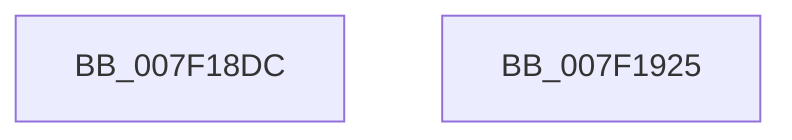

# CmpSubtreeEnumeratorBeginForKcbStack

- RVA: `0x007F18DC`–`0x007F1926` (길이 `74` bytes)
- VA: `0x00000001407F18DC`
- 실행 섹션: `PAGE`
- PDB 이름 있음: `예`; PDB Function 태그: `아니요`
- unwind 정보 RVA: `0x00060BC4`
- 디코드: `22`개 명령, `74/74` bytes 표시
- 미해석 바이트: `0` (있으면 어셈블리에 `.byte`로 보존)

> 이 문서는 커널 이미지의 기계어와 PDB 기호를 분석해 생성했습니다. 4번과 5번은 함수 원형과 자료형을 바이너리 사용 방식에서 추정한 C 해석이며 원본 소스 복구 결과는 아닙니다.

## 1. Dependencies

- 직접 호출 지점: **1**; 고유 호출 대상: **1**
- 직접 호출자로 확인된 함수: **3**
- RIP 상대 이미지 참조: **0**

### Outgoing calls
- `0x007F18FF` → [CmpPopulateKeyNodeStackFromKcbStack](../94/CmpPopulateKeyNodeStackFromKcbStack_function_009453CC.md) (function, `0x009453CC`)

### Direct callers
- [CmRenameKey](../7E/CmRenameKey_function_007E8F48.md) at `0x007E9F4F`
- [CmpSubtreeEnumeratorStartForKcbStack](../94/CmpSubtreeEnumeratorStartForKcbStack_function_009445EC.md) at `0x0094460F`
- [CmpPromoteSubtree](../94/CmpPromoteSubtree_function_00944D60.md) at `0x00944EF8`

### Static image references
- 디코드된 RIP-relative 메모리 참조가 없습니다.

## 2. Other-region calls and transfers

- 다른 실행 섹션으로 향하는 call: **0**
- 별도 외부 분기/꼬리 이동을 확인하지 못했습니다.

## 3. Assembly (complete function range)

```asm
007F18DC  48 89 5C 24 08                  mov qword ptr [rsp + 8], rbx
007F18E1  48 89 74 24 10                  mov qword ptr [rsp + 0x10], rsi
007F18E6  57                              push rdi
007F18E7  48 83 EC 20                     sub rsp, 0x20
007F18EB  48 8D 59 10                     lea rbx, [rcx + 0x10]
007F18EF  48 89 51 08                     mov qword ptr [rcx + 8], rdx
007F18F3  48 8B F1                        mov rsi, rcx
007F18F6  45 33 C0                        xor r8d, r8d
007F18F9  48 8B CB                        mov rcx, rbx
007F18FC  48 8B FA                        mov rdi, rdx
007F18FF  E8 C8 3A 15 00                  call 0x1409453cc
007F1904  48 8B 46 60                     mov rax, qword ptr [rsi + 0x60]
007F1908  48 89 58 10                     mov qword ptr [rax + 0x10], rbx
007F190C  48 8B 5C 24 30                  mov rbx, qword ptr [rsp + 0x30]
007F1911  48 89 78 08                     mov qword ptr [rax + 8], rdi
007F1915  33 C0                           xor eax, eax
007F1917  66 89 06                        mov word ptr [rsi], ax
007F191A  48 8B 74 24 38                  mov rsi, qword ptr [rsp + 0x38]
007F191F  48 83 C4 20                     add rsp, 0x20
007F1923  5F                              pop rdi
007F1924  C3                              ret
007F1925  CC                              int3
```

## 4. C-style interpretation (structured pseudocode)

```c
__int64 __fastcall CmpSubtreeEnumeratorBeginForKcbStack(__int64 a1, __int64 a2, int a3)
{
    __int64 result;
    __int64 v_rsp;
    unsigned __int64 v_stack_p10;
    unsigned __int64 v_stack_p8;

    v_stack_p8 = v_rbx;
    v_stack_p10 = v_rsi;
    v_rsp = (v_rsp) - (32);
    *(unsigned __int64 *)(a1 + 8) = a2;
    a3 = 0;
    result = CmpPopulateKeyNodeStackFromKcbStack(a1 + 16, a2, a3, a4);
    *(unsigned __int64 *)(*(unsigned __int64 *)(a1 + 96) + 16) = a1 + 16;
    *(unsigned __int64 *)(*(unsigned __int64 *)(a1 + 96) + 8) = a2;
    result = 0;
    *(unsigned __int16 *)(a1) = 0;
    v_rsp = (v_rsp) + (32);
    return result;
}
```

## 5. (Beta) C Style

```c
int64_t CmpSubtreeEnumeratorBeginForKcbStack(void *Arg1, int64_t Arg2, int32_t Arg3)
{
    uint8_t *arg1 = (uint8_t *)Arg1;

    int64_t result;
    int64_t local_rsp;
    uint64_t v_stack_p10;
    uint64_t v_stack_p8;

    v_stack_p8 = local_rbx;
    v_stack_p10 = local_rsi;
    local_rsp = (local_rsp) - (32);
    *(uint64_t *)(arg1 + 0x8) = Arg2;
    Arg3 = 0;
    result = CmpPopulateKeyNodeStackFromKcbStack(Arg1 + 16, Arg2, Arg3, a4);
    *(void **)(*(uint64_t *)(arg1 + 0x60) + 0x10) = Arg1 + 16;
    *(uint64_t *)(*(uint64_t *)(arg1 + 0x60) + 0x8) = Arg2;
    result = 0;
    *(uint16_t *)(arg1) = 0;
    local_rsp = (local_rsp) + (32);
    return result;
}
```

### 관측된 메모리 오프셋

구조체 형식이 확인되지 않은 접근은 인자 기준의 오프셋으로만 기록했습니다.

| 기준 인자 | 오프셋 표현 | 폭 (bit) | 접근 |
|---|---:|---:|---|
| `Arg1` | `+ 0x0` | `16` | `W` |
| `Arg1` | `+ 0x8` | `64` | `W` |
| `Arg1` | `+ 0x10` | `64` | `R` |
| `Arg1` | `+ 0x60` | `64` | `R` |

## 6. Execution-region graph

[열기: 2D/3D 그래프와 함수 탐색 컨트롤 패널](../../../control-panel.html?section=page&rva=0x007F18DC&view=graph)

- 2D 그래프는 위에서 아래로 흐르고, 3D 그래프는 빈 공간을 드래그해 회전합니다. Shift+드래그는 이동, 휠은 확대·축소, 함수 노드 선택은 대상 보고서 이동입니다.

### Static fallback


