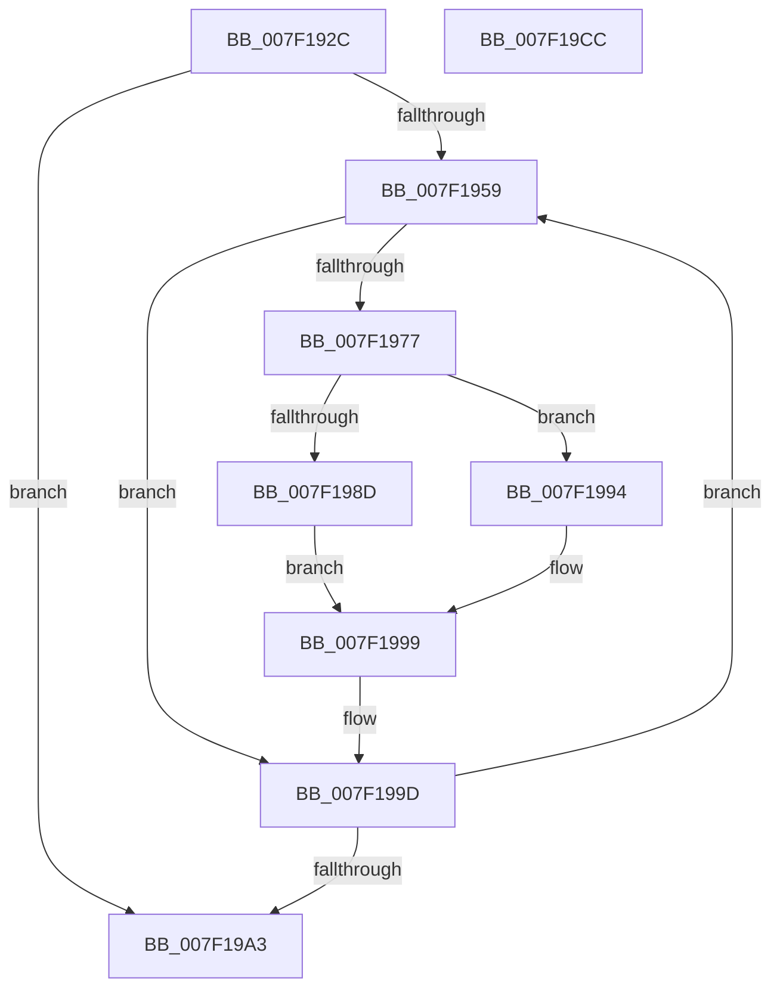

# CmpSubtreeEnumeratorBeginForKeyNodeStack

- RVA: `0x007F192C`–`0x007F19CD` (길이 `161` bytes)
- VA: `0x00000001407F192C`
- 실행 섹션: `PAGE`
- PDB 이름 있음: `예`; PDB Function 태그: `아니요`
- unwind 정보 RVA: `0x00060300`
- 디코드: `48`개 명령, `161/161` bytes 표시
- 미해석 바이트: `0` (있으면 어셈블리에 `.byte`로 보존)

> 이 문서는 커널 이미지의 기계어와 PDB 기호를 분석해 생성했습니다. 4번과 5번은 함수 원형과 자료형을 바이너리 사용 방식에서 추정한 C 해석이며 원본 소스 복구 결과는 아닙니다.

## 1. Dependencies

- 직접 호출 지점: **4**; 고유 호출 대상: **3**
- 직접 호출자로 확인된 함수: **2**
- RIP 상대 이미지 참조: **0**

### Outgoing calls
- `0x007F195F` → [CmpKeyNodeStackGetEntryAtLayerHeight](../94/CmpKeyNodeStackGetEntryAtLayerHeight_function_00946ABC.md) (function, `0x00946ABC`)
- `0x007F196A` → [CmpKeyNodeStackGetEntryAtLayerHeight](../94/CmpKeyNodeStackGetEntryAtLayerHeight_function_00946ABC.md) (function, `0x00946ABC`)
- `0x007F198D` → [HvpGetCellFlat](../85/HvpGetCellFlat_function_00854C60.md) (function, `0x00854C60`)
- `0x007F1994` → [HvpGetCellPaged](../85/HvpGetCellPaged_function_00854CB0.md) (function, `0x00854CB0`)

### Direct callers
- [CmpPromoteSubtree](../94/CmpPromoteSubtree_function_00944D60.md) at `0x00944DD7`
- [CmpDoAccessCheckOnLayeredSubtree](../94/CmpDoAccessCheckOnLayeredSubtree_function_00945488.md) at `0x009455FE`

### Static image references
- 디코드된 RIP-relative 메모리 참조가 없습니다.

## 2. Other-region calls and transfers

- 다른 실행 섹션으로 향하는 call: **0**
- 별도 외부 분기/꼬리 이동을 확인하지 못했습니다.

## 3. Assembly (complete function range)

```asm
007F192C  48 89 5C 24 08                  mov qword ptr [rsp + 8], rbx
007F1931  48 89 6C 24 10                  mov qword ptr [rsp + 0x10], rbp
007F1936  48 89 74 24 18                  mov qword ptr [rsp + 0x18], rsi
007F193B  57                              push rdi
007F193C  41 56                           push r14
007F193E  41 57                           push r15
007F1940  48 83 EC 20                     sub rsp, 0x20
007F1944  0F B7 1A                        movzx ebx, word ptr [rdx]
007F1947  48 8D 69 10                     lea rbp, [rcx + 0x10]
007F194B  45 33 FF                        xor r15d, r15d
007F194E  4C 8B F2                        mov r14, rdx
007F1951  48 8B F9                        mov rdi, rcx
007F1954  66 85 DB                        test bx, bx
007F1957  78 4A                           js 0x1407f19a3
007F1959  0F B7 D3                        movzx edx, bx
007F195C  48 8B CD                        mov rcx, rbp
007F195F  E8 58 51 15 00                  call 0x140946abc
007F1964  49 8B CE                        mov rcx, r14
007F1967  48 8B F0                        mov rsi, rax
007F196A  E8 4D 51 15 00                  call 0x140946abc
007F196F  8B 50 08                        mov edx, dword ptr [rax + 8]
007F1972  83 FA FF                        cmp edx, -1
007F1975  74 26                           je 0x1407f199d
007F1977  48 8B 08                        mov rcx, qword ptr [rax]
007F197A  4C 8D 46 18                     lea r8, [rsi + 0x18]
007F197E  48 89 0E                        mov qword ptr [rsi], rcx
007F1981  89 56 08                        mov dword ptr [rsi + 8], edx
007F1984  F6 81 8C 00 00 00 01            test byte ptr [rcx + 0x8c], 1
007F198B  74 07                           je 0x1407f1994
007F198D  E8 CE 32 06 00                  call 0x140854c60
007F1992  EB 05                           jmp 0x1407f1999
007F1994  E8 17 33 06 00                  call 0x140854cb0
007F1999  48 89 46 10                     mov qword ptr [rsi + 0x10], rax
007F199D  66 83 EB 01                     sub bx, 1
007F19A1  79 B6                           jns 0x1407f1959
007F19A3  48 8B 47 60                     mov rax, qword ptr [rdi + 0x60]
007F19A7  48 8B 5C 24 40                  mov rbx, qword ptr [rsp + 0x40]
007F19AC  48 8B 74 24 50                  mov rsi, qword ptr [rsp + 0x50]
007F19B1  48 89 68 10                     mov qword ptr [rax + 0x10], rbp
007F19B5  48 8B 6C 24 48                  mov rbp, qword ptr [rsp + 0x48]
007F19BA  4C 89 78 08                     mov qword ptr [rax + 8], r15
007F19BE  66 44 89 3F                     mov word ptr [rdi], r15w
007F19C2  48 83 C4 20                     add rsp, 0x20
007F19C6  41 5F                           pop r15
007F19C8  41 5E                           pop r14
007F19CA  5F                              pop rdi
007F19CB  C3                              ret
007F19CC  CC                              int3
```

## 4. C-style interpretation (structured pseudocode)

```c
__int64 __fastcall CmpSubtreeEnumeratorBeginForKeyNodeStack(__int64 a1, __int64 a2)
{
    __int64 result;
    __int64 v_r15;
    __int64 v_rbx;
    __int64 v_rsp;
    unsigned __int64 v_stack_p10;
    unsigned __int64 v_stack_p18;
    unsigned __int64 v_stack_p8;

    v_stack_p8 = v_rbx;
    v_stack_p10 = v_rbp;
    v_stack_p18 = v_rsi;
    v_rsp = (v_rsp) - (32);
    v_r15 = 0;
    if (sign_flag) goto loc_007F19A3;
loc_007F1959:
    result = CmpKeyNodeStackGetEntryAtLayerHeight(a1 + 16, (unsigned __int16)(*(unsigned __int16 *)(a2)), a3, a4);
    result = CmpKeyNodeStackGetEntryAtLayerHeight(a2, (unsigned __int16)(*(unsigned __int16 *)(a2)), a3, a4);
    if (((unsigned int)((unsigned int)(*(unsigned int *)(result + 8)))) == -1) goto loc_007F199D;
    *(unsigned __int64 *)(result) = *(unsigned __int64 *)(result);
    *(unsigned int *)(result + 8) = (unsigned int)((unsigned int)(*(unsigned int *)(result + 8)));
    if (((*(unsigned __int8 *)(*(unsigned __int64 *)(result) + 140)) & (1)) == 0) goto loc_007F1994;
    result = HvpGetCellFlat(*(unsigned __int64 *)(result), (unsigned int)(*(unsigned int *)(result + 8)), result + 24, a4);
    goto loc_007F1999;
loc_007F1994:
    result = HvpGetCellPaged(*(unsigned __int64 *)(result), (unsigned int)(*(unsigned int *)(result + 8)), result + 24, a4);
loc_007F1999:
    *(unsigned __int64 *)(result + 16) = result;
loc_007F199D:
    v_rbx = (unsigned __int16)((*(unsigned __int16 *)(a2)) - (1));
    if (!sign_flag) goto loc_007F1959;
loc_007F19A3:
    *(unsigned __int64 *)(*(unsigned __int64 *)(a1 + 96) + 16) = a1 + 16;
    *(unsigned __int64 *)(*(unsigned __int64 *)(a1 + 96) + 8) = 0;
    *(unsigned __int16 *)(a1) = 0;
    v_rsp = (v_rsp) + (32);
    return *(unsigned __int64 *)(a1 + 96);
}
```

## 5. (Beta) C Style

```c
int64_t CmpSubtreeEnumeratorBeginForKeyNodeStack(void *Arg1, void *Arg2)
{
    uint8_t *arg1 = (uint8_t *)Arg1;
    uint8_t *arg2 = (uint8_t *)Arg2;

    int64_t result;
    int64_t local_r15;
    int64_t local_rbx;
    int64_t local_rsp;
    uint64_t v_stack_p10;
    uint64_t v_stack_p18;
    uint64_t v_stack_p8;

    v_stack_p8 = local_rbx;
    v_stack_p10 = local_rbp;
    v_stack_p18 = local_rsi;
    local_rsp = (local_rsp) - (32);
    local_r15 = 0;
    if (sign_flag) goto loc_007F19A3;
loc_007F1959:
    result = CmpKeyNodeStackGetEntryAtLayerHeight(Arg1 + 16, (uint16_t)(*(uint16_t *)(arg2)), a3, a4);
    result = CmpKeyNodeStackGetEntryAtLayerHeight(Arg2, (uint16_t)(*(uint16_t *)(arg2)), a3, a4);
    if (((uint32_t)((uint32_t)(*(uint32_t *)(result + 0x8)))) == -1) goto loc_007F199D;
    *(uint64_t *)(result) = *(uint64_t *)(result);
    *(uint32_t *)(result + 0x8) = (uint32_t)((uint32_t)(*(uint32_t *)(result + 0x8)));
    if (((*(uint8_t *)(*(uint64_t *)(result) + 0x8C)) & (1)) == 0) goto loc_007F1994;
    result = HvpGetCellFlat(*(uint64_t *)(result), (uint32_t)(*(uint32_t *)(result + 0x8)), result + 24, a4);
    goto loc_007F1999;
loc_007F1994:
    result = HvpGetCellPaged(*(uint64_t *)(result), (uint32_t)(*(uint32_t *)(result + 0x8)), result + 24, a4);
loc_007F1999:
    *(uint64_t *)(result + 0x10) = result;
loc_007F199D:
    local_rbx = (uint16_t)((*(uint16_t *)(arg2)) - (1));
    if (!sign_flag) goto loc_007F1959;
loc_007F19A3:
    *(void **)(*(uint64_t *)(arg1 + 0x60) + 0x10) = Arg1 + 16;
    *(uint64_t *)(*(uint64_t *)(arg1 + 0x60) + 0x8) = 0;
    *(uint16_t *)(arg1) = 0;
    local_rsp = (local_rsp) + (32);
    return *(uint64_t *)(arg1 + 0x60);
}
```

### 관측된 메모리 오프셋

구조체 형식이 확인되지 않은 접근은 인자 기준의 오프셋으로만 기록했습니다.

| 기준 인자 | 오프셋 표현 | 폭 (bit) | 접근 |
|---|---:|---:|---|
| `Arg1` | `+ 0x0` | `16` | `W` |
| `Arg1` | `+ 0x10` | `64` | `R` |
| `Arg1` | `+ 0x60` | `64` | `R` |
| `Arg2` | `+ 0x0` | `16` | `R` |

## 6. Execution-region graph

[열기: 2D/3D 그래프와 함수 탐색 컨트롤 패널](../../../control-panel.html?section=page&rva=0x007F192C&view=graph)

- 2D 그래프는 위에서 아래로 흐르고, 3D 그래프는 빈 공간을 드래그해 회전합니다. Shift+드래그는 이동, 휠은 확대·축소, 함수 노드 선택은 대상 보고서 이동입니다.

### Static fallback


