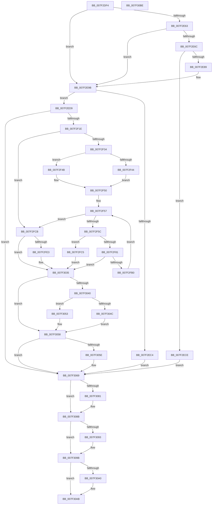

# CmpSyncKeyValues

- RVA: `0x007F2DF4`–`0x007F30BF` (길이 `715` bytes)
- VA: `0x00000001407F2DF4`
- 실행 섹션: `PAGE`
- PDB 이름 있음: `예`; PDB Function 태그: `아니요`
- unwind 정보 RVA: `0x000D7310`
- 디코드: `210`개 명령, `715/715` bytes 표시
- 미해석 바이트: `0` (있으면 어셈블리에 `.byte`로 보존)

> 이 문서는 커널 이미지의 기계어와 PDB 기호를 분석해 생성했습니다. 4번과 5번은 함수 원형과 자료형을 바이너리 사용 방식에서 추정한 C 해석이며 원본 소스 복구 결과는 아닙니다.

## 1. Dependencies

- 직접 호출 지점: **18**; 고유 호출 대상: **18**
- 직접 호출자로 확인된 함수: **2**
- RIP 상대 이미지 참조: **0**

### Outgoing calls
- `0x007F2E4B` → [HvpGetCellContextInitialize](../85/HvpGetCellContextInitialize_function_00855F10.md) (function, `0x00855F10`)
- `0x007F2E7E` → [CmpCopyCell](../85/CmpCopyCell_function_0085A608.md) (function, `0x0085A608`)
- `0x007F2EA1` → [CmpLockTwoSecurityCachesExclusiveShared](../A4/CmpLockTwoSecurityCachesExclusiveShared_function_00A45A94.md) (function, `0x00A45A94`)
- `0x007F2EBB` → [CmpFindSecurityCellCacheIndex](../../text/42/CmpFindSecurityCellCacheIndex_function_00428060.md) (function, `0x00428060`)
- `0x007F2F0F` → [CmpGetSecurityDescriptorNodeEx](../94/CmpGetSecurityDescriptorNodeEx_function_00949268.md) (function, `0x00949268`)
- `0x007F2F44` → [HvpGetCellFlat](../85/HvpGetCellFlat_function_00854C60.md) (function, `0x00854C60`)
- `0x007F2F4B` → [HvpGetCellPaged](../85/HvpGetCellPaged_function_00854CB0.md) (function, `0x00854CB0`)
- `0x007F2F76` → [CmpCopyValue](../85/CmpCopyValue_function_0085B798.md) (function, `0x0085B798`)
- `0x007F2FA1` → [CmpAddValueToListEx](../85/CmpAddValueToListEx_function_0085B460.md) (function, `0x0085B460`)
- `0x007F2FD8` → [CmpFreeKeyValues](../A8/CmpFreeKeyValues_function_00A8B3E4.md) (function, `0x00A8B3E4`)
- `0x007F3023` → [CmpFreeSecurityDescriptor](../84/CmpFreeSecurityDescriptor_function_00849E44.md) (function, `0x00849E44`)
- `0x007F304C` → [HvpReleaseCellFlat](../85/HvpReleaseCellFlat_function_0085CC20.md) (function, `0x0085CC20`)
- `0x007F3053` → [HvpReleaseCellPaged](../85/HvpReleaseCellPaged_function_00855F40.md) (function, `0x00855F40`)
- `0x007F3064` → [CmpFreeValue](../84/CmpFreeValue_function_0084AF98.md) (function, `0x0084AF98`)
- `0x007F3070` → [CmpFreeKeyValueList](CmpFreeKeyValueList_function_007F2250.md) (function, `0x007F2250`)
- `0x007F3086` → [HvFreeCell](../85/HvFreeCell_function_0085A72C.md) (function, `0x0085A72C`)
- `0x007F3096` → [CmpDereferenceSecurityNode](../../text/4A/CmpDereferenceSecurityNode_function_004A672C.md) (function, `0x004A672C`)
- `0x007F30A6` → [CmpUnlockTwoSecurityCaches](../A4/CmpUnlockTwoSecurityCaches_function_00A4ACD8.md) (function, `0x00A4ACD8`)

### Direct callers
- [CmpMergeKeyValues](CmpMergeKeyValues_function_007F2304.md) at `0x007F237D`
- [sub_00B16DFE](../B1/Unknown_function_00B16DFE.md) at `0x00B16E1E`

### Static image references
- 디코드된 RIP-relative 메모리 참조가 없습니다.

## 2. Other-region calls and transfers

- 다른 실행 섹션으로 향하는 call: **2**
  - `0x007F2EBB` → [CmpFindSecurityCellCacheIndex](../../text/42/CmpFindSecurityCellCacheIndex_function_00428060.md) (`PAGE` → `.text`)
  - `0x007F3096` → [CmpDereferenceSecurityNode](../../text/4A/CmpDereferenceSecurityNode_function_004A672C.md) (`PAGE` → `.text`)
- 별도 외부 분기/꼬리 이동을 확인하지 못했습니다.

## 3. Assembly (complete function range)

```asm
007F2DF4  89 54 24 10                     mov dword ptr [rsp + 0x10], edx
007F2DF8  55                              push rbp
007F2DF9  53                              push rbx
007F2DFA  56                              push rsi
007F2DFB  57                              push rdi
007F2DFC  41 54                           push r12
007F2DFE  41 55                           push r13
007F2E00  41 56                           push r14
007F2E02  41 57                           push r15
007F2E04  48 8B EC                        mov rbp, rsp
007F2E07  48 83 EC 68                     sub rsp, 0x68
007F2E0B  45 33 F6                        xor r14d, r14d
007F2E0E  48 8B F9                        mov rdi, rcx
007F2E11  4D 8B E8                        mov r13, r8
007F2E14  4C 89 75 E8                     mov qword ptr [rbp - 0x18], r14
007F2E18  41 83 C8 FF                     or r8d, 0xffffffff
007F2E1C  44 89 75 D8                     mov dword ptr [rbp - 0x28], r14d
007F2E20  48 8D 4D E8                     lea rcx, [rbp - 0x18]
007F2E24  44 89 45 50                     mov dword ptr [rbp + 0x50], r8d
007F2E28  44 89 45 58                     mov dword ptr [rbp + 0x58], r8d
007F2E2C  45 8B F8                        mov r15d, r8d
007F2E2F  44 89 45 60                     mov dword ptr [rbp + 0x60], r8d
007F2E33  49 8B D9                        mov rbx, r9
007F2E36  44 89 45 48                     mov dword ptr [rbp + 0x48], r8d
007F2E3A  44 89 45 E4                     mov dword ptr [rbp - 0x1c], r8d
007F2E3E  66 44 89 75 78                  mov word ptr [rbp + 0x78], r14w
007F2E43  44 89 75 E0                     mov dword ptr [rbp - 0x20], r14d
007F2E47  4C 89 75 F0                     mov qword ptr [rbp - 0x10], r14
007F2E4B  E8 C0 30 06 00                  call 0x140855f10
007F2E50  8B 75 68                        mov esi, dword ptr [rbp + 0x68]
007F2E53  45 8A E6                        mov r12b, r14b
007F2E56  C1 EE 1F                        shr esi, 0x1f
007F2E59  89 75 DC                        mov dword ptr [rbp - 0x24], esi
007F2E5C  66 45 39 75 4A                  cmp word ptr [r13 + 0x4a], r14w
007F2E61  76 38                           jbe 0x1407f2e9b
007F2E63  41 8B 55 30                     mov edx, dword ptr [r13 + 0x30]
007F2E67  41 3B D0                        cmp edx, r8d
007F2E6A  74 2F                           je 0x1407f2e9b
007F2E6C  48 8D 45 58                     lea rax, [rbp + 0x58]
007F2E70  44 8B CE                        mov r9d, esi
007F2E73  4C 8B C3                        mov r8, rbx
007F2E76  48 89 44 24 20                  mov qword ptr [rsp + 0x20], rax
007F2E7B  48 8B CF                        mov rcx, rdi
007F2E7E  E8 85 77 06 00                  call 0x14085a608
007F2E83  8B F0                           mov esi, eax
007F2E85  85 C0                           test eax, eax
007F2E87  78 45                           js 0x1407f2ece
007F2E89  41 0F B7 45 4A                  movzx eax, word ptr [r13 + 0x4a]
007F2E8E  8B 75 DC                        mov esi, dword ptr [rbp - 0x24]
007F2E91  66 89 45 78                     mov word ptr [rbp + 0x78], ax
007F2E95  8B 45 58                        mov eax, dword ptr [rbp + 0x58]
007F2E98  89 45 50                        mov dword ptr [rbp + 0x50], eax
007F2E9B  48 8B D7                        mov rdx, rdi
007F2E9E  48 8B CB                        mov rcx, rbx
007F2EA1  E8 EE 2B 25 00                  call 0x140a45a94
007F2EA6  41 8B 55 2C                     mov edx, dword ptr [r13 + 0x2c]
007F2EAA  4C 8D 45 D8                     lea r8, [rbp - 0x28]
007F2EAE  41 BC 01 00 00 00               mov r12d, 1
007F2EB4  48 8B CF                        mov rcx, rdi
007F2EB7  44 89 65 58                     mov dword ptr [rbp + 0x58], r12d
007F2EBB  E8 A0 51 C3 FF                  call 0x140428060
007F2EC0  84 C0                           test al, al
007F2EC2  75 15                           jne 0x1407f2ed9
007F2EC4  BE 4C 01 00 C0                  mov esi, 0xc000014c
007F2EC9  E9 9B 01 00 00                  jmp 0x1407f3069
007F2ECE  8B 45 58                        mov eax, dword ptr [rbp + 0x58]
007F2ED1  89 45 50                        mov dword ptr [rbp + 0x50], eax
007F2ED4  E9 90 01 00 00                  jmp 0x1407f3069
007F2ED9  48 8B 87 60 07 00 00            mov rax, qword ptr [rdi + 0x760]
007F2EE0  44 8B CE                        mov r9d, esi
007F2EE3  8B 4D D8                        mov ecx, dword ptr [rbp - 0x28]
007F2EE6  4C 8B 45 70                     mov r8, qword ptr [rbp + 0x70]
007F2EEA  48 03 C9                        add rcx, rcx
007F2EED  48 8B 54 C8 08                  mov rdx, qword ptr [rax + rcx*8 + 8]
007F2EF2  48 8D 45 60                     lea rax, [rbp + 0x60]
007F2EF6  48 89 44 24 30                  mov qword ptr [rsp + 0x30], rax
007F2EFB  48 83 C2 20                     add rdx, 0x20
007F2EFF  44 88 74 24 28                  mov byte ptr [rsp + 0x28], r14b
007F2F04  48 8B CB                        mov rcx, rbx
007F2F07  48 89 54 24 20                  mov qword ptr [rsp + 0x20], rdx
007F2F0C  8B 55 68                        mov edx, dword ptr [rbp + 0x68]
007F2F0F  E8 54 63 15 00                  call 0x140949268
007F2F14  8B F0                           mov esi, eax
007F2F16  85 C0                           test eax, eax
007F2F18  0F 88 4B 01 00 00               js 0x1407f3069
007F2F1E  41 8B 75 24                     mov esi, dword ptr [r13 + 0x24]
007F2F22  4C 8D B7 8C 00 00 00            lea r14, [rdi + 0x8c]
007F2F29  89 75 D8                        mov dword ptr [rbp - 0x28], esi
007F2F2C  85 F6                           test esi, esi
007F2F2E  0F 84 97 00 00 00               je 0x1407f2fcb
007F2F34  4C 8D 45 E8                     lea r8, [rbp - 0x18]
007F2F38  41 8B 55 28                     mov edx, dword ptr [r13 + 0x28]
007F2F3C  48 8B CF                        mov rcx, rdi
007F2F3F  45 84 26                        test byte ptr [r14], r12b
007F2F42  74 07                           je 0x1407f2f4b
007F2F44  E8 17 1D 06 00                  call 0x140854c60
007F2F49  EB 05                           jmp 0x1407f2f50
007F2F4B  E8 60 1D 06 00                  call 0x140854cb0
007F2F50  48 89 45 F0                     mov qword ptr [rbp - 0x10], rax
007F2F54  45 33 E4                        xor r12d, r12d
007F2F57  44 3B E6                        cmp r12d, esi
007F2F5A  73 6F                           jae 0x1407f2fcb
007F2F5C  44 8B 7D DC                     mov r15d, dword ptr [rbp - 0x24]
007F2F60  48 8D 4D 48                     lea rcx, [rbp + 0x48]
007F2F64  42 8B 14 A0                     mov edx, dword ptr [rax + r12*4]
007F2F68  45 8B CF                        mov r9d, r15d
007F2F6B  48 89 4C 24 20                  mov qword ptr [rsp + 0x20], rcx
007F2F70  4C 8B C3                        mov r8, rbx
007F2F73  48 8B CF                        mov rcx, rdi
007F2F76  E8 1D 88 06 00                  call 0x14085b798
007F2F7B  8B F0                           mov esi, eax
007F2F7D  85 C0                           test eax, eax
007F2F7F  78 44                           js 0x1407f2fc5
007F2F81  8B 45 58                        mov eax, dword ptr [rbp + 0x58]
007F2F84  45 8B CF                        mov r9d, r15d
007F2F87  44 8B 7D 48                     mov r15d, dword ptr [rbp + 0x48]
007F2F8B  45 8B C4                        mov r8d, r12d
007F2F8E  89 44 24 28                     mov dword ptr [rsp + 0x28], eax
007F2F92  41 8B D7                        mov edx, r15d
007F2F95  48 8D 45 E0                     lea rax, [rbp - 0x20]
007F2F99  48 8B CB                        mov rcx, rbx
007F2F9C  48 89 44 24 20                  mov qword ptr [rsp + 0x20], rax
007F2FA1  E8 BA 84 06 00                  call 0x14085b460
007F2FA6  8B F0                           mov esi, eax
007F2FA8  85 C0                           test eax, eax
007F2FAA  0F 88 85 00 00 00               js 0x1407f3035
007F2FB0  8B 75 D8                        mov esi, dword ptr [rbp - 0x28]
007F2FB3  41 83 CF FF                     or r15d, 0xffffffff
007F2FB7  44 03 65 58                     add r12d, dword ptr [rbp + 0x58]
007F2FBB  48 8B 45 F0                     mov rax, qword ptr [rbp - 0x10]
007F2FBF  44 89 7D 48                     mov dword ptr [rbp + 0x48], r15d
007F2FC3  EB 92                           jmp 0x1407f2f57
007F2FC5  44 8B 7D 48                     mov r15d, dword ptr [rbp + 0x48]
007F2FC9  EB 6A                           jmp 0x1407f3035
007F2FCB  4C 8B 65 70                     mov r12, qword ptr [rbp + 0x70]
007F2FCF  48 8B CB                        mov rcx, rbx
007F2FD2  8B 55 68                        mov edx, dword ptr [rbp + 0x68]
007F2FD5  4D 8B C4                        mov r8, r12
007F2FD8  E8 07 84 29 00                  call 0x140a8b3e4
007F2FDD  8B F0                           mov esi, eax
007F2FDF  85 C0                           test eax, eax
007F2FE1  78 52                           js 0x1407f3035
007F2FE3  8B 45 50                        mov eax, dword ptr [rbp + 0x50]
007F2FE6  83 CE FF                        or esi, 0xffffffff
007F2FE9  8B 55 68                        mov edx, dword ptr [rbp + 0x68]
007F2FEC  48 8B CB                        mov rcx, rbx
007F2FEF  41 89 44 24 30                  mov dword ptr [r12 + 0x30], eax
007F2FF4  0F B7 45 78                     movzx eax, word ptr [rbp + 0x78]
007F2FF8  66 41 89 44 24 4A               mov word ptr [r12 + 0x4a], ax
007F2FFE  48 8B 45 E0                     mov rax, qword ptr [rbp - 0x20]
007F3002  83 65 E0 00                     and dword ptr [rbp - 0x20], 0
007F3006  49 89 44 24 24                  mov qword ptr [r12 + 0x24], rax
007F300B  41 8B 45 3C                     mov eax, dword ptr [r13 + 0x3c]
007F300F  41 89 44 24 3C                  mov dword ptr [r12 + 0x3c], eax
007F3014  41 8B 45 40                     mov eax, dword ptr [r13 + 0x40]
007F3018  41 89 44 24 40                  mov dword ptr [r12 + 0x40], eax
007F301D  89 75 50                        mov dword ptr [rbp + 0x50], esi
007F3020  89 75 E4                        mov dword ptr [rbp - 0x1c], esi
007F3023  E8 1C 6E 05 00                  call 0x140849e44
007F3028  8B 45 60                        mov eax, dword ptr [rbp + 0x60]
007F302B  89 75 60                        mov dword ptr [rbp + 0x60], esi
007F302E  33 F6                           xor esi, esi
007F3030  41 89 44 24 2C                  mov dword ptr [r12 + 0x2c], eax
007F3035  48 83 7D F0 00                  cmp qword ptr [rbp - 0x10], 0
007F303A  44 8B 65 58                     mov r12d, dword ptr [rbp + 0x58]
007F303E  74 18                           je 0x1407f3058
007F3040  48 8D 55 E8                     lea rdx, [rbp - 0x18]
007F3044  48 8B CF                        mov rcx, rdi
007F3047  45 84 26                        test byte ptr [r14], r12b
007F304A  74 07                           je 0x1407f3053
007F304C  E8 CF 9B 06 00                  call 0x14085cc20
007F3051  EB 05                           jmp 0x1407f3058
007F3053  E8 E8 2E 06 00                  call 0x140855f40
007F3058  41 83 FF FF                     cmp r15d, -1
007F305C  74 0B                           je 0x1407f3069
007F305E  41 8B D7                        mov edx, r15d
007F3061  48 8B CB                        mov rcx, rbx
007F3064  E8 2F 7F 05 00                  call 0x14084af98
007F3069  48 8D 55 E0                     lea rdx, [rbp - 0x20]
007F306D  48 8B CB                        mov rcx, rbx
007F3070  E8 DB F1 FF FF                  call 0x1407f2250
007F3075  8B 45 50                        mov eax, dword ptr [rbp + 0x50]
007F3078  41 83 CF FF                     or r15d, 0xffffffff
007F307C  41 3B C7                        cmp eax, r15d
007F307F  74 0A                           je 0x1407f308b
007F3081  8B D0                           mov edx, eax
007F3083  48 8B CB                        mov rcx, rbx
007F3086  E8 A1 76 06 00                  call 0x14085a72c
007F308B  8B 55 60                        mov edx, dword ptr [rbp + 0x60]
007F308E  41 3B D7                        cmp edx, r15d
007F3091  74 08                           je 0x1407f309b
007F3093  48 8B CB                        mov rcx, rbx
007F3096  E8 91 36 CB FF                  call 0x1404a672c
007F309B  45 84 E4                        test r12b, r12b
007F309E  74 0B                           je 0x1407f30ab
007F30A0  48 8B D7                        mov rdx, rdi
007F30A3  48 8B CB                        mov rcx, rbx
007F30A6  E8 2D 7C 25 00                  call 0x140a4acd8
007F30AB  8B C6                           mov eax, esi
007F30AD  48 83 C4 68                     add rsp, 0x68
007F30B1  41 5F                           pop r15
007F30B3  41 5E                           pop r14
007F30B5  41 5D                           pop r13
007F30B7  41 5C                           pop r12
007F30B9  5F                              pop rdi
007F30BA  5E                              pop rsi
007F30BB  5B                              pop rbx
007F30BC  5D                              pop rbp
007F30BD  C3                              ret
007F30BE  CC                              int3
```

## 4. C-style interpretation (structured pseudocode)

```c
__int64 __fastcall CmpSyncKeyValues(__int64 a1, int a2, __int64 a3, __int64 a4, unsigned int a5, __int64 a6, unsigned __int16 a7)
{
    __int64 result;
    __int64 v_r12;
    __int64 v_r14;
    __int64 v_r15;
    __int64 v_rsi;
    __int64 v_rsp;
    unsigned __int64 v_stack_m50;
    unsigned __int64 v_stack_m58;
    unsigned int v_stack_m5C;
    unsigned int v_stack_m60;
    unsigned int v_stack_m64;
    unsigned int v_stack_m68;
    unsigned __int64 v_stack_m78;
    unsigned __int8 v_stack_m80;
    unsigned __int64 v_stack_m88;
    unsigned int v_stack_p10;
    unsigned int v_stack_p18;
    unsigned int v_stack_p20;
    unsigned __int16 v_stack_p38;
    unsigned int v_stack_p8;

    v_stack_p10 = a2;
    v_rsp = (v_rsp) - (104);
    v_r14 = 0;
    v_stack_m58 = 0;
    a3 = (unsigned int)((a3) | (0xFFFFFFFFULL));
    v_stack_m68 = 0;
    v_stack_p10 = (unsigned int)(a3);
    v_stack_p18 = (unsigned int)(a3);
    v_stack_p20 = (unsigned int)(a3);
    v_stack_p8 = (unsigned int)(a3);
    v_stack_m5C = (unsigned int)(a3);
    v_stack_p38 = 0;
    v_stack_m60 = 0;
    v_stack_m50 = 0;
    result = HvpGetCellContextInitialize(v_stack_m58, a2, a3, a4);
    v_rsi = (unsigned int)(((unsigned int)(a5)) >> (31));
    v_stack_m64 = (unsigned int)(v_rsi);
    if ((*(unsigned __int16 *)(a3 + 74)) <= 0) goto loc_007F2E9B;
    if (((unsigned int)((unsigned int)(*(unsigned int *)(a3 + 48)))) == ((unsigned int)(a3))) goto loc_007F2E9B;
    v_stack_m88 = v_stack_p18;
    result = CmpCopyCell(a1, (unsigned int)(*(unsigned int *)(a3 + 48)), a4, (unsigned int)((unsigned int)(v_rsi)));
    if (sign_flag) goto loc_007F2ECE;
    v_stack_p38 = (unsigned __int16)(*(unsigned __int16 *)(a3 + 74));
    v_stack_p10 = (unsigned int)((unsigned int)(v_stack_p18));
loc_007F2E9B:
    result = CmpLockTwoSecurityCachesExclusiveShared(a4, a1, a4, (unsigned int)((unsigned int)(v_rsi)));
    v_stack_p18 = 1;
    result = CmpFindSecurityCellCacheIndex(a1, (unsigned int)(*(unsigned int *)(a3 + 44)), v_stack_m68, (unsigned int)((unsigned int)(v_rsi)));
    if ((unsigned __int8)(result) != 0) goto loc_007F2ED9;
    goto loc_007F3069;
loc_007F2ECE:
    v_stack_p10 = (unsigned int)((unsigned int)(v_stack_p18));
    goto loc_007F3069;
loc_007F2ED9:
    a1 = ((unsigned int)(v_stack_m68)) + ((unsigned int)(v_stack_m68));
    v_stack_m78 = v_stack_p20;
    a2 = (*(unsigned __int64 *)(*(unsigned __int64 *)(a1 + 1888) + a1 * 8 + 8)) + (32);
    v_stack_m80 = 0;
    v_stack_m88 = a2;
    result = CmpGetSecurityDescriptorNodeEx(a4, (unsigned int)(a5), a6, (unsigned int)((unsigned int)((unsigned int)(0xC000014CULL))));
    if (sign_flag) goto loc_007F3069;
    v_stack_m68 = (unsigned int)((unsigned int)(*(unsigned int *)(a3 + 36)));
    if ((unsigned int)((unsigned int)(*(unsigned int *)(a3 + 36))) == 0) goto loc_007F2FCB;
    if (((*(unsigned __int8 *)(a1 + 140)) & (1)) == 0) goto loc_007F2F4B;
    result = HvpGetCellFlat(a1, (unsigned int)(*(unsigned int *)(a3 + 40)), v_stack_m58, (unsigned int)((unsigned int)((unsigned int)(0xC000014CULL))));
    goto loc_007F2F50;
loc_007F2F4B:
    result = HvpGetCellPaged(a1, (unsigned int)(*(unsigned int *)(a3 + 40)), v_stack_m58, (unsigned int)((unsigned int)((unsigned int)(0xC000014CULL))));
loc_007F2F50:
    v_stack_m50 = result;
    v_r12 = 0;
loc_007F2F57:
    if (0 >= ((unsigned int)((unsigned int)(*(unsigned int *)(a3 + 36))))) goto loc_007F2FCB;
    v_stack_m88 = v_stack_p8;
    result = CmpCopyValue(a1, (unsigned int)(*(unsigned int *)(result + v_r12 * 4)), a4, (unsigned int)((unsigned int)((unsigned int)(v_stack_m64))));
    if (sign_flag) goto loc_007F2FC5;
    v_stack_m80 = (unsigned int)((unsigned int)(v_stack_p18));
    v_stack_m88 = v_stack_m60;
    result = CmpAddValueToListEx(a4, (unsigned int)((unsigned int)((unsigned int)(v_stack_p8))), 0, (unsigned int)((unsigned int)((unsigned int)(v_stack_m64))));
    if (sign_flag) goto loc_007F3035;
    v_r15 = (unsigned int)(((unsigned int)(v_stack_p8)) | (0xFFFFFFFFULL));
    v_r12 = (unsigned int)((v_r12) + (v_stack_p18));
    v_stack_p8 = (unsigned int)(v_r15);
    goto loc_007F2F57;
loc_007F2FC5:
    goto loc_007F3035;
loc_007F2FCB:
    result = CmpFreeKeyValues(a4, (unsigned int)(a5), a6, (unsigned int)((unsigned int)((unsigned int)(v_stack_m64))));
    v_rsi = (unsigned int)((unsigned int)(result));
    if (!(sign_flag)) {
        result = v_stack_p10;
        v_rsi = (unsigned int)(((unsigned int)((unsigned int)(result))) | (0xFFFFFFFFULL));
        a2 = a5;
        a1 = a4;
        *(unsigned int *)(a6 + 48) = (unsigned int)(result);
        result = a7;
        *(unsigned __int16 *)(a6 + 74) = (unsigned __int16)(result);
        result = v_stack_m60;
        *(unsigned __int64 *)(a6 + 36) = result;
        result = *(unsigned int *)(a3 + 60);
        *(unsigned int *)(a6 + 60) = (unsigned int)(result);
        result = *(unsigned int *)(a3 + 64);
        *(unsigned int *)(a6 + 64) = (unsigned int)(result);
        v_stack_p10 = (unsigned int)(v_rsi);
        v_stack_m5C = (unsigned int)(v_rsi);
        result = CmpFreeSecurityDescriptor(a1, a2, a6, (unsigned int)((unsigned int)((unsigned int)(v_stack_m64))));
        result = v_stack_p20;
        v_stack_p20 = (unsigned int)(v_rsi);
        v_rsi = 0;
        *(unsigned int *)(a6 + 44) = (unsigned int)(result);
    }
    if (v_stack_m50 == 0) goto loc_007F3058;
    if (((*(unsigned __int8 *)(a1 + 140)) & ((unsigned __int8)((unsigned int)(v_stack_p18)))) == 0) goto loc_007F3053;
    result = HvpReleaseCellFlat(a1, v_stack_m58, a6, (unsigned int)((unsigned int)((unsigned int)(v_stack_m64))));
    goto loc_007F3058;
loc_007F3053:
    result = HvpReleaseCellPaged(a1, v_stack_m58, a6, (unsigned int)((unsigned int)((unsigned int)(v_stack_m64))));
loc_007F3058:
    if (((unsigned int)((unsigned int)(v_stack_p8))) != -1) {
        a2 = (unsigned int)((unsigned int)(v_stack_p8));
        a1 = a4;
        result = CmpFreeValue(a1, a2, a6, (unsigned int)((unsigned int)((unsigned int)(v_stack_m64))));
    }
    result = CmpFreeKeyValueList(a4, v_stack_m60, a6, (unsigned int)((unsigned int)((unsigned int)(v_stack_m64))));
    v_r15 = (unsigned int)(((unsigned int)(v_stack_p8)) | (0xFFFFFFFFULL));
    result = (unsigned int)(v_stack_p10);
    if (((unsigned int)((unsigned int)(v_stack_p10))) != ((unsigned int)(v_r15))) {
        a2 = (unsigned int)((unsigned int)(v_stack_p10));
        a1 = a4;
        result = HvFreeCell(a1, a2, a6, (unsigned int)((unsigned int)((unsigned int)(v_stack_m64))));
    }
    if (((unsigned int)((unsigned int)(v_stack_p20))) != ((unsigned int)(v_r15))) {
        a1 = a4;
        result = CmpDereferenceSecurityNode(a1, (unsigned int)(v_stack_p20), a6, (unsigned int)((unsigned int)((unsigned int)(v_stack_m64))));
    }
    if ((unsigned __int8)((unsigned int)(v_stack_p18)) != 0) {
        a2 = a1;
        a1 = a4;
        result = CmpUnlockTwoSecurityCaches(a1, a2, a6, (unsigned int)((unsigned int)((unsigned int)(v_stack_m64))));
    }
    v_rsp = (v_rsp) + (104);
    return 0;
}
```

## 5. (Beta) C Style

```c
int64_t CmpSyncKeyValues(void *Arg1, int32_t Arg2, void *Arg3, int64_t Arg4, uint32_t Arg5, void *Arg6, uint16_t Arg7)
{
    uint8_t *arg1 = (uint8_t *)Arg1;
    uint8_t *arg3 = (uint8_t *)Arg3;
    uint8_t *arg6 = (uint8_t *)Arg6;

    int64_t result;
    int64_t local_r12;
    int64_t local_r14;
    int64_t local_r15;
    int64_t local_rsi;
    int64_t local_rsp;
    uint64_t v_stack_m50;
    uint64_t v_stack_m58;
    uint32_t v_stack_m5C;
    uint32_t v_stack_m60;
    uint32_t v_stack_m64;
    uint32_t v_stack_m68;
    uint64_t v_stack_m78;
    uint8_t v_stack_m80;
    uint64_t v_stack_m88;
    uint32_t v_stack_p10;
    uint32_t v_stack_p18;
    uint32_t v_stack_p20;
    uint16_t v_stack_p38;
    uint32_t v_stack_p8;

    v_stack_p10 = Arg2;
    local_rsp = (local_rsp) - (104);
    local_r14 = 0;
    v_stack_m58 = 0;
    Arg3 = (uint32_t)((Arg3) | (0xFFFFFFFFULL));
    v_stack_m68 = 0;
    v_stack_p10 = (uint32_t)(Arg3);
    v_stack_p18 = (uint32_t)(Arg3);
    v_stack_p20 = (uint32_t)(Arg3);
    v_stack_p8 = (uint32_t)(Arg3);
    v_stack_m5C = (uint32_t)(Arg3);
    v_stack_p38 = 0;
    v_stack_m60 = 0;
    v_stack_m50 = 0;
    result = HvpGetCellContextInitialize(v_stack_m58, Arg2, Arg3, Arg4);
    local_rsi = (uint32_t)(((uint32_t)(Arg5)) >> (31));
    v_stack_m64 = (uint32_t)(local_rsi);
    if ((*(uint16_t *)(arg3 + 0x4A)) <= 0) goto loc_007F2E9B;
    if (((uint32_t)((uint32_t)(*(uint32_t *)(arg3 + 0x30)))) == ((uint32_t)(Arg3))) goto loc_007F2E9B;
    v_stack_m88 = v_stack_p18;
    result = CmpCopyCell(Arg1, (uint32_t)(*(uint32_t *)(arg3 + 0x30)), Arg4, (uint32_t)((uint32_t)(local_rsi)));
    if (sign_flag) goto loc_007F2ECE;
    v_stack_p38 = (uint16_t)(*(uint16_t *)(arg3 + 0x4A));
    v_stack_p10 = (uint32_t)((uint32_t)(v_stack_p18));
loc_007F2E9B:
    result = CmpLockTwoSecurityCachesExclusiveShared(Arg4, Arg1, Arg4, (uint32_t)((uint32_t)(local_rsi)));
    v_stack_p18 = 1;
    result = CmpFindSecurityCellCacheIndex(Arg1, (uint32_t)(*(uint32_t *)(arg3 + 0x2C)), v_stack_m68, (uint32_t)((uint32_t)(local_rsi)));
    if ((uint8_t)(result) != 0) goto loc_007F2ED9;
    goto loc_007F3069;
loc_007F2ECE:
    v_stack_p10 = (uint32_t)((uint32_t)(v_stack_p18));
    goto loc_007F3069;
loc_007F2ED9:
    Arg1 = ((uint32_t)(v_stack_m68)) + ((uint32_t)(v_stack_m68));
    v_stack_m78 = v_stack_p20;
    Arg2 = (*(uint64_t *)(*(uint64_t *)(arg1 + 0x760) + arg1 * 8 + 0x8)) + (32);
    v_stack_m80 = 0;
    v_stack_m88 = Arg2;
    result = CmpGetSecurityDescriptorNodeEx(Arg4, (uint32_t)(Arg5), Arg6, (uint32_t)((uint32_t)((uint32_t)(0xC000014CULL))));
    if (sign_flag) goto loc_007F3069;
    v_stack_m68 = (uint32_t)((uint32_t)(*(uint32_t *)(arg3 + 0x24)));
    if ((uint32_t)((uint32_t)(*(uint32_t *)(arg3 + 0x24))) == 0) goto loc_007F2FCB;
    if (((*(uint8_t *)(arg1 + 0x8C)) & (1)) == 0) goto loc_007F2F4B;
    result = HvpGetCellFlat(Arg1, (uint32_t)(*(uint32_t *)(arg3 + 0x28)), v_stack_m58, (uint32_t)((uint32_t)((uint32_t)(0xC000014CULL))));
    goto loc_007F2F50;
loc_007F2F4B:
    result = HvpGetCellPaged(Arg1, (uint32_t)(*(uint32_t *)(arg3 + 0x28)), v_stack_m58, (uint32_t)((uint32_t)((uint32_t)(0xC000014CULL))));
loc_007F2F50:
    v_stack_m50 = result;
    local_r12 = 0;
loc_007F2F57:
    if (0 >= ((uint32_t)((uint32_t)(*(uint32_t *)(arg3 + 0x24))))) goto loc_007F2FCB;
    v_stack_m88 = v_stack_p8;
    result = CmpCopyValue(Arg1, (uint32_t)(*(uint32_t *)(result + local_r12 * 4)), Arg4, (uint32_t)((uint32_t)((uint32_t)(v_stack_m64))));
    if (sign_flag) goto loc_007F2FC5;
    v_stack_m80 = (uint32_t)((uint32_t)(v_stack_p18));
    v_stack_m88 = v_stack_m60;
    result = CmpAddValueToListEx(Arg4, (uint32_t)((uint32_t)((uint32_t)(v_stack_p8))), 0, (uint32_t)((uint32_t)((uint32_t)(v_stack_m64))));
    if (sign_flag) goto loc_007F3035;
    local_r15 = (uint32_t)(((uint32_t)(v_stack_p8)) | (0xFFFFFFFFULL));
    local_r12 = (uint32_t)((local_r12) + (v_stack_p18));
    v_stack_p8 = (uint32_t)(local_r15);
    goto loc_007F2F57;
loc_007F2FC5:
    goto loc_007F3035;
loc_007F2FCB:
    result = CmpFreeKeyValues(Arg4, (uint32_t)(Arg5), Arg6, (uint32_t)((uint32_t)((uint32_t)(v_stack_m64))));
    local_rsi = (uint32_t)((uint32_t)(result));
    if (!(sign_flag)) {
        result = v_stack_p10;
        local_rsi = (uint32_t)(((uint32_t)((uint32_t)(result))) | (0xFFFFFFFFULL));
        Arg2 = Arg5;
        Arg1 = Arg4;
        *(uint32_t *)(arg6 + 0x30) = (uint32_t)(result);
        result = Arg7;
        *(uint16_t *)(arg6 + 0x4A) = (uint16_t)(result);
        result = v_stack_m60;
        *(uint64_t *)(arg6 + 0x24) = result;
        result = *(uint32_t *)(arg3 + 0x3C);
        *(uint32_t *)(arg6 + 0x3C) = (uint32_t)(result);
        result = *(uint32_t *)(arg3 + 0x40);
        *(uint32_t *)(arg6 + 0x40) = (uint32_t)(result);
        v_stack_p10 = (uint32_t)(local_rsi);
        v_stack_m5C = (uint32_t)(local_rsi);
        result = CmpFreeSecurityDescriptor(Arg1, Arg2, Arg6, (uint32_t)((uint32_t)((uint32_t)(v_stack_m64))));
        result = v_stack_p20;
        v_stack_p20 = (uint32_t)(local_rsi);
        local_rsi = 0;
        *(uint32_t *)(arg6 + 0x2C) = (uint32_t)(result);
    }
    if (v_stack_m50 == 0) goto loc_007F3058;
    if (((*(uint8_t *)(arg1 + 0x8C)) & ((uint8_t)((uint32_t)(v_stack_p18)))) == 0) goto loc_007F3053;
    result = HvpReleaseCellFlat(Arg1, v_stack_m58, Arg6, (uint32_t)((uint32_t)((uint32_t)(v_stack_m64))));
    goto loc_007F3058;
loc_007F3053:
    result = HvpReleaseCellPaged(Arg1, v_stack_m58, Arg6, (uint32_t)((uint32_t)((uint32_t)(v_stack_m64))));
loc_007F3058:
    if (((uint32_t)((uint32_t)(v_stack_p8))) != -1) {
        Arg2 = (uint32_t)((uint32_t)(v_stack_p8));
        Arg1 = Arg4;
        result = CmpFreeValue(Arg1, Arg2, Arg6, (uint32_t)((uint32_t)((uint32_t)(v_stack_m64))));
    }
    result = CmpFreeKeyValueList(Arg4, v_stack_m60, Arg6, (uint32_t)((uint32_t)((uint32_t)(v_stack_m64))));
    local_r15 = (uint32_t)(((uint32_t)(v_stack_p8)) | (0xFFFFFFFFULL));
    result = (uint32_t)(v_stack_p10);
    if (((uint32_t)((uint32_t)(v_stack_p10))) != ((uint32_t)(local_r15))) {
        Arg2 = (uint32_t)((uint32_t)(v_stack_p10));
        Arg1 = Arg4;
        result = HvFreeCell(Arg1, Arg2, Arg6, (uint32_t)((uint32_t)((uint32_t)(v_stack_m64))));
    }
    if (((uint32_t)((uint32_t)(v_stack_p20))) != ((uint32_t)(local_r15))) {
        Arg1 = Arg4;
        result = CmpDereferenceSecurityNode(Arg1, (uint32_t)(v_stack_p20), Arg6, (uint32_t)((uint32_t)((uint32_t)(v_stack_m64))));
    }
    if ((uint8_t)((uint32_t)(v_stack_p18)) != 0) {
        Arg2 = Arg1;
        Arg1 = Arg4;
        result = CmpUnlockTwoSecurityCaches(Arg1, Arg2, Arg6, (uint32_t)((uint32_t)((uint32_t)(v_stack_m64))));
    }
    local_rsp = (local_rsp) + (104);
    return 0;
}
```

### 관측된 메모리 오프셋

구조체 형식이 확인되지 않은 접근은 인자 기준의 오프셋으로만 기록했습니다.

| 기준 인자 | 오프셋 표현 | 폭 (bit) | 접근 |
|---|---:|---:|---|
| `Arg1` | `+ 0x0` | `8` | `R` |
| `Arg1` | `+ 0x8C` | `64` | `R` |
| `Arg1` | `+ 0x760` | `64` | `R` |
| `Arg3` | `+ 0x24` | `32` | `R` |
| `Arg3` | `+ 0x28` | `32` | `R` |
| `Arg3` | `+ 0x2C` | `32` | `R` |
| `Arg3` | `+ 0x30` | `32` | `R` |
| `Arg3` | `+ 0x3C` | `32` | `R` |
| `Arg3` | `+ 0x40` | `32` | `R` |
| `Arg3` | `+ 0x4A` | `16` | `R` |
| `Arg6` | `+ 0x24` | `64` | `W` |
| `Arg6` | `+ 0x2C` | `32` | `W` |
| `Arg6` | `+ 0x30` | `32` | `W` |
| `Arg6` | `+ 0x3C` | `32` | `W` |
| `Arg6` | `+ 0x40` | `32` | `W` |
| `Arg6` | `+ 0x4A` | `16` | `W` |

## 6. Execution-region graph

[열기: 2D/3D 그래프와 함수 탐색 컨트롤 패널](../../../control-panel.html?section=page&rva=0x007F2DF4&view=graph)

- 2D 그래프는 위에서 아래로 흐르고, 3D 그래프는 빈 공간을 드래그해 회전합니다. Shift+드래그는 이동, 휠은 확대·축소, 함수 노드 선택은 대상 보고서 이동입니다.

### Static fallback


