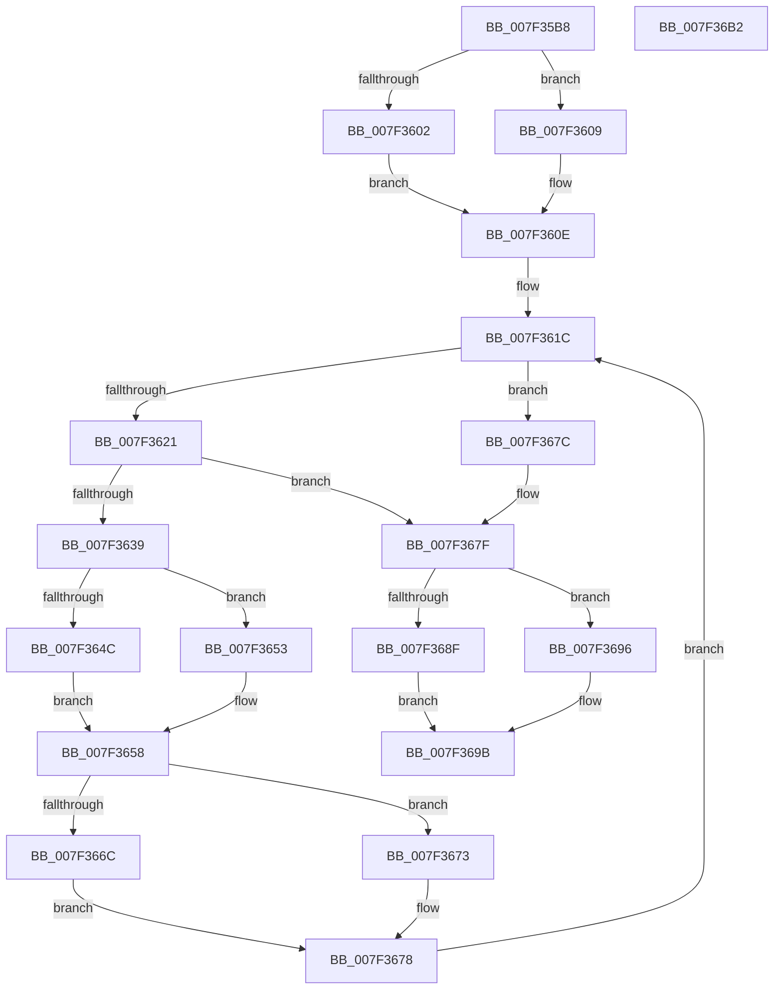

# CmpUpdateParentForEachSon

- RVA: `0x007F35B8`–`0x007F36B3` (길이 `251` bytes)
- VA: `0x00000001407F35B8`
- 실행 섹션: `PAGE`
- PDB 이름 있음: `예`; PDB Function 태그: `아니요`
- unwind 정보 RVA: `0x000D7364`
- 디코드: `79`개 명령, `251/251` bytes 표시
- 미해석 바이트: `0` (있으면 어셈블리에 `.byte`로 보존)

> 이 문서는 커널 이미지의 기계어와 PDB 기호를 분석해 생성했습니다. 4번과 5번은 함수 원형과 자료형을 바이너리 사용 방식에서 추정한 C 해석이며 원본 소스 복구 결과는 아닙니다.

## 1. Dependencies

- 직접 호출 지점: **9**; 고유 호출 대상: **5**
- 직접 호출자로 확인된 함수: **1**
- RIP 상대 이미지 참조: **0**

### Outgoing calls
- `0x007F3602` → [HvpGetCellFlat](../85/HvpGetCellFlat_function_00854C60.md) (function, `0x00854C60`)
- `0x007F3609` → [HvpGetCellPaged](../85/HvpGetCellPaged_function_00854CB0.md) (function, `0x00854CB0`)
- `0x007F362E` → [CmpFindSubKeyByNumber](../85/CmpFindSubKeyByNumber_function_0085C930.md) (function, `0x0085C930`)
- `0x007F364C` → [HvpGetCellFlat](../85/HvpGetCellFlat_function_00854C60.md) (function, `0x00854C60`)
- `0x007F3653` → [HvpGetCellPaged](../85/HvpGetCellPaged_function_00854CB0.md) (function, `0x00854CB0`)
- `0x007F366C` → [HvpReleaseCellFlat](../85/HvpReleaseCellFlat_function_0085CC20.md) (function, `0x0085CC20`)
- `0x007F3673` → [HvpReleaseCellPaged](../85/HvpReleaseCellPaged_function_00855F40.md) (function, `0x00855F40`)
- `0x007F368F` → [HvpReleaseCellFlat](../85/HvpReleaseCellFlat_function_0085CC20.md) (function, `0x0085CC20`)
- `0x007F3696` → [HvpReleaseCellPaged](../85/HvpReleaseCellPaged_function_00855F40.md) (function, `0x00855F40`)

### Direct callers
- [CmRenameKey](../7E/CmRenameKey_function_007E8F48.md) at `0x007E9EED`

### Static image references
- 디코드된 RIP-relative 메모리 참조가 없습니다.

## 2. Other-region calls and transfers

- 다른 실행 섹션으로 향하는 call: **0**
- 별도 외부 분기/꼬리 이동을 확인하지 못했습니다.

## 3. Assembly (complete function range)

```asm
007F35B8  48 89 5C 24 10                  mov qword ptr [rsp + 0x10], rbx
007F35BD  44 88 44 24 18                  mov byte ptr [rsp + 0x18], r8b
007F35C2  55                              push rbp
007F35C3  56                              push rsi
007F35C4  57                              push rdi
007F35C5  41 54                           push r12
007F35C7  41 55                           push r13
007F35C9  41 56                           push r14
007F35CB  41 57                           push r15
007F35CD  48 8B EC                        mov rbp, rsp
007F35D0  48 83 EC 20                     sub rsp, 0x20
007F35D4  45 33 ED                        xor r13d, r13d
007F35D7  4C 8D 45 58                     lea r8, [rbp + 0x58]
007F35DB  48 8B D9                        mov rbx, rcx
007F35DE  44 89 6D 5C                     mov dword ptr [rbp + 0x5c], r13d
007F35E2  83 C9 FF                        or ecx, 0xffffffff
007F35E5  44 89 6D 44                     mov dword ptr [rbp + 0x44], r13d
007F35E9  89 4D 58                        mov dword ptr [rbp + 0x58], ecx
007F35EC  44 8B E2                        mov r12d, edx
007F35EF  89 4D 40                        mov dword ptr [rbp + 0x40], ecx
007F35F2  48 8B CB                        mov rcx, rbx
007F35F5  F6 83 8C 00 00 00 01            test byte ptr [rbx + 0x8c], 1
007F35FC  44 89 6D 50                     mov dword ptr [rbp + 0x50], r13d
007F3600  74 07                           je 0x1407f3609
007F3602  E8 59 16 06 00                  call 0x140854c60
007F3607  EB 05                           jmp 0x1407f360e
007F3609  E8 A2 16 06 00                  call 0x140854cb0
007F360E  44 8B 78 18                     mov r15d, dword ptr [rax + 0x18]
007F3612  4C 8B F0                        mov r14, rax
007F3615  44 03 78 14                     add r15d, dword ptr [rax + 0x14]
007F3619  41 8B F5                        mov esi, r13d
007F361C  41 3B F7                        cmp esi, r15d
007F361F  73 5B                           jae 0x1407f367c
007F3621  4C 8D 4D 50                     lea r9, [rbp + 0x50]
007F3625  44 8B C6                        mov r8d, esi
007F3628  49 8B D6                        mov rdx, r14
007F362B  48 8B CB                        mov rcx, rbx
007F362E  E8 FD 92 06 00                  call 0x14085c930
007F3633  8B F8                           mov edi, eax
007F3635  85 C0                           test eax, eax
007F3637  78 46                           js 0x1407f367f
007F3639  F6 83 8C 00 00 00 01            test byte ptr [rbx + 0x8c], 1
007F3640  4C 8D 45 40                     lea r8, [rbp + 0x40]
007F3644  8B 55 50                        mov edx, dword ptr [rbp + 0x50]
007F3647  48 8B CB                        mov rcx, rbx
007F364A  74 07                           je 0x1407f3653
007F364C  E8 0F 16 06 00                  call 0x140854c60
007F3651  EB 05                           jmp 0x1407f3658
007F3653  E8 58 16 06 00                  call 0x140854cb0
007F3658  44 89 60 10                     mov dword ptr [rax + 0x10], r12d
007F365C  48 8D 55 40                     lea rdx, [rbp + 0x40]
007F3660  F6 83 8C 00 00 00 01            test byte ptr [rbx + 0x8c], 1
007F3667  48 8B CB                        mov rcx, rbx
007F366A  74 07                           je 0x1407f3673
007F366C  E8 AF 95 06 00                  call 0x14085cc20
007F3671  EB 05                           jmp 0x1407f3678
007F3673  E8 C8 28 06 00                  call 0x140855f40
007F3678  FF C6                           inc esi
007F367A  EB A0                           jmp 0x1407f361c
007F367C  41 8B FD                        mov edi, r13d
007F367F  F6 83 8C 00 00 00 01            test byte ptr [rbx + 0x8c], 1
007F3686  48 8D 55 58                     lea rdx, [rbp + 0x58]
007F368A  48 8B CB                        mov rcx, rbx
007F368D  74 07                           je 0x1407f3696
007F368F  E8 8C 95 06 00                  call 0x14085cc20
007F3694  EB 05                           jmp 0x1407f369b
007F3696  E8 A5 28 06 00                  call 0x140855f40
007F369B  48 8B 5C 24 68                  mov rbx, qword ptr [rsp + 0x68]
007F36A0  8B C7                           mov eax, edi
007F36A2  48 83 C4 20                     add rsp, 0x20
007F36A6  41 5F                           pop r15
007F36A8  41 5E                           pop r14
007F36AA  41 5D                           pop r13
007F36AC  41 5C                           pop r12
007F36AE  5F                              pop rdi
007F36AF  5E                              pop rsi
007F36B0  5D                              pop rbp
007F36B1  C3                              ret
007F36B2  CC                              int3
```

## 4. C-style interpretation (structured pseudocode)

```c
__int64 __fastcall CmpUpdateParentForEachSon(__int64 a1, int a2, unsigned __int8 a3)
{
    __int64 result;
    __int64 v_r13;
    __int64 v_r15;
    __int64 v_rsi;
    __int64 v_rsp;
    unsigned __int64 v_stack_p10;
    unsigned __int8 v_stack_p18;
    unsigned __int64 v_stack_p20;
    unsigned int v_stack_p24;
    unsigned int v_stack_p8;
    unsigned int v_stack_pC;

    v_stack_p10 = v_rbx;
    v_stack_p18 = a3;
    v_rsp = (v_rsp) - (32);
    v_r13 = 0;
    v_stack_p24 = 0;
    a1 = (unsigned int)((a1) | (0xFFFFFFFFULL));
    v_stack_pC = 0;
    v_stack_p20 = (unsigned int)(a1);
    v_stack_p8 = (unsigned int)(a1);
    v_stack_p18 = 0;
    if (((*(unsigned __int8 *)(a1 + 140)) & (1)) == 0) goto loc_007F3609;
    result = HvpGetCellFlat(a1, a2, v_stack_p20, a4);
    goto loc_007F360E;
loc_007F3609:
    result = HvpGetCellPaged(a1, a2, v_stack_p20, a4);
loc_007F360E:
    v_r15 = (unsigned int)(((unsigned int)(*(unsigned int *)(result + 24))) + (*(unsigned int *)(result + 20)));
loc_007F361C:
    if (0 >= ((unsigned int)(v_r15))) goto loc_007F367C;
    result = CmpFindSubKeyByNumber(a1, result, 0, v_stack_p18);
    if (sign_flag) goto loc_007F367F;
    if (((*(unsigned __int8 *)(a1 + 140)) & (1)) == 0) goto loc_007F3653;
    result = HvpGetCellFlat(a1, (unsigned int)(v_stack_p18), v_stack_p8, v_stack_p18);
    goto loc_007F3658;
loc_007F3653:
    result = HvpGetCellPaged(a1, (unsigned int)(v_stack_p18), v_stack_p8, v_stack_p18);
loc_007F3658:
    *(unsigned int *)(result + 16) = (unsigned int)((unsigned int)(a2));
    if (((*(unsigned __int8 *)(a1 + 140)) & (1)) == 0) goto loc_007F3673;
    result = HvpReleaseCellFlat(a1, v_stack_p8, v_stack_p8, v_stack_p18);
    goto loc_007F3678;
loc_007F3673:
    result = HvpReleaseCellPaged(a1, v_stack_p8, v_stack_p8, v_stack_p18);
loc_007F3678:
    v_rsi = (unsigned int)((0) + 1);
    goto loc_007F361C;
loc_007F367C:
loc_007F367F:
    if (((*(unsigned __int8 *)(a1 + 140)) & (1)) == 0) goto loc_007F3696;
    result = HvpReleaseCellFlat(a1, v_stack_p20, v_stack_p8, v_stack_p18);
    goto loc_007F369B;
loc_007F3696:
    result = HvpReleaseCellPaged(a1, v_stack_p20, v_stack_p8, v_stack_p18);
loc_007F369B:
    v_rsp = (v_rsp) + (32);
    return 0;
}
```

## 5. (Beta) C Style

```c
int64_t CmpUpdateParentForEachSon(void *Arg1, int32_t Arg2, uint8_t Arg3)
{
    uint8_t *arg1 = (uint8_t *)Arg1;

    int64_t result;
    int64_t local_r13;
    int64_t local_r15;
    int64_t local_rsi;
    int64_t local_rsp;
    uint64_t v_stack_p10;
    uint8_t v_stack_p18;
    uint64_t v_stack_p20;
    uint32_t v_stack_p24;
    uint32_t v_stack_p8;
    uint32_t v_stack_pC;

    v_stack_p10 = local_rbx;
    v_stack_p18 = Arg3;
    local_rsp = (local_rsp) - (32);
    local_r13 = 0;
    v_stack_p24 = 0;
    Arg1 = (uint32_t)((Arg1) | (0xFFFFFFFFULL));
    v_stack_pC = 0;
    v_stack_p20 = (uint32_t)(Arg1);
    v_stack_p8 = (uint32_t)(Arg1);
    v_stack_p18 = 0;
    if (((*(uint8_t *)(arg1 + 0x8C)) & (1)) == 0) goto loc_007F3609;
    result = HvpGetCellFlat(Arg1, Arg2, v_stack_p20, a4);
    goto loc_007F360E;
loc_007F3609:
    result = HvpGetCellPaged(Arg1, Arg2, v_stack_p20, a4);
loc_007F360E:
    local_r15 = (uint32_t)(((uint32_t)(*(uint32_t *)(result + 0x18))) + (*(uint32_t *)(result + 0x14)));
loc_007F361C:
    if (0 >= ((uint32_t)(local_r15))) goto loc_007F367C;
    result = CmpFindSubKeyByNumber(Arg1, result, 0, v_stack_p18);
    if (sign_flag) goto loc_007F367F;
    if (((*(uint8_t *)(arg1 + 0x8C)) & (1)) == 0) goto loc_007F3653;
    result = HvpGetCellFlat(Arg1, (uint32_t)(v_stack_p18), v_stack_p8, v_stack_p18);
    goto loc_007F3658;
loc_007F3653:
    result = HvpGetCellPaged(Arg1, (uint32_t)(v_stack_p18), v_stack_p8, v_stack_p18);
loc_007F3658:
    *(uint32_t *)(result + 0x10) = (uint32_t)((uint32_t)(Arg2));
    if (((*(uint8_t *)(arg1 + 0x8C)) & (1)) == 0) goto loc_007F3673;
    result = HvpReleaseCellFlat(Arg1, v_stack_p8, v_stack_p8, v_stack_p18);
    goto loc_007F3678;
loc_007F3673:
    result = HvpReleaseCellPaged(Arg1, v_stack_p8, v_stack_p8, v_stack_p18);
loc_007F3678:
    local_rsi = (uint32_t)((0) + 1);
    goto loc_007F361C;
loc_007F367C:
loc_007F367F:
    if (((*(uint8_t *)(arg1 + 0x8C)) & (1)) == 0) goto loc_007F3696;
    result = HvpReleaseCellFlat(Arg1, v_stack_p20, v_stack_p8, v_stack_p18);
    goto loc_007F369B;
loc_007F3696:
    result = HvpReleaseCellPaged(Arg1, v_stack_p20, v_stack_p8, v_stack_p18);
loc_007F369B:
    local_rsp = (local_rsp) + (32);
    return 0;
}
```

### 관측된 메모리 오프셋

구조체 형식이 확인되지 않은 접근은 인자 기준의 오프셋으로만 기록했습니다.

| 기준 인자 | 오프셋 표현 | 폭 (bit) | 접근 |
|---|---:|---:|---|
| `Arg1` | `+ 0x8C` | `8` | `R` |

## 6. Execution-region graph

[열기: 2D/3D 그래프와 함수 탐색 컨트롤 패널](../../../control-panel.html?section=page&rva=0x007F35B8&view=graph)

- 2D 그래프는 위에서 아래로 흐르고, 3D 그래프는 빈 공간을 드래그해 회전합니다. Shift+드래그는 이동, 휠은 확대·축소, 함수 노드 선택은 대상 보고서 이동입니다.

### Static fallback


