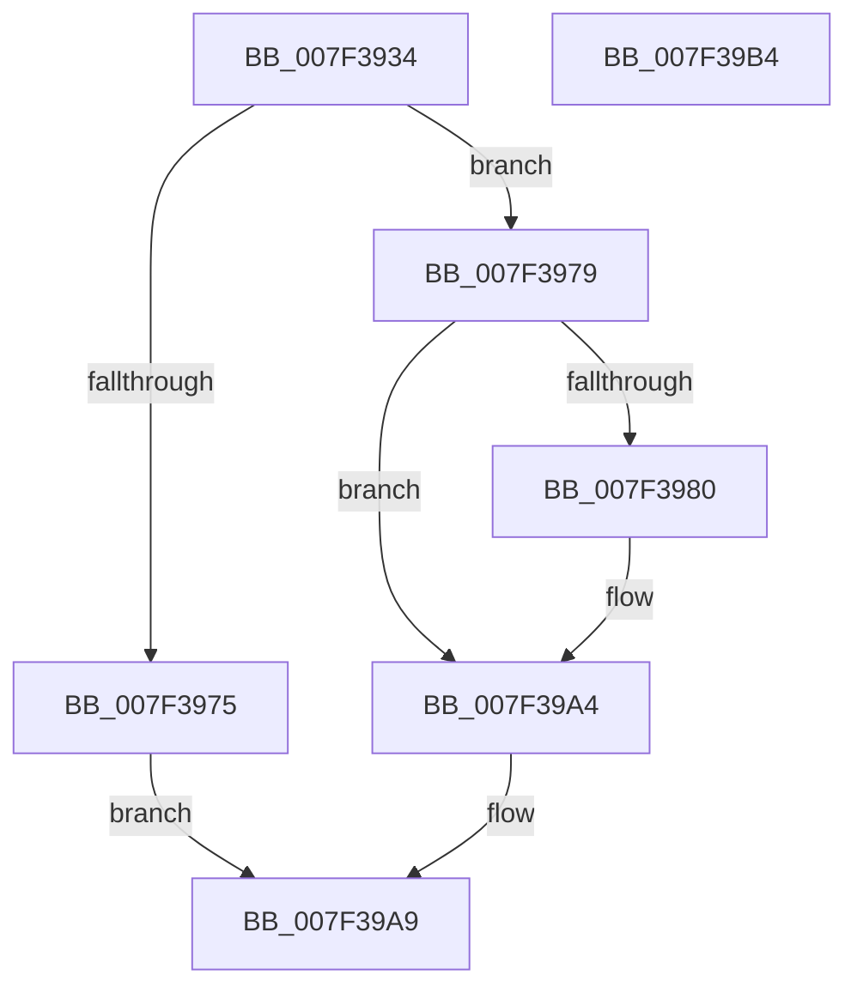

# CmpValueToData

- RVA: `0x007F3934`–`0x007F39B5` (길이 `129` bytes)
- VA: `0x00000001407F3934`
- 실행 섹션: `PAGE`
- PDB 이름 있음: `예`; PDB Function 태그: `아니요`
- unwind 정보 RVA: `0x00089EA4`
- 디코드: `37`개 명령, `129/129` bytes 표시
- 미해석 바이트: `0` (있으면 어셈블리에 `.byte`로 보존)

> 이 문서는 커널 이미지의 기계어와 PDB 기호를 분석해 생성했습니다. 4번과 5번은 함수 원형과 자료형을 바이너리 사용 방식에서 추정한 C 해석이며 원본 소스 복구 결과는 아닙니다.

## 1. Dependencies

- 직접 호출 지점: **3**; 고유 호출 대상: **3**
- 직접 호출자로 확인된 함수: **7**
- RIP 상대 이미지 참조: **0**

### Outgoing calls
- `0x007F396C` → [CmpGetValueData](../85/CmpGetValueData_function_00856DB0.md) (function, `0x00856DB0`)
- `0x007F3987` → [ExFreePoolWithTag](../../poolcode/B8/ExFreePoolWithTag_function_00B82870.md) (function, `0x00B82870`)
- `0x007F399E` → [KeBugCheckEx](../../text/4F/KeBugCheckEx_function_004FD660.md) (function, `0x004FD660`)

### Direct callers
- [CmpFindControlSet](CmpFindControlSet_function_007F1A34.md) at `0x007F1BE5`
- [CmpFindControlSet](CmpFindControlSet_function_007F1A34.md) at `0x007F1CE5`
- [CmpFindControlSet](CmpFindControlSet_function_007F1A34.md) at `0x007F1EC3`
- [CmSelectQualifiedInstallLanguage](../../init/C5/CmSelectQualifiedInstallLanguage_function_00C58F58.md) at `0x00C59129`
- [CmSelectQualifiedInstallLanguage](../../init/C5/CmSelectQualifiedInstallLanguage_function_00C58F58.md) at `0x00C592DC`
- [CmpAddDriverToList](../../init/C5/CmpAddDriverToList_function_00C5B758.md) at `0x00C5BA17`
- [CmpAddDriverToList](../../init/C5/CmpAddDriverToList_function_00C5B758.md) at `0x00C5BC22`
- [CmpAddDriverToList](../../init/C5/CmpAddDriverToList_function_00C5B758.md) at `0x00C5BCD5`
- [CmpAddDriverToList](../../init/C5/CmpAddDriverToList_function_00C5B758.md) at `0x00C5BD9C`
- [CmpFindTagIndex](../../init/C5/CmpFindTagIndex_function_00C5C628.md) at `0x00C5C6C4`
- [CmpGetStateSepKeysRedirectionPathValue](../../init/C5/CmpGetStateSepKeysRedirectionPathValue_function_00C5CA3C.md) at `0x00C5CB6F`
- [CmpIsLoadType](../../init/C5/CmpIsLoadType_function_00C5CBF8.md) at `0x00C5CDC0`
- [CmpIsLoadType](../../init/C5/CmpIsLoadType_function_00C5CBF8.md) at `0x00C5CEEF`
- [CmpSortDriverList](../../init/C5/CmpSortDriverList_function_00C5D3D0.md) at `0x00C5D597`

### Static image references
- 디코드된 RIP-relative 메모리 참조가 없습니다.

## 2. Other-region calls and transfers

- 다른 실행 섹션으로 향하는 call: **2**
  - `0x007F3987` → [ExFreePoolWithTag](../../poolcode/B8/ExFreePoolWithTag_function_00B82870.md) (`PAGE` → `POOLCODE`)
  - `0x007F399E` → [KeBugCheckEx](../../text/4F/KeBugCheckEx_function_004FD660.md) (`PAGE` → `.text`)
- 별도 외부 분기/꼬리 이동을 확인하지 못했습니다.

## 3. Assembly (complete function range)

```asm
007F3934  4C 8B DC                        mov r11, rsp
007F3937  49 89 5B 08                     mov qword ptr [r11 + 8], rbx
007F393B  57                              push rdi
007F393C  48 83 EC 50                     sub rsp, 0x50
007F3940  48 8B 84 24 80 00 00 00         mov rax, qword ptr [rsp + 0x80]
007F3948  49 8B D8                        mov rbx, r8
007F394B  49 83 63 F0 00                  and qword ptr [r11 - 0x10], 0
007F3950  48 8B F9                        mov rdi, rcx
007F3953  49 89 43 D8                     mov qword ptr [r11 - 0x28], rax
007F3957  49 8D 43 E8                     lea rax, [r11 - 0x18]
007F395B  49 89 43 D0                     mov qword ptr [r11 - 0x30], rax
007F395F  49 8D 43 F0                     lea rax, [r11 - 0x10]
007F3963  49 89 43 C8                     mov qword ptr [r11 - 0x38], rax
007F3967  C6 44 24 40 00                  mov byte ptr [rsp + 0x40], 0
007F396C  E8 3F 34 06 00                  call 0x140856db0
007F3971  84 C0                           test al, al
007F3973  75 04                           jne 0x1407f3979
007F3975  33 C0                           xor eax, eax
007F3977  EB 30                           jmp 0x1407f39a9
007F3979  80 7C 24 40 01                  cmp byte ptr [rsp + 0x40], 1
007F397E  75 24                           jne 0x1407f39a4
007F3980  48 8B 4C 24 48                  mov rcx, qword ptr [rsp + 0x48]
007F3985  33 D2                           xor edx, edx
007F3987  E8 E4 EE 38 00                  call 0x140b82870
007F398C  45 33 C0                        xor r8d, r8d
007F398F  48 89 5C 24 20                  mov qword ptr [rsp + 0x20], rbx
007F3994  4C 8B CF                        mov r9, rdi
007F3997  41 8D 50 08                     lea edx, [r8 + 8]
007F399B  8D 4A 49                        lea ecx, [rdx + 0x49]
007F399E  E8 BD 9C D0 FF                  call 0x1404fd660
007F39A3  CC                              int3
007F39A4  48 8B 44 24 48                  mov rax, qword ptr [rsp + 0x48]
007F39A9  48 8B 5C 24 60                  mov rbx, qword ptr [rsp + 0x60]
007F39AE  48 83 C4 50                     add rsp, 0x50
007F39B2  5F                              pop rdi
007F39B3  C3                              ret
007F39B4  CC                              int3
```

## 4. C-style interpretation (structured pseudocode)

```c
__int64 __fastcall CmpValueToData(__int64 a1, int a2, __int64 a3, __int64 a4, __int64 a5)
{
    __int64 result;
    __int64 v_rsp;
    unsigned __int64 v_stack_m10;
    unsigned __int8 v_stack_m18;
    unsigned __int64 v_stack_m38;
    unsigned __int64 v_stack_p8;

    *(unsigned __int64 *)(v_rsp + 8) = v_rbx;
    v_rsp = (v_rsp) - (80);
    *(unsigned __int64 *)(v_rsp - 40) = a5;
    *(unsigned __int64 *)(v_rsp - 48) = v_rsp - 24;
    *(unsigned __int64 *)(v_rsp - 56) = v_rsp - 16;
    v_stack_m18 = 0;
    result = CmpGetValueData(a1, a2, a3, a4);
    if ((unsigned __int8)(result) != 0) goto loc_007F3979;
    result = 0;
    goto loc_007F39A9;
loc_007F3979:
    if (v_stack_m18 == 1) {
        a1 = v_stack_m10;
        a2 = 0;
        result = ExFreePoolWithTag(a1, a2, a3, a4);
        a3 = 0;
        v_stack_m38 = 0;
        a4 = a1;
        a2 = a3 + 8;
        a1 = a2 + 73;
        result = KeBugCheckEx(a1, a2, a3, a4);
    }
loc_007F39A9:
    v_rsp = (v_rsp) + (80);
    return v_stack_m10;
}
```

## 5. (Beta) C Style

```c
int64_t CmpValueToData(int64_t Arg1, int32_t Arg2, int64_t Arg3, int64_t Arg4, int64_t Arg5)
{
    int64_t result;
    int64_t local_rsp;
    uint64_t v_stack_m10;
    uint8_t v_stack_m18;
    uint64_t v_stack_m38;
    uint64_t v_stack_p8;

    *(uint64_t *)(local_rsp + 0x8) = local_rbx;
    local_rsp = (local_rsp) - (80);
    *(uint64_t *)(local_rsp - 0x28) = Arg5;
    *(uint64_t *)(local_rsp - 0x30) = local_rsp - 24;
    *(uint64_t *)(local_rsp - 0x38) = local_rsp - 16;
    v_stack_m18 = 0;
    result = CmpGetValueData(Arg1, Arg2, Arg3, Arg4);
    if ((uint8_t)(result) != 0) goto loc_007F3979;
    result = 0;
    goto loc_007F39A9;
loc_007F3979:
    if (v_stack_m18 == 1) {
        Arg1 = v_stack_m10;
        Arg2 = 0;
        result = ExFreePoolWithTag(Arg1, Arg2, Arg3, Arg4);
        Arg3 = 0;
        v_stack_m38 = 0;
        Arg4 = Arg1;
        Arg2 = Arg3 + 8;
        Arg1 = Arg2 + 73;
        result = KeBugCheckEx(Arg1, Arg2, Arg3, Arg4);
    }
loc_007F39A9:
    local_rsp = (local_rsp) + (80);
    return v_stack_m10;
}
```

## 6. Execution-region graph

[열기: 2D/3D 그래프와 함수 탐색 컨트롤 패널](../../../control-panel.html?section=page&rva=0x007F3934&view=graph)

- 2D 그래프는 위에서 아래로 흐르고, 3D 그래프는 빈 공간을 드래그해 회전합니다. Shift+드래그는 이동, 휠은 확대·축소, 함수 노드 선택은 대상 보고서 이동입니다.

### Static fallback


