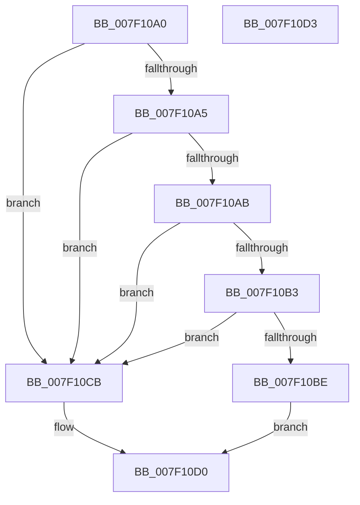

# CmpVerifyBigLogRecordChunk

- RVA: `0x007F10A0`–`0x007F10D4` (길이 `52` bytes)
- VA: `0x00000001407F10A0`
- 실행 섹션: `PAGE`
- PDB 이름 있음: `예`; PDB Function 태그: `아니요`
- unwind 정보 RVA: `0x000DB714`
- 디코드: `20`개 명령, `52/52` bytes 표시
- 미해석 바이트: `0` (있으면 어셈블리에 `.byte`로 보존)

> 이 문서는 커널 이미지의 기계어와 PDB 기호를 분석해 생성했습니다. 4번과 5번은 함수 원형과 자료형을 바이너리 사용 방식에서 추정한 C 해석이며 원본 소스 복구 결과는 아닙니다.

## 1. Dependencies

- 직접 호출 지점: **0**; 고유 호출 대상: **0**
- 직접 호출자로 확인된 함수: **1**
- RIP 상대 이미지 참조: **0**

### Outgoing calls
- 직접 디코드된 call 명령이 없습니다.

### Direct callers
- [CmpDoReadTxRBigLogRecord](CmpDoReadTxRBigLogRecord_function_007F0338.md) at `0x007F0379`
- [CmpDoReadTxRBigLogRecord](CmpDoReadTxRBigLogRecord_function_007F0338.md) at `0x007F044A`

### Static image references
- 디코드된 RIP-relative 메모리 참조가 없습니다.

## 2. Other-region calls and transfers

- 다른 실행 섹션으로 향하는 call: **0**
- 별도 외부 분기/꼬리 이동을 확인하지 못했습니다.

## 3. Assembly (complete function range)

```asm
007F10A0  83 FA 40                        cmp edx, 0x40
007F10A3  72 26                           jb 0x1407f10cb
007F10A5  83 79 0C 00                     cmp dword ptr [rcx + 0xc], 0
007F10A9  7D 20                           jge 0x1407f10cb
007F10AB  8B 41 30                        mov eax, dword ptr [rcx + 0x30]
007F10AE  39 41 34                        cmp dword ptr [rcx + 0x34], eax
007F10B1  73 18                           jae 0x1407f10cb
007F10B3  8B 41 38                        mov eax, dword ptr [rcx + 0x38]
007F10B6  83 C0 40                        add eax, 0x40
007F10B9  83 F8 40                        cmp eax, 0x40
007F10BC  72 0D                           jb 0x1407f10cb
007F10BE  3B D0                           cmp edx, eax
007F10C0  B9 30 00 19 C0                  mov ecx, 0xc0190030
007F10C5  1B C0                           sbb eax, eax
007F10C7  23 C8                           and ecx, eax
007F10C9  EB 05                           jmp 0x1407f10d0
007F10CB  B9 30 00 19 C0                  mov ecx, 0xc0190030
007F10D0  8B C1                           mov eax, ecx
007F10D2  C3                              ret
007F10D3  CC                              int3
```

## 4. C-style interpretation (structured pseudocode)

```c
__int64 __fastcall CmpVerifyBigLogRecordChunk(__int64 a1, int a2)
{
    __int64 result;

    if (a2 < 64) goto loc_007F10CB;
    if ((*(unsigned int *)(a1 + 12)) >= 0) goto loc_007F10CB;
    if ((*(unsigned int *)(a1 + 52)) >= ((unsigned int)((unsigned int)(*(unsigned int *)(a1 + 48))))) goto loc_007F10CB;
    result = (unsigned int)(((unsigned int)(*(unsigned int *)(a1 + 56))) + (64));
    if (((unsigned int)(result)) < 64) goto loc_007F10CB;
    a1 = (unsigned int)(((unsigned int)(0xC0190030ULL)) & ((unsigned int)(result)));
    goto loc_007F10D0;
loc_007F10CB:
loc_007F10D0:
    return (unsigned int)((unsigned int)((unsigned int)(0xC0190030ULL)));
}
```

## 5. (Beta) C Style

```c
int64_t CmpVerifyBigLogRecordChunk(void *Arg1, int32_t Arg2)
{
    uint8_t *arg1 = (uint8_t *)Arg1;

    int64_t result;

    if (Arg2 < 64) goto loc_007F10CB;
    if ((*(uint32_t *)(arg1 + 0xC)) >= 0) goto loc_007F10CB;
    if ((*(uint32_t *)(arg1 + 0x34)) >= ((uint32_t)((uint32_t)(*(uint32_t *)(arg1 + 0x30))))) goto loc_007F10CB;
    result = (uint32_t)(((uint32_t)(*(uint32_t *)(arg1 + 0x38))) + (64));
    if (((uint32_t)(result)) < 64) goto loc_007F10CB;
    Arg1 = (uint32_t)(((uint32_t)(0xC0190030ULL)) & ((uint32_t)(result)));
    goto loc_007F10D0;
loc_007F10CB:
loc_007F10D0:
    return (uint32_t)((uint32_t)((uint32_t)(0xC0190030ULL)));
}
```

### 관측된 메모리 오프셋

구조체 형식이 확인되지 않은 접근은 인자 기준의 오프셋으로만 기록했습니다.

| 기준 인자 | 오프셋 표현 | 폭 (bit) | 접근 |
|---|---:|---:|---|
| `Arg1` | `+ 0xC` | `32` | `R` |
| `Arg1` | `+ 0x30` | `32` | `R` |
| `Arg1` | `+ 0x34` | `32` | `R` |
| `Arg1` | `+ 0x38` | `32` | `R` |

## 6. Execution-region graph

[열기: 2D/3D 그래프와 함수 탐색 컨트롤 패널](../../../control-panel.html?section=page&rva=0x007F10A0&view=graph)

- 2D 그래프는 위에서 아래로 흐르고, 3D 그래프는 빈 공간을 드래그해 회전합니다. Shift+드래그는 이동, 휠은 확대·축소, 함수 노드 선택은 대상 보고서 이동입니다.

### Static fallback


