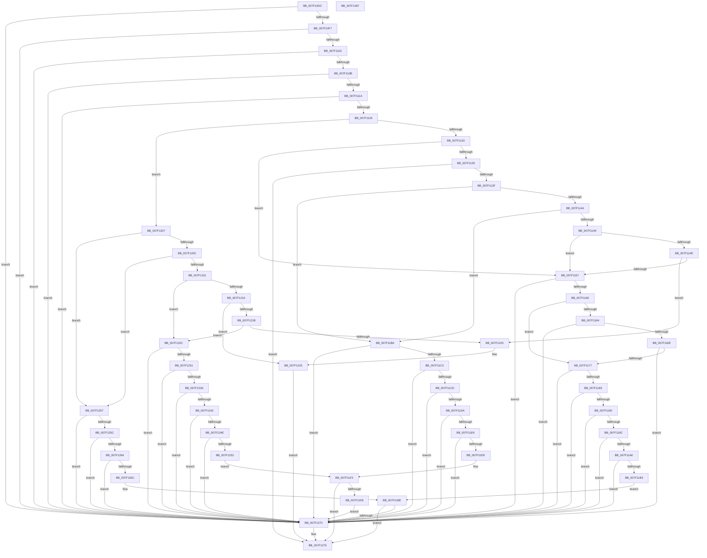

# CmpVerifyLogRecord

- RVA: `0x007F10DC`–`0x007F1288` (길이 `428` bytes)
- VA: `0x00000001407F10DC`
- 실행 섹션: `PAGE`
- PDB 이름 있음: `예`; PDB Function 태그: `아니요`
- unwind 정보 RVA: `0x00060BC4`
- 디코드: `130`개 명령, `428/428` bytes 표시
- 미해석 바이트: `0` (있으면 어셈블리에 `.byte`로 보존)

> 이 문서는 커널 이미지의 기계어와 PDB 기호를 분석해 생성했습니다. 4번과 5번은 함수 원형과 자료형을 바이너리 사용 방식에서 추정한 C 해석이며 원본 소스 복구 결과는 아닙니다.

## 1. Dependencies

- 직접 호출 지점: **2**; 고유 호출 대상: **2**
- 직접 호출자로 확인된 함수: **1**
- RIP 상대 이미지 참조: **0**

### Outgoing calls
- `0x007F110D` → [HvBufferCheckSum](../84/HvBufferCheckSum_function_00842A04.md) (function, `0x00842A04`)
- `0x007F11FC` → [RtlValidRelativeSecurityDescriptor](../8B/RtlValidRelativeSecurityDescriptor_function_008BDC70.md) (function, `0x008BDC70`)

### Direct callers
- [CmpRmReDoPhase](CmpRmReDoPhase_function_007F0794.md) at `0x007F08A3`

### Static image references
- 디코드된 RIP-relative 메모리 참조가 없습니다.

## 2. Other-region calls and transfers

- 다른 실행 섹션으로 향하는 call: **0**
- 별도 외부 분기/꼬리 이동을 확인하지 못했습니다.

## 3. Assembly (complete function range)

```asm
007F10DC  48 89 5C 24 08                  mov qword ptr [rsp + 8], rbx
007F10E1  48 89 74 24 10                  mov qword ptr [rsp + 0x10], rsi
007F10E6  57                              push rdi
007F10E7  48 83 EC 20                     sub rsp, 0x20
007F10EB  48 8B F9                        mov rdi, rcx
007F10EE  83 FA 30                        cmp edx, 0x30
007F10F1  0F 82 79 01 00 00               jb 0x1407f1270
007F10F7  8B 71 04                        mov esi, dword ptr [rcx + 4]
007F10FA  3B F2                           cmp esi, edx
007F10FC  0F 87 6E 01 00 00               ja 0x1407f1270
007F1102  83 FE 30                        cmp esi, 0x30
007F1105  0F 82 65 01 00 00               jb 0x1407f1270
007F110B  8B D6                           mov edx, esi
007F110D  E8 F2 18 05 00                  call 0x140842a04
007F1112  39 07                           cmp dword ptr [rdi], eax
007F1114  0F 85 56 01 00 00               jne 0x1407f1270
007F111A  8B 47 0C                        mov eax, dword ptr [rdi + 0xc]
007F111D  83 F8 0B                        cmp eax, 0xb
007F1120  0F 83 4A 01 00 00               jae 0x1407f1270
007F1126  33 DB                           xor ebx, ebx
007F1128  8D 53 05                        lea edx, [rbx + 5]
007F112B  3B C2                           cmp eax, edx
007F112D  0F 87 D4 00 00 00               ja 0x1407f1207
007F1133  74 22                           je 0x1407f1157
007F1135  8B C8                           mov ecx, eax
007F1137  85 C0                           test eax, eax
007F1139  0F 84 36 01 00 00               je 0x1407f1275
007F113F  83 E9 01                        sub ecx, 1
007F1142  74 76                           je 0x1407f11ba
007F1144  83 E9 01                        sub ecx, 1
007F1147  74 71                           je 0x1407f11ba
007F1149  83 E9 01                        sub ecx, 1
007F114C  74 09                           je 0x1407f1157
007F114E  83 F9 01                        cmp ecx, 1
007F1151  0F 85 C9 00 00 00               jne 0x1407f1220
007F1157  83 FE 50                        cmp esi, 0x50
007F115A  0F 82 10 01 00 00               jb 0x1407f1270
007F1160  3B C2                           cmp eax, edx
007F1162  75 13                           jne 0x1407f1177
007F1164  48 39 5F 48                     cmp qword ptr [rdi + 0x48], rbx
007F1168  0F 85 02 01 00 00               jne 0x1407f1270
007F116E  39 5F 44                        cmp dword ptr [rdi + 0x44], ebx
007F1171  0F 85 F9 00 00 00               jne 0x1407f1270
007F1177  0F B7 47 20                     movzx eax, word ptr [rdi + 0x20]
007F117B  A8 01                           test al, 1
007F117D  0F 85 ED 00 00 00               jne 0x1407f1270
007F1183  0F B7 4F 30                     movzx ecx, word ptr [rdi + 0x30]
007F1187  F6 C1 01                        test cl, 1
007F118A  0F 85 E0 00 00 00               jne 0x1407f1270
007F1190  8D 50 40                        lea edx, [rax + 0x40]
007F1193  83 FA 40                        cmp edx, 0x40
007F1196  0F 82 D4 00 00 00               jb 0x1407f1270
007F119C  03 CA                           add ecx, edx
007F119E  3B CA                           cmp ecx, edx
007F11A0  0F 82 CA 00 00 00               jb 0x1407f1270
007F11A6  8B 57 44                        mov edx, dword ptr [rdi + 0x44]
007F11A9  03 D1                           add edx, ecx
007F11AB  3B D1                           cmp edx, ecx
007F11AD  0F 82 BD 00 00 00               jb 0x1407f1270
007F11B3  3B F2                           cmp esi, edx
007F11B5  E9 B4 00 00 00                  jmp 0x1407f126e
007F11BA  83 FE 40                        cmp esi, 0x40
007F11BD  0F 82 AD 00 00 00               jb 0x1407f1270
007F11C3  83 7F 30 01                     cmp dword ptr [rdi + 0x30], 1
007F11C7  0F 87 A3 00 00 00               ja 0x1407f1270
007F11CD  0F B7 4F 20                     movzx ecx, word ptr [rdi + 0x20]
007F11D1  F6 C1 01                        test cl, 1
007F11D4  0F 85 96 00 00 00               jne 0x1407f1270
007F11DA  8D 41 40                        lea eax, [rcx + 0x40]
007F11DD  83 F8 40                        cmp eax, 0x40
007F11E0  0F 82 8A 00 00 00               jb 0x1407f1270
007F11E6  3B F0                           cmp esi, eax
007F11E8  0F 82 82 00 00 00               jb 0x1407f1270
007F11EE  2B F0                           sub esi, eax
007F11F0  8B D6                           mov edx, esi
007F11F2  48 83 C1 40                     add rcx, 0x40
007F11F6  45 33 C0                        xor r8d, r8d
007F11F9  48 03 CF                        add rcx, rdi
007F11FC  E8 6F CA 0C 00                  call 0x1408bdc70
007F1201  84 C0                           test al, al
007F1203  75 70                           jne 0x1407f1275
007F1205  EB 69                           jmp 0x1407f1270
007F1207  83 E8 06                        sub eax, 6
007F120A  74 4B                           je 0x1407f1257
007F120C  83 E8 01                        sub eax, 1
007F120F  74 46                           je 0x1407f1257
007F1211  83 E8 01                        sub eax, 1
007F1214  74 16                           je 0x1407f122c
007F1216  83 E8 01                        sub eax, 1
007F1219  74 0A                           je 0x1407f1225
007F121B  83 F8 01                        cmp eax, 1
007F121E  74 0C                           je 0x1407f122c
007F1220  48 8B CA                        mov rcx, rdx
007F1223  CD 29                           int 0x29
007F1225  BB 02 00 00 C0                  mov ebx, 0xc0000002
007F122A  EB 49                           jmp 0x1407f1275
007F122C  83 FE 40                        cmp esi, 0x40
007F122F  72 3F                           jb 0x1407f1270
007F1231  0F B7 4F 20                     movzx ecx, word ptr [rdi + 0x20]
007F1235  F6 C1 01                        test cl, 1
007F1238  75 36                           jne 0x1407f1270
007F123A  8D 41 40                        lea eax, [rcx + 0x40]
007F123D  83 F8 40                        cmp eax, 0x40
007F1240  72 2E                           jb 0x1407f1270
007F1242  44 8B 4F 30                     mov r9d, dword ptr [rdi + 0x30]
007F1246  41 8D 14 01                     lea edx, [r9 + rax]
007F124A  3B D0                           cmp edx, eax
007F124C  72 22                           jb 0x1407f1270
007F124E  3B F2                           cmp esi, edx
007F1250  72 1E                           jb 0x1407f1270
007F1252  41 8B D1                        mov edx, r9d
007F1255  EB 9B                           jmp 0x1407f11f2
007F1257  83 FE 38                        cmp esi, 0x38
007F125A  72 14                           jb 0x1407f1270
007F125C  0F B7 47 20                     movzx eax, word ptr [rdi + 0x20]
007F1260  A8 01                           test al, 1
007F1262  75 0C                           jne 0x1407f1270
007F1264  83 C0 38                        add eax, 0x38
007F1267  83 F8 38                        cmp eax, 0x38
007F126A  72 04                           jb 0x1407f1270
007F126C  3B F0                           cmp esi, eax
007F126E  73 05                           jae 0x1407f1275
007F1270  BB 30 00 19 C0                  mov ebx, 0xc0190030
007F1275  48 8B 74 24 38                  mov rsi, qword ptr [rsp + 0x38]
007F127A  8B C3                           mov eax, ebx
007F127C  48 8B 5C 24 30                  mov rbx, qword ptr [rsp + 0x30]
007F1281  48 83 C4 20                     add rsp, 0x20
007F1285  5F                              pop rdi
007F1286  C3                              ret
007F1287  CC                              int3
```

## 4. C-style interpretation (structured pseudocode)

```c
__int64 __fastcall CmpVerifyLogRecord(__int64 a1, int a2, int a3)
{
    __int64 result;
    __int64 v_rbx;
    __int64 v_rsi;
    __int64 v_rsp;
    unsigned __int64 v_stack_p10;
    unsigned __int64 v_stack_p8;

    v_stack_p8 = v_rbx;
    v_stack_p10 = v_rsi;
    v_rsp = (v_rsp) - (32);
    if (a2 < 48) goto loc_007F1270;
    if (((unsigned int)((unsigned int)(*(unsigned int *)(a1 + 4)))) > a2) goto loc_007F1270;
    if (((unsigned int)((unsigned int)(*(unsigned int *)(a1 + 4)))) < 48) goto loc_007F1270;
    result = HvBufferCheckSum(a1, (unsigned int)((unsigned int)((unsigned int)(*(unsigned int *)(a1 + 4)))), a3, a4);
    if ((*(unsigned int *)(a1)) != ((unsigned int)(result))) goto loc_007F1270;
    if (((unsigned int)((unsigned int)(*(unsigned int *)(a1 + 12)))) >= 11) goto loc_007F1270;
    v_rbx = 0;
    if (((unsigned int)((unsigned int)(*(unsigned int *)(a1 + 12)))) > ((unsigned int)(v_rbx + 5))) goto loc_007F1207;
    if (((unsigned int)((unsigned int)(*(unsigned int *)(a1 + 12)))) == ((unsigned int)(v_rbx + 5))) goto loc_007F1157;
    if ((unsigned int)((unsigned int)(*(unsigned int *)(a1 + 12))) == 0) goto loc_007F1275;
    a1 = (unsigned int)(((unsigned int)((unsigned int)((unsigned int)(*(unsigned int *)(a1 + 12))))) - (1));
    if (condition_is_equal) goto loc_007F11BA;
    a1 = (unsigned int)((a1) - (1));
    if (condition_is_equal) goto loc_007F11BA;
    a1 = (unsigned int)((a1) - (1));
    if (condition_is_equal) goto loc_007F1157;
    if (((unsigned int)(a1)) != 1) goto loc_007F1220;
loc_007F1157:
    if (((unsigned int)((unsigned int)(*(unsigned int *)(a1 + 4)))) < 80) goto loc_007F1270;
    if (((unsigned int)((unsigned int)(*(unsigned int *)(a1 + 12)))) != ((unsigned int)(v_rbx + 5))) goto loc_007F1177;
    if ((*(unsigned __int64 *)(a1 + 72)) != 0) goto loc_007F1270;
    if ((*(unsigned int *)(a1 + 68)) != 0) goto loc_007F1270;
loc_007F1177:
    if ((((unsigned __int8)(*(unsigned __int16 *)(a1 + 32))) & (1)) != 0) goto loc_007F1270;
    if ((((unsigned __int8)(*(unsigned __int16 *)(a1 + 48))) & (1)) != 0) goto loc_007F1270;
    if (((unsigned int)(*(unsigned __int16 *)(a1 + 32) + 64)) < 64) goto loc_007F1270;
    a1 = (unsigned int)((*(unsigned __int16 *)(a1 + 48)) + ((unsigned int)(*(unsigned __int16 *)(a1 + 32) + 64)));
    if (((unsigned int)(a1)) < ((unsigned int)(*(unsigned __int16 *)(a1 + 32) + 64))) goto loc_007F1270;
    a2 = (unsigned int)(((unsigned int)(*(unsigned int *)(a1 + 68))) + ((unsigned int)(a1)));
    if (a2 < ((unsigned int)(a1))) goto loc_007F1270;
    goto loc_007F126E;
loc_007F11BA:
    if (((unsigned int)((unsigned int)(*(unsigned int *)(a1 + 4)))) < 64) goto loc_007F1270;
    if ((*(unsigned int *)(a1 + 48)) > 1) goto loc_007F1270;
    if ((((unsigned __int8)(*(unsigned __int16 *)(a1 + 32))) & (1)) != 0) goto loc_007F1270;
    if (((unsigned int)(*(unsigned __int16 *)(a1 + 32) + 64)) < 64) goto loc_007F1270;
    if (((unsigned int)((unsigned int)(*(unsigned int *)(a1 + 4)))) < ((unsigned int)(*(unsigned __int16 *)(a1 + 32) + 64))) goto loc_007F1270;
    v_rsi = (unsigned int)(((unsigned int)(*(unsigned int *)(a1 + 4))) - ((unsigned int)(*(unsigned __int16 *)(a1 + 32) + 64)));
loc_007F11F2:
    a1 = (*(unsigned __int16 *)(a1 + 32)) + (64);
    a3 = 0;
    a1 = (a1) + (a1);
    result = RtlValidRelativeSecurityDescriptor(a1, (unsigned int)((unsigned int)(v_rsi)), a3, a4);
    if ((unsigned __int8)(result) != 0) goto loc_007F1275;
    goto loc_007F1270;
loc_007F1207:
    result = (unsigned int)((result) - (6));
    if (condition_is_equal) goto loc_007F1257;
    result = (unsigned int)((result) - (1));
    if (condition_is_equal) goto loc_007F1257;
    result = (unsigned int)((result) - (1));
    if (condition_is_equal) goto loc_007F122C;
    result = (unsigned int)((result) - (1));
    if (condition_is_equal) goto loc_007F1225;
    if (((unsigned int)(result)) == 1) goto loc_007F122C;
loc_007F1220:
loc_007F1225:
    goto loc_007F1275;
loc_007F122C:
    if (((unsigned int)(v_rsi)) < 64) goto loc_007F1270;
    if ((((unsigned __int8)(*(unsigned __int16 *)(a1 + 32))) & (1)) != 0) goto loc_007F1270;
    if (((unsigned int)(*(unsigned __int16 *)(a1 + 32) + 64)) < 64) goto loc_007F1270;
    if (((unsigned int)((unsigned int)(*(unsigned int *)(a1 + 48)) + *(unsigned __int16 *)(a1 + 32) + 64 * 1)) < ((unsigned int)(*(unsigned __int16 *)(a1 + 32) + 64))) goto loc_007F1270;
    if (((unsigned int)(v_rsi)) < ((unsigned int)((unsigned int)(*(unsigned int *)(a1 + 48)) + *(unsigned __int16 *)(a1 + 32) + 64 * 1))) goto loc_007F1270;
    goto loc_007F11F2;
loc_007F1257:
    if (((unsigned int)(v_rsi)) < 56) goto loc_007F1270;
    if ((((unsigned __int8)(*(unsigned __int16 *)(a1 + 32))) & (1)) != 0) goto loc_007F1270;
    result = (unsigned int)((*(unsigned __int16 *)(a1 + 32)) + (56));
    if (((unsigned int)(result)) < 56) goto loc_007F1270;
loc_007F126E:
    v_rbx = (unsigned int)(0xC0000002ULL);
    if (((unsigned int)(v_rsi)) < ((unsigned int)(result))) {
        v_rbx = 0xC0190030ULL;
    }
    v_rsp = (v_rsp) + (32);
    return (unsigned int)((unsigned int)(v_rbx));
}
```

## 5. (Beta) C Style

```c
int64_t CmpVerifyLogRecord(void *Arg1, int32_t Arg2, int32_t Arg3)
{
    uint8_t *arg1 = (uint8_t *)Arg1;

    int64_t result;
    int64_t local_rbx;
    int64_t local_rsi;
    int64_t local_rsp;
    uint64_t v_stack_p10;
    uint64_t v_stack_p8;

    v_stack_p8 = local_rbx;
    v_stack_p10 = local_rsi;
    local_rsp = (local_rsp) - (32);
    if (Arg2 < 48) goto loc_007F1270;
    if (((uint32_t)((uint32_t)(*(uint32_t *)(arg1 + 0x4)))) > Arg2) goto loc_007F1270;
    if (((uint32_t)((uint32_t)(*(uint32_t *)(arg1 + 0x4)))) < 48) goto loc_007F1270;
    result = HvBufferCheckSum(Arg1, (uint32_t)((uint32_t)((uint32_t)(*(uint32_t *)(arg1 + 0x4)))), Arg3, a4);
    if ((*(uint32_t *)(arg1)) != ((uint32_t)(result))) goto loc_007F1270;
    if (((uint32_t)((uint32_t)(*(uint32_t *)(arg1 + 0xC)))) >= 11) goto loc_007F1270;
    local_rbx = 0;
    if (((uint32_t)((uint32_t)(*(uint32_t *)(arg1 + 0xC)))) > ((uint32_t)(local_rbx + 5))) goto loc_007F1207;
    if (((uint32_t)((uint32_t)(*(uint32_t *)(arg1 + 0xC)))) == ((uint32_t)(local_rbx + 5))) goto loc_007F1157;
    if ((uint32_t)((uint32_t)(*(uint32_t *)(arg1 + 0xC))) == 0) goto loc_007F1275;
    Arg1 = (uint32_t)(((uint32_t)((uint32_t)((uint32_t)(*(uint32_t *)(arg1 + 0xC))))) - (1));
    if (condition_is_equal) goto loc_007F11BA;
    Arg1 = (uint32_t)((Arg1) - (1));
    if (condition_is_equal) goto loc_007F11BA;
    Arg1 = (uint32_t)((Arg1) - (1));
    if (condition_is_equal) goto loc_007F1157;
    if (((uint32_t)(Arg1)) != 1) goto loc_007F1220;
loc_007F1157:
    if (((uint32_t)((uint32_t)(*(uint32_t *)(arg1 + 0x4)))) < 80) goto loc_007F1270;
    if (((uint32_t)((uint32_t)(*(uint32_t *)(arg1 + 0xC)))) != ((uint32_t)(local_rbx + 5))) goto loc_007F1177;
    if ((*(uint64_t *)(arg1 + 0x48)) != 0) goto loc_007F1270;
    if ((*(uint32_t *)(arg1 + 0x44)) != 0) goto loc_007F1270;
loc_007F1177:
    if ((((uint8_t)(*(uint16_t *)(arg1 + 0x20))) & (1)) != 0) goto loc_007F1270;
    if ((((uint8_t)(*(uint16_t *)(arg1 + 0x30))) & (1)) != 0) goto loc_007F1270;
    if (((uint32_t)(*(uint16_t *)(arg1 + 0x20) + 64)) < 64) goto loc_007F1270;
    Arg1 = (uint32_t)((*(uint16_t *)(arg1 + 0x30)) + ((uint32_t)(*(uint16_t *)(arg1 + 0x20) + 64)));
    if (((uint32_t)(Arg1)) < ((uint32_t)(*(uint16_t *)(arg1 + 0x20) + 64))) goto loc_007F1270;
    Arg2 = (uint32_t)(((uint32_t)(*(uint32_t *)(arg1 + 0x44))) + ((uint32_t)(Arg1)));
    if (Arg2 < ((uint32_t)(Arg1))) goto loc_007F1270;
    goto loc_007F126E;
loc_007F11BA:
    if (((uint32_t)((uint32_t)(*(uint32_t *)(arg1 + 0x4)))) < 64) goto loc_007F1270;
    if ((*(uint32_t *)(arg1 + 0x30)) > 1) goto loc_007F1270;
    if ((((uint8_t)(*(uint16_t *)(arg1 + 0x20))) & (1)) != 0) goto loc_007F1270;
    if (((uint32_t)(*(uint16_t *)(arg1 + 0x20) + 64)) < 64) goto loc_007F1270;
    if (((uint32_t)((uint32_t)(*(uint32_t *)(arg1 + 0x4)))) < ((uint32_t)(*(uint16_t *)(arg1 + 0x20) + 64))) goto loc_007F1270;
    local_rsi = (uint32_t)(((uint32_t)(*(uint32_t *)(arg1 + 0x4))) - ((uint32_t)(*(uint16_t *)(arg1 + 0x20) + 64)));
loc_007F11F2:
    Arg1 = (*(uint16_t *)(arg1 + 0x20)) + (64);
    Arg3 = 0;
    Arg1 = (Arg1) + (Arg1);
    result = RtlValidRelativeSecurityDescriptor(Arg1, (uint32_t)((uint32_t)(local_rsi)), Arg3, a4);
    if ((uint8_t)(result) != 0) goto loc_007F1275;
    goto loc_007F1270;
loc_007F1207:
    result = (uint32_t)((result) - (6));
    if (condition_is_equal) goto loc_007F1257;
    result = (uint32_t)((result) - (1));
    if (condition_is_equal) goto loc_007F1257;
    result = (uint32_t)((result) - (1));
    if (condition_is_equal) goto loc_007F122C;
    result = (uint32_t)((result) - (1));
    if (condition_is_equal) goto loc_007F1225;
    if (((uint32_t)(result)) == 1) goto loc_007F122C;
loc_007F1220:
loc_007F1225:
    goto loc_007F1275;
loc_007F122C:
    if (((uint32_t)(local_rsi)) < 64) goto loc_007F1270;
    if ((((uint8_t)(*(uint16_t *)(arg1 + 0x20))) & (1)) != 0) goto loc_007F1270;
    if (((uint32_t)(*(uint16_t *)(arg1 + 0x20) + 64)) < 64) goto loc_007F1270;
    if (((uint32_t)((uint32_t)(*(uint32_t *)(arg1 + 0x30)) + *(uint16_t *)(arg1 + 0x20) + 64 * 1)) < ((uint32_t)(*(uint16_t *)(arg1 + 0x20) + 64))) goto loc_007F1270;
    if (((uint32_t)(local_rsi)) < ((uint32_t)((uint32_t)(*(uint32_t *)(arg1 + 0x30)) + *(uint16_t *)(arg1 + 0x20) + 64 * 1))) goto loc_007F1270;
    goto loc_007F11F2;
loc_007F1257:
    if (((uint32_t)(local_rsi)) < 56) goto loc_007F1270;
    if ((((uint8_t)(*(uint16_t *)(arg1 + 0x20))) & (1)) != 0) goto loc_007F1270;
    result = (uint32_t)((*(uint16_t *)(arg1 + 0x20)) + (56));
    if (((uint32_t)(result)) < 56) goto loc_007F1270;
loc_007F126E:
    local_rbx = (uint32_t)(0xC0000002ULL);
    if (((uint32_t)(local_rsi)) < ((uint32_t)(result))) {
        local_rbx = 0xC0190030ULL;
    }
    local_rsp = (local_rsp) + (32);
    return (uint32_t)((uint32_t)(local_rbx));
}
```

### 관측된 메모리 오프셋

구조체 형식이 확인되지 않은 접근은 인자 기준의 오프셋으로만 기록했습니다.

| 기준 인자 | 오프셋 표현 | 폭 (bit) | 접근 |
|---|---:|---:|---|
| `Arg1` | `+ 0x0` | `32` | `R` |
| `Arg1` | `+ 0x4` | `32` | `R` |
| `Arg1` | `+ 0xC` | `32` | `R` |
| `Arg1` | `+ 0x20` | `16` | `R` |
| `Arg1` | `+ 0x30` | `16` | `R` |
| `Arg1` | `+ 0x30` | `32` | `R` |
| `Arg1` | `+ 0x44` | `32` | `R` |
| `Arg1` | `+ 0x48` | `64` | `R` |

## 6. Execution-region graph

[열기: 2D/3D 그래프와 함수 탐색 컨트롤 패널](../../../control-panel.html?section=page&rva=0x007F10DC&view=graph)

- 2D 그래프는 위에서 아래로 흐르고, 3D 그래프는 빈 공간을 드래그해 회전합니다. Shift+드래그는 이동, 휠은 확대·축소, 함수 노드 선택은 대상 보고서 이동입니다.

### Static fallback


