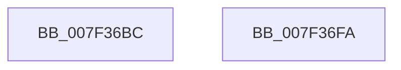

# CmpWalkPath

- RVA: `0x007F36BC`–`0x007F36FB` (길이 `63` bytes)
- VA: `0x00000001407F36BC`
- 실행 섹션: `PAGE`
- PDB 이름 있음: `예`; PDB Function 태그: `아니요`
- unwind 정보 RVA: `0x0006E5F8`
- 디코드: `19`개 명령, `63/63` bytes 표시
- 미해석 바이트: `0` (있으면 어셈블리에 `.byte`로 보존)

> 이 문서는 커널 이미지의 기계어와 PDB 기호를 분석해 생성했습니다. 4번과 5번은 함수 원형과 자료형을 바이너리 사용 방식에서 추정한 C 해석이며 원본 소스 복구 결과는 아닙니다.

## 1. Dependencies

- 직접 호출 지점: **2**; 고유 호출 대상: **2**
- 직접 호출자로 확인된 함수: **3**
- RIP 상대 이미지 참조: **0**

### Outgoing calls
- `0x007F36DB` → [RtlInitUnicodeString](../../text/42/RtlInitUnicodeString_function_0042A780.md) (function, `0x0042A780`)
- `0x007F36EA` → [CmpWalkUnicodeStringPath](CmpWalkUnicodeStringPath_function_007F3704.md) (function, `0x007F3704`)

### Direct callers
- [CmpPreserveSystemHiveData](CmpPreserveSystemHiveData_function_007F2518.md) at `0x007F26BF`
- [CmpPreserveSystemHiveData](CmpPreserveSystemHiveData_function_007F2518.md) at `0x007F26D0`
- [CmpPreserveSystemHiveData](CmpPreserveSystemHiveData_function_007F2518.md) at `0x007F275D`
- [CmpPreserveSystemHiveData](CmpPreserveSystemHiveData_function_007F2518.md) at `0x007F2909`
- [CmpPreserveSystemHiveData](CmpPreserveSystemHiveData_function_007F2518.md) at `0x007F297E`
- [CmpPreserveSystemHiveData](CmpPreserveSystemHiveData_function_007F2518.md) at `0x007F2BA5`
- [CmSelectQualifiedInstallLanguage](../../init/C5/CmSelectQualifiedInstallLanguage_function_00C58F58.md) at `0x00C5907E`
- [CmSelectQualifiedInstallLanguage](../../init/C5/CmSelectQualifiedInstallLanguage_function_00C58F58.md) at `0x00C591C1`
- [CmpGetSystemControlValues](../../init/C5/CmpGetSystemControlValues_function_00C5959C.md) at `0x00C5983C`

### Static image references
- 디코드된 RIP-relative 메모리 참조가 없습니다.

## 2. Other-region calls and transfers

- 다른 실행 섹션으로 향하는 call: **1**
  - `0x007F36DB` → [RtlInitUnicodeString](../../text/42/RtlInitUnicodeString_function_0042A780.md) (`PAGE` → `.text`)
- 별도 외부 분기/꼬리 이동을 확인하지 못했습니다.

## 3. Assembly (complete function range)

```asm
007F36BC  48 89 5C 24 08                  mov qword ptr [rsp + 8], rbx
007F36C1  57                              push rdi
007F36C2  48 83 EC 30                     sub rsp, 0x30
007F36C6  8B DA                           mov ebx, edx
007F36C8  48 8B F9                        mov rdi, rcx
007F36CB  0F 57 C0                        xorps xmm0, xmm0
007F36CE  48 8D 4C 24 20                  lea rcx, [rsp + 0x20]
007F36D3  49 8B D0                        mov rdx, r8
007F36D6  0F 11 44 24 20                  movups xmmword ptr [rsp + 0x20], xmm0
007F36DB  E8 A0 70 C3 FF                  call 0x14042a780
007F36E0  4C 8D 44 24 20                  lea r8, [rsp + 0x20]
007F36E5  8B D3                           mov edx, ebx
007F36E7  48 8B CF                        mov rcx, rdi
007F36EA  E8 15 00 00 00                  call 0x1407f3704
007F36EF  48 8B 5C 24 40                  mov rbx, qword ptr [rsp + 0x40]
007F36F4  48 83 C4 30                     add rsp, 0x30
007F36F8  5F                              pop rdi
007F36F9  C3                              ret
007F36FA  CC                              int3
```

## 4. C-style interpretation (structured pseudocode)

```c
__int64 __fastcall CmpWalkPath(__int64 a1, int a2, __int64 a3)
{
    __int64 result;
    __int64 v_rsp;
    unsigned __int64 v_stack_m18;
    unsigned __int64 v_stack_p8;

    v_stack_p8 = v_rbx;
    v_rsp = (v_rsp) - (48);
    v_stack_m18 = v_xmm0;
    result = RtlInitUnicodeString(v_stack_m18, a3, a3, a4);
    result = CmpWalkUnicodeStringPath(a1, (unsigned int)((unsigned int)((unsigned int)(a2))), v_stack_m18, a4);
    v_rsp = (v_rsp) + (48);
    return result;
}
```

## 5. (Beta) C Style

```c
int64_t CmpWalkPath(int64_t Arg1, int32_t Arg2, int64_t Arg3)
{
    int64_t result;
    int64_t local_rsp;
    uint64_t v_stack_m18;
    uint64_t v_stack_p8;

    v_stack_p8 = local_rbx;
    local_rsp = (local_rsp) - (48);
    v_stack_m18 = v_xmm0;
    result = RtlInitUnicodeString(v_stack_m18, Arg3, Arg3, a4);
    result = CmpWalkUnicodeStringPath(Arg1, (uint32_t)((uint32_t)((uint32_t)(Arg2))), v_stack_m18, a4);
    local_rsp = (local_rsp) + (48);
    return result;
}
```

## 6. Execution-region graph

[열기: 2D/3D 그래프와 함수 탐색 컨트롤 패널](../../../control-panel.html?section=page&rva=0x007F36BC&view=graph)

- 2D 그래프는 위에서 아래로 흐르고, 3D 그래프는 빈 공간을 드래그해 회전합니다. Shift+드래그는 이동, 휠은 확대·축소, 함수 노드 선택은 대상 보고서 이동입니다.

### Static fallback


