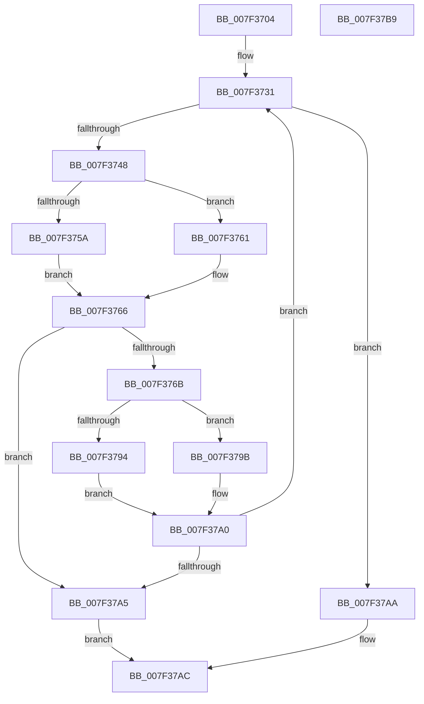

# CmpWalkUnicodeStringPath

- RVA: `0x007F3704`–`0x007F37BA` (길이 `182` bytes)
- VA: `0x00000001407F3704`
- 실행 섹션: `PAGE`
- PDB 이름 있음: `예`; PDB Function 태그: `아니요`
- unwind 정보 RVA: `0x000C8D78`
- 디코드: `57`개 명령, `182/182` bytes 표시
- 미해석 바이트: `0` (있으면 어셈블리에 `.byte`로 보존)

> 이 문서는 커널 이미지의 기계어와 PDB 기호를 분석해 생성했습니다. 4번과 5번은 함수 원형과 자료형을 바이너리 사용 방식에서 추정한 C 해석이며 원본 소스 복구 결과는 아닙니다.

## 1. Dependencies

- 직접 호출 지점: **6**; 고유 호출 대상: **6**
- 직접 호출자로 확인된 함수: **2**
- RIP 상대 이미지 참조: **0**

### Outgoing calls
- `0x007F373D` → [CmpGetNextName](CmpGetNextName_function_007F138C.md) (function, `0x007F138C`)
- `0x007F375A` → [HvpGetCellFlat](../85/HvpGetCellFlat_function_00854C60.md) (function, `0x00854C60`)
- `0x007F3761` → [HvpGetCellPaged](../85/HvpGetCellPaged_function_00854CB0.md) (function, `0x00854CB0`)
- `0x007F377C` → [CmpFindSubKeyByNameWithStatus](../85/CmpFindSubKeyByNameWithStatus_function_00852770.md) (function, `0x00852770`)
- `0x007F3794` → [HvpReleaseCellFlat](../85/HvpReleaseCellFlat_function_0085CC20.md) (function, `0x0085CC20`)
- `0x007F379B` → [HvpReleaseCellPaged](../85/HvpReleaseCellPaged_function_00855F40.md) (function, `0x00855F40`)

### Direct callers
- [CmpWalkPath](CmpWalkPath_function_007F36BC.md) at `0x007F36EA`
- [CmpFindHiveSubKey](../../init/C5/CmpFindHiveSubKey_function_00C5C398.md) at `0x00C5C421`

### Static image references
- 디코드된 RIP-relative 메모리 참조가 없습니다.

## 2. Other-region calls and transfers

- 다른 실행 섹션으로 향하는 call: **0**
- 별도 외부 분기/꼬리 이동을 확인하지 못했습니다.

## 3. Assembly (complete function range)

```asm
007F3704  48 89 5C 24 08                  mov qword ptr [rsp + 8], rbx
007F3709  55                              push rbp
007F370A  56                              push rsi
007F370B  57                              push rdi
007F370C  48 8B EC                        mov rbp, rsp
007F370F  48 83 EC 40                     sub rsp, 0x40
007F3713  83 4D 30 FF                     or dword ptr [rbp + 0x30], 0xffffffff
007F3717  0F 57 C0                        xorps xmm0, xmm0
007F371A  0F 11 45 E0                     movups xmmword ptr [rbp - 0x20], xmm0
007F371E  33 F6                           xor esi, esi
007F3720  8B FA                           mov edi, edx
007F3722  41 0F 10 00                     movups xmm0, xmmword ptr [r8]
007F3726  48 8B D9                        mov rbx, rcx
007F3729  89 75 34                        mov dword ptr [rbp + 0x34], esi
007F372C  F3 0F 7F 45 F0                  movdqu xmmword ptr [rbp - 0x10], xmm0
007F3731  4C 8D 45 28                     lea r8, [rbp + 0x28]
007F3735  48 8D 55 E0                     lea rdx, [rbp - 0x20]
007F3739  48 8D 4D F0                     lea rcx, [rbp - 0x10]
007F373D  E8 4A DC FF FF                  call 0x1407f138c
007F3742  66 39 75 E0                     cmp word ptr [rbp - 0x20], si
007F3746  74 62                           je 0x1407f37aa
007F3748  F6 83 8C 00 00 00 01            test byte ptr [rbx + 0x8c], 1
007F374F  4C 8D 45 30                     lea r8, [rbp + 0x30]
007F3753  8B D7                           mov edx, edi
007F3755  48 8B CB                        mov rcx, rbx
007F3758  74 07                           je 0x1407f3761
007F375A  E8 01 15 06 00                  call 0x140854c60
007F375F  EB 05                           jmp 0x1407f3766
007F3761  E8 4A 15 06 00                  call 0x140854cb0
007F3766  48 85 C0                        test rax, rax
007F3769  74 3A                           je 0x1407f37a5
007F376B  4C 8D 4D 28                     lea r9, [rbp + 0x28]
007F376F  89 75 28                        mov dword ptr [rbp + 0x28], esi
007F3772  4C 8D 45 E0                     lea r8, [rbp - 0x20]
007F3776  48 8B D0                        mov rdx, rax
007F3779  48 8B CB                        mov rcx, rbx
007F377C  E8 EF EF 05 00                  call 0x140852770
007F3781  F6 83 8C 00 00 00 01            test byte ptr [rbx + 0x8c], 1
007F3788  48 8D 55 30                     lea rdx, [rbp + 0x30]
007F378C  8B 7D 28                        mov edi, dword ptr [rbp + 0x28]
007F378F  48 8B CB                        mov rcx, rbx
007F3792  74 07                           je 0x1407f379b
007F3794  E8 87 94 06 00                  call 0x14085cc20
007F3799  EB 05                           jmp 0x1407f37a0
007F379B  E8 A0 27 06 00                  call 0x140855f40
007F37A0  83 FF FF                        cmp edi, -1
007F37A3  75 8C                           jne 0x1407f3731
007F37A5  83 C8 FF                        or eax, 0xffffffff
007F37A8  EB 02                           jmp 0x1407f37ac
007F37AA  8B C7                           mov eax, edi
007F37AC  48 8B 5C 24 60                  mov rbx, qword ptr [rsp + 0x60]
007F37B1  48 83 C4 40                     add rsp, 0x40
007F37B5  5F                              pop rdi
007F37B6  5E                              pop rsi
007F37B7  5D                              pop rbp
007F37B8  C3                              ret
007F37B9  CC                              int3
```

## 4. C-style interpretation (structured pseudocode)

```c
__int64 __fastcall CmpWalkUnicodeStringPath(__int64 a1, int a2, __int64 a3)
{
    __int64 result;
    __int64 v_rsi;
    __int64 v_rsp;
    unsigned __int64 v_stack_m28;
    unsigned __int64 v_stack_m38;
    unsigned __int64 v_stack_p10;
    unsigned int v_stack_p18;
    unsigned int v_stack_p1C;
    unsigned __int64 v_stack_p8;

    v_stack_p8 = v_rbx;
    v_rsp = (v_rsp) - (64);
    v_stack_m38 = v_xmm0;
    v_rsi = 0;
    v_stack_p1C = 0;
    v_stack_m28 = v_xmm0;
loc_007F3731:
    result = CmpGetNextName(v_stack_m28, v_stack_m38, v_stack_p10, a4);
    if (v_stack_m38 == 0) goto loc_007F37AA;
    if (((*(unsigned __int8 *)(a1 + 140)) & (1)) == 0) goto loc_007F3761;
    result = HvpGetCellFlat(a1, (unsigned int)((unsigned int)((unsigned int)(a2))), v_stack_p18, a4);
    goto loc_007F3766;
loc_007F3761:
    result = HvpGetCellPaged(a1, (unsigned int)((unsigned int)((unsigned int)(a2))), v_stack_p18, a4);
loc_007F3766:
    if (result == 0) goto loc_007F37A5;
    v_stack_p10 = 0;
    result = CmpFindSubKeyByNameWithStatus(a1, result, v_stack_m38, v_stack_p10);
    if (((*(unsigned __int8 *)(a1 + 140)) & (1)) == 0) goto loc_007F379B;
    result = HvpReleaseCellFlat(a1, v_stack_p18, v_stack_m38, v_stack_p10);
    goto loc_007F37A0;
loc_007F379B:
    result = HvpReleaseCellPaged(a1, v_stack_p18, v_stack_m38, v_stack_p10);
loc_007F37A0:
    if (((unsigned int)((unsigned int)(v_stack_p10))) != -1) goto loc_007F3731;
loc_007F37A5:
    result = (unsigned int)((result) | (0xFFFFFFFFULL));
    goto loc_007F37AC;
loc_007F37AA:
loc_007F37AC:
    v_rsp = (v_rsp) + (64);
    return (unsigned int)((unsigned int)((unsigned int)(v_stack_p10)));
}
```

## 5. (Beta) C Style

```c
int64_t CmpWalkUnicodeStringPath(void *Arg1, int32_t Arg2, void *Arg3)
{
    uint8_t *arg1 = (uint8_t *)Arg1;
    uint8_t *arg3 = (uint8_t *)Arg3;

    int64_t result;
    int64_t local_rsi;
    int64_t local_rsp;
    uint64_t v_stack_m28;
    uint64_t v_stack_m38;
    uint64_t v_stack_p10;
    uint32_t v_stack_p18;
    uint32_t v_stack_p1C;
    uint64_t v_stack_p8;

    v_stack_p8 = local_rbx;
    local_rsp = (local_rsp) - (64);
    v_stack_m38 = v_xmm0;
    local_rsi = 0;
    v_stack_p1C = 0;
    v_stack_m28 = v_xmm0;
loc_007F3731:
    result = CmpGetNextName(v_stack_m28, v_stack_m38, v_stack_p10, a4);
    if (v_stack_m38 == 0) goto loc_007F37AA;
    if (((*(uint8_t *)(arg1 + 0x8C)) & (1)) == 0) goto loc_007F3761;
    result = HvpGetCellFlat(Arg1, (uint32_t)((uint32_t)((uint32_t)(Arg2))), v_stack_p18, a4);
    goto loc_007F3766;
loc_007F3761:
    result = HvpGetCellPaged(Arg1, (uint32_t)((uint32_t)((uint32_t)(Arg2))), v_stack_p18, a4);
loc_007F3766:
    if (result == 0) goto loc_007F37A5;
    v_stack_p10 = 0;
    result = CmpFindSubKeyByNameWithStatus(Arg1, result, v_stack_m38, v_stack_p10);
    if (((*(uint8_t *)(arg1 + 0x8C)) & (1)) == 0) goto loc_007F379B;
    result = HvpReleaseCellFlat(Arg1, v_stack_p18, v_stack_m38, v_stack_p10);
    goto loc_007F37A0;
loc_007F379B:
    result = HvpReleaseCellPaged(Arg1, v_stack_p18, v_stack_m38, v_stack_p10);
loc_007F37A0:
    if (((uint32_t)((uint32_t)(v_stack_p10))) != -1) goto loc_007F3731;
loc_007F37A5:
    result = (uint32_t)((result) | (0xFFFFFFFFULL));
    goto loc_007F37AC;
loc_007F37AA:
loc_007F37AC:
    local_rsp = (local_rsp) + (64);
    return (uint32_t)((uint32_t)((uint32_t)(v_stack_p10)));
}
```

### 관측된 메모리 오프셋

구조체 형식이 확인되지 않은 접근은 인자 기준의 오프셋으로만 기록했습니다.

| 기준 인자 | 오프셋 표현 | 폭 (bit) | 접근 |
|---|---:|---:|---|
| `Arg1` | `+ 0x8C` | `8` | `R` |
| `Arg3` | `+ 0x0` | `128` | `R` |

## 6. Execution-region graph

[열기: 2D/3D 그래프와 함수 탐색 컨트롤 패널](../../../control-panel.html?section=page&rva=0x007F3704&view=graph)

- 2D 그래프는 위에서 아래로 흐르고, 3D 그래프는 빈 공간을 드래그해 회전합니다. Shift+드래그는 이동, 휠은 확대·축소, 함수 노드 선택은 대상 보고서 이동입니다.

### Static fallback


