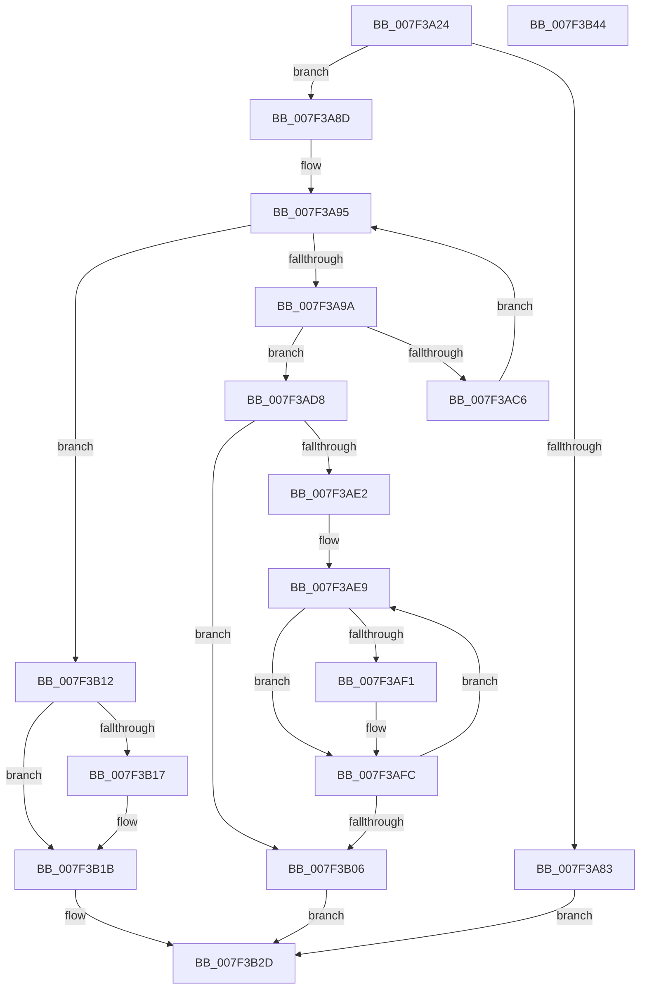

# HvAllocateOffsetArraysForHiveSnapshot

- RVA: `0x007F3A24`–`0x007F3B45` (길이 `289` bytes)
- VA: `0x00000001407F3A24`
- 실행 섹션: `PAGE`
- PDB 이름 있음: `예`; PDB Function 태그: `아니요`
- unwind 정보 RVA: `0x000AF26C`
- 디코드: `89`개 명령, `289/289` bytes 표시
- 미해석 바이트: `0` (있으면 어셈블리에 `.byte`로 보존)

> 이 문서는 커널 이미지의 기계어와 PDB 기호를 분석해 생성했습니다. 4번과 5번은 함수 원형과 자료형을 바이너리 사용 방식에서 추정한 C 해석이며 원본 소스 복구 결과는 아닙니다.

## 1. Dependencies

- 직접 호출 지점: **4**; 고유 호출 대상: **2**
- 직접 호출자로 확인된 함수: **2**
- RIP 상대 이미지 참조: **0**

### Outgoing calls
- `0x007F3A76` → [ExAllocatePool2](../../poolcode/B8/ExAllocatePool2_function_00B820F0.md) (function, `0x00B820F0`)
- `0x007F3AB3` → [ExAllocatePool2](../../poolcode/B8/ExAllocatePool2_function_00B820F0.md) (function, `0x00B820F0`)
- `0x007F3AF3` → [ExFreePoolWithTag](../../poolcode/B8/ExFreePoolWithTag_function_00B82870.md) (function, `0x00B82870`)
- `0x007F3B0B` → [ExFreePoolWithTag](../../poolcode/B8/ExFreePoolWithTag_function_00B82870.md) (function, `0x00B82870`)

### Direct callers
- [CmDumpKeyToFile](../7D/CmDumpKeyToFile_function_007DCD64.md) at `0x007DCE49`
- [CmpFlushBackupHive](../7E/CmpFlushBackupHive_function_007EC1A8.md) at `0x007EC342`

### Static image references
- 디코드된 RIP-relative 메모리 참조가 없습니다.

## 2. Other-region calls and transfers

- 다른 실행 섹션으로 향하는 call: **4**
  - `0x007F3A76` → [ExAllocatePool2](../../poolcode/B8/ExAllocatePool2_function_00B820F0.md) (`PAGE` → `POOLCODE`)
  - `0x007F3AB3` → [ExAllocatePool2](../../poolcode/B8/ExAllocatePool2_function_00B820F0.md) (`PAGE` → `POOLCODE`)
  - `0x007F3AF3` → [ExFreePoolWithTag](../../poolcode/B8/ExFreePoolWithTag_function_00B82870.md) (`PAGE` → `POOLCODE`)
  - `0x007F3B0B` → [ExFreePoolWithTag](../../poolcode/B8/ExFreePoolWithTag_function_00B82870.md) (`PAGE` → `POOLCODE`)
- 별도 외부 분기/꼬리 이동을 확인하지 못했습니다.

## 3. Assembly (complete function range)

```asm
007F3A24  48 89 5C 24 08                  mov qword ptr [rsp + 8], rbx
007F3A29  4C 89 44 24 18                  mov qword ptr [rsp + 0x18], r8
007F3A2E  48 89 54 24 10                  mov qword ptr [rsp + 0x10], rdx
007F3A33  55                              push rbp
007F3A34  56                              push rsi
007F3A35  57                              push rdi
007F3A36  41 54                           push r12
007F3A38  41 55                           push r13
007F3A3A  41 56                           push r14
007F3A3C  41 57                           push r15
007F3A3E  48 83 EC 20                     sub rsp, 0x20
007F3A42  8B A9 18 01 00 00               mov ebp, dword ptr [rcx + 0x118]
007F3A48  41 B8 43 4D 20 20               mov r8d, 0x20204d43
007F3A4E  81 C5 00 10 00 00               add ebp, 0x1000
007F3A54  B9 00 01 00 00                  mov ecx, 0x100
007F3A59  8B C5                           mov eax, ebp
007F3A5B  4D 8B E9                        mov r13, r9
007F3A5E  C1 E8 14                        shr eax, 0x14
007F3A61  F7 C5 FF FF 0F 00               test ebp, 0xfffff
007F3A67  44 8D 70 01                     lea r14d, [rax + 1]
007F3A6B  44 0F 44 F0                     cmove r14d, eax
007F3A6F  43 8D 14 76                     lea edx, [r14 + r14*2]
007F3A73  C1 E2 03                        shl edx, 3
007F3A76  E8 75 E6 38 00                  call 0x140b820f0
007F3A7B  48 8B F8                        mov rdi, rax
007F3A7E  48 85 C0                        test rax, rax
007F3A81  75 0A                           jne 0x1407f3a8d
007F3A83  BB 17 00 00 C0                  mov ebx, 0xc0000017
007F3A88  E9 A0 00 00 00                  jmp 0x1407f3b2d
007F3A8D  45 33 FF                        xor r15d, r15d
007F3A90  44 8B E5                        mov r12d, ebp
007F3A93  33 DB                           xor ebx, ebx
007F3A95  41 3B DE                        cmp ebx, r14d
007F3A98  73 78                           jae 0x1407f3b12
007F3A9A  BE 00 00 10 00                  mov esi, 0x100000
007F3A9F  B9 00 01 00 00                  mov ecx, 0x100
007F3AA4  44 3B E6                        cmp r12d, esi
007F3AA7  41 B8 43 4D 20 20               mov r8d, 0x20204d43
007F3AAD  41 0F 42 F4                     cmovb esi, r12d
007F3AB1  8B D6                           mov edx, esi
007F3AB3  E8 38 E6 38 00                  call 0x140b820f0
007F3AB8  48 8D 14 5B                     lea rdx, [rbx + rbx*2]
007F3ABC  48 89 44 D7 08                  mov qword ptr [rdi + rdx*8 + 8], rax
007F3AC1  48 85 C0                        test rax, rax
007F3AC4  74 12                           je 0x1407f3ad8
007F3AC6  44 89 3C D7                     mov dword ptr [rdi + rdx*8], r15d
007F3ACA  44 2B E6                        sub r12d, esi
007F3ACD  44 03 FE                        add r15d, esi
007F3AD0  89 74 D7 10                     mov dword ptr [rdi + rdx*8 + 0x10], esi
007F3AD4  FF C3                           inc ebx
007F3AD6  EB BD                           jmp 0x1407f3a95
007F3AD8  BB 17 00 00 C0                  mov ebx, 0xc0000017
007F3ADD  45 85 F6                        test r14d, r14d
007F3AE0  74 24                           je 0x1407f3b06
007F3AE2  48 8D 77 08                     lea rsi, [rdi + 8]
007F3AE6  41 8B EE                        mov ebp, r14d
007F3AE9  48 8B 0E                        mov rcx, qword ptr [rsi]
007F3AEC  48 85 C9                        test rcx, rcx
007F3AEF  74 0B                           je 0x1407f3afc
007F3AF1  33 D2                           xor edx, edx
007F3AF3  E8 78 ED 38 00                  call 0x140b82870
007F3AF8  48 83 26 00                     and qword ptr [rsi], 0
007F3AFC  48 83 C6 18                     add rsi, 0x18
007F3B00  48 83 ED 01                     sub rbp, 1
007F3B04  75 E3                           jne 0x1407f3ae9
007F3B06  33 D2                           xor edx, edx
007F3B08  48 8B CF                        mov rcx, rdi
007F3B0B  E8 60 ED 38 00                  call 0x140b82870
007F3B10  EB 1B                           jmp 0x1407f3b2d
007F3B12  4D 85 ED                        test r13, r13
007F3B15  74 04                           je 0x1407f3b1b
007F3B17  41 89 6D 00                     mov dword ptr [r13], ebp
007F3B1B  48 8B 44 24 68                  mov rax, qword ptr [rsp + 0x68]
007F3B20  33 DB                           xor ebx, ebx
007F3B22  44 89 30                        mov dword ptr [rax], r14d
007F3B25  48 8B 44 24 70                  mov rax, qword ptr [rsp + 0x70]
007F3B2A  48 89 38                        mov qword ptr [rax], rdi
007F3B2D  8B C3                           mov eax, ebx
007F3B2F  48 8B 5C 24 60                  mov rbx, qword ptr [rsp + 0x60]
007F3B34  48 83 C4 20                     add rsp, 0x20
007F3B38  41 5F                           pop r15
007F3B3A  41 5E                           pop r14
007F3B3C  41 5D                           pop r13
007F3B3E  41 5C                           pop r12
007F3B40  5F                              pop rdi
007F3B41  5E                              pop rsi
007F3B42  5D                              pop rbp
007F3B43  C3                              ret
007F3B44  CC                              int3
```

## 4. C-style interpretation (structured pseudocode)

```c
__int64 __fastcall HvAllocateOffsetArraysForHiveSnapshot(__int64 a1, __int64 a2, __int64 a3, __int64 a4)
{
    __int64 result;
    __int64 v_r12;
    __int64 v_r14;
    __int64 v_r15;
    __int64 v_rbp;
    __int64 v_rbx;
    __int64 v_rsi;
    __int64 v_rsp;
    unsigned __int64 v_stack_p10;
    unsigned __int64 v_stack_p18;
    unsigned __int64 v_stack_p8;

    v_stack_p8 = v_rbx;
    v_stack_p18 = a3;
    v_stack_p10 = a2;
    v_rsp = (v_rsp) - (32);
    v_rbp = (unsigned int)(((unsigned int)(*(unsigned int *)(a1 + 280))) + (0x1000ULL));
    result = (unsigned int)(((unsigned int)((unsigned int)(v_rbp))) >> (20));
    v_r14 = result + 1;
    if ((((unsigned int)(v_rbp)) & (0xFFFFFULL)) == 0) { v_r14 = (unsigned int)(result); }
    a2 = (unsigned int)((v_r14 + v_r14 * 2) << (3));
    result = ExAllocatePool2(256, a2, (unsigned int)(0x20204D43ULL), a4);
    if (result != 0) goto loc_007F3A8D;
    goto loc_007F3B2D;
loc_007F3A8D:
    v_r15 = 0;
    v_rbx = 0;
loc_007F3A95:
    if (0 >= ((unsigned int)(v_r14))) goto loc_007F3B12;
    v_rsi = (unsigned int)(0x100000ULL);
    if (((unsigned int)((unsigned int)((unsigned int)(v_rbp)))) < ((unsigned int)((unsigned int)(0x100000ULL)))) { v_rsi = (unsigned int)((unsigned int)((unsigned int)(v_rbp))); }
    result = ExAllocatePool2(256, (unsigned int)((unsigned int)(v_rsi)), (unsigned int)(0x20204D43ULL), a4);
    *(unsigned __int64 *)(result + v_rbx + v_rbx * 2 * 8 + 8) = result;
    if (result == 0) goto loc_007F3AD8;
    *(unsigned int *)(result + v_rbx + v_rbx * 2 * 8) = 0;
    v_r12 = (unsigned int)(((unsigned int)((unsigned int)(v_rbp))) - ((unsigned int)(v_rsi)));
    v_r15 = (unsigned int)((v_r15) + ((unsigned int)(v_rsi)));
    *(unsigned int *)(result + v_rbx + v_rbx * 2 * 8 + 16) = (unsigned int)(v_rsi);
    v_rbx = (unsigned int)((v_rbx) + 1);
    goto loc_007F3A95;
loc_007F3AD8:
    if ((unsigned int)(v_r14) == 0) goto loc_007F3B06;
loc_007F3AE9:
    if (*(unsigned __int64 *)(result + 8) != 0) {
        a2 = 0;
        result = ExFreePoolWithTag(*(unsigned __int64 *)(result + 8), a2, (unsigned int)(0x20204D43ULL), a4);
    }
    v_rsi = (result + 8) + (24);
    v_rbp = ((unsigned int)((unsigned int)(v_r14))) - (1);
    if (condition_is_not_equal) goto loc_007F3AE9;
loc_007F3B06:
    a2 = 0;
    result = ExFreePoolWithTag(result, a2, (unsigned int)(0x20204D43ULL), a4);
    goto loc_007F3B2D;
loc_007F3B12:
    if (a4 != 0) {
        *(unsigned int *)(a4) = (unsigned int)(v_rbp);
    }
    v_rbx = 0;
    *(unsigned int *)(v_stack_p10) = (unsigned int)(v_r14);
    *(unsigned __int64 *)(v_stack_p18) = result;
loc_007F3B2D:
    v_rsp = (v_rsp) + (32);
    return 0;
}
```

## 5. (Beta) C Style

```c
int64_t HvAllocateOffsetArraysForHiveSnapshot(void *Arg1, int64_t Arg2, int64_t Arg3, int64_t Arg4)
{
    uint8_t *arg1 = (uint8_t *)Arg1;

    int64_t result;
    int64_t local_r12;
    int64_t local_r14;
    int64_t local_r15;
    int64_t local_rbp;
    int64_t local_rbx;
    int64_t local_rsi;
    int64_t local_rsp;
    uint64_t v_stack_p10;
    uint64_t v_stack_p18;
    uint64_t v_stack_p8;

    v_stack_p8 = local_rbx;
    v_stack_p18 = Arg3;
    v_stack_p10 = Arg2;
    local_rsp = (local_rsp) - (32);
    local_rbp = (uint32_t)(((uint32_t)(*(uint32_t *)(arg1 + 0x118))) + (0x1000ULL));
    result = (uint32_t)(((uint32_t)((uint32_t)(local_rbp))) >> (20));
    local_r14 = result + 1;
    if ((((uint32_t)(local_rbp)) & (0xFFFFFULL)) == 0) { local_r14 = (uint32_t)(result); }
    Arg2 = (uint32_t)((local_r14 + local_r14 * 2) << (3));
    result = ExAllocatePool2(256, Arg2, (uint32_t)(0x20204D43ULL), Arg4);
    if (result != 0) goto loc_007F3A8D;
    goto loc_007F3B2D;
loc_007F3A8D:
    local_r15 = 0;
    local_rbx = 0;
loc_007F3A95:
    if (0 >= ((uint32_t)(local_r14))) goto loc_007F3B12;
    local_rsi = (uint32_t)(0x100000ULL);
    if (((uint32_t)((uint32_t)((uint32_t)(local_rbp)))) < ((uint32_t)((uint32_t)(0x100000ULL)))) { local_rsi = (uint32_t)((uint32_t)((uint32_t)(local_rbp))); }
    result = ExAllocatePool2(256, (uint32_t)((uint32_t)(local_rsi)), (uint32_t)(0x20204D43ULL), Arg4);
    *(uint64_t *)(result + local_rbx + local_rbx * 2 * 8 + 0x8) = result;
    if (result == 0) goto loc_007F3AD8;
    *(uint32_t *)(result + local_rbx + local_rbx * 2 * 8) = 0;
    local_r12 = (uint32_t)(((uint32_t)((uint32_t)(local_rbp))) - ((uint32_t)(local_rsi)));
    local_r15 = (uint32_t)((local_r15) + ((uint32_t)(local_rsi)));
    *(uint32_t *)(result + local_rbx + local_rbx * 2 * 8 + 0x10) = (uint32_t)(local_rsi);
    local_rbx = (uint32_t)((local_rbx) + 1);
    goto loc_007F3A95;
loc_007F3AD8:
    if ((uint32_t)(local_r14) == 0) goto loc_007F3B06;
loc_007F3AE9:
    if (*(uint64_t *)(result + 0x8) != 0) {
        Arg2 = 0;
        result = ExFreePoolWithTag(*(uint64_t *)(result + 0x8), Arg2, (uint32_t)(0x20204D43ULL), Arg4);
    }
    local_rsi = (result + 8) + (24);
    local_rbp = ((uint32_t)((uint32_t)(local_r14))) - (1);
    if (condition_is_not_equal) goto loc_007F3AE9;
loc_007F3B06:
    Arg2 = 0;
    result = ExFreePoolWithTag(result, Arg2, (uint32_t)(0x20204D43ULL), Arg4);
    goto loc_007F3B2D;
loc_007F3B12:
    if (Arg4 != 0) {
        *(uint32_t *)(Arg4) = (uint32_t)(local_rbp);
    }
    local_rbx = 0;
    *(uint32_t *)(v_stack_p10) = (uint32_t)(local_r14);
    *(uint64_t *)(v_stack_p18) = result;
loc_007F3B2D:
    local_rsp = (local_rsp) + (32);
    return 0;
}
```

### 관측된 메모리 오프셋

구조체 형식이 확인되지 않은 접근은 인자 기준의 오프셋으로만 기록했습니다.

| 기준 인자 | 오프셋 표현 | 폭 (bit) | 접근 |
|---|---:|---:|---|
| `Arg1` | `+ 0x118` | `32` | `R` |

## 6. Execution-region graph

[열기: 2D/3D 그래프와 함수 탐색 컨트롤 패널](../../../control-panel.html?section=page&rva=0x007F3A24&view=graph)

- 2D 그래프는 위에서 아래로 흐르고, 3D 그래프는 빈 공간을 드래그해 회전합니다. Shift+드래그는 이동, 휠은 확대·축소, 함수 노드 선택은 대상 보고서 이동입니다.

### Static fallback


