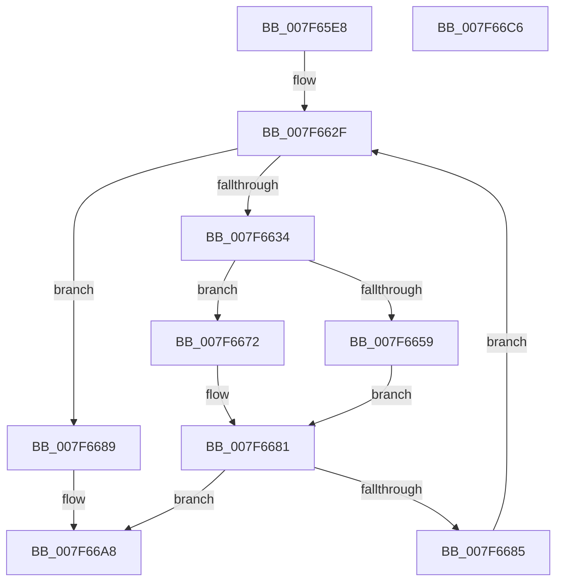

# HvApplyLogFiles

- RVA: `0x007F65E8`–`0x007F66C7` (길이 `223` bytes)
- VA: `0x00000001407F65E8`
- 실행 섹션: `PAGE`
- PDB 이름 있음: `예`; PDB Function 태그: `아니요`
- unwind 정보 RVA: `0x000AC264`
- 디코드: `62`개 명령, `223/223` bytes 표시
- 미해석 바이트: `0` (있으면 어셈블리에 `.byte`로 보존)

> 이 문서는 커널 이미지의 기계어와 PDB 기호를 분석해 생성했습니다. 4번과 5번은 함수 원형과 자료형을 바이너리 사용 방식에서 추정한 C 해석이며 원본 소스 복구 결과는 아닙니다.

## 1. Dependencies

- 직접 호출 지점: **3**; 고유 호출 대상: **3**
- 직접 호출자로 확인된 함수: **1**
- RIP 상대 이미지 참조: **0**

### Outgoing calls
- `0x007F666B` → [HvpApplyLegacyLogFile](HvpApplyLegacyLogFile_function_007F66D0.md) (function, `0x007F66D0`)
- `0x007F667C` → [HvpApplyIncrementalLogFile](../AA/HvpApplyIncrementalLogFile_function_00AA06A8.md) (function, `0x00AA06A8`)
- `0x007F6698` → [HvpHeaderCheckSum](../../pagecmrc/BC/HvpHeaderCheckSum_function_00BC97A0.md) (function, `0x00BC97A0`)

### Direct callers
- [HvpPerformLogFileRecovery](../9B/HvpPerformLogFileRecovery_function_009B7994.md) at `0x009B7BE0`

### Static image references
- 디코드된 RIP-relative 메모리 참조가 없습니다.

## 2. Other-region calls and transfers

- 다른 실행 섹션으로 향하는 call: **1**
  - `0x007F6698` → [HvpHeaderCheckSum](../../pagecmrc/BC/HvpHeaderCheckSum_function_00BC97A0.md) (`PAGE` → `PAGECMRC`)
- 별도 외부 분기/꼬리 이동을 확인하지 못했습니다.

## 3. Assembly (complete function range)

```asm
007F65E8  48 89 5C 24 08                  mov qword ptr [rsp + 8], rbx
007F65ED  48 89 6C 24 10                  mov qword ptr [rsp + 0x10], rbp
007F65F2  48 89 74 24 18                  mov qword ptr [rsp + 0x18], rsi
007F65F7  57                              push rdi
007F65F8  41 54                           push r12
007F65FA  41 55                           push r13
007F65FC  41 56                           push r14
007F65FE  41 57                           push r15
007F6600  48 83 EC 40                     sub rsp, 0x40
007F6604  48 8B AC 24 B0 00 00 00         mov rbp, qword ptr [rsp + 0xb0]
007F660C  49 8B F9                        mov rdi, r9
007F660F  4C 8B BC 24 A8 00 00 00         mov r15, qword ptr [rsp + 0xa8]
007F6617  4C 8B EA                        mov r13, rdx
007F661A  4C 8B A4 24 A0 00 00 00         mov r12, qword ptr [rsp + 0xa0]
007F6622  48 8B D9                        mov rbx, rcx
007F6625  4C 8B B4 24 98 00 00 00         mov r14, qword ptr [rsp + 0x98]
007F662D  33 F6                           xor esi, esi
007F662F  3B 77 3C                        cmp esi, dword ptr [rdi + 0x3c]
007F6632  73 55                           jae 0x1407f6689
007F6634  8B 4C B7 34                     mov ecx, dword ptr [rdi + rsi*4 + 0x34]
007F6638  4C 8D 47 04                     lea r8, [rdi + 4]
007F663C  48 8D 04 49                     lea rax, [rcx + rcx*2]
007F6640  48 8B CB                        mov rcx, rbx
007F6643  48 8D 14 C5 00 00 00 00         lea rdx, [rax*8]
007F664B  4D 8D 04 C0                     lea r8, [r8 + rax*8]
007F664F  49 03 D5                        add rdx, r13
007F6652  41 8B 00                        mov eax, dword ptr [r8]
007F6655  A8 02                           test al, 2
007F6657  74 19                           je 0x1407f6672
007F6659  48 89 6C 24 30                  mov qword ptr [rsp + 0x30], rbp
007F665E  4D 8B CE                        mov r9, r14
007F6661  4C 89 7C 24 28                  mov qword ptr [rsp + 0x28], r15
007F6666  4C 89 64 24 20                  mov qword ptr [rsp + 0x20], r12
007F666B  E8 60 00 00 00                  call 0x1407f66d0
007F6670  EB 0F                           jmp 0x1407f6681
007F6672  48 89 6C 24 28                  mov qword ptr [rsp + 0x28], rbp
007F6677  4C 89 74 24 20                  mov qword ptr [rsp + 0x20], r14
007F667C  E8 27 A0 2A 00                  call 0x140aa06a8
007F6681  85 C0                           test eax, eax
007F6683  78 23                           js 0x1407f66a8
007F6685  FF C6                           inc esi
007F6687  EB A6                           jmp 0x1407f662f
007F6689  8B 47 50                        mov eax, dword ptr [rdi + 0x50]
007F668C  48 8B CB                        mov rcx, rbx
007F668F  89 43 04                        mov dword ptr [rbx + 4], eax
007F6692  8B 47 50                        mov eax, dword ptr [rdi + 0x50]
007F6695  89 43 08                        mov dword ptr [rbx + 8], eax
007F6698  E8 03 31 3D 00                  call 0x140bc97a0
007F669D  89 83 FC 01 00 00               mov dword ptr [rbx + 0x1fc], eax
007F66A3  B8 09 00 00 40                  mov eax, 0x40000009
007F66A8  4C 8D 5C 24 40                  lea r11, [rsp + 0x40]
007F66AD  49 8B 5B 30                     mov rbx, qword ptr [r11 + 0x30]
007F66B1  49 8B 6B 38                     mov rbp, qword ptr [r11 + 0x38]
007F66B5  49 8B 73 40                     mov rsi, qword ptr [r11 + 0x40]
007F66B9  49 8B E3                        mov rsp, r11
007F66BC  41 5F                           pop r15
007F66BE  41 5E                           pop r14
007F66C0  41 5D                           pop r13
007F66C2  41 5C                           pop r12
007F66C4  5F                              pop rdi
007F66C5  C3                              ret
007F66C6  CC                              int3
```

## 4. C-style interpretation (structured pseudocode)

```c
__int64 __fastcall HvApplyLogFiles(__int64 a1, __int64 a2, __int64 a3, __int64 a4, __int64 a5, __int64 a6, __int64 a7, __int64 a8, __int64 a9)
{
    __int64 result;
    __int64 v_rsi;
    __int64 v_rsp;
    unsigned __int64 v_stack_m28;
    unsigned __int64 v_stack_m38;
    unsigned __int64 v_stack_m40;
    unsigned __int64 v_stack_m48;
    unsigned __int64 v_stack_p10;
    unsigned __int64 v_stack_p18;
    unsigned __int64 v_stack_p8;

    v_stack_p8 = v_rbx;
    v_stack_p10 = v_rbp;
    v_stack_p18 = v_rsi;
    v_rsp = (v_rsp) - (64);
    v_rsi = 0;
loc_007F662F:
    if (0 >= (*(unsigned int *)(a4 + 60))) goto loc_007F6689;
    a2 = ((unsigned int)(*(unsigned int *)(a4 + v_rsi * 4 + 52)) + (unsigned int)(*(unsigned int *)(a4 + v_rsi * 4 + 52)) * 2 * 8) + (a2);
    if ((((unsigned __int8)((unsigned int)(*(unsigned int *)(a4 + 4 + (unsigned int)(*(unsigned int *)(a4 + v_rsi * 4 + 52)) + (unsigned int)(*(unsigned int *)(a4 + v_rsi * 4 + 52)) * 2 * 8)))) & (2)) == 0) goto loc_007F6672;
    v_stack_m38 = a9;
    v_stack_m40 = a8;
    v_stack_m48 = a7;
    result = HvpApplyLegacyLogFile(a1, a2, a4 + 4 + (unsigned int)(*(unsigned int *)(a4 + v_rsi * 4 + 52)) + (unsigned int)(*(unsigned int *)(a4 + v_rsi * 4 + 52)) * 2 * 8, a6);
    goto loc_007F6681;
loc_007F6672:
    v_stack_m40 = a9;
    v_stack_m48 = a6;
    result = HvpApplyIncrementalLogFile(a1, a2, a4 + 4 + (unsigned int)(*(unsigned int *)(a4 + v_rsi * 4 + 52)) + (unsigned int)(*(unsigned int *)(a4 + v_rsi * 4 + 52)) * 2 * 8, a6);
loc_007F6681:
    if (sign_flag) goto loc_007F66A8;
    v_rsi = (unsigned int)((v_rsi) + 1);
    goto loc_007F662F;
loc_007F6689:
    *(unsigned int *)(a1 + 4) = (unsigned int)((unsigned int)(*(unsigned int *)(a4 + 80)));
    *(unsigned int *)(a1 + 8) = (unsigned int)((unsigned int)(*(unsigned int *)(a4 + 80)));
    result = HvpHeaderCheckSum(a1, a2, a4 + 4 + (unsigned int)(*(unsigned int *)(a4 + v_rsi * 4 + 52)) + (unsigned int)(*(unsigned int *)(a4 + v_rsi * 4 + 52)) * 2 * 8, a6);
    *(unsigned int *)(a1 + 508) = (unsigned int)(result);
loc_007F66A8:
    return (unsigned int)(0x40000009ULL);
}
```

## 5. (Beta) C Style

```c
int64_t HvApplyLogFiles(void *Arg1, int64_t Arg2, int64_t Arg3, void *Arg4, uint64_t Arg5, int64_t Arg6, int64_t Arg7, int64_t Arg8, int64_t Arg9)
{
    uint8_t *arg1 = (uint8_t *)Arg1;
    uint8_t *arg4 = (uint8_t *)Arg4;

    int64_t result;
    int64_t local_rsi;
    int64_t local_rsp;
    uint64_t v_stack_m28;
    uint64_t v_stack_m38;
    uint64_t v_stack_m40;
    uint64_t v_stack_m48;
    uint64_t v_stack_p10;
    uint64_t v_stack_p18;
    uint64_t v_stack_p8;

    v_stack_p8 = local_rbx;
    v_stack_p10 = local_rbp;
    v_stack_p18 = local_rsi;
    local_rsp = (local_rsp) - (64);
    local_rsi = 0;
loc_007F662F:
    if (0 >= (*(uint32_t *)(arg4 + 0x3C))) goto loc_007F6689;
    Arg2 = ((uint32_t)(*(uint32_t *)(arg4 + local_rsi * 4 + 0x34)) + (uint32_t)(*(uint32_t *)(arg4 + local_rsi * 4 + 0x34)) * 2 * 8) + (Arg2);
    if ((((uint8_t)((uint32_t)(*(uint32_t *)(arg4 + 0x4 + (uint32_t)(*(uint32_t *)(arg4 + local_rsi * 4 + 0x34)) + (uint32_t)(*(uint32_t *)(arg4 + local_rsi * 4 + 0x34)) * 2 * 8)))) & (2)) == 0) goto loc_007F6672;
    v_stack_m38 = Arg9;
    v_stack_m40 = Arg8;
    v_stack_m48 = Arg7;
    result = HvpApplyLegacyLogFile(Arg1, Arg2, Arg4 + 4 + (uint32_t)(*(uint32_t *)(arg4 + local_rsi * 4 + 0x34)) + (uint32_t)(*(uint32_t *)(arg4 + local_rsi * 4 + 0x34)) * 2 * 8, Arg6);
    goto loc_007F6681;
loc_007F6672:
    v_stack_m40 = Arg9;
    v_stack_m48 = Arg6;
    result = HvpApplyIncrementalLogFile(Arg1, Arg2, Arg4 + 4 + (uint32_t)(*(uint32_t *)(arg4 + local_rsi * 4 + 0x34)) + (uint32_t)(*(uint32_t *)(arg4 + local_rsi * 4 + 0x34)) * 2 * 8, Arg6);
loc_007F6681:
    if (sign_flag) goto loc_007F66A8;
    local_rsi = (uint32_t)((local_rsi) + 1);
    goto loc_007F662F;
loc_007F6689:
    *(uint32_t *)(arg1 + 0x4) = (uint32_t)((uint32_t)(*(uint32_t *)(arg4 + 0x50)));
    *(uint32_t *)(arg1 + 0x8) = (uint32_t)((uint32_t)(*(uint32_t *)(arg4 + 0x50)));
    result = HvpHeaderCheckSum(Arg1, Arg2, Arg4 + 4 + (uint32_t)(*(uint32_t *)(arg4 + local_rsi * 4 + 0x34)) + (uint32_t)(*(uint32_t *)(arg4 + local_rsi * 4 + 0x34)) * 2 * 8, Arg6);
    *(uint32_t *)(arg1 + 0x1FC) = (uint32_t)(result);
loc_007F66A8:
    return (uint32_t)(0x40000009ULL);
}
```

### 관측된 메모리 오프셋

구조체 형식이 확인되지 않은 접근은 인자 기준의 오프셋으로만 기록했습니다.

| 기준 인자 | 오프셋 표현 | 폭 (bit) | 접근 |
|---|---:|---:|---|
| `Arg1` | `+ 0x4` | `32` | `W` |
| `Arg1` | `+ 0x8` | `32` | `W` |
| `Arg1` | `+ 0x1FC` | `32` | `W` |
| `Arg4` | `+ 0x0` | `32` | `R` |
| `Arg4` | `+ 0x0 + rax*8` | `64` | `R` |
| `Arg4` | `+ 0x4` | `64` | `R` |
| `Arg4` | `+ 0x34 + rsi*4` | `32` | `R` |
| `Arg4` | `+ 0x3C` | `32` | `R` |
| `Arg4` | `+ 0x50` | `32` | `R` |

## 6. Execution-region graph

[열기: 2D/3D 그래프와 함수 탐색 컨트롤 패널](../../../control-panel.html?section=page&rva=0x007F65E8&view=graph)

- 2D 그래프는 위에서 아래로 흐르고, 3D 그래프는 빈 공간을 드래그해 회전합니다. Shift+드래그는 이동, 휠은 확대·축소, 함수 노드 선택은 대상 보고서 이동입니다.

### Static fallback


