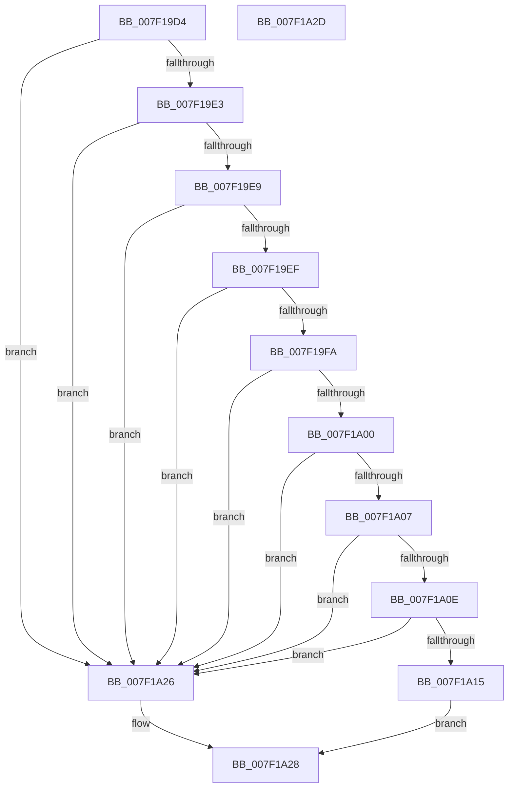

# HvIsInPlaceBaseBlockValid

- RVA: `0x007F19D4`–`0x007F1A2E` (길이 `90` bytes)
- VA: `0x00000001407F19D4`
- 실행 섹션: `PAGE`
- PDB 이름 있음: `예`; PDB Function 태그: `아니요`
- unwind 정보 RVA: `0x0005C788`
- 디코드: `29`개 명령, `90/90` bytes 표시
- 미해석 바이트: `0` (있으면 어셈블리에 `.byte`로 보존)

> 이 문서는 커널 이미지의 기계어와 PDB 기호를 분석해 생성했습니다. 4번과 5번은 함수 원형과 자료형을 바이너리 사용 방식에서 추정한 C 해석이며 원본 소스 복구 결과는 아닙니다.

## 1. Dependencies

- 직접 호출 지점: **1**; 고유 호출 대상: **1**
- 직접 호출자로 확인된 함수: **1**
- RIP 상대 이미지 참조: **0**

### Outgoing calls
- `0x007F1A15` → [HvpHeaderCheckSum](../../pagecmrc/BC/HvpHeaderCheckSum_function_00BC97A0.md) (function, `0x00BC97A0`)

### Direct callers
- [HvHiveStartMemoryBacked](../87/HvHiveStartMemoryBacked_function_0087BF38.md) at `0x0087C2BA`

### Static image references
- 디코드된 RIP-relative 메모리 참조가 없습니다.

## 2. Other-region calls and transfers

- 다른 실행 섹션으로 향하는 call: **1**
  - `0x007F1A15` → [HvpHeaderCheckSum](../../pagecmrc/BC/HvpHeaderCheckSum_function_00BC97A0.md) (`PAGE` → `PAGECMRC`)
- 별도 외부 분기/꼬리 이동을 확인하지 못했습니다.

## 3. Assembly (complete function range)

```asm
007F19D4  48 83 EC 28                     sub rsp, 0x28
007F19D8  81 39 72 65 67 66               cmp dword ptr [rcx], 0x66676572
007F19DE  4C 8B C9                        mov r9, rcx
007F19E1  75 43                           jne 0x1407f1a26
007F19E3  83 79 1C 00                     cmp dword ptr [rcx + 0x1c], 0
007F19E7  75 3D                           jne 0x1407f1a26
007F19E9  83 79 14 01                     cmp dword ptr [rcx + 0x14], 1
007F19ED  77 37                           ja 0x1407f1a26
007F19EF  8B 41 18                        mov eax, dword ptr [rcx + 0x18]
007F19F2  83 E8 03                        sub eax, 3
007F19F5  83 F8 03                        cmp eax, 3
007F19F8  77 2C                           ja 0x1407f1a26
007F19FA  83 79 20 01                     cmp dword ptr [rcx + 0x20], 1
007F19FE  75 26                           jne 0x1407f1a26
007F1A00  8B 41 28                        mov eax, dword ptr [rcx + 0x28]
007F1A03  85 C0                           test eax, eax
007F1A05  74 1F                           je 0x1407f1a26
007F1A07  A9 FF 0F 00 00                  test eax, 0xfff
007F1A0C  75 18                           jne 0x1407f1a26
007F1A0E  3D 00 E0 FF 7F                  cmp eax, 0x7fffe000
007F1A13  77 11                           ja 0x1407f1a26
007F1A15  E8 86 7D 3D 00                  call 0x140bc97a0
007F1A1A  41 3B 81 FC 01 00 00            cmp eax, dword ptr [r9 + 0x1fc]
007F1A21  0F 94 C0                        sete al
007F1A24  EB 02                           jmp 0x1407f1a28
007F1A26  32 C0                           xor al, al
007F1A28  48 83 C4 28                     add rsp, 0x28
007F1A2C  C3                              ret
007F1A2D  CC                              int3
```

## 4. C-style interpretation (structured pseudocode)

```c
__int64 __fastcall HvIsInPlaceBaseBlockValid(__int64 a1)
{
    __int64 result;
    __int64 v_rsp;

    v_rsp = (v_rsp) - (40);
    if ((*(unsigned int *)(a1)) != 0x66676572ULL) goto loc_007F1A26;
    if ((*(unsigned int *)(a1 + 28)) != 0) goto loc_007F1A26;
    if ((*(unsigned int *)(a1 + 20)) > 1) goto loc_007F1A26;
    result = (unsigned int)(((unsigned int)(*(unsigned int *)(a1 + 24))) - (3));
    if (((unsigned int)(result)) > 3) goto loc_007F1A26;
    if ((*(unsigned int *)(a1 + 32)) != 1) goto loc_007F1A26;
    if ((unsigned int)((unsigned int)(*(unsigned int *)(a1 + 40))) == 0) goto loc_007F1A26;
    if ((((unsigned int)((unsigned int)(*(unsigned int *)(a1 + 40)))) & (0xFFFULL)) != 0) goto loc_007F1A26;
    if (((unsigned int)((unsigned int)(*(unsigned int *)(a1 + 40)))) > 0x7FFFE000ULL) goto loc_007F1A26;
    result = HvpHeaderCheckSum(a1, a2, a3, a1);
    result = (((unsigned int)(result)) == (*(unsigned int *)(a1 + 508))) ? 1 : 0;
    goto loc_007F1A28;
loc_007F1A26:
    result = 0;
loc_007F1A28:
    v_rsp = (v_rsp) + (40);
    return result;
}
```

## 5. (Beta) C Style

```c
int64_t HvIsInPlaceBaseBlockValid(void *Arg1)
{
    uint8_t *arg1 = (uint8_t *)Arg1;

    int64_t result;
    int64_t local_rsp;

    local_rsp = (local_rsp) - (40);
    if ((*(uint32_t *)(arg1)) != 0x66676572ULL) goto loc_007F1A26;
    if ((*(uint32_t *)(arg1 + 0x1C)) != 0) goto loc_007F1A26;
    if ((*(uint32_t *)(arg1 + 0x14)) > 1) goto loc_007F1A26;
    result = (uint32_t)(((uint32_t)(*(uint32_t *)(arg1 + 0x18))) - (3));
    if (((uint32_t)(result)) > 3) goto loc_007F1A26;
    if ((*(uint32_t *)(arg1 + 0x20)) != 1) goto loc_007F1A26;
    if ((uint32_t)((uint32_t)(*(uint32_t *)(arg1 + 0x28))) == 0) goto loc_007F1A26;
    if ((((uint32_t)((uint32_t)(*(uint32_t *)(arg1 + 0x28)))) & (0xFFFULL)) != 0) goto loc_007F1A26;
    if (((uint32_t)((uint32_t)(*(uint32_t *)(arg1 + 0x28)))) > 0x7FFFE000ULL) goto loc_007F1A26;
    result = HvpHeaderCheckSum(Arg1, a2, a3, Arg1);
    result = (((uint32_t)(result)) == (*(uint32_t *)(arg1 + 0x1FC))) ? 1 : 0;
    goto loc_007F1A28;
loc_007F1A26:
    result = 0;
loc_007F1A28:
    local_rsp = (local_rsp) + (40);
    return result;
}
```

### 관측된 메모리 오프셋

구조체 형식이 확인되지 않은 접근은 인자 기준의 오프셋으로만 기록했습니다.

| 기준 인자 | 오프셋 표현 | 폭 (bit) | 접근 |
|---|---:|---:|---|
| `Arg1` | `+ 0x0` | `32` | `R` |
| `Arg1` | `+ 0x14` | `32` | `R` |
| `Arg1` | `+ 0x18` | `32` | `R` |
| `Arg1` | `+ 0x1C` | `32` | `R` |
| `Arg1` | `+ 0x20` | `32` | `R` |
| `Arg1` | `+ 0x28` | `32` | `R` |

## 6. Execution-region graph

[열기: 2D/3D 그래프와 함수 탐색 컨트롤 패널](../../../control-panel.html?section=page&rva=0x007F19D4&view=graph)

- 2D 그래프는 위에서 아래로 흐르고, 3D 그래프는 빈 공간을 드래그해 회전합니다. Shift+드래그는 이동, 휠은 확대·축소, 함수 노드 선택은 대상 보고서 이동입니다.

### Static fallback


