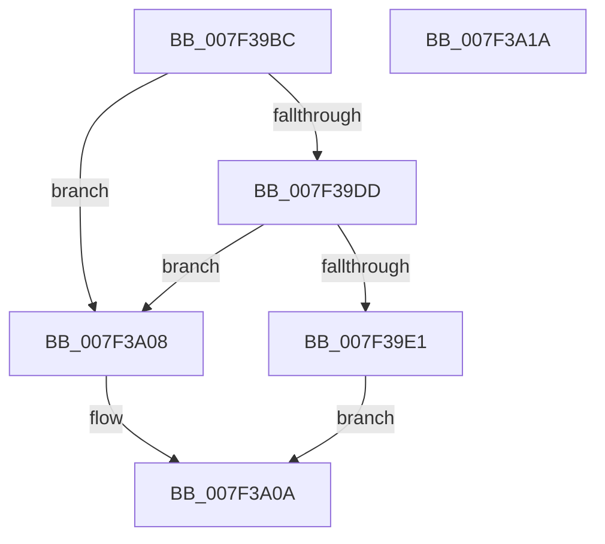

# HvIsRangeDirty

- RVA: `0x007F39BC`–`0x007F3A1B` (길이 `95` bytes)
- VA: `0x00000001407F39BC`
- 실행 섹션: `PAGE`
- PDB 이름 있음: `예`; PDB Function 태그: `아니요`
- unwind 정보 RVA: `0x00060BC4`
- 디코드: `31`개 명령, `95/95` bytes 표시
- 미해석 바이트: `0` (있으면 어셈블리에 `.byte`로 보존)

> 이 문서는 커널 이미지의 기계어와 PDB 기호를 분석해 생성했습니다. 4번과 5번은 함수 원형과 자료형을 바이너리 사용 방식에서 추정한 C 해석이며 원본 소스 복구 결과는 아닙니다.

## 1. Dependencies

- 직접 호출 지점: **3**; 고유 호출 대상: **3**
- 직접 호출자로 확인된 함수: **1**
- RIP 상대 이미지 참조: **0**

### Outgoing calls
- `0x007F39E1` → [HvLockHiveWriter](../85/HvLockHiveWriter_function_00859894.md) (function, `0x00859894`)
- `0x007F39F2` → [RtlAreBitsClear](../../text/45/RtlAreBitsClear_function_00451800.md) (function, `0x00451800`)
- `0x007F39FC` → [HvUnlockHiveWriter](../85/HvUnlockHiveWriter_function_008598E4.md) (function, `0x008598E4`)

### Direct callers
- [sub_00B2E0F0](../B2/Unknown_function_00B2E0F0.md) at `0x00B2E321`

### Static image references
- 디코드된 RIP-relative 메모리 참조가 없습니다.

## 2. Other-region calls and transfers

- 다른 실행 섹션으로 향하는 call: **1**
  - `0x007F39F2` → [RtlAreBitsClear](../../text/45/RtlAreBitsClear_function_00451800.md) (`PAGE` → `.text`)
- 별도 외부 분기/꼬리 이동을 확인하지 못했습니다.

## 3. Assembly (complete function range)

```asm
007F39BC  48 89 5C 24 08                  mov qword ptr [rsp + 8], rbx
007F39C1  48 89 74 24 10                  mov qword ptr [rsp + 0x10], rsi
007F39C6  57                              push rdi
007F39C7  48 83 EC 20                     sub rsp, 0x20
007F39CB  8B 81 A0 00 00 00               mov eax, dword ptr [rcx + 0xa0]
007F39D1  41 8B F0                        mov esi, r8d
007F39D4  8B DA                           mov ebx, edx
007F39D6  48 8B F9                        mov rdi, rcx
007F39D9  A8 01                           test al, 1
007F39DB  75 2B                           jne 0x1407f3a08
007F39DD  85 D2                           test edx, edx
007F39DF  78 27                           js 0x1407f3a08
007F39E1  E8 AE 5E 06 00                  call 0x140859894
007F39E6  C1 EB 09                        shr ebx, 9
007F39E9  48 8D 4F 58                     lea rcx, [rdi + 0x58]
007F39ED  8B D3                           mov edx, ebx
007F39EF  44 8B C6                        mov r8d, esi
007F39F2  E8 09 DE C5 FF                  call 0x140451800
007F39F7  48 8B CF                        mov rcx, rdi
007F39FA  8A D8                           mov bl, al
007F39FC  E8 E3 5E 06 00                  call 0x1408598e4
007F3A01  84 DB                           test bl, bl
007F3A03  0F 94 C0                        sete al
007F3A06  EB 02                           jmp 0x1407f3a0a
007F3A08  B0 01                           mov al, 1
007F3A0A  48 8B 5C 24 30                  mov rbx, qword ptr [rsp + 0x30]
007F3A0F  48 8B 74 24 38                  mov rsi, qword ptr [rsp + 0x38]
007F3A14  48 83 C4 20                     add rsp, 0x20
007F3A18  5F                              pop rdi
007F3A19  C3                              ret
007F3A1A  CC                              int3
```

## 4. C-style interpretation (structured pseudocode)

```c
__int64 __fastcall HvIsRangeDirty(__int64 a1, int a2, int a3)
{
    __int64 result;
    __int64 v_rbx;
    __int64 v_rsp;
    unsigned __int64 v_stack_p10;
    unsigned __int64 v_stack_p8;

    v_stack_p8 = v_rbx;
    v_stack_p10 = v_rsi;
    v_rsp = (v_rsp) - (32);
    if ((((unsigned __int8)((unsigned int)(*(unsigned int *)(a1 + 160)))) & (1)) != 0) goto loc_007F3A08;
    if (sign_flag) goto loc_007F3A08;
    result = HvLockHiveWriter(a1, a2, a3, a4);
    v_rbx = (unsigned int)(((unsigned int)(a2)) >> (9));
    result = RtlAreBitsClear(a1 + 88, (unsigned int)((unsigned int)(v_rbx)), (unsigned int)((unsigned int)((unsigned int)(a3))), a4);
    result = HvUnlockHiveWriter(a1, (unsigned int)((unsigned int)(v_rbx)), (unsigned int)((unsigned int)((unsigned int)(a3))), a4);
    result = ((unsigned __int8)((unsigned __int8)(result)) == 0) ? 1 : 0;
    goto loc_007F3A0A;
loc_007F3A08:
loc_007F3A0A:
    v_rsp = (v_rsp) + (32);
    return 1;
}
```

## 5. (Beta) C Style

```c
int64_t HvIsRangeDirty(void *Arg1, int32_t Arg2, int32_t Arg3)
{
    uint8_t *arg1 = (uint8_t *)Arg1;

    int64_t result;
    int64_t local_rbx;
    int64_t local_rsp;
    uint64_t v_stack_p10;
    uint64_t v_stack_p8;

    v_stack_p8 = local_rbx;
    v_stack_p10 = local_rsi;
    local_rsp = (local_rsp) - (32);
    if ((((uint8_t)((uint32_t)(*(uint32_t *)(arg1 + 0xA0)))) & (1)) != 0) goto loc_007F3A08;
    if (sign_flag) goto loc_007F3A08;
    result = HvLockHiveWriter(Arg1, Arg2, Arg3, a4);
    local_rbx = (uint32_t)(((uint32_t)(Arg2)) >> (9));
    result = RtlAreBitsClear(Arg1 + 88, (uint32_t)((uint32_t)(local_rbx)), (uint32_t)((uint32_t)((uint32_t)(Arg3))), a4);
    result = HvUnlockHiveWriter(Arg1, (uint32_t)((uint32_t)(local_rbx)), (uint32_t)((uint32_t)((uint32_t)(Arg3))), a4);
    result = ((uint8_t)((uint8_t)(result)) == 0) ? 1 : 0;
    goto loc_007F3A0A;
loc_007F3A08:
loc_007F3A0A:
    local_rsp = (local_rsp) + (32);
    return 1;
}
```

### 관측된 메모리 오프셋

구조체 형식이 확인되지 않은 접근은 인자 기준의 오프셋으로만 기록했습니다.

| 기준 인자 | 오프셋 표현 | 폭 (bit) | 접근 |
|---|---:|---:|---|
| `Arg1` | `+ 0x58` | `64` | `R` |
| `Arg1` | `+ 0xA0` | `32` | `R` |

## 6. Execution-region graph

[열기: 2D/3D 그래프와 함수 탐색 컨트롤 패널](../../../control-panel.html?section=page&rva=0x007F39BC&view=graph)

- 2D 그래프는 위에서 아래로 흐르고, 3D 그래프는 빈 공간을 드래그해 회전합니다. Shift+드래그는 이동, 휠은 확대·축소, 함수 노드 선택은 대상 보고서 이동입니다.

### Static fallback


