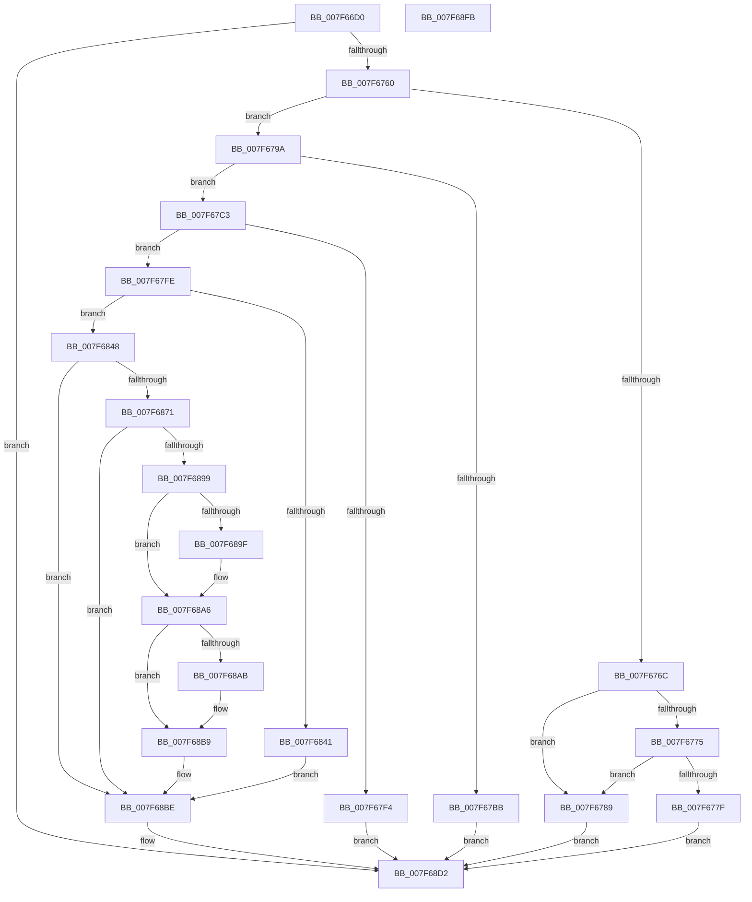

# HvpApplyLegacyLogFile

- RVA: `0x007F66D0`–`0x007F68FC` (길이 `556` bytes)
- VA: `0x00000001407F66D0`
- 실행 섹션: `PAGE`
- PDB 이름 있음: `예`; PDB Function 태그: `아니요`
- unwind 정보 RVA: `0x000D367C`
- 디코드: `152`개 명령, `556/556` bytes 표시
- 미해석 바이트: `0` (있으면 어셈블리에 `.byte`로 보존)

> 이 문서는 커널 이미지의 기계어와 PDB 기호를 분석해 생성했습니다. 4번과 5번은 함수 원형과 자료형을 바이너리 사용 방식에서 추정한 C 해석이며 원본 소스 복구 결과는 아닙니다.

## 1. Dependencies

- 직접 호출 지점: **11**; 고유 호출 대상: **7**
- 직접 호출자로 확인된 함수: **1**
- RIP 상대 이미지 참조: **3**

### Outgoing calls
- `0x007F6751` → [guard_dispatch_icall](../../text/6B/guard_dispatch_icall_function_006BAAD0.md) (function, `0x006BAAD0`)
- `0x007F67AF` → [RtlNumberOfSetBits](../../text/43/RtlNumberOfSetBits_function_00433F70.md) (function, `0x00433F70`)
- `0x007F67D1` → [HvpGenerateLogMetadata](../9B/HvpGenerateLogMetadata_function_009B68B0.md) (function, `0x009B68B0`)
- `0x007F67E7` → [guard_dispatch_icall](../../text/6B/guard_dispatch_icall_function_006BAAD0.md) (function, `0x006BAAD0`)
- `0x007F6809` → [HvpGenerateLogMetadata](../9B/HvpGenerateLogMetadata_function_009B68B0.md) (function, `0x009B68B0`)
- `0x007F6838` → [HvpIsMetadataArrayCoherent](../AA/HvpIsMetadataArrayCoherent_function_00AA09A4.md) (function, `0x00AA09A4`)
- `0x007F6866` → [guard_dispatch_icall](../../text/6B/guard_dispatch_icall_function_006BAAD0.md) (function, `0x006BAAD0`)
- `0x007F688E` → [HvpApplyLogEntryDataToFileBackedHive](../9B/HvpApplyLogEntryDataToFileBackedHive_function_009B6FF8.md) (function, `0x009B6FF8`)
- `0x007F68B4` → [HvpUpdateRecoveryVector](../AB/HvpUpdateRecoveryVector_function_00AB5E70.md) (function, `0x00AB5E70`)
- `0x007F68CD` → [guard_dispatch_icall](../../text/6B/guard_dispatch_icall_function_006BAAD0.md) (function, `0x006BAAD0`)
- `0x007F68DB` → [_security_check_cookie](../../text/6A/_security_check_cookie_function_006AC640.md) (function, `0x006AC640`)

### Direct callers
- [HvApplyLogFiles](HvApplyLogFiles_function_007F65E8.md) at `0x007F666B`

### Static image references
- `0x007F66EC` → RVA `0x00E0A740` (`.data`; read)
- `0x007F676C` → RVA `0x00FD8002` (`PAGEDATA`; read)
- `0x007F6775` → RVA `0x00EF7C60` (`.data`; read)

## 2. Other-region calls and transfers

- 다른 실행 섹션으로 향하는 call: **6**
  - `0x007F6751` → [guard_dispatch_icall](../../text/6B/guard_dispatch_icall_function_006BAAD0.md) (`PAGE` → `.text`)
  - `0x007F67AF` → [RtlNumberOfSetBits](../../text/43/RtlNumberOfSetBits_function_00433F70.md) (`PAGE` → `.text`)
  - `0x007F67E7` → [guard_dispatch_icall](../../text/6B/guard_dispatch_icall_function_006BAAD0.md) (`PAGE` → `.text`)
  - `0x007F6866` → [guard_dispatch_icall](../../text/6B/guard_dispatch_icall_function_006BAAD0.md) (`PAGE` → `.text`)
  - `0x007F68CD` → [guard_dispatch_icall](../../text/6B/guard_dispatch_icall_function_006BAAD0.md) (`PAGE` → `.text`)
  - `0x007F68DB` → [_security_check_cookie](../../text/6A/_security_check_cookie_function_006AC640.md) (`PAGE` → `.text`)
- 별도 외부 분기/꼬리 이동을 확인하지 못했습니다.

## 3. Assembly (complete function range)

```asm
007F66D0  48 89 5C 24 18                  mov qword ptr [rsp + 0x18], rbx
007F66D5  55                              push rbp
007F66D6  56                              push rsi
007F66D7  57                              push rdi
007F66D8  41 54                           push r12
007F66DA  41 55                           push r13
007F66DC  41 56                           push r14
007F66DE  41 57                           push r15
007F66E0  48 8D 6C 24 F1                  lea rbp, [rsp - 0xf]
007F66E5  48 81 EC A0 00 00 00            sub rsp, 0xa0
007F66EC  48 8B 05 4D 40 61 00            mov rax, qword ptr [rip + 0x61404d]
007F66F3  48 33 C4                        xor rax, rsp
007F66F6  48 89 45 FF                     mov qword ptr [rbp - 1], rax
007F66FA  48 8B 45 77                     mov rax, qword ptr [rbp + 0x77]
007F66FE  45 33 FF                        xor r15d, r15d
007F6701  48 8B 75 6F                     mov rsi, qword ptr [rbp + 0x6f]
007F6705  4C 8B EA                        mov r13, rdx
007F6708  4C 8B 65 7F                     mov r12, qword ptr [rbp + 0x7f]
007F670C  48 8B F9                        mov rdi, rcx
007F670F  48 89 45 CF                     mov qword ptr [rbp - 0x31], rax
007F6713  0F 57 C0                        xorps xmm0, xmm0
007F6716  8B 41 28                        mov eax, dword ptr [rcx + 0x28]
007F6719  49 8B 4D 10                     mov rcx, qword ptr [r13 + 0x10]
007F671D  C1 E8 0C                        shr eax, 0xc
007F6720  89 45 AF                        mov dword ptr [rbp - 0x51], eax
007F6723  4C 89 4D C7                     mov qword ptr [rbp - 0x39], r9
007F6727  4C 8D 4D A7                     lea r9, [rbp - 0x59]
007F672B  44 89 7D B3                     mov dword ptr [rbp - 0x4d], r15d
007F672F  44 8D 40 04                     lea r8d, [rax + 4]
007F6733  44 89 7D BB                     mov dword ptr [rbp - 0x45], r15d
007F6737  48 8B 42 08                     mov rax, qword ptr [rdx + 8]
007F673B  BA 00 02 00 00                  mov edx, 0x200
007F6740  4C 89 7D A7                     mov qword ptr [rbp - 0x59], r15
007F6744  4C 89 7D DF                     mov qword ptr [rbp - 0x21], r15
007F6748  F3 0F 7F 45 EF                  movdqu xmmword ptr [rbp - 0x11], xmm0
007F674D  44 89 7D 9F                     mov dword ptr [rbp - 0x61], r15d
007F6751  E8 7A 43 EC FF                  call 0x1406baad0
007F6756  8B D8                           mov ebx, eax
007F6758  85 C0                           test eax, eax
007F675A  0F 88 72 01 00 00               js 0x1407f68d2
007F6760  48 8B 4D A7                     mov rcx, qword ptr [rbp - 0x59]
007F6764  81 39 44 49 52 54               cmp dword ptr [rcx], 0x54524944
007F676A  74 2E                           je 0x1407f679a
007F676C  44 38 3D 8F 18 7E 00            cmp byte ptr [rip + 0x7e188f], r15b
007F6773  75 14                           jne 0x1407f6789
007F6775  8B 05 E5 14 70 00               mov eax, dword ptr [rip + 0x7014e5]
007F677B  A8 06                           test al, 6
007F677D  75 0A                           jne 0x1407f6789
007F677F  BB 4C 01 00 C0                  mov ebx, 0xc000014c
007F6784  E9 49 01 00 00                  jmp 0x1407f68d2
007F6789  83 8F F8 0F 00 00 04            or dword ptr [rdi + 0xff8], 4
007F6790  BB 09 00 00 40                  mov ebx, 0x40000009
007F6795  E9 38 01 00 00                  jmp 0x1407f68d2
007F679A  8B 47 28                        mov eax, dword ptr [rdi + 0x28]
007F679D  C1 E8 09                        shr eax, 9
007F67A0  89 45 B7                        mov dword ptr [rbp - 0x49], eax
007F67A3  48 8D 41 04                     lea rax, [rcx + 4]
007F67A7  48 8D 4D B7                     lea rcx, [rbp - 0x49]
007F67AB  48 89 45 BF                     mov qword ptr [rbp - 0x41], rax
007F67AF  E8 BC D7 C3 FF                  call 0x140433f70
007F67B4  44 8B F0                        mov r14d, eax
007F67B7  85 C0                           test eax, eax
007F67B9  75 08                           jne 0x1407f67c3
007F67BB  41 8B DF                        mov ebx, r15d
007F67BE  E9 0F 01 00 00                  jmp 0x1407f68d2
007F67C3  4C 8D 45 9F                     lea r8, [rbp - 0x61]
007F67C7  41 C1 E6 09                     shl r14d, 9
007F67CB  33 D2                           xor edx, edx
007F67CD  48 8D 4D B7                     lea rcx, [rbp - 0x49]
007F67D1  E8 DA 00 1C 00                  call 0x1409b68b0
007F67D6  8B 4D 9F                        mov ecx, dword ptr [rbp - 0x61]
007F67D9  33 D2                           xor edx, edx
007F67DB  C1 E1 03                        shl ecx, 3
007F67DE  41 B8 43 4D 33 33               mov r8d, 0x33334d43
007F67E4  48 8B C6                        mov rax, rsi
007F67E7  E8 E4 42 EC FF                  call 0x1406baad0
007F67EC  48 8B F0                        mov rsi, rax
007F67EF  48 85 C0                        test rax, rax
007F67F2  75 0A                           jne 0x1407f67fe
007F67F4  BB 17 00 00 C0                  mov ebx, 0xc0000017
007F67F9  E9 D4 00 00 00                  jmp 0x1407f68d2
007F67FE  4C 8D 45 9F                     lea r8, [rbp - 0x61]
007F6802  48 8B D6                        mov rdx, rsi
007F6805  48 8D 4D B7                     lea rcx, [rbp - 0x49]
007F6809  E8 A2 00 1C 00                  call 0x1409b68b0
007F680E  44 8B 7D 9F                     mov r15d, dword ptr [rbp - 0x61]
007F6812  48 8D 4D D7                     lea rcx, [rbp - 0x29]
007F6816  8B 47 28                        mov eax, dword ptr [rdi + 0x28]
007F6819  45 8B C7                        mov r8d, r15d
007F681C  89 45 E7                        mov dword ptr [rbp - 0x19], eax
007F681F  48 8B D6                        mov rdx, rsi
007F6822  C7 45 D7 48 76 4C 45            mov dword ptr [rbp - 0x29], 0x454c7648
007F6829  41 8D 47 05                     lea eax, [r15 + 5]
007F682D  44 89 7D EB                     mov dword ptr [rbp - 0x15], r15d
007F6831  41 8D 04 C6                     lea eax, [r14 + rax*8]
007F6835  89 45 DB                        mov dword ptr [rbp - 0x25], eax
007F6838  E8 67 A1 2A 00                  call 0x140aa09a4
007F683D  84 C0                           test al, al
007F683F  75 07                           jne 0x1407f6848
007F6841  BB 4C 01 00 C0                  mov ebx, 0xc000014c
007F6846  EB 76                           jmp 0x1407f68be
007F6848  8B 55 AF                        mov edx, dword ptr [rbp - 0x51]
007F684B  4C 8D 4D A7                     lea r9, [rbp - 0x59]
007F684F  49 8B 45 08                     mov rax, qword ptr [r13 + 8]
007F6853  81 C2 03 04 00 00               add edx, 0x403
007F6859  49 8B 4D 10                     mov rcx, qword ptr [r13 + 0x10]
007F685D  81 E2 00 FE FF FF               and edx, 0xfffffe00
007F6863  45 8B C6                        mov r8d, r14d
007F6866  E8 65 42 EC FF                  call 0x1406baad0
007F686B  8B D8                           mov ebx, eax
007F686D  85 C0                           test eax, eax
007F686F  78 4D                           js 0x1407f68be
007F6871  4C 8B 4D A7                     mov r9, qword ptr [rbp - 0x59]
007F6875  48 8D 45 B3                     lea rax, [rbp - 0x4d]
007F6879  48 8B 4D C7                     mov rcx, qword ptr [rbp - 0x39]
007F687D  48 8D 55 D7                     lea rdx, [rbp - 0x29]
007F6881  48 89 44 24 28                  mov qword ptr [rsp + 0x28], rax
007F6886  4C 8B C6                        mov r8, rsi
007F6889  44 89 74 24 20                  mov dword ptr [rsp + 0x20], r14d
007F688E  E8 65 07 1C 00                  call 0x1409b6ff8
007F6893  8B D8                           mov ebx, eax
007F6895  85 C0                           test eax, eax
007F6897  78 25                           js 0x1407f68be
007F6899  F6 45 DF 01                     test byte ptr [rbp - 0x21], 1
007F689D  74 07                           je 0x1407f68a6
007F689F  83 8F 90 00 00 00 01            or dword ptr [rdi + 0x90], 1
007F68A6  4D 85 E4                        test r12, r12
007F68A9  74 0E                           je 0x1407f68b9
007F68AB  4D 8B C4                        mov r8, r12
007F68AE  41 8B D7                        mov edx, r15d
007F68B1  48 8B CE                        mov rcx, rsi
007F68B4  E8 B7 F5 2B 00                  call 0x140ab5e70
007F68B9  BB 09 00 00 40                  mov ebx, 0x40000009
007F68BE  48 8B 45 CF                     mov rax, qword ptr [rbp - 0x31]
007F68C2  42 8D 14 FD 00 00 00 00         lea edx, [r15*8]
007F68CA  48 8B CE                        mov rcx, rsi
007F68CD  E8 FE 41 EC FF                  call 0x1406baad0
007F68D2  8B C3                           mov eax, ebx
007F68D4  48 8B 4D FF                     mov rcx, qword ptr [rbp - 1]
007F68D8  48 33 CC                        xor rcx, rsp
007F68DB  E8 60 5D EB FF                  call 0x1406ac640
007F68E0  48 8B 9C 24 F0 00 00 00         mov rbx, qword ptr [rsp + 0xf0]
007F68E8  48 81 C4 A0 00 00 00            add rsp, 0xa0
007F68EF  41 5F                           pop r15
007F68F1  41 5E                           pop r14
007F68F3  41 5D                           pop r13
007F68F5  41 5C                           pop r12
007F68F7  5F                              pop rdi
007F68F8  5E                              pop rsi
007F68F9  5D                              pop rbp
007F68FA  C3                              ret
007F68FB  CC                              int3
```

## 4. C-style interpretation (structured pseudocode)

```c
__int64 __fastcall HvpApplyLegacyLogFile(__int64 a1, __int64 a2, __int64 a3, __int64 a4, __int64 a5, __int64 a6, __int64 a7)
{
    __int64 result;
    __int64 v_r14;
    __int64 v_r15;
    __int64 v_rsp;
    unsigned __int64 v_stack_m47;
    unsigned __int64 v_stack_m48;
    unsigned __int64 v_stack_m58;
    unsigned int v_stack_m5C;
    unsigned int v_stack_m60;
    unsigned __int64 v_stack_m68;
    unsigned int v_stack_m6C;
    unsigned __int64 v_stack_m70;
    unsigned __int64 v_stack_m78;
    unsigned __int64 v_stack_m80;
    unsigned __int64 v_stack_m88;
    unsigned int v_stack_m8C;
    unsigned int v_stack_m90;
    unsigned int v_stack_m94;
    unsigned int v_stack_m98;
    unsigned __int64 v_stack_mA0;
    unsigned int v_stack_mA8;
    unsigned __int64 v_stack_mB0;
    unsigned int v_stack_mB8;
    unsigned __int64 v_stack_p18;

    v_stack_p18 = v_rbx;
    v_rsp = (v_rsp) - (160);
    result = (*(unsigned __int64 *)(v_rip + 6373453)) ^ (v_rsp);
    v_stack_m48 = result;
    v_r15 = 0;
    v_stack_m78 = a6;
    result = (unsigned int)(((unsigned int)(*(unsigned int *)(a1 + 40))) >> (12));
    v_stack_m98 = (unsigned int)(result);
    v_stack_m80 = a4;
    v_stack_m94 = 0;
    v_stack_m8C = 0;
    v_stack_mA0 = 0;
    v_stack_m68 = 0;
    v_stack_m58 = v_xmm0;
    v_stack_mA8 = 0;
    result = guard_dispatch_icall(*(unsigned __int64 *)(a2 + 16), 512, result + 4, v_stack_mA0);
    if (sign_flag) goto loc_007F68D2;
    if ((*(unsigned int *)(v_stack_mA0)) == 0x54524944ULL) goto loc_007F679A;
    if ((*(unsigned __int8 *)(v_rip + 8263823)) != 0) goto loc_007F6789;
    if ((((unsigned __int8)((unsigned int)(*(unsigned int *)(v_rip + 7345381)))) & (6)) != 0) goto loc_007F6789;
    goto loc_007F68D2;
loc_007F6789:
    goto loc_007F68D2;
loc_007F679A:
    result = (unsigned int)(((unsigned int)(*(unsigned int *)(a1 + 40))) >> (9));
    v_stack_m90 = (unsigned int)(result);
    v_stack_m88 = v_stack_mA0 + 4;
    result = RtlNumberOfSetBits(v_stack_m90, 512, result + 4, v_stack_mA0);
    if ((unsigned int)(result) != 0) goto loc_007F67C3;
    goto loc_007F68D2;
loc_007F67C3:
    v_r14 = (unsigned int)(((unsigned int)((unsigned int)(result))) << (9));
    a2 = 0;
    result = HvpGenerateLogMetadata(v_stack_m90, a2, v_stack_mA8, v_stack_mA0);
    a2 = 0;
    a1 = (unsigned int)(((unsigned int)(v_stack_mA8)) << (3));
    result = guard_dispatch_icall(a1, a2, (unsigned int)(0x33334D43ULL), v_stack_mA0);
    if (result != 0) goto loc_007F67FE;
    goto loc_007F68D2;
loc_007F67FE:
    result = HvpGenerateLogMetadata(v_stack_m90, result, v_stack_mA8, v_stack_mA0);
    v_stack_m60 = (unsigned int)((unsigned int)(*(unsigned int *)(a1 + 40)));
    v_stack_m70 = 0x454C7648ULL;
    v_stack_m5C = (unsigned int)((unsigned int)(v_stack_mA8));
    v_stack_m6C = (unsigned int)(v_r14 + (unsigned int)(v_stack_mA8) + 5 * 8);
    result = HvpIsMetadataArrayCoherent(v_stack_m70, result, (unsigned int)((unsigned int)((unsigned int)(v_stack_mA8))), v_stack_mA0);
    if ((unsigned __int8)(result) != 0) goto loc_007F6848;
    goto loc_007F68BE;
loc_007F6848:
    a2 = (unsigned int)(((unsigned int)(v_stack_m98)) + (0x403ULL));
    a2 = (unsigned int)((a2) & (0xFFFFFE00ULL));
    result = guard_dispatch_icall(*(unsigned __int64 *)(a2 + 16), a2, (unsigned int)((unsigned int)(v_r14)), v_stack_mA0);
    if (sign_flag) goto loc_007F68BE;
    v_stack_mB0 = v_stack_m94;
    v_stack_mB8 = (unsigned int)(v_r14);
    result = HvpApplyLogEntryDataToFileBackedHive(v_stack_m80, v_stack_m70, result, v_stack_mA0);
    if (sign_flag) goto loc_007F68BE;
    if (((v_stack_m68) & (1)) != 0) {
    }
    if (a7 != 0) {
        a3 = a7;
        a2 = (unsigned int)((unsigned int)(v_stack_mA8));
        a1 = result;
        result = HvpUpdateRecoveryVector(a1, a2, a3, v_stack_mA0);
    }
loc_007F68BE:
    result = guard_dispatch_icall(result, (unsigned int)(v_stack_mA8) * 8, a3, v_stack_mA0);
loc_007F68D2:
    a1 = (v_stack_m48) ^ (v_rsp);
    result = _security_check_cookie(a1, (unsigned int)(v_stack_mA8) * 8, a3, v_stack_mA0);
    v_rsp = (v_rsp) + (160);
    return result;
}
```

## 5. (Beta) C Style

```c
int64_t HvpApplyLegacyLogFile(void *Arg1, void *Arg2, int64_t Arg3, int64_t Arg4, int64_t Arg5, int64_t Arg6, int64_t Arg7)
{
    uint8_t *arg1 = (uint8_t *)Arg1;
    uint8_t *arg2 = (uint8_t *)Arg2;

    int64_t result;
    int64_t local_r14;
    int64_t local_r15;
    int64_t local_rsp;
    uint64_t v_stack_m47;
    uint64_t v_stack_m48;
    uint64_t v_stack_m58;
    uint32_t v_stack_m5C;
    uint32_t v_stack_m60;
    uint64_t v_stack_m68;
    uint32_t v_stack_m6C;
    uint64_t v_stack_m70;
    uint64_t v_stack_m78;
    uint64_t v_stack_m80;
    uint64_t v_stack_m88;
    uint32_t v_stack_m8C;
    uint32_t v_stack_m90;
    uint32_t v_stack_m94;
    uint32_t v_stack_m98;
    uint64_t v_stack_mA0;
    uint32_t v_stack_mA8;
    uint64_t v_stack_mB0;
    uint32_t v_stack_mB8;
    uint64_t v_stack_p18;

    v_stack_p18 = local_rbx;
    local_rsp = (local_rsp) - (160);
    result = (*(uint64_t *)(v_rip + 0x61404D)) ^ (local_rsp);
    v_stack_m48 = result;
    local_r15 = 0;
    v_stack_m78 = Arg6;
    result = (uint32_t)(((uint32_t)(*(uint32_t *)(arg1 + 0x28))) >> (12));
    v_stack_m98 = (uint32_t)(result);
    v_stack_m80 = Arg4;
    v_stack_m94 = 0;
    v_stack_m8C = 0;
    v_stack_mA0 = 0;
    v_stack_m68 = 0;
    v_stack_m58 = v_xmm0;
    v_stack_mA8 = 0;
    result = guard_dispatch_icall(*(uint64_t *)(arg2 + 0x10), 512, result + 4, v_stack_mA0);
    if (sign_flag) goto loc_007F68D2;
    if ((*(uint32_t *)(v_stack_mA0)) == 0x54524944ULL) goto loc_007F679A;
    if ((*(uint8_t *)(v_rip + 0x7E188F)) != 0) goto loc_007F6789;
    if ((((uint8_t)((uint32_t)(*(uint32_t *)(v_rip + 0x7014E5)))) & (6)) != 0) goto loc_007F6789;
    goto loc_007F68D2;
loc_007F6789:
    goto loc_007F68D2;
loc_007F679A:
    result = (uint32_t)(((uint32_t)(*(uint32_t *)(arg1 + 0x28))) >> (9));
    v_stack_m90 = (uint32_t)(result);
    v_stack_m88 = v_stack_mA0 + 4;
    result = RtlNumberOfSetBits(v_stack_m90, 512, result + 4, v_stack_mA0);
    if ((uint32_t)(result) != 0) goto loc_007F67C3;
    goto loc_007F68D2;
loc_007F67C3:
    local_r14 = (uint32_t)(((uint32_t)((uint32_t)(result))) << (9));
    Arg2 = 0;
    result = HvpGenerateLogMetadata(v_stack_m90, Arg2, v_stack_mA8, v_stack_mA0);
    Arg2 = 0;
    Arg1 = (uint32_t)(((uint32_t)(v_stack_mA8)) << (3));
    result = guard_dispatch_icall(Arg1, Arg2, (uint32_t)(0x33334D43ULL), v_stack_mA0);
    if (result != 0) goto loc_007F67FE;
    goto loc_007F68D2;
loc_007F67FE:
    result = HvpGenerateLogMetadata(v_stack_m90, result, v_stack_mA8, v_stack_mA0);
    v_stack_m60 = (uint32_t)((uint32_t)(*(uint32_t *)(arg1 + 0x28)));
    v_stack_m70 = 0x454C7648ULL;
    v_stack_m5C = (uint32_t)((uint32_t)(v_stack_mA8));
    v_stack_m6C = (uint32_t)(local_r14 + (uint32_t)(v_stack_mA8) + 5 * 8);
    result = HvpIsMetadataArrayCoherent(v_stack_m70, result, (uint32_t)((uint32_t)((uint32_t)(v_stack_mA8))), v_stack_mA0);
    if ((uint8_t)(result) != 0) goto loc_007F6848;
    goto loc_007F68BE;
loc_007F6848:
    Arg2 = (uint32_t)(((uint32_t)(v_stack_m98)) + (0x403ULL));
    Arg2 = (uint32_t)((Arg2) & (0xFFFFFE00ULL));
    result = guard_dispatch_icall(*(uint64_t *)(arg2 + 0x10), Arg2, (uint32_t)((uint32_t)(local_r14)), v_stack_mA0);
    if (sign_flag) goto loc_007F68BE;
    v_stack_mB0 = v_stack_m94;
    v_stack_mB8 = (uint32_t)(local_r14);
    result = HvpApplyLogEntryDataToFileBackedHive(v_stack_m80, v_stack_m70, result, v_stack_mA0);
    if (sign_flag) goto loc_007F68BE;
    if (((v_stack_m68) & (1)) != 0) {
    }
    if (Arg7 != 0) {
        Arg3 = Arg7;
        Arg2 = (uint32_t)((uint32_t)(v_stack_mA8));
        Arg1 = result;
        result = HvpUpdateRecoveryVector(Arg1, Arg2, Arg3, v_stack_mA0);
    }
loc_007F68BE:
    result = guard_dispatch_icall(result, (uint32_t)(v_stack_mA8) * 8, Arg3, v_stack_mA0);
loc_007F68D2:
    Arg1 = (v_stack_m48) ^ (local_rsp);
    result = _security_check_cookie(Arg1, (uint32_t)(v_stack_mA8) * 8, Arg3, v_stack_mA0);
    local_rsp = (local_rsp) + (160);
    return result;
}
```

### 관측된 메모리 오프셋

구조체 형식이 확인되지 않은 접근은 인자 기준의 오프셋으로만 기록했습니다.

| 기준 인자 | 오프셋 표현 | 폭 (bit) | 접근 |
|---|---:|---:|---|
| `Arg1` | `+ 0x28` | `32` | `R` |
| `Arg1` | `+ 0x90` | `32` | `R/W` |
| `Arg1` | `+ 0xFF8` | `32` | `R/W` |
| `Arg2` | `+ 0x8` | `64` | `R` |
| `Arg2` | `+ 0x10` | `64` | `R` |

## 6. Execution-region graph

[열기: 2D/3D 그래프와 함수 탐색 컨트롤 패널](../../../control-panel.html?section=page&rva=0x007F66D0&view=graph)

- 2D 그래프는 위에서 아래로 흐르고, 3D 그래프는 빈 공간을 드래그해 회전합니다. Shift+드래그는 이동, 휠은 확대·축소, 함수 노드 선택은 대상 보고서 이동입니다.

### Static fallback


