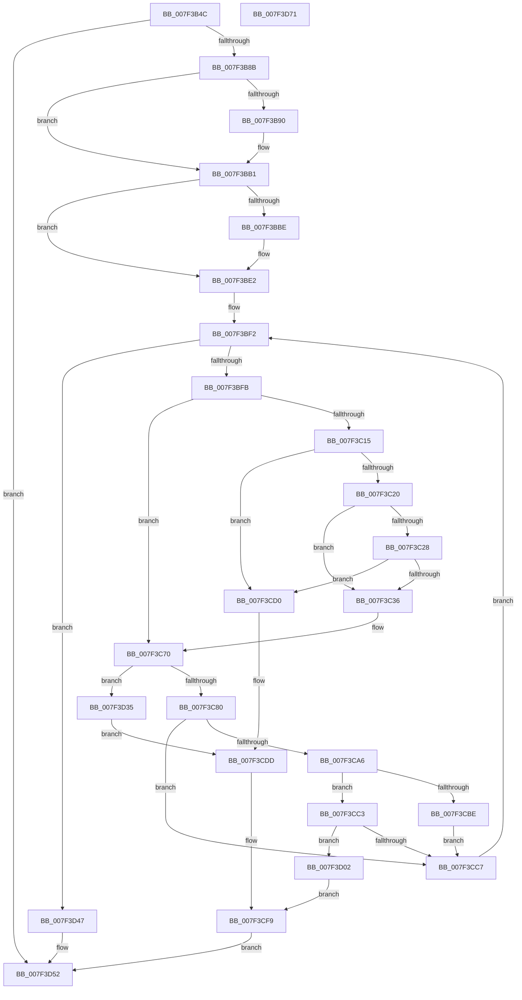

# HvpBuildMapForMemoryBackedHive

- RVA: `0x007F3B4C`–`0x007F3D72` (길이 `550` bytes)
- VA: `0x00000001407F3B4C`
- 실행 섹션: `PAGE`
- PDB 이름 있음: `예`; PDB Function 태그: `아니요`
- unwind 정보 RVA: `0x000C5440`
- 디코드: `143`개 명령, `550/550` bytes 표시
- 미해석 바이트: `0` (있으면 어셈블리에 `.byte`로 보존)

> 이 문서는 커널 이미지의 기계어와 PDB 기호를 분석해 생성했습니다. 4번과 5번은 함수 원형과 자료형을 바이너리 사용 방식에서 추정한 C 해석이며 원본 소스 복구 결과는 아닙니다.

## 1. Dependencies

- 직접 호출 지점: **12**; 고유 호출 대상: **8**
- 직접 호출자로 확인된 함수: **1**
- RIP 상대 이미지 참조: **2**

### Outgoing calls
- `0x007F3B7C` → [HvpInitMap](../9B/HvpInitMap_function_009B8A68.md) (function, `0x009B8A68`)
- `0x007F3BA0` → [memcpy](../../text/6C/memcpy_function_006C6840.md) (function, `0x006C6840`)
- `0x007F3BA9` → [RtlNumberOfSetBits](../../text/43/RtlNumberOfSetBits_function_00433F70.md) (function, `0x00433F70`)
- `0x007F3BCE` → [memcpy](../../text/6C/memcpy_function_006C6840.md) (function, `0x006C6840`)
- `0x007F3BD7` → [RtlNumberOfSetBits](../../text/43/RtlNumberOfSetBits_function_00433F70.md) (function, `0x00433F70`)
- `0x007F3C0A` → [HvpValidateLoadedBin](../9B/HvpValidateLoadedBin_function_009BA590.md) (function, `0x009BA590`)
- `0x007F3C6B` → [SetFailureLocation](../../text/46/SetFailureLocation_function_0046EF54.md) (function, `0x0046EF54`)
- `0x007F3C73` → [CmpClaimGlobalQuota](../84/CmpClaimGlobalQuota_function_0084DDAC.md) (function, `0x0084DDAC`)
- `0x007F3C98` → [HvpPointMapEntriesToBuffer](../9B/HvpPointMapEntriesToBuffer_function_009B7328.md) (function, `0x009B7328`)
- `0x007F3CB2` → [HvpEnlistFreeCells](../85/HvpEnlistFreeCells_function_0085AC00.md) (function, `0x0085AC00`)
- `0x007F3CE6` → [SetFailureLocation](../../text/46/SetFailureLocation_function_0046EF54.md) (function, `0x0046EF54`)
- `0x007F3D1C` → [SetFailureLocation](../../text/46/SetFailureLocation_function_0046EF54.md) (function, `0x0046EF54`)

### Direct callers
- [HvHiveStartMemoryBacked](../87/HvHiveStartMemoryBacked_function_0087BF38.md) at `0x0087C361`
- [HvHiveStartMemoryBacked](../87/HvHiveStartMemoryBacked_function_0087BF38.md) at `0x0087C5B2`

### Static image references
- `0x007F3C20` → RVA `0x00FD8002` (`PAGEDATA`; read)
- `0x007F3C28` → RVA `0x00EF7C60` (`.data`; read)

## 2. Other-region calls and transfers

- 다른 실행 섹션으로 향하는 call: **7**
  - `0x007F3BA0` → [memcpy](../../text/6C/memcpy_function_006C6840.md) (`PAGE` → `.text`)
  - `0x007F3BA9` → [RtlNumberOfSetBits](../../text/43/RtlNumberOfSetBits_function_00433F70.md) (`PAGE` → `.text`)
  - `0x007F3BCE` → [memcpy](../../text/6C/memcpy_function_006C6840.md) (`PAGE` → `.text`)
  - `0x007F3BD7` → [RtlNumberOfSetBits](../../text/43/RtlNumberOfSetBits_function_00433F70.md) (`PAGE` → `.text`)
  - `0x007F3C6B` → [SetFailureLocation](../../text/46/SetFailureLocation_function_0046EF54.md) (`PAGE` → `.text`)
  - `0x007F3CE6` → [SetFailureLocation](../../text/46/SetFailureLocation_function_0046EF54.md) (`PAGE` → `.text`)
  - `0x007F3D1C` → [SetFailureLocation](../../text/46/SetFailureLocation_function_0046EF54.md) (`PAGE` → `.text`)
- 별도 외부 분기/꼬리 이동을 확인하지 못했습니다.

## 3. Assembly (complete function range)

```asm
007F3B4C  48 8B C4                        mov rax, rsp
007F3B4F  48 89 58 08                     mov qword ptr [rax + 8], rbx
007F3B53  48 89 68 18                     mov qword ptr [rax + 0x18], rbp
007F3B57  48 89 70 20                     mov qword ptr [rax + 0x20], rsi
007F3B5B  48 89 50 10                     mov qword ptr [rax + 0x10], rdx
007F3B5F  57                              push rdi
007F3B60  41 54                           push r12
007F3B62  41 55                           push r13
007F3B64  41 56                           push r14
007F3B66  41 57                           push r15
007F3B68  48 83 EC 30                     sub rsp, 0x30
007F3B6C  48 8B 79 38                     mov rdi, qword ptr [rcx + 0x38]
007F3B70  49 8B F1                        mov rsi, r9
007F3B73  45 8B E8                        mov r13d, r8d
007F3B76  48 8B E9                        mov rbp, rcx
007F3B79  45 32 FF                        xor r15b, r15b
007F3B7C  E8 E7 4E 1C 00                  call 0x1409b8a68
007F3B81  8B D8                           mov ebx, eax
007F3B83  85 C0                           test eax, eax
007F3B85  0F 88 C7 01 00 00               js 0x1407f3d52
007F3B8B  48 85 F6                        test rsi, rsi
007F3B8E  74 21                           je 0x1407f3bb1
007F3B90  44 8B 45 58                     mov r8d, dword ptr [rbp + 0x58]
007F3B94  48 8B 56 08                     mov rdx, qword ptr [rsi + 8]
007F3B98  48 8B 4D 60                     mov rcx, qword ptr [rbp + 0x60]
007F3B9C  49 C1 E8 03                     shr r8, 3
007F3BA0  E8 9B 2C ED FF                  call 0x1406c6840
007F3BA5  48 8D 4D 58                     lea rcx, [rbp + 0x58]
007F3BA9  E8 C2 03 C4 FF                  call 0x140433f70
007F3BAE  89 45 68                        mov dword ptr [rbp + 0x68], eax
007F3BB1  48 8B 94 24 80 00 00 00         mov rdx, qword ptr [rsp + 0x80]
007F3BB9  48 85 D2                        test rdx, rdx
007F3BBC  74 24                           je 0x1407f3be2
007F3BBE  44 8B 45 70                     mov r8d, dword ptr [rbp + 0x70]
007F3BC2  48 8B 52 08                     mov rdx, qword ptr [rdx + 8]
007F3BC6  48 8B 4D 78                     mov rcx, qword ptr [rbp + 0x78]
007F3BCA  49 C1 E8 03                     shr r8, 3
007F3BCE  E8 6D 2C ED FF                  call 0x1406c6840
007F3BD3  48 8D 4D 70                     lea rcx, [rbp + 0x70]
007F3BD7  E8 94 03 C4 FF                  call 0x140433f70
007F3BDC  89 85 80 00 00 00               mov dword ptr [rbp + 0x80], eax
007F3BE2  48 8B 45 40                     mov rax, qword ptr [rbp + 0x40]
007F3BE6  45 33 F6                        xor r14d, r14d
007F3BE9  48 8B 5C 24 68                  mov rbx, qword ptr [rsp + 0x68]
007F3BEE  44 8B 60 28                     mov r12d, dword ptr [rax + 0x28]
007F3BF2  45 3B F4                        cmp r14d, r12d
007F3BF5  0F 83 4C 01 00 00               jae 0x1407f3d47
007F3BFB  41 8B F6                        mov esi, r14d
007F3BFE  45 8B C4                        mov r8d, r12d
007F3C01  48 03 F3                        add rsi, rbx
007F3C04  41 8B D6                        mov edx, r14d
007F3C07  48 8B CE                        mov rcx, rsi
007F3C0A  E8 81 69 1C 00                  call 0x1409ba590
007F3C0F  33 C9                           xor ecx, ecx
007F3C11  84 C0                           test al, al
007F3C13  75 5B                           jne 0x1407f3c70
007F3C15  41 0F BA E5 11                  bt r13d, 0x11
007F3C1A  0F 82 B0 00 00 00               jb 0x1407f3cd0
007F3C20  38 0D DC 43 7E 00               cmp byte ptr [rip + 0x7e43dc], cl
007F3C26  75 0E                           jne 0x1407f3c36
007F3C28  8B 05 32 40 70 00               mov eax, dword ptr [rip + 0x704032]
007F3C2E  A8 06                           test al, 6
007F3C30  0F 84 9A 00 00 00               je 0x1407f3cd0
007F3C36  C7 06 68 62 69 6E               mov dword ptr [rsi], 0x6e696268
007F3C3C  BA 01 00 00 00                  mov edx, 1
007F3C41  44 89 76 04                     mov dword ptr [rsi + 4], r14d
007F3C45  41 B9 09 00 00 40               mov r9d, 0x40000009
007F3C4B  C7 46 08 00 10 00 00            mov dword ptr [rsi + 8], 0x1000
007F3C52  41 B7 01                        mov r15b, 1
007F3C55  48 8B 45 40                     mov rax, qword ptr [rbp + 0x40]
007F3C59  89 4C 24 20                     mov dword ptr [rsp + 0x20], ecx
007F3C5D  44 8D 42 03                     lea r8d, [rdx + 3]
007F3C61  48 8B CF                        mov rcx, rdi
007F3C64  83 88 F8 0F 00 00 04            or dword ptr [rax + 0xff8], 4
007F3C6B  E8 E4 B2 C7 FF                  call 0x14046ef54
007F3C70  8B 4E 08                        mov ecx, dword ptr [rsi + 8]
007F3C73  E8 34 A1 05 00                  call 0x14084ddac
007F3C78  84 C0                           test al, al
007F3C7A  0F 84 B5 00 00 00               je 0x1407f3d35
007F3C80  48 83 64 24 28 00               and qword ptr [rsp + 0x28], 0
007F3C86  45 8B CE                        mov r9d, r14d
007F3C89  44 8B 46 08                     mov r8d, dword ptr [rsi + 8]
007F3C8D  48 8B D6                        mov rdx, rsi
007F3C90  48 8B CD                        mov rcx, rbp
007F3C93  C6 44 24 20 00                  mov byte ptr [rsp + 0x20], 0
007F3C98  E8 8B 36 1C 00                  call 0x1409b7328
007F3C9D  F6 85 8C 00 00 00 02            test byte ptr [rbp + 0x8c], 2
007F3CA4  75 21                           jne 0x1407f3cc7
007F3CA6  45 8B CD                        mov r9d, r13d
007F3CA9  45 8B C6                        mov r8d, r14d
007F3CAC  48 8B D6                        mov rdx, rsi
007F3CAF  48 8B CD                        mov rcx, rbp
007F3CB2  E8 49 6F 06 00                  call 0x14085ac00
007F3CB7  3D 09 00 00 40                  cmp eax, 0x40000009
007F3CBC  75 05                           jne 0x1407f3cc3
007F3CBE  41 B7 01                        mov r15b, 1
007F3CC1  EB 04                           jmp 0x1407f3cc7
007F3CC3  85 C0                           test eax, eax
007F3CC5  78 3B                           js 0x1407f3d02
007F3CC7  44 03 76 08                     add r14d, dword ptr [rsi + 8]
007F3CCB  E9 22 FF FF FF                  jmp 0x1407f3bf2
007F3CD0  41 B9 4C 01 00 C0               mov r9d, 0xc000014c
007F3CD6  89 4C 24 20                     mov dword ptr [rsp + 0x20], ecx
007F3CDA  41 8B D9                        mov ebx, r9d
007F3CDD  33 D2                           xor edx, edx
007F3CDF  48 8B CF                        mov rcx, rdi
007F3CE2  44 8D 42 04                     lea r8d, [rdx + 4]
007F3CE6  E8 69 B2 C7 FF                  call 0x14046ef54
007F3CEB  44 89 A7 28 01 00 00            mov dword ptr [rdi + 0x128], r12d
007F3CF2  44 89 B7 2C 01 00 00            mov dword ptr [rdi + 0x12c], r14d
007F3CF9  48 89 B7 30 01 00 00            mov qword ptr [rdi + 0x130], rsi
007F3D00  EB 50                           jmp 0x1407f3d52
007F3D02  33 D2                           xor edx, edx
007F3D04  C7 44 24 20 20 00 00 00         mov dword ptr [rsp + 0x20], 0x20
007F3D0C  41 B9 4C 01 00 C0               mov r9d, 0xc000014c
007F3D12  48 8B CF                        mov rcx, rdi
007F3D15  41 8B D9                        mov ebx, r9d
007F3D18  44 8D 42 04                     lea r8d, [rdx + 4]
007F3D1C  E8 33 B2 C7 FF                  call 0x14046ef54
007F3D21  8B 46 08                        mov eax, dword ptr [rsi + 8]
007F3D24  89 87 28 01 00 00               mov dword ptr [rdi + 0x128], eax
007F3D2A  8B 46 04                        mov eax, dword ptr [rsi + 4]
007F3D2D  89 87 2C 01 00 00               mov dword ptr [rdi + 0x12c], eax
007F3D33  EB C4                           jmp 0x1407f3cf9
007F3D35  BB 9A 00 00 C0                  mov ebx, 0xc000009a
007F3D3A  C7 44 24 20 10 00 00 00         mov dword ptr [rsp + 0x20], 0x10
007F3D42  44 8B CB                        mov r9d, ebx
007F3D45  EB 96                           jmp 0x1407f3cdd
007F3D47  41 F6 DF                        neg r15b
007F3D4A  1B DB                           sbb ebx, ebx
007F3D4C  81 E3 09 00 00 40               and ebx, 0x40000009
007F3D52  48 8B 6C 24 70                  mov rbp, qword ptr [rsp + 0x70]
007F3D57  8B C3                           mov eax, ebx
007F3D59  48 8B 5C 24 60                  mov rbx, qword ptr [rsp + 0x60]
007F3D5E  48 8B 74 24 78                  mov rsi, qword ptr [rsp + 0x78]
007F3D63  48 83 C4 30                     add rsp, 0x30
007F3D67  41 5F                           pop r15
007F3D69  41 5E                           pop r14
007F3D6B  41 5D                           pop r13
007F3D6D  41 5C                           pop r12
007F3D6F  5F                              pop rdi
007F3D70  C3                              ret
007F3D71  CC                              int3
```

## 4. C-style interpretation (structured pseudocode)

```c
__int64 __fastcall HvpBuildMapForMemoryBackedHive(__int64 a1, __int64 a2, int a3, __int64 a4, __int64 a5)
{
    __int64 result;
    __int64 v_r14;
    __int64 v_r15;
    __int64 v_rbx;
    __int64 v_rsi;
    __int64 v_rsp;
    unsigned __int64 v_stack_m30;
    unsigned int v_stack_m38;
    unsigned __int64 v_stack_p10;
    unsigned __int64 v_stack_p18;
    unsigned __int64 v_stack_p20;
    unsigned __int64 v_stack_p8;

    *(unsigned __int64 *)(v_rsp + 8) = v_rbx;
    *(unsigned __int64 *)(v_rsp + 24) = v_rbp;
    *(unsigned __int64 *)(v_rsp + 32) = v_rsi;
    *(unsigned __int64 *)(v_rsp + 16) = a2;
    v_rsp = (v_rsp) - (48);
    v_r15 = 0;
    result = HvpInitMap(a1, a2, a3, a4);
    if (sign_flag) goto loc_007F3D52;
    if (a4 != 0) {
        a3 = *(unsigned int *)(a1 + 88);
        a2 = *(unsigned __int64 *)(a4 + 8);
        a1 = *(unsigned __int64 *)(a1 + 96);
        a3 = (a3) >> (3);
        result = memcpy(a1, a2, a3, a4);
        a1 = a1 + 88;
        result = RtlNumberOfSetBits(a1, a2, a3, a4);
        *(unsigned int *)(a1 + 104) = (unsigned int)(result);
    }
    if (a5 != 0) {
        a3 = *(unsigned int *)(a1 + 112);
        a2 = *(unsigned __int64 *)(a5 + 8);
        a1 = *(unsigned __int64 *)(a1 + 120);
        a3 = (a3) >> (3);
        result = memcpy(a1, a2, a3, a4);
        a1 = a1 + 112;
        result = RtlNumberOfSetBits(a1, a2, a3, a4);
        *(unsigned int *)(a1 + 128) = (unsigned int)(result);
    }
    v_r14 = 0;
loc_007F3BF2:
    if (0 >= ((unsigned int)((unsigned int)(*(unsigned int *)(*(unsigned __int64 *)(a1 + 64) + 40))))) goto loc_007F3D47;
    v_rsi = (0) + (v_stack_p10);
    result = HvpValidateLoadedBin(v_rsi, 0, (unsigned int)((unsigned int)((unsigned int)(*(unsigned int *)(*(unsigned __int64 *)(a1 + 64) + 40)))), a4);
    a1 = 0;
    if ((unsigned __int8)(result) != 0) goto loc_007F3C70;
    if (condition_is_below) goto loc_007F3CD0;
    if ((*(unsigned __int8 *)(v_rip + 8274908)) != 0) goto loc_007F3C36;
    if ((((unsigned __int8)((unsigned int)(*(unsigned int *)(v_rip + 7356466)))) & (6)) == 0) goto loc_007F3CD0;
loc_007F3C36:
    *(unsigned int *)(v_rsi) = 0x6E696268ULL;
    *(unsigned int *)(v_rsi + 4) = 0;
    *(unsigned int *)(v_rsi + 8) = 0x1000ULL;
    v_stack_m38 = 0;
    result = SetFailureLocation(*(unsigned __int64 *)(a1 + 56), 1, 1 + 3, (unsigned int)(0x40000009ULL));
loc_007F3C70:
    result = CmpClaimGlobalQuota((unsigned int)(*(unsigned int *)(v_rsi + 8)), 1, 1 + 3, (unsigned int)(0x40000009ULL));
    if ((unsigned __int8)(result) == 0) goto loc_007F3D35;
    v_stack_m38 = 0;
    result = HvpPointMapEntriesToBuffer(0, v_rsi, (unsigned int)(*(unsigned int *)(v_rsi + 8)), 0);
    if (((*(unsigned __int8 *)(a1 + 140)) & (2)) != 0) goto loc_007F3CC7;
    result = HvpEnlistFreeCells(0, v_rsi, 0, (unsigned int)((unsigned int)((unsigned int)(a3))));
    if (((unsigned int)(result)) != 0x40000009ULL) goto loc_007F3CC3;
    goto loc_007F3CC7;
loc_007F3CC3:
    if (sign_flag) goto loc_007F3D02;
loc_007F3CC7:
    v_r14 = (unsigned int)((v_r14) + (*(unsigned int *)(v_rsi + 8)));
    goto loc_007F3BF2;
loc_007F3CD0:
    v_stack_m38 = 0;
loc_007F3CDD:
    a2 = 0;
    result = SetFailureLocation(*(unsigned __int64 *)(a1 + 56), a2, a2 + 4, (unsigned int)(0xC000014CULL));
    *(unsigned int *)(*(unsigned __int64 *)(a1 + 56) + 296) = (unsigned int)((unsigned int)(*(unsigned int *)(*(unsigned __int64 *)(a1 + 64) + 40)));
    *(unsigned int *)(*(unsigned __int64 *)(a1 + 56) + 300) = (unsigned int)(v_r14);
loc_007F3CF9:
    *(unsigned __int64 *)(*(unsigned __int64 *)(a1 + 56) + 304) = v_rsi;
    goto loc_007F3D52;
loc_007F3D02:
    a2 = 0;
    v_stack_m38 = 32;
    result = SetFailureLocation(*(unsigned __int64 *)(a1 + 56), a2, a2 + 4, (unsigned int)(0xC000014CULL));
    *(unsigned int *)(*(unsigned __int64 *)(a1 + 56) + 296) = (unsigned int)((unsigned int)(*(unsigned int *)(v_rsi + 8)));
    *(unsigned int *)(*(unsigned __int64 *)(a1 + 56) + 300) = (unsigned int)((unsigned int)(*(unsigned int *)(v_rsi + 4)));
    goto loc_007F3CF9;
loc_007F3D35:
    v_stack_m38 = 16;
    goto loc_007F3CDD;
loc_007F3D47:
    v_r15 = (unsigned __int8)(-(1));
    v_rbx = (unsigned int)(((unsigned int)(0xC000009AULL)) & (0x40000009ULL));
loc_007F3D52:
    v_rsp = (v_rsp) + (48);
    return (unsigned int)((unsigned int)(v_rbx));
}
```

## 5. (Beta) C Style

```c
int64_t HvpBuildMapForMemoryBackedHive(void *Arg1, int64_t Arg2, int32_t Arg3, int64_t Arg4, int64_t Arg5)
{
    uint8_t *arg1 = (uint8_t *)Arg1;

    int64_t result;
    int64_t local_r14;
    int64_t local_r15;
    int64_t local_rbx;
    int64_t local_rsi;
    int64_t local_rsp;
    uint64_t v_stack_m30;
    uint32_t v_stack_m38;
    uint64_t v_stack_p10;
    uint64_t v_stack_p18;
    uint64_t v_stack_p20;
    uint64_t v_stack_p8;

    *(uint64_t *)(local_rsp + 0x8) = local_rbx;
    *(uint64_t *)(local_rsp + 0x18) = local_rbp;
    *(uint64_t *)(local_rsp + 0x20) = local_rsi;
    *(uint64_t *)(local_rsp + 0x10) = Arg2;
    local_rsp = (local_rsp) - (48);
    local_r15 = 0;
    result = HvpInitMap(Arg1, Arg2, Arg3, Arg4);
    if (sign_flag) goto loc_007F3D52;
    if (Arg4 != 0) {
        Arg3 = *(uint32_t *)(arg1 + 0x58);
        Arg2 = *(uint64_t *)(Arg4 + 0x8);
        Arg1 = *(uint64_t *)(arg1 + 0x60);
        Arg3 = (Arg3) >> (3);
        result = memcpy(Arg1, Arg2, Arg3, Arg4);
        Arg1 = Arg1 + 88;
        result = RtlNumberOfSetBits(Arg1, Arg2, Arg3, Arg4);
        *(uint32_t *)(arg1 + 0x68) = (uint32_t)(result);
    }
    if (Arg5 != 0) {
        Arg3 = *(uint32_t *)(arg1 + 0x70);
        Arg2 = *(uint64_t *)(Arg5 + 0x8);
        Arg1 = *(uint64_t *)(arg1 + 0x78);
        Arg3 = (Arg3) >> (3);
        result = memcpy(Arg1, Arg2, Arg3, Arg4);
        Arg1 = Arg1 + 112;
        result = RtlNumberOfSetBits(Arg1, Arg2, Arg3, Arg4);
        *(uint32_t *)(arg1 + 0x80) = (uint32_t)(result);
    }
    local_r14 = 0;
loc_007F3BF2:
    if (0 >= ((uint32_t)((uint32_t)(*(uint32_t *)(*(uint64_t *)(arg1 + 0x40) + 0x28))))) goto loc_007F3D47;
    local_rsi = (0) + (v_stack_p10);
    result = HvpValidateLoadedBin(local_rsi, 0, (uint32_t)((uint32_t)((uint32_t)(*(uint32_t *)(*(uint64_t *)(arg1 + 0x40) + 0x28)))), Arg4);
    Arg1 = 0;
    if ((uint8_t)(result) != 0) goto loc_007F3C70;
    if (condition_is_below) goto loc_007F3CD0;
    if ((*(uint8_t *)(v_rip + 0x7E43DC)) != 0) goto loc_007F3C36;
    if ((((uint8_t)((uint32_t)(*(uint32_t *)(v_rip + 0x704032)))) & (6)) == 0) goto loc_007F3CD0;
loc_007F3C36:
    *(uint32_t *)(local_rsi) = 0x6E696268ULL;
    *(uint32_t *)(local_rsi + 0x4) = 0;
    *(uint32_t *)(local_rsi + 0x8) = 0x1000ULL;
    v_stack_m38 = 0;
    result = SetFailureLocation(*(uint64_t *)(arg1 + 0x38), 1, 1 + 3, (uint32_t)(0x40000009ULL));
loc_007F3C70:
    result = CmpClaimGlobalQuota((uint32_t)(*(uint32_t *)(local_rsi + 0x8)), 1, 1 + 3, (uint32_t)(0x40000009ULL));
    if ((uint8_t)(result) == 0) goto loc_007F3D35;
    v_stack_m38 = 0;
    result = HvpPointMapEntriesToBuffer(0, local_rsi, (uint32_t)(*(uint32_t *)(local_rsi + 0x8)), 0);
    if (((*(uint8_t *)(arg1 + 0x8C)) & (2)) != 0) goto loc_007F3CC7;
    result = HvpEnlistFreeCells(0, local_rsi, 0, (uint32_t)((uint32_t)((uint32_t)(Arg3))));
    if (((uint32_t)(result)) != 0x40000009ULL) goto loc_007F3CC3;
    goto loc_007F3CC7;
loc_007F3CC3:
    if (sign_flag) goto loc_007F3D02;
loc_007F3CC7:
    local_r14 = (uint32_t)((local_r14) + (*(uint32_t *)(local_rsi + 0x8)));
    goto loc_007F3BF2;
loc_007F3CD0:
    v_stack_m38 = 0;
loc_007F3CDD:
    Arg2 = 0;
    result = SetFailureLocation(*(uint64_t *)(arg1 + 0x38), Arg2, Arg2 + 4, (uint32_t)(0xC000014CULL));
    *(uint32_t *)(*(uint64_t *)(arg1 + 0x38) + 0x128) = (uint32_t)((uint32_t)(*(uint32_t *)(*(uint64_t *)(arg1 + 0x40) + 0x28)));
    *(uint32_t *)(*(uint64_t *)(arg1 + 0x38) + 0x12C) = (uint32_t)(local_r14);
loc_007F3CF9:
    *(uint64_t *)(*(uint64_t *)(arg1 + 0x38) + 0x130) = local_rsi;
    goto loc_007F3D52;
loc_007F3D02:
    Arg2 = 0;
    v_stack_m38 = 32;
    result = SetFailureLocation(*(uint64_t *)(arg1 + 0x38), Arg2, Arg2 + 4, (uint32_t)(0xC000014CULL));
    *(uint32_t *)(*(uint64_t *)(arg1 + 0x38) + 0x128) = (uint32_t)((uint32_t)(*(uint32_t *)(local_rsi + 0x8)));
    *(uint32_t *)(*(uint64_t *)(arg1 + 0x38) + 0x12C) = (uint32_t)((uint32_t)(*(uint32_t *)(local_rsi + 0x4)));
    goto loc_007F3CF9;
loc_007F3D35:
    v_stack_m38 = 16;
    goto loc_007F3CDD;
loc_007F3D47:
    local_r15 = (uint8_t)(-(1));
    local_rbx = (uint32_t)(((uint32_t)(0xC000009AULL)) & (0x40000009ULL));
loc_007F3D52:
    local_rsp = (local_rsp) + (48);
    return (uint32_t)((uint32_t)(local_rbx));
}
```

### 관측된 메모리 오프셋

구조체 형식이 확인되지 않은 접근은 인자 기준의 오프셋으로만 기록했습니다.

| 기준 인자 | 오프셋 표현 | 폭 (bit) | 접근 |
|---|---:|---:|---|
| `Arg1` | `+ 0x38` | `64` | `R` |
| `Arg1` | `+ 0x40` | `64` | `R` |
| `Arg1` | `+ 0x58` | `32` | `R` |
| `Arg1` | `+ 0x58` | `64` | `R` |
| `Arg1` | `+ 0x60` | `64` | `R` |
| `Arg1` | `+ 0x68` | `32` | `W` |
| `Arg1` | `+ 0x70` | `32` | `R` |
| `Arg1` | `+ 0x70` | `64` | `R` |
| `Arg1` | `+ 0x78` | `64` | `R` |
| `Arg1` | `+ 0x80` | `32` | `W` |
| `Arg1` | `+ 0x8C` | `8` | `R` |

## 6. Execution-region graph

[열기: 2D/3D 그래프와 함수 탐색 컨트롤 패널](../../../control-panel.html?section=page&rva=0x007F3B4C&view=graph)

- 2D 그래프는 위에서 아래로 흐르고, 3D 그래프는 빈 공간을 드래그해 회전합니다. Shift+드래그는 이동, 휠은 확대·축소, 함수 노드 선택은 대상 보고서 이동입니다.

### Static fallback


