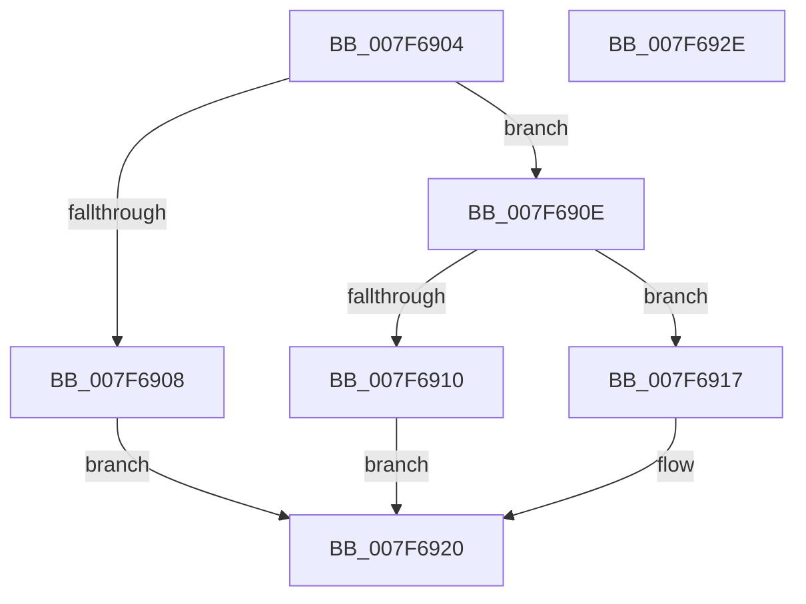

# HvpCompareLogSequenceNumbers

- RVA: `0x007F6904`–`0x007F692F` (길이 `43` bytes)
- VA: `0x00000001407F6904`
- 실행 섹션: `PAGE`
- PDB 이름 있음: `예`; PDB Function 태그: `아니요`
- unwind 정보 RVA: `0x000DB714`
- 디코드: `18`개 명령, `43/43` bytes 표시
- 미해석 바이트: `0` (있으면 어셈블리에 `.byte`로 보존)

> 이 문서는 커널 이미지의 기계어와 PDB 기호를 분석해 생성했습니다. 4번과 5번은 함수 원형과 자료형을 바이너리 사용 방식에서 추정한 C 해석이며 원본 소스 복구 결과는 아닙니다.

## 1. Dependencies

- 직접 호출 지점: **0**; 고유 호출 대상: **0**
- 직접 호출자로 확인된 함수: **2**
- RIP 상대 이미지 참조: **0**

### Outgoing calls
- 직접 디코드된 call 명령이 없습니다.

### Direct callers
- [HvpDetermineLogFileApplicationOrder](../9B/HvpDetermineLogFileApplicationOrder_function_009BA694.md) at `0x009BA702`
- [sub_00B2E3D0](../B2/Unknown_function_00B2E3D0.md) at `0x00B2E40E`
- [sub_00B2E3D0](../B2/Unknown_function_00B2E3D0.md) at `0x00B2E441`

### Static image references
- 디코드된 RIP-relative 메모리 참조가 없습니다.

## 2. Other-region calls and transfers

- 다른 실행 섹션으로 향하는 call: **0**
- 별도 외부 분기/꼬리 이동을 확인하지 못했습니다.

## 3. Assembly (complete function range)

```asm
007F6904  3B CA                           cmp ecx, edx
007F6906  75 06                           jne 0x1407f690e
007F6908  33 D2                           xor edx, edx
007F690A  8B CA                           mov ecx, edx
007F690C  EB 12                           jmp 0x1407f6920
007F690E  73 07                           jae 0x1407f6917
007F6910  2B D1                           sub edx, ecx
007F6912  83 C9 FF                        or ecx, 0xffffffff
007F6915  EB 09                           jmp 0x1407f6920
007F6917  2B CA                           sub ecx, edx
007F6919  8B D1                           mov edx, ecx
007F691B  B9 01 00 00 00                  mov ecx, 1
007F6920  8B C1                           mov eax, ecx
007F6922  F7 D8                           neg eax
007F6924  81 FA FF FF FF 7F               cmp edx, 0x7fffffff
007F692A  0F 46 C1                        cmovbe eax, ecx
007F692D  C3                              ret
007F692E  CC                              int3
```

## 4. C-style interpretation (structured pseudocode)

```c
__int64 __fastcall HvpCompareLogSequenceNumbers(int a1, int a2)
{
    __int64 result;

    if (a1 != a2) goto loc_007F690E;
    a2 = 0;
    goto loc_007F6920;
loc_007F690E:
    if (condition_is_above_or_equal) goto loc_007F6917;
    a2 = (unsigned int)((a2) - (0));
    a1 = (unsigned int)((0) | (0xFFFFFFFFULL));
    goto loc_007F6920;
loc_007F6917:
    a1 = (unsigned int)((a1) - (a2));
loc_007F6920:
    result = (unsigned int)(-(1));
    if (((unsigned int)((unsigned int)(a1))) <= 0x7FFFFFFFULL) { result = 1; }
    return result;
}
```

## 5. (Beta) C Style

```c
int64_t HvpCompareLogSequenceNumbers(int32_t Arg1, int32_t Arg2)
{
    int64_t result;

    if (Arg1 != Arg2) goto loc_007F690E;
    Arg2 = 0;
    goto loc_007F6920;
loc_007F690E:
    if (condition_is_above_or_equal) goto loc_007F6917;
    Arg2 = (uint32_t)((Arg2) - (0));
    Arg1 = (uint32_t)((0) | (0xFFFFFFFFULL));
    goto loc_007F6920;
loc_007F6917:
    Arg1 = (uint32_t)((Arg1) - (Arg2));
loc_007F6920:
    result = (uint32_t)(-(1));
    if (((uint32_t)((uint32_t)(Arg1))) <= 0x7FFFFFFFULL) { result = 1; }
    return result;
}
```

## 6. Execution-region graph

[열기: 2D/3D 그래프와 함수 탐색 컨트롤 패널](../../../control-panel.html?section=page&rva=0x007F6904&view=graph)

- 2D 그래프는 위에서 아래로 흐르고, 3D 그래프는 빈 공간을 드래그해 회전합니다. Shift+드래그는 이동, 휠은 확대·축소, 함수 노드 선택은 대상 보고서 이동입니다.

### Static fallback


