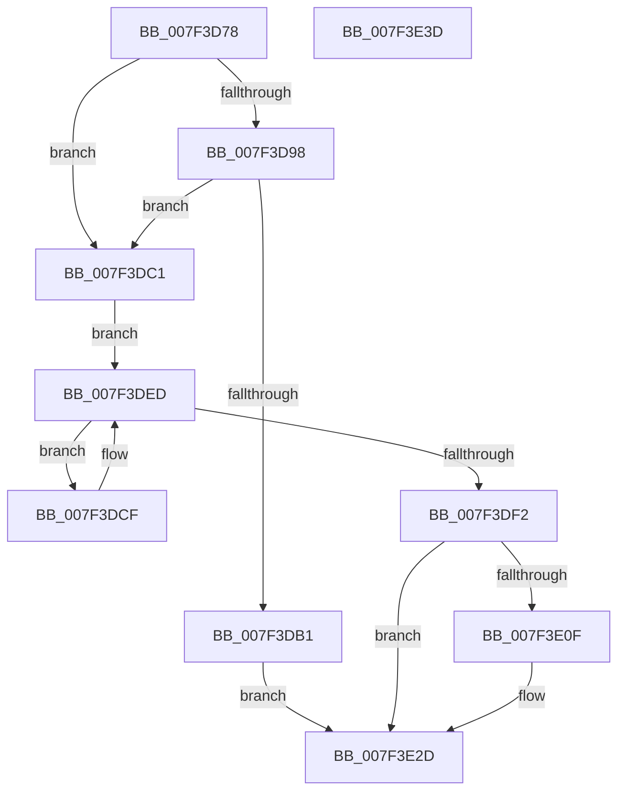

# HvpShrinkMap

- RVA: `0x007F3D78`–`0x007F3E3E` (길이 `198` bytes)
- VA: `0x00000001407F3D78`
- 실행 섹션: `PAGE`
- PDB 이름 있음: `예`; PDB Function 태그: `아니요`
- unwind 정보 RVA: `0x00060BC4`
- 디코드: `54`개 명령, `198/198` bytes 표시
- 미해석 바이트: `0` (있으면 어셈블리에 `.byte`로 보존)

> 이 문서는 커널 이미지의 기계어와 PDB 기호를 분석해 생성했습니다. 4번과 5번은 함수 원형과 자료형을 바이너리 사용 방식에서 추정한 C 해석이며 원본 소스 복구 결과는 아닙니다.

## 1. Dependencies

- 직접 호출 지점: **3**; 고유 호출 대상: **3**
- 직접 호출자로 확인된 함수: **1**
- RIP 상대 이미지 참조: **0**

### Outgoing calls
- `0x007F3DBA` → [guard_dispatch_icall](../../text/6B/guard_dispatch_icall_function_006BAAD0.md) (function, `0x006BAAD0`)
- `0x007F3DD5` → [HvpGetCellMap](../../pagecmrc/BC/HvpGetCellMap_function_00BC9710.md) (function, `0x00BC9710`)
- `0x007F3E28` → [HvpFreeMap](../A6/HvpFreeMap_function_00A68674.md) (function, `0x00A68674`)

### Direct callers
- [HvpAddBin](../AF/HvpAddBin_function_00AF7D48.md) at `0x00AF80C6`

### Static image references
- 디코드된 RIP-relative 메모리 참조가 없습니다.

## 2. Other-region calls and transfers

- 다른 실행 섹션으로 향하는 call: **2**
  - `0x007F3DBA` → [guard_dispatch_icall](../../text/6B/guard_dispatch_icall_function_006BAAD0.md) (`PAGE` → `.text`)
  - `0x007F3DD5` → [HvpGetCellMap](../../pagecmrc/BC/HvpGetCellMap_function_00BC9710.md) (`PAGE` → `PAGECMRC`)
- 별도 외부 분기/꼬리 이동을 확인하지 못했습니다.

## 3. Assembly (complete function range)

```asm
007F3D78  48 89 5C 24 08                  mov qword ptr [rsp + 8], rbx
007F3D7D  48 89 74 24 10                  mov qword ptr [rsp + 0x10], rsi
007F3D82  57                              push rdi
007F3D83  48 83 EC 20                     sub rsp, 0x20
007F3D87  48 63 FA                        movsxd rdi, edx
007F3D8A  45 8B D1                        mov r10d, r9d
007F3D8D  41 8B D8                        mov ebx, r8d
007F3D90  4C 8B D9                        mov r11, rcx
007F3D93  45 85 C9                        test r9d, r9d
007F3D96  75 29                           jne 0x1407f3dc1
007F3D98  4C 69 C7 78 02 00 00            imul r8, rdi, 0x278
007F3D9F  49 8B 8C 08 28 01 00 00         mov rcx, qword ptr [r8 + rcx + 0x128]
007F3DA7  4B 3B 8C 18 20 01 00 00         cmp rcx, qword ptr [r8 + r11 + 0x120]
007F3DAF  75 10                           jne 0x1407f3dc1
007F3DB1  49 8B 43 20                     mov rax, qword ptr [r11 + 0x20]
007F3DB5  BA 00 30 00 00                  mov edx, 0x3000
007F3DBA  E8 11 6D EC FF                  call 0x1406baad0
007F3DBF  EB 6C                           jmp 0x1407f3e2d
007F3DC1  8B C7                           mov eax, edi
007F3DC3  C1 E0 1F                        shl eax, 0x1f
007F3DC6  8D 34 18                        lea esi, [rax + rbx]
007F3DC9  46 8D 04 08                     lea r8d, [rax + r9]
007F3DCD  EB 1E                           jmp 0x1407f3ded
007F3DCF  41 8B D0                        mov edx, r8d
007F3DD2  49 8B CB                        mov rcx, r11
007F3DD5  E8 36 59 3D 00                  call 0x140bc9710
007F3DDA  33 C9                           xor ecx, ecx
007F3DDC  0F 57 C0                        xorps xmm0, xmm0
007F3DDF  41 81 C0 00 10 00 00            add r8d, 0x1000
007F3DE6  0F 11 00                        movups xmmword ptr [rax], xmm0
007F3DE9  48 89 48 10                     mov qword ptr [rax + 0x10], rcx
007F3DED  44 3B C6                        cmp r8d, esi
007F3DF0  72 DD                           jb 0x1407f3dcf
007F3DF2  41 C1 EA 0C                     shr r10d, 0xc
007F3DF6  B8 FF 01 00 00                  mov eax, 0x1ff
007F3DFB  C1 EB 0C                        shr ebx, 0xc
007F3DFE  44 03 D0                        add r10d, eax
007F3E01  03 D8                           add ebx, eax
007F3E03  41 C1 EA 09                     shr r10d, 9
007F3E07  C1 EB 09                        shr ebx, 9
007F3E0A  44 3B D3                        cmp r10d, ebx
007F3E0D  73 1E                           jae 0x1407f3e2d
007F3E0F  48 69 D7 78 02 00 00            imul rdx, rdi, 0x278
007F3E16  44 8D 4B FF                     lea r9d, [rbx - 1]
007F3E1A  45 8B C2                        mov r8d, r10d
007F3E1D  49 8B CB                        mov rcx, r11
007F3E20  4A 8B 94 1A 20 01 00 00         mov rdx, qword ptr [rdx + r11 + 0x120]
007F3E28  E8 47 48 27 00                  call 0x140a68674
007F3E2D  48 8B 5C 24 30                  mov rbx, qword ptr [rsp + 0x30]
007F3E32  48 8B 74 24 38                  mov rsi, qword ptr [rsp + 0x38]
007F3E37  48 83 C4 20                     add rsp, 0x20
007F3E3B  5F                              pop rdi
007F3E3C  C3                              ret
007F3E3D  CC                              int3
```

## 4. C-style interpretation (structured pseudocode)

```c
__int64 __fastcall HvpShrinkMap(__int64 a1, int a2, int a3, __int64 a4)
{
    __int64 result;
    __int64 v_r10;
    __int64 v_rbx;
    __int64 v_rsp;
    unsigned __int64 v_stack_p10;
    unsigned __int64 v_stack_p8;

    v_stack_p8 = v_rbx;
    v_stack_p10 = v_rsi;
    v_rsp = (v_rsp) - (32);
    if ((unsigned int)(a4) != 0) goto loc_007F3DC1;
    a3 = (a3) * ((int)(a2));
    if ((*(unsigned __int64 *)(a3 + a1 * 1 + 296)) != (*(unsigned __int64 *)(a3 + a1 * 1 + 288))) goto loc_007F3DC1;
    result = guard_dispatch_icall(*(unsigned __int64 *)(a3 + a1 * 1 + 296), (unsigned int)(0x3000ULL), a3, a4);
    goto loc_007F3E2D;
loc_007F3DC1:
    result = (unsigned int)(((unsigned int)((unsigned int)((int)(a2)))) << (31));
    goto loc_007F3DED;
loc_007F3DCF:
    result = HvpGetCellMap(a1, (unsigned int)((unsigned int)(result + a4 * 1)), result + a4 * 1, a4);
    a1 = 0;
    a3 = (unsigned int)((result + a4 * 1) + (0x1000ULL));
    *(unsigned __int64 *)(result) = v_xmm0;
    *(unsigned __int64 *)(result + 16) = 0;
loc_007F3DED:
    if (a3 < ((unsigned int)(result + (unsigned int)(a3) * 1))) goto loc_007F3DCF;
    v_r10 = (unsigned int)(((unsigned int)((unsigned int)(a4))) >> (12));
    v_rbx = (unsigned int)(((unsigned int)(a3)) >> (12));
    v_r10 = (unsigned int)((v_r10) + (511));
    v_rbx = (unsigned int)((v_rbx) + (511));
    v_r10 = (unsigned int)((v_r10) >> (9));
    v_rbx = (unsigned int)((v_rbx) >> (9));
    result = 511;
    if (((unsigned int)(v_r10)) < ((unsigned int)(v_rbx))) {
        a2 = ((unsigned int)((unsigned int)(result + a4 * 1))) * ((int)(a2));
        a4 = v_rbx - 1;
        a3 = (unsigned int)(v_r10);
        a1 = 0;
        a2 = *(unsigned __int64 *)(a2 + a1 * 1 + 288);
        result = HvpFreeMap(a1, a2, a3, a4);
    }
    v_rsp = (v_rsp) + (32);
    return result;
}
```

## 5. (Beta) C Style

```c
int64_t HvpShrinkMap(void *Arg1, int32_t Arg2, void *Arg3, int64_t Arg4)
{
    uint8_t *arg1 = (uint8_t *)Arg1;
    uint8_t *arg3 = (uint8_t *)Arg3;

    int64_t result;
    int64_t local_r10;
    int64_t local_rbx;
    int64_t local_rsp;
    uint64_t v_stack_p10;
    uint64_t v_stack_p8;

    v_stack_p8 = local_rbx;
    v_stack_p10 = local_rsi;
    local_rsp = (local_rsp) - (32);
    if ((uint32_t)(Arg4) != 0) goto loc_007F3DC1;
    Arg3 = (Arg3) * ((int32_t)(Arg2));
    if ((*(uint64_t *)(arg3 + arg1 * 1 + 0x128)) != (*(uint64_t *)(arg3 + arg1 * 1 + 0x120))) goto loc_007F3DC1;
    result = guard_dispatch_icall(*(uint64_t *)(arg3 + arg1 * 1 + 0x128), (uint32_t)(0x3000ULL), Arg3, Arg4);
    goto loc_007F3E2D;
loc_007F3DC1:
    result = (uint32_t)(((uint32_t)((uint32_t)((int32_t)(Arg2)))) << (31));
    goto loc_007F3DED;
loc_007F3DCF:
    result = HvpGetCellMap(Arg1, (uint32_t)((uint32_t)(result + Arg4 * 1)), result + Arg4 * 1, Arg4);
    Arg1 = 0;
    Arg3 = (uint32_t)((result + Arg4 * 1) + (0x1000ULL));
    *(uint64_t *)(result) = v_xmm0;
    *(uint64_t *)(result + 0x10) = 0;
loc_007F3DED:
    if (Arg3 < ((uint32_t)(result + (uint32_t)(Arg3) * 1))) goto loc_007F3DCF;
    local_r10 = (uint32_t)(((uint32_t)((uint32_t)(Arg4))) >> (12));
    local_rbx = (uint32_t)(((uint32_t)(Arg3)) >> (12));
    local_r10 = (uint32_t)((local_r10) + (511));
    local_rbx = (uint32_t)((local_rbx) + (511));
    local_r10 = (uint32_t)((local_r10) >> (9));
    local_rbx = (uint32_t)((local_rbx) >> (9));
    result = 511;
    if (((uint32_t)(local_r10)) < ((uint32_t)(local_rbx))) {
        Arg2 = ((uint32_t)((uint32_t)(result + Arg4 * 1))) * ((int32_t)(Arg2));
        Arg4 = local_rbx - 1;
        Arg3 = (uint32_t)(local_r10);
        Arg1 = 0;
        Arg2 = *(uint64_t *)(Arg2 + arg1 * 1 + 0x120);
        result = HvpFreeMap(Arg1, Arg2, Arg3, Arg4);
    }
    local_rsp = (local_rsp) + (32);
    return result;
}
```

### 관측된 메모리 오프셋

구조체 형식이 확인되지 않은 접근은 인자 기준의 오프셋으로만 기록했습니다.

| 기준 인자 | 오프셋 표현 | 폭 (bit) | 접근 |
|---|---:|---:|---|
| `Arg1` | `+ 0x20` | `64` | `R` |
| `Arg3` | `+ 0x120 + r11*1` | `64` | `R` |
| `Arg3` | `+ 0x128 + rcx*1` | `64` | `R` |

## 6. Execution-region graph

[열기: 2D/3D 그래프와 함수 탐색 컨트롤 패널](../../../control-panel.html?section=page&rva=0x007F3D78&view=graph)

- 2D 그래프는 위에서 아래로 흐르고, 3D 그래프는 빈 공간을 드래그해 회전합니다. Shift+드래그는 이동, 휠은 확대·축소, 함수 노드 선택은 대상 보고서 이동입니다.

### Static fallback


