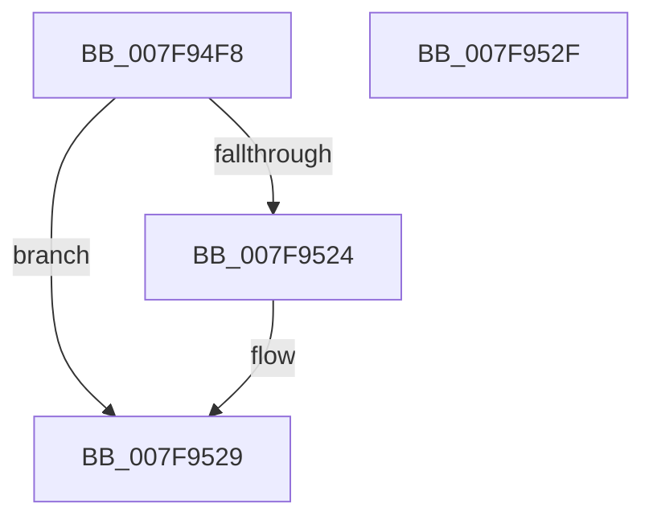

# MiAcquireAddMemoryLocks

- RVA: `0x007F94F8`–`0x007F9530` (길이 `56` bytes)
- VA: `0x00000001407F94F8`
- 실행 섹션: `PAGE`
- PDB 이름 있음: `예`; PDB Function 태그: `아니요`
- unwind 정보 RVA: `0x0005CF00`
- 디코드: `15`개 명령, `56/56` bytes 표시
- 미해석 바이트: `0` (있으면 어셈블리에 `.byte`로 보존)

> 이 문서는 커널 이미지의 기계어와 PDB 기호를 분석해 생성했습니다. 4번과 5번은 함수 원형과 자료형을 바이너리 사용 방식에서 추정한 C 해석이며 원본 소스 복구 결과는 아닙니다.

## 1. Dependencies

- 직접 호출 지점: **2**; 고유 호출 대상: **2**
- 직접 호출자로 확인된 함수: **2**
- RIP 상대 이미지 참조: **1**

### Outgoing calls
- `0x007F9512` → [MiLockDynamicMemoryExclusive](../../text/67/MiLockDynamicMemoryExclusive_function_006730F8.md) (function, `0x006730F8`)
- `0x007F9524` → [MiLockDynamicMemoryNestedExclusive](../../text/67/MiLockDynamicMemoryNestedExclusive_function_00673154.md) (function, `0x00673154`)

### Direct callers
- [MiAddPhysicalMemory](MiAddPhysicalMemory_function_007F95FC.md) at `0x007F9731`
- [MiAddPhysicalMemory](MiAddPhysicalMemory_function_007F95FC.md) at `0x007F9857`
- [MiRemovePhysicalMemory](MiRemovePhysicalMemory_function_007FAD3C.md) at `0x007FAE0A`
- [MiRemovePhysicalMemory](MiRemovePhysicalMemory_function_007FAD3C.md) at `0x007FAEC4`
- [MiRemovePhysicalMemory](MiRemovePhysicalMemory_function_007FAD3C.md) at `0x007FAF2F`

### Static image references
- `0x007F9517` → RVA `0x00E38D00` (`.data`; read)

## 2. Other-region calls and transfers

- 다른 실행 섹션으로 향하는 call: **2**
  - `0x007F9512` → [MiLockDynamicMemoryExclusive](../../text/67/MiLockDynamicMemoryExclusive_function_006730F8.md) (`PAGE` → `.text`)
  - `0x007F9524` → [MiLockDynamicMemoryNestedExclusive](../../text/67/MiLockDynamicMemoryNestedExclusive_function_00673154.md) (`PAGE` → `.text`)
- 별도 외부 분기/꼬리 이동을 확인하지 못했습니다.

## 3. Assembly (complete function range)

```asm
007F94F8  40 53                           push rbx
007F94FA  48 83 EC 20                     sub rsp, 0x20
007F94FE  C6 41 2C 01                     mov byte ptr [rcx + 0x2c], 1
007F9502  48 8B D9                        mov rbx, rcx
007F9505  65 48 8B 14 25 88 01 00 00      mov rdx, qword ptr gs:[0x188]
007F950E  48 8B 49 30                     mov rcx, qword ptr [rcx + 0x30]
007F9512  E8 E1 9B E7 FF                  call 0x1406730f8
007F9517  48 8D 05 E2 F7 63 00            lea rax, [rip + 0x63f7e2]
007F951E  48 39 43 30                     cmp qword ptr [rbx + 0x30], rax
007F9522  74 05                           je 0x1407f9529
007F9524  E8 2B 9C E7 FF                  call 0x140673154
007F9529  48 83 C4 20                     add rsp, 0x20
007F952D  5B                              pop rbx
007F952E  C3                              ret
007F952F  CC                              int3
```

## 4. C-style interpretation (structured pseudocode)

```c
__int64 __fastcall MiAcquireAddMemoryLocks(__int64 a1)
{
    __int64 result;
    __int64 v_rsp;

    v_rsp = (v_rsp) - (32);
    *(unsigned __int8 *)(a1 + 44) = 1;
    result = MiLockDynamicMemoryExclusive(*(unsigned __int64 *)(a1 + 48), *(unsigned __int64 *)(gs_base + (0 + 392)), a3, a4);
    result = v_rip + 6551522;
    if ((*(unsigned __int64 *)(a1 + 48)) != (v_rip + 6551522)) {
        result = MiLockDynamicMemoryNestedExclusive(*(unsigned __int64 *)(a1 + 48), *(unsigned __int64 *)(gs_base + (0 + 392)), a3, a4);
    }
    v_rsp = (v_rsp) + (32);
    return result;
}
```

## 5. (Beta) C Style

```c
int64_t MiAcquireAddMemoryLocks(void *Arg1)
{
    uint8_t *arg1 = (uint8_t *)Arg1;

    int64_t result;
    int64_t local_rsp;

    local_rsp = (local_rsp) - (32);
    *(uint8_t *)(arg1 + 0x2C) = 1;
    result = MiLockDynamicMemoryExclusive(*(uint64_t *)(arg1 + 0x30), *(uint64_t *)(gs_base + (0 + 0x188)), a3, a4);
    result = v_rip + 6551522;
    if ((*(uint64_t *)(arg1 + 0x30)) != (v_rip + 6551522)) {
        result = MiLockDynamicMemoryNestedExclusive(*(uint64_t *)(arg1 + 0x30), *(uint64_t *)(gs_base + (0 + 0x188)), a3, a4);
    }
    local_rsp = (local_rsp) + (32);
    return result;
}
```

### 관측된 메모리 오프셋

구조체 형식이 확인되지 않은 접근은 인자 기준의 오프셋으로만 기록했습니다.

| 기준 인자 | 오프셋 표현 | 폭 (bit) | 접근 |
|---|---:|---:|---|
| `Arg1` | `+ 0x2C` | `8` | `W` |
| `Arg1` | `+ 0x30` | `64` | `R` |

## 6. Execution-region graph

[열기: 2D/3D 그래프와 함수 탐색 컨트롤 패널](../../../control-panel.html?section=page&rva=0x007F94F8&view=graph)

- 2D 그래프는 위에서 아래로 흐르고, 3D 그래프는 빈 공간을 드래그해 회전합니다. Shift+드래그는 이동, 휠은 확대·축소, 함수 노드 선택은 대상 보고서 이동입니다.

### Static fallback


