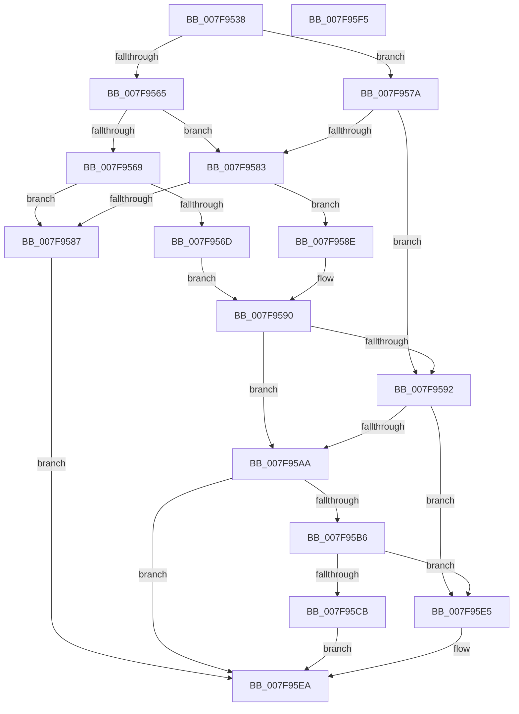

# MiAcquireAddMemoryResources

- RVA: `0x007F9538`–`0x007F95F6` (길이 `190` bytes)
- VA: `0x00000001407F9538`
- 실행 섹션: `PAGE`
- PDB 이름 있음: `예`; PDB Function 태그: `아니요`
- unwind 정보 RVA: `0x0005CAAC`
- 디코드: `60`개 명령, `190/190` bytes 표시
- 미해석 바이트: `0` (있으면 어셈블리에 `.byte`로 보존)

> 이 문서는 커널 이미지의 기계어와 PDB 기호를 분석해 생성했습니다. 4번과 5번은 함수 원형과 자료형을 바이너리 사용 방식에서 추정한 C 해석이며 원본 소스 복구 결과는 아닙니다.

## 1. Dependencies

- 직접 호출 지점: **5**; 고유 호출 대상: **5**
- 직접 호출자로 확인된 함수: **1**
- RIP 상대 이미지 참조: **1**

### Outgoing calls
- `0x007F954F` → [MiIsAnyPartOfRangeInHugePfn](../../text/67/MiIsAnyPartOfRangeInHugePfn_function_006764E0.md) (function, `0x006764E0`)
- `0x007F95A1` → [MiAddRangeToPartitionTree](../../text/69/MiAddRangeToPartitionTree_function_0069020C.md) (function, `0x0069020C`)
- `0x007F95AD` → [MiAllocateInitialMemoryBlocks](MiAllocateInitialMemoryBlocks_function_007F9E34.md) (function, `0x007F9E34`)
- `0x007F95C2` → [MiSplitPfnBitMapsForPartitionHierarchy](../../text/69/MiSplitPfnBitMapsForPartitionHierarchy_function_00691D64.md) (function, `0x00691D64`)
- `0x007F95D3` → [MiUpdateMirrorBitmaps](../AD/MiUpdateMirrorBitmaps_function_00ADA220.md) (function, `0x00ADA220`)

### Direct callers
- [MiAddPhysicalMemory](MiAddPhysicalMemory_function_007F95FC.md) at `0x007F97FD`

### Static image references
- `0x007F956D` → RVA `0x00E38D00` (`.data`; read)

## 2. Other-region calls and transfers

- 다른 실행 섹션으로 향하는 call: **3**
  - `0x007F954F` → [MiIsAnyPartOfRangeInHugePfn](../../text/67/MiIsAnyPartOfRangeInHugePfn_function_006764E0.md) (`PAGE` → `.text`)
  - `0x007F95A1` → [MiAddRangeToPartitionTree](../../text/69/MiAddRangeToPartitionTree_function_0069020C.md) (`PAGE` → `.text`)
  - `0x007F95C2` → [MiSplitPfnBitMapsForPartitionHierarchy](../../text/69/MiSplitPfnBitMapsForPartitionHierarchy_function_00691D64.md) (`PAGE` → `.text`)
- 별도 외부 분기/꼬리 이동을 확인하지 못했습니다.

## 3. Assembly (complete function range)

```asm
007F9538  48 89 5C 24 08                  mov qword ptr [rsp + 8], rbx
007F953D  57                              push rdi
007F953E  48 83 EC 20                     sub rsp, 0x20
007F9542  48 8B 51 20                     mov rdx, qword ptr [rcx + 0x20]
007F9546  48 8B D9                        mov rbx, rcx
007F9549  48 8B 49 10                     mov rcx, qword ptr [rcx + 0x10]
007F954D  33 FF                           xor edi, edi
007F954F  E8 8C CF E7 FF                  call 0x1406764e0
007F9554  8B 53 28                        mov edx, dword ptr [rbx + 0x28]
007F9557  8B CA                           mov ecx, edx
007F9559  81 E1 00 00 01 00               and ecx, 0x10000
007F955F  0F BA E2 11                     bt edx, 0x11
007F9563  72 15                           jb 0x1407f957a
007F9565  85 C9                           test ecx, ecx
007F9567  74 1A                           je 0x1407f9583
007F9569  85 C0                           test eax, eax
007F956B  74 1A                           je 0x1407f9587
007F956D  48 8D 05 8C F7 63 00            lea rax, [rip + 0x63f78c]
007F9574  48 39 43 30                     cmp qword ptr [rbx + 0x30], rax
007F9578  EB 16                           jmp 0x1407f9590
007F957A  BF 01 00 00 00                  mov edi, 1
007F957F  85 C9                           test ecx, ecx
007F9581  75 0F                           jne 0x1407f9592
007F9583  85 C0                           test eax, eax
007F9585  74 07                           je 0x1407f958e
007F9587  B8 18 00 00 C0                  mov eax, 0xc0000018
007F958C  EB 5C                           jmp 0x1407f95ea
007F958E  85 FF                           test edi, edi
007F9590  74 18                           je 0x1407f95aa
007F9592  4C 8B 43 20                     mov r8, qword ptr [rbx + 0x20]
007F9596  48 8D 4B 68                     lea rcx, [rbx + 0x68]
007F959A  48 8B 53 10                     mov rdx, qword ptr [rbx + 0x10]
007F959E  45 33 C9                        xor r9d, r9d
007F95A1  E8 66 6C E9 FF                  call 0x14069020c
007F95A6  85 C0                           test eax, eax
007F95A8  74 3B                           je 0x1407f95e5
007F95AA  48 8B CB                        mov rcx, rbx
007F95AD  E8 82 08 00 00                  call 0x1407f9e34
007F95B2  85 C0                           test eax, eax
007F95B4  78 34                           js 0x1407f95ea
007F95B6  4C 8B 43 20                     mov r8, qword ptr [rbx + 0x20]
007F95BA  48 8B 53 10                     mov rdx, qword ptr [rbx + 0x10]
007F95BE  48 8B 4B 30                     mov rcx, qword ptr [rbx + 0x30]
007F95C2  E8 9D 87 E9 FF                  call 0x140691d64
007F95C7  85 C0                           test eax, eax
007F95C9  74 1A                           je 0x1407f95e5
007F95CB  48 8B 53 20                     mov rdx, qword ptr [rbx + 0x20]
007F95CF  48 8B 4B 10                     mov rcx, qword ptr [rbx + 0x10]
007F95D3  E8 48 0C 2E 00                  call 0x140ada220
007F95D8  F7 D8                           neg eax
007F95DA  1B C0                           sbb eax, eax
007F95DC  F7 D0                           not eax
007F95DE  25 9A 00 00 C0                  and eax, 0xc000009a
007F95E3  EB 05                           jmp 0x1407f95ea
007F95E5  B8 9A 00 00 C0                  mov eax, 0xc000009a
007F95EA  48 8B 5C 24 30                  mov rbx, qword ptr [rsp + 0x30]
007F95EF  48 83 C4 20                     add rsp, 0x20
007F95F3  5F                              pop rdi
007F95F4  C3                              ret
007F95F5  CC                              int3
```

## 4. C-style interpretation (structured pseudocode)

```c
__int64 __fastcall MiAcquireAddMemoryResources(__int64 a1, __int64 a2, __int64 a3, int a4)
{
    __int64 result;
    __int64 v_rdi;
    __int64 v_rsp;
    unsigned __int64 v_stack_p8;

    v_stack_p8 = v_rbx;
    v_rsp = (v_rsp) - (32);
    v_rdi = 0;
    result = MiIsAnyPartOfRangeInHugePfn(*(unsigned __int64 *)(a1 + 16), *(unsigned __int64 *)(a1 + 32), a3, a4);
    a1 = (unsigned int)(((unsigned int)((unsigned int)((unsigned int)(*(unsigned int *)(a1 + 40))))) & (0x10000ULL));
    if (condition_is_below) goto loc_007F957A;
    if ((unsigned int)(a1) == 0) goto loc_007F9583;
    if ((unsigned int)(result) == 0) goto loc_007F9587;
    goto loc_007F9590;
loc_007F957A:
    if ((unsigned int)(a1) != 0) goto loc_007F9592;
loc_007F9583:
    if ((unsigned int)(v_rip + 6551436) == 0) goto loc_007F958E;
loc_007F9587:
    goto loc_007F95EA;
loc_007F958E:
loc_007F9590:
    if (1 == 0) goto loc_007F95AA;
loc_007F9592:
    a4 = 0;
    result = MiAddRangeToPartitionTree(a1 + 104, *(unsigned __int64 *)(a1 + 16), *(unsigned __int64 *)(a1 + 32), a4);
    if ((unsigned int)(result) == 0) goto loc_007F95E5;
loc_007F95AA:
    result = MiAllocateInitialMemoryBlocks(a1, *(unsigned __int64 *)(a1 + 16), *(unsigned __int64 *)(a1 + 32), a4);
    if (sign_flag) goto loc_007F95EA;
    result = MiSplitPfnBitMapsForPartitionHierarchy(*(unsigned __int64 *)(a1 + 48), *(unsigned __int64 *)(a1 + 16), *(unsigned __int64 *)(a1 + 32), a4);
    if ((unsigned int)(result) == 0) goto loc_007F95E5;
    result = MiUpdateMirrorBitmaps(*(unsigned __int64 *)(a1 + 16), *(unsigned __int64 *)(a1 + 32), *(unsigned __int64 *)(a1 + 32), a4);
    result = (unsigned int)(-(result));
    result = (unsigned int)(~(result));
    result = (unsigned int)((result) & (0xC000009AULL));
    goto loc_007F95EA;
loc_007F95E5:
loc_007F95EA:
    v_rsp = (v_rsp) + (32);
    return (unsigned int)(0xC000009AULL);
}
```

## 5. (Beta) C Style

```c
int64_t MiAcquireAddMemoryResources(void *Arg1, int64_t Arg2, int64_t Arg3, int32_t Arg4)
{
    uint8_t *arg1 = (uint8_t *)Arg1;

    int64_t result;
    int64_t local_rdi;
    int64_t local_rsp;
    uint64_t v_stack_p8;

    v_stack_p8 = local_rbx;
    local_rsp = (local_rsp) - (32);
    local_rdi = 0;
    result = MiIsAnyPartOfRangeInHugePfn(*(uint64_t *)(arg1 + 0x10), *(uint64_t *)(arg1 + 0x20), Arg3, Arg4);
    Arg1 = (uint32_t)(((uint32_t)((uint32_t)((uint32_t)(*(uint32_t *)(arg1 + 0x28))))) & (0x10000ULL));
    if (condition_is_below) goto loc_007F957A;
    if ((uint32_t)(Arg1) == 0) goto loc_007F9583;
    if ((uint32_t)(result) == 0) goto loc_007F9587;
    goto loc_007F9590;
loc_007F957A:
    if ((uint32_t)(Arg1) != 0) goto loc_007F9592;
loc_007F9583:
    if ((uint32_t)(v_rip + 6551436) == 0) goto loc_007F958E;
loc_007F9587:
    goto loc_007F95EA;
loc_007F958E:
loc_007F9590:
    if (1 == 0) goto loc_007F95AA;
loc_007F9592:
    Arg4 = 0;
    result = MiAddRangeToPartitionTree(Arg1 + 104, *(uint64_t *)(arg1 + 0x10), *(uint64_t *)(arg1 + 0x20), Arg4);
    if ((uint32_t)(result) == 0) goto loc_007F95E5;
loc_007F95AA:
    result = MiAllocateInitialMemoryBlocks(Arg1, *(uint64_t *)(arg1 + 0x10), *(uint64_t *)(arg1 + 0x20), Arg4);
    if (sign_flag) goto loc_007F95EA;
    result = MiSplitPfnBitMapsForPartitionHierarchy(*(uint64_t *)(arg1 + 0x30), *(uint64_t *)(arg1 + 0x10), *(uint64_t *)(arg1 + 0x20), Arg4);
    if ((uint32_t)(result) == 0) goto loc_007F95E5;
    result = MiUpdateMirrorBitmaps(*(uint64_t *)(arg1 + 0x10), *(uint64_t *)(arg1 + 0x20), *(uint64_t *)(arg1 + 0x20), Arg4);
    result = (uint32_t)(-(result));
    result = (uint32_t)(~(result));
    result = (uint32_t)((result) & (0xC000009AULL));
    goto loc_007F95EA;
loc_007F95E5:
loc_007F95EA:
    local_rsp = (local_rsp) + (32);
    return (uint32_t)(0xC000009AULL);
}
```

### 관측된 메모리 오프셋

구조체 형식이 확인되지 않은 접근은 인자 기준의 오프셋으로만 기록했습니다.

| 기준 인자 | 오프셋 표현 | 폭 (bit) | 접근 |
|---|---:|---:|---|
| `Arg1` | `+ 0x10` | `64` | `R` |
| `Arg1` | `+ 0x20` | `64` | `R` |
| `Arg1` | `+ 0x28` | `32` | `R` |
| `Arg1` | `+ 0x30` | `64` | `R` |
| `Arg1` | `+ 0x68` | `64` | `R` |

## 6. Execution-region graph

[열기: 2D/3D 그래프와 함수 탐색 컨트롤 패널](../../../control-panel.html?section=page&rva=0x007F9538&view=graph)

- 2D 그래프는 위에서 아래로 흐르고, 3D 그래프는 빈 공간을 드래그해 회전합니다. Shift+드래그는 이동, 휠은 확대·축소, 함수 노드 선택은 대상 보고서 이동입니다.

### Static fallback


