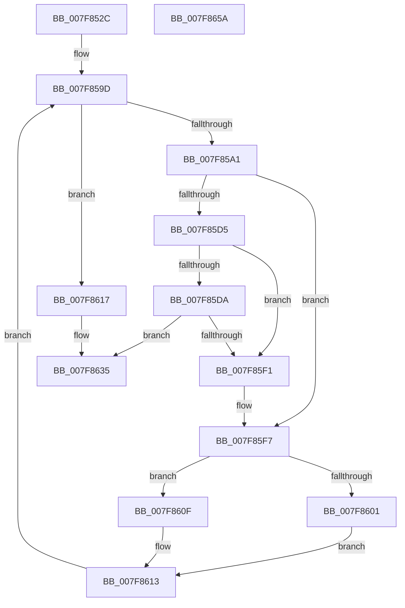

# MiActOnLargeKernelHalPages

- RVA: `0x007F852C`–`0x007F865B` (길이 `303` bytes)
- VA: `0x00000001407F852C`
- 실행 섹션: `PAGE`
- PDB 이름 있음: `예`; PDB Function 태그: `아니요`
- unwind 정보 RVA: `0x000C7BA4`
- 디코드: `88`개 명령, `303/303` bytes 표시
- 미해석 바이트: `0` (있으면 어셈블리에 `.byte`로 보존)

> 이 문서는 커널 이미지의 기계어와 PDB 기호를 분석해 생성했습니다. 4번과 5번은 함수 원형과 자료형을 바이너리 사용 방식에서 추정한 C 해석이며 원본 소스 복구 결과는 아닙니다.

## 1. Dependencies

- 직접 호출 지점: **4**; 고유 호출 대상: **3**
- 직접 호출자로 확인된 함수: **3**
- RIP 상대 이미지 참조: **1**

### Outgoing calls
- `0x007F855A` → [RtlImageNtHeader](../../text/44/RtlImageNtHeader_function_00443B60.md) (function, `0x00443B60`)
- `0x007F85E8` → [guard_dispatch_icall](../../text/6B/guard_dispatch_icall_function_006BAAD0.md) (function, `0x006BAAD0`)
- `0x007F8630` → [guard_dispatch_icall](../../text/6B/guard_dispatch_icall_function_006BAAD0.md) (function, `0x006BAAD0`)
- `0x007F863D` → [_security_check_cookie](../../text/6A/_security_check_cookie_function_006AC640.md) (function, `0x006AC640`)

### Direct callers
- [MiProtectSystemImage](../AA/MiProtectSystemImage_function_00AA7D74.md) at `0x00AA7E00`
- [MiInitSystem](../../init/C5/MiInitSystem_function_00C5E6C0.md) at `0x00C5E8EE`
- [MiInitializeBootLoadedDriverPfns](../../init/C6/MiInitializeBootLoadedDriverPfns_function_00C6BB10.md) at `0x00C6BB98`

### Static image references
- `0x007F8540` → RVA `0x00E0A740` (`.data`; read)

## 2. Other-region calls and transfers

- 다른 실행 섹션으로 향하는 call: **4**
  - `0x007F855A` → [RtlImageNtHeader](../../text/44/RtlImageNtHeader_function_00443B60.md) (`PAGE` → `.text`)
  - `0x007F85E8` → [guard_dispatch_icall](../../text/6B/guard_dispatch_icall_function_006BAAD0.md) (`PAGE` → `.text`)
  - `0x007F8630` → [guard_dispatch_icall](../../text/6B/guard_dispatch_icall_function_006BAAD0.md) (`PAGE` → `.text`)
  - `0x007F863D` → [_security_check_cookie](../../text/6A/_security_check_cookie_function_006AC640.md) (`PAGE` → `.text`)
- 별도 외부 분기/꼬리 이동을 확인하지 못했습니다.

## 3. Assembly (complete function range)

```asm
007F852C  48 89 5C 24 20                  mov qword ptr [rsp + 0x20], rbx
007F8531  55                              push rbp
007F8532  56                              push rsi
007F8533  57                              push rdi
007F8534  41 54                           push r12
007F8536  41 55                           push r13
007F8538  41 56                           push r14
007F853A  41 57                           push r15
007F853C  48 83 EC 70                     sub rsp, 0x70
007F8540  48 8B 05 F9 21 61 00            mov rax, qword ptr [rip + 0x6121f9]
007F8547  48 33 C4                        xor rax, rsp
007F854A  48 89 44 24 60                  mov qword ptr [rsp + 0x60], rax
007F854F  44 89 44 24 30                  mov dword ptr [rsp + 0x30], r8d
007F8554  4C 8B EA                        mov r13, rdx
007F8557  4C 8B E1                        mov r12, rcx
007F855A  E8 01 B6 C4 FF                  call 0x140443b60
007F855F  48 83 64 24 38 00               and qword ptr [rsp + 0x38], 0
007F8565  48 8D 5C 24 38                  lea rbx, [rsp + 0x38]
007F856A  83 64 24 44 00                  and dword ptr [rsp + 0x44], 0
007F856F  41 B8 00 00 00 40               mov r8d, 0x40000000
007F8575  0F 57 C0                        xorps xmm0, xmm0
007F8578  44 89 44 24 5C                  mov dword ptr [rsp + 0x5c], r8d
007F857D  8B 48 54                        mov ecx, dword ptr [rax + 0x54]
007F8580  4C 8B F8                        mov r15, rax
007F8583  0F B7 70 06                     movzx esi, word ptr [rax + 6]
007F8587  49 8B EC                        mov rbp, r12
007F858A  FF C6                           inc esi
007F858C  89 4C 24 40                     mov dword ptr [rsp + 0x40], ecx
007F8590  4D 8B D4                        mov r10, r12
007F8593  89 4C 24 48                     mov dword ptr [rsp + 0x48], ecx
007F8597  F3 0F 7F 44 24 4C               movdqu xmmword ptr [rsp + 0x4c], xmm0
007F859D  85 F6                           test esi, esi
007F859F  74 76                           je 0x1407f8617
007F85A1  8B 4B 10                        mov ecx, dword ptr [rbx + 0x10]
007F85A4  8B 43 08                        mov eax, dword ptr [rbx + 8]
007F85A7  8B 7B 0C                        mov edi, dword ptr [rbx + 0xc]
007F85AA  44 8B 73 24                     mov r14d, dword ptr [rbx + 0x24]
007F85AE  49 03 FC                        add rdi, r12
007F85B1  3B C8                           cmp ecx, eax
007F85B3  0F 42 C8                        cmovb ecx, eax
007F85B6  41 81 E6 00 00 00 E0            and r14d, 0xe0000000
007F85BD  8B E9                           mov ebp, ecx
007F85BF  48 81 C5 FF 0F 00 00            add rbp, 0xfff
007F85C6  48 81 E5 00 F0 FF FF            and rbp, 0xfffffffffffff000
007F85CD  48 03 EF                        add rbp, rdi
007F85D0  45 3B F0                        cmp r14d, r8d
007F85D3  74 22                           je 0x1407f85f7
007F85D5  4C 3B D7                        cmp r10, rdi
007F85D8  73 17                           jae 0x1407f85f1
007F85DA  44 8B 4C 24 30                  mov r9d, dword ptr [rsp + 0x30]
007F85DF  48 8B D7                        mov rdx, rdi
007F85E2  49 8B CA                        mov rcx, r10
007F85E5  49 8B C5                        mov rax, r13
007F85E8  E8 E3 24 EC FF                  call 0x1406baad0
007F85ED  85 C0                           test eax, eax
007F85EF  78 44                           js 0x1407f8635
007F85F1  45 8B C6                        mov r8d, r14d
007F85F4  4C 8B D7                        mov r10, rdi
007F85F7  48 8D 44 24 38                  lea rax, [rsp + 0x38]
007F85FC  48 3B D8                        cmp rbx, rax
007F85FF  75 0E                           jne 0x1407f860f
007F8601  41 0F B7 5F 14                  movzx ebx, word ptr [r15 + 0x14]
007F8606  48 83 C3 18                     add rbx, 0x18
007F860A  49 03 DF                        add rbx, r15
007F860D  EB 04                           jmp 0x1407f8613
007F860F  48 83 C3 28                     add rbx, 0x28
007F8613  FF CE                           dec esi
007F8615  EB 86                           jmp 0x1407f859d
007F8617  44 8B 4C 24 30                  mov r9d, dword ptr [rsp + 0x30]
007F861C  48 8D 95 FF FF 1F 00            lea rdx, [rbp + 0x1fffff]
007F8623  48 81 E2 00 00 E0 FF            and rdx, 0xffffffffffe00000
007F862A  49 8B CA                        mov rcx, r10
007F862D  49 8B C5                        mov rax, r13
007F8630  E8 9B 24 EC FF                  call 0x1406baad0
007F8635  48 8B 4C 24 60                  mov rcx, qword ptr [rsp + 0x60]
007F863A  48 33 CC                        xor rcx, rsp
007F863D  E8 FE 3F EB FF                  call 0x1406ac640
007F8642  48 8B 9C 24 C8 00 00 00         mov rbx, qword ptr [rsp + 0xc8]
007F864A  48 83 C4 70                     add rsp, 0x70
007F864E  41 5F                           pop r15
007F8650  41 5E                           pop r14
007F8652  41 5D                           pop r13
007F8654  41 5C                           pop r12
007F8656  5F                              pop rdi
007F8657  5E                              pop rsi
007F8658  5D                              pop rbp
007F8659  C3                              ret
007F865A  CC                              int3
```

## 4. C-style interpretation (structured pseudocode)

```c
__int64 __fastcall MiActOnLargeKernelHalPages(__int64 a1, __int64 a2, int a3)
{
    __int64 result;
    __int64 v_r14;
    __int64 v_rbp;
    __int64 v_rbx;
    __int64 v_rdi;
    __int64 v_rsi;
    __int64 v_rsp;
    unsigned __int64 v_stack_m48;
    unsigned int v_stack_m4C;
    unsigned __int64 v_stack_m5C;
    unsigned int v_stack_m60;
    unsigned int v_stack_m64;
    unsigned int v_stack_m68;
    unsigned __int64 v_stack_m70;
    unsigned int v_stack_m78;
    unsigned __int64 v_stack_p20;

    v_stack_p20 = v_rbx;
    v_rsp = (v_rsp) - (112);
    result = (*(unsigned __int64 *)(v_rip + 6365689)) ^ (v_rsp);
    v_stack_m48 = result;
    v_stack_m78 = a3;
    result = RtlImageNtHeader(a1, a2, a3, a4);
    v_stack_m4C = (unsigned int)((unsigned int)(0x40000000ULL));
    v_rsi = (unsigned int)((*(unsigned __int16 *)(result + 6)) + 1);
    v_stack_m68 = (unsigned int)((unsigned int)(*(unsigned int *)(result + 84)));
    v_stack_m60 = (unsigned int)((unsigned int)(*(unsigned int *)(result + 84)));
    v_stack_m5C = v_xmm0;
loc_007F859D:
    if ((unsigned int)(v_rsi) == 0) goto loc_007F8617;
    v_rdi = ((unsigned int)(*(unsigned int *)(v_stack_m70 + 12))) + (a1);
    a1 = (unsigned int)(*(unsigned int *)(v_stack_m70 + 16));
    if (((unsigned int)((unsigned int)(*(unsigned int *)(v_stack_m70 + 16)))) < ((unsigned int)((unsigned int)(*(unsigned int *)(v_stack_m70 + 8))))) { a1 = (unsigned int)((unsigned int)(*(unsigned int *)(v_stack_m70 + 8))); }
    v_r14 = (unsigned int)(((unsigned int)(*(unsigned int *)(v_stack_m70 + 36))) & (0xE0000000ULL));
    v_rbp = ((unsigned int)((unsigned int)(a1))) + (0xFFFULL);
    v_rbp = (v_rbp) & (0xFFFFFFFFFFFFF000ULL);
    v_rbp = (v_rbp) + (v_rdi);
    if (((unsigned int)(v_r14)) == ((unsigned int)((unsigned int)(0x40000000ULL)))) goto loc_007F85F7;
    if (a1 >= v_rdi) goto loc_007F85F1;
    result = guard_dispatch_icall(a1, v_rdi, (unsigned int)(0x40000000ULL), (unsigned int)(v_stack_m78));
    if (sign_flag) goto loc_007F8635;
loc_007F85F1:
loc_007F85F7:
    if (v_stack_m70 != v_stack_m70) goto loc_007F860F;
    v_rbx = (*(unsigned __int16 *)(result + 20)) + (24);
    v_rbx = (v_rbx) + (result);
    goto loc_007F8613;
loc_007F860F:
    v_rbx = (v_rbx) + (40);
loc_007F8613:
    v_rsi = (unsigned int)((v_rsi) - 1);
    goto loc_007F859D;
loc_007F8617:
    a2 = (v_rbp + 2097151) & (0xFFFFFFFFFFE00000ULL);
    result = guard_dispatch_icall(v_rdi, a2, (unsigned int)((unsigned int)(v_r14)), (unsigned int)(v_stack_m78));
loc_007F8635:
    a1 = (v_stack_m48) ^ (v_rsp);
    result = _security_check_cookie(a1, a2, (unsigned int)((unsigned int)(v_r14)), (unsigned int)(v_stack_m78));
    v_rsp = (v_rsp) + (112);
    return result;
}
```

## 5. (Beta) C Style

```c
int64_t MiActOnLargeKernelHalPages(int64_t Arg1, int64_t Arg2, int32_t Arg3)
{
    int64_t result;
    int64_t local_r14;
    int64_t local_rbp;
    int64_t local_rbx;
    int64_t local_rdi;
    int64_t local_rsi;
    int64_t local_rsp;
    uint64_t v_stack_m48;
    uint32_t v_stack_m4C;
    uint64_t v_stack_m5C;
    uint32_t v_stack_m60;
    uint32_t v_stack_m64;
    uint32_t v_stack_m68;
    uint64_t v_stack_m70;
    uint32_t v_stack_m78;
    uint64_t v_stack_p20;

    v_stack_p20 = local_rbx;
    local_rsp = (local_rsp) - (112);
    result = (*(uint64_t *)(v_rip + 0x6121F9)) ^ (local_rsp);
    v_stack_m48 = result;
    v_stack_m78 = Arg3;
    result = RtlImageNtHeader(Arg1, Arg2, Arg3, a4);
    v_stack_m4C = (uint32_t)((uint32_t)(0x40000000ULL));
    local_rsi = (uint32_t)((*(uint16_t *)(result + 0x6)) + 1);
    v_stack_m68 = (uint32_t)((uint32_t)(*(uint32_t *)(result + 0x54)));
    v_stack_m60 = (uint32_t)((uint32_t)(*(uint32_t *)(result + 0x54)));
    v_stack_m5C = v_xmm0;
loc_007F859D:
    if ((uint32_t)(local_rsi) == 0) goto loc_007F8617;
    local_rdi = ((uint32_t)(*(uint32_t *)(v_stack_m70 + 0xC))) + (Arg1);
    Arg1 = (uint32_t)(*(uint32_t *)(v_stack_m70 + 0x10));
    if (((uint32_t)((uint32_t)(*(uint32_t *)(v_stack_m70 + 0x10)))) < ((uint32_t)((uint32_t)(*(uint32_t *)(v_stack_m70 + 0x8))))) { Arg1 = (uint32_t)((uint32_t)(*(uint32_t *)(v_stack_m70 + 0x8))); }
    local_r14 = (uint32_t)(((uint32_t)(*(uint32_t *)(v_stack_m70 + 0x24))) & (0xE0000000ULL));
    local_rbp = ((uint32_t)((uint32_t)(Arg1))) + (0xFFFULL);
    local_rbp = (local_rbp) & (0xFFFFFFFFFFFFF000ULL);
    local_rbp = (local_rbp) + (local_rdi);
    if (((uint32_t)(local_r14)) == ((uint32_t)((uint32_t)(0x40000000ULL)))) goto loc_007F85F7;
    if (Arg1 >= local_rdi) goto loc_007F85F1;
    result = guard_dispatch_icall(Arg1, local_rdi, (uint32_t)(0x40000000ULL), (uint32_t)(v_stack_m78));
    if (sign_flag) goto loc_007F8635;
loc_007F85F1:
loc_007F85F7:
    if (v_stack_m70 != v_stack_m70) goto loc_007F860F;
    local_rbx = (*(uint16_t *)(result + 0x14)) + (24);
    local_rbx = (local_rbx) + (result);
    goto loc_007F8613;
loc_007F860F:
    local_rbx = (local_rbx) + (40);
loc_007F8613:
    local_rsi = (uint32_t)((local_rsi) - 1);
    goto loc_007F859D;
loc_007F8617:
    Arg2 = (local_rbp + 2097151) & (0xFFFFFFFFFFE00000ULL);
    result = guard_dispatch_icall(local_rdi, Arg2, (uint32_t)((uint32_t)(local_r14)), (uint32_t)(v_stack_m78));
loc_007F8635:
    Arg1 = (v_stack_m48) ^ (local_rsp);
    result = _security_check_cookie(Arg1, Arg2, (uint32_t)((uint32_t)(local_r14)), (uint32_t)(v_stack_m78));
    local_rsp = (local_rsp) + (112);
    return result;
}
```

## 6. Execution-region graph

[열기: 2D/3D 그래프와 함수 탐색 컨트롤 패널](../../../control-panel.html?section=page&rva=0x007F852C&view=graph)

- 2D 그래프는 위에서 아래로 흐르고, 3D 그래프는 빈 공간을 드래그해 회전합니다. Shift+드래그는 이동, 휠은 확대·축소, 함수 노드 선택은 대상 보고서 이동입니다.

### Static fallback


