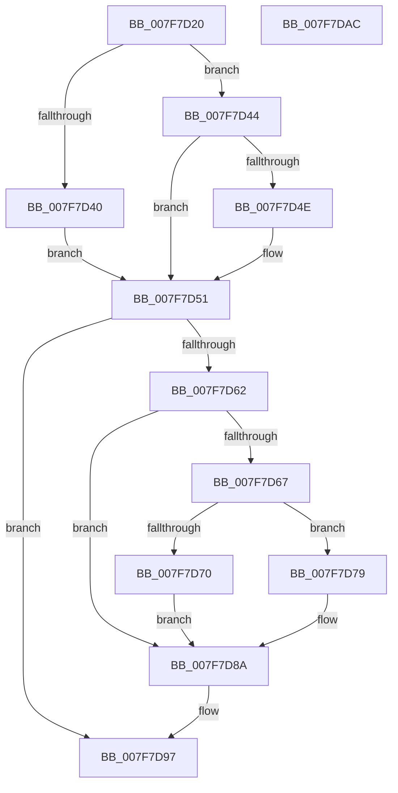

# MiAddEntryToImportList

- RVA: `0x007F7D20`–`0x007F7DAD` (길이 `141` bytes)
- VA: `0x00000001407F7D20`
- 실행 섹션: `PAGE`
- PDB 이름 있음: `예`; PDB Function 태그: `아니요`
- unwind 정보 RVA: `0x0005C954`
- 디코드: `41`개 명령, `141/141` bytes 표시
- 미해석 바이트: `0` (있으면 어셈블리에 `.byte`로 보존)

> 이 문서는 커널 이미지의 기계어와 PDB 기호를 분석해 생성했습니다. 4번과 5번은 함수 원형과 자료형을 바이너리 사용 방식에서 추정한 C 해석이며 원본 소스 복구 결과는 아닙니다.

## 1. Dependencies

- 직접 호출 지점: **3**; 고유 호출 대상: **3**
- 직접 호출자로 확인된 함수: **2**
- RIP 상대 이미지 참조: **0**

### Outgoing calls
- `0x007F7D55` → [MiAllocateImportList](../A2/MiAllocateImportList_function_00A243F4.md) (function, `0x00A243F4`)
- `0x007F7D85` → [memcpy](../../text/6C/memcpy_function_006C6840.md) (function, `0x006C6840`)
- `0x007F7D92` → [MiCompressImportList](../A2/MiCompressImportList_function_00A24344.md) (function, `0x00A24344`)

### Direct callers
- [MiApplyDriverHotPatch](../80/MiApplyDriverHotPatch_function_008018EC.md) at `0x00801AE0`
- [MiUpdateBootDriverHotPatchImports](../../init/C6/MiUpdateBootDriverHotPatchImports_function_00C674C0.md) at `0x00C6750A`

### Static image references
- 디코드된 RIP-relative 메모리 참조가 없습니다.

## 2. Other-region calls and transfers

- 다른 실행 섹션으로 향하는 call: **1**
  - `0x007F7D85` → [memcpy](../../text/6C/memcpy_function_006C6840.md) (`PAGE` → `.text`)
- 별도 외부 분기/꼬리 이동을 확인하지 못했습니다.

## 3. Assembly (complete function range)

```asm
007F7D20  48 89 5C 24 08                  mov qword ptr [rsp + 8], rbx
007F7D25  48 89 6C 24 10                  mov qword ptr [rsp + 0x10], rbp
007F7D2A  48 89 74 24 18                  mov qword ptr [rsp + 0x18], rsi
007F7D2F  57                              push rdi
007F7D30  48 83 EC 20                     sub rsp, 0x20
007F7D34  48 8B EA                        mov rbp, rdx
007F7D37  48 8B D9                        mov rbx, rcx
007F7D3A  48 83 F9 FE                     cmp rcx, -2
007F7D3E  75 04                           jne 0x1407f7d44
007F7D40  33 FF                           xor edi, edi
007F7D42  EB 0D                           jmp 0x1407f7d51
007F7D44  BF 01 00 00 00                  mov edi, 1
007F7D49  F6 C3 01                        test bl, 1
007F7D4C  75 03                           jne 0x1407f7d51
007F7D4E  48 8B 39                        mov rdi, qword ptr [rcx]
007F7D51  48 8D 4F 01                     lea rcx, [rdi + 1]
007F7D55  E8 9A C6 22 00                  call 0x140a243f4
007F7D5A  48 8B F0                        mov rsi, rax
007F7D5D  48 85 C0                        test rax, rax
007F7D60  74 35                           je 0x1407f7d97
007F7D62  48 85 FF                        test rdi, rdi
007F7D65  74 23                           je 0x1407f7d8a
007F7D67  48 8D 48 08                     lea rcx, [rax + 8]
007F7D6B  F6 C3 01                        test bl, 1
007F7D6E  74 09                           je 0x1407f7d79
007F7D70  48 83 E3 FE                     and rbx, 0xfffffffffffffffe
007F7D74  48 89 19                        mov qword ptr [rcx], rbx
007F7D77  EB 11                           jmp 0x1407f7d8a
007F7D79  4C 8D 04 FD 00 00 00 00         lea r8, [rdi*8]
007F7D81  48 8D 53 08                     lea rdx, [rbx + 8]
007F7D85  E8 B6 EA EC FF                  call 0x1406c6840
007F7D8A  48 8B CE                        mov rcx, rsi
007F7D8D  48 89 6C FE 08                  mov qword ptr [rsi + rdi*8 + 8], rbp
007F7D92  E8 AD C5 22 00                  call 0x140a24344
007F7D97  48 8B 5C 24 30                  mov rbx, qword ptr [rsp + 0x30]
007F7D9C  48 8B 6C 24 38                  mov rbp, qword ptr [rsp + 0x38]
007F7DA1  48 8B 74 24 40                  mov rsi, qword ptr [rsp + 0x40]
007F7DA6  48 83 C4 20                     add rsp, 0x20
007F7DAA  5F                              pop rdi
007F7DAB  C3                              ret
007F7DAC  CC                              int3
```

## 4. C-style interpretation (structured pseudocode)

```c
__int64 __fastcall MiAddEntryToImportList(__int64 a1, __int64 a2)
{
    __int64 result;
    __int64 v_rbx;
    __int64 v_rdi;
    __int64 v_rsp;
    unsigned __int64 v_stack_p10;
    unsigned __int64 v_stack_p18;
    unsigned __int64 v_stack_p8;

    v_stack_p8 = v_rbx;
    v_stack_p10 = v_rbp;
    v_stack_p18 = v_rsi;
    v_rsp = (v_rsp) - (32);
    if (a1 != -2) goto loc_007F7D44;
    v_rdi = 0;
    goto loc_007F7D51;
loc_007F7D44:
    v_rdi = 1;
    if ((((unsigned __int8)(a1)) & (1)) == 0) {
        v_rdi = *(unsigned __int64 *)(a1);
    }
    result = MiAllocateImportList(v_rdi + 1, a2, a3, a4);
    if (result == 0) goto loc_007F7D97;
    if (v_rdi == 0) goto loc_007F7D8A;
    if ((((unsigned __int8)(a1)) & (1)) == 0) goto loc_007F7D79;
    v_rbx = (a1) & (-2);
    *(unsigned __int64 *)(result + 8) = v_rbx;
    goto loc_007F7D8A;
loc_007F7D79:
    result = memcpy(result + 8, v_rbx + 8, v_rdi * 8, a4);
loc_007F7D8A:
    *(unsigned __int64 *)(result + v_rdi * 8 + 8) = a2;
    result = MiCompressImportList(result, v_rbx + 8, v_rdi * 8, a4);
loc_007F7D97:
    v_rsp = (v_rsp) + (32);
    return result;
}
```

## 5. (Beta) C Style

```c
int64_t MiAddEntryToImportList(int64_t Arg1, int64_t Arg2)
{
    int64_t result;
    int64_t local_rbx;
    int64_t local_rdi;
    int64_t local_rsp;
    uint64_t v_stack_p10;
    uint64_t v_stack_p18;
    uint64_t v_stack_p8;

    v_stack_p8 = local_rbx;
    v_stack_p10 = local_rbp;
    v_stack_p18 = local_rsi;
    local_rsp = (local_rsp) - (32);
    if (Arg1 != -2) goto loc_007F7D44;
    local_rdi = 0;
    goto loc_007F7D51;
loc_007F7D44:
    local_rdi = 1;
    if ((((uint8_t)(Arg1)) & (1)) == 0) {
        local_rdi = *(uint64_t *)(Arg1);
    }
    result = MiAllocateImportList(local_rdi + 1, Arg2, a3, a4);
    if (result == 0) goto loc_007F7D97;
    if (local_rdi == 0) goto loc_007F7D8A;
    if ((((uint8_t)(Arg1)) & (1)) == 0) goto loc_007F7D79;
    local_rbx = (Arg1) & (-2);
    *(uint64_t *)(result + 0x8) = local_rbx;
    goto loc_007F7D8A;
loc_007F7D79:
    result = memcpy(result + 8, local_rbx + 8, local_rdi * 8, a4);
loc_007F7D8A:
    *(uint64_t *)(result + local_rdi * 8 + 0x8) = Arg2;
    result = MiCompressImportList(result, local_rbx + 8, local_rdi * 8, a4);
loc_007F7D97:
    local_rsp = (local_rsp) + (32);
    return result;
}
```

## 6. Execution-region graph

[열기: 2D/3D 그래프와 함수 탐색 컨트롤 패널](../../../control-panel.html?section=page&rva=0x007F7D20&view=graph)

- 2D 그래프는 위에서 아래로 흐르고, 3D 그래프는 빈 공간을 드래그해 회전합니다. Shift+드래그는 이동, 휠은 확대·축소, 함수 노드 선택은 대상 보고서 이동입니다.

### Static fallback


