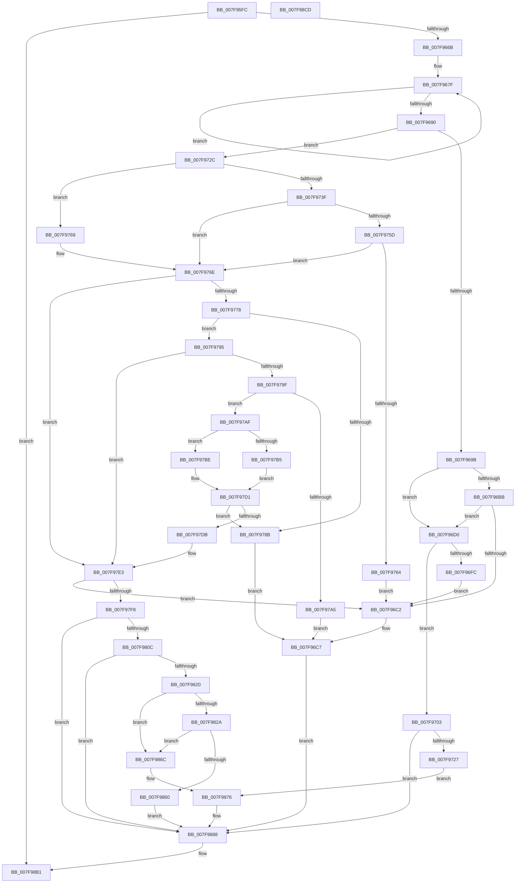

# MiAddPhysicalMemory

- RVA: `0x007F95FC`–`0x007F98CE` (길이 `722` bytes)
- VA: `0x00000001407F95FC`
- 실행 섹션: `PAGE`
- PDB 이름 있음: `예`; PDB Function 태그: `아니요`
- unwind 정보 RVA: `0x000D7A48`
- 디코드: `184`개 명령, `722/722` bytes 표시
- 미해석 바이트: `0` (있으면 어셈블리에 `.byte`로 보존)

> 이 문서는 커널 이미지의 기계어와 PDB 기호를 분석해 생성했습니다. 4번과 5번은 함수 원형과 자료형을 바이너리 사용 방식에서 추정한 C 해석이며 원본 소스 복구 결과는 아닙니다.

## 1. Dependencies

- 직접 호출 지점: **22**; 고유 호출 대상: **17**
- 직접 호출자로 확인된 함수: **2**
- RIP 상대 이미지 참조: **6**

### Outgoing calls
- `0x007F963C` → [memset](../../text/6C/memset_function_006C6C40.md) (function, `0x006C6C40`)
- `0x007F965C` → [MiValidateAddPhysicalMemoryParameters](MiValidateAddPhysicalMemoryParameters_function_007FB19C.md) (function, `0x007FB19C`)
- `0x007F969B` → [MiDeleteExtentPfns](../../text/68/MiDeleteExtentPfns_function_006808B0.md) (function, `0x006808B0`)
- `0x007F96AF` → [MiIsExtentDangling](../80/MiIsExtentDangling_function_008010A0.md) (function, `0x008010A0`)
- `0x007F96DA` → [MiLockDynamicMemoryShared](../../text/3B/MiLockDynamicMemoryShared_function_003B8AA8.md) (function, `0x003B8AA8`)
- `0x007F96E9` → [MiMemoryRangeAlreadyExists](../../text/67/MiMemoryRangeAlreadyExists_function_00673354.md) (function, `0x00673354`)
- `0x007F96FC` → [MiUnlockDynamicMemoryShared](../../text/3B/MiUnlockDynamicMemoryShared_function_003B8A48.md) (function, `0x003B8A48`)
- `0x007F970A` → [MiUnlockDynamicMemoryShared](../../text/3B/MiUnlockDynamicMemoryShared_function_003B8A48.md) (function, `0x003B8A48`)
- `0x007F9714` → [MiMapNewPfns](MiMapNewPfns_function_007FA63C.md) (function, `0x007FA63C`)
- `0x007F9731` → [MiAcquireAddMemoryLocks](MiAcquireAddMemoryLocks_function_007F94F8.md) (function, `0x007F94F8`)
- `0x007F974E` → [MiIsExtentDangling](../80/MiIsExtentDangling_function_008010A0.md) (function, `0x008010A0`)
- `0x007F97EB` → [MiMemoryRangeAlreadyExists](../../text/67/MiMemoryRangeAlreadyExists_function_00673354.md) (function, `0x00673354`)
- `0x007F97FD` → [MiAcquireAddMemoryResources](MiAcquireAddMemoryResources_function_007F9538.md) (function, `0x007F9538`)
- `0x007F9811` → [MiMapNewPfns](MiMapNewPfns_function_007FA63C.md) (function, `0x007FA63C`)
- `0x007F982F` → [MiReleaseAddMemoryLocks](MiReleaseAddMemoryLocks_function_007FACEC.md) (function, `0x007FACEC`)
- `0x007F9847` → [KeConfigureDynamicMemory](../../text/5B/KeConfigureDynamicMemory_function_005B8C9C.md) (function, `0x005B8C9C`)
- `0x007F9857` → [MiAcquireAddMemoryLocks](MiAcquireAddMemoryLocks_function_007F94F8.md) (function, `0x007F94F8`)
- `0x007F9865` → [MiUnmapPfns](MiUnmapPfns_function_007FB0A0.md) (function, `0x007FB0A0`)
- `0x007F9871` → [MiCompleteMemoryAddition](MiCompleteMemoryAddition_function_007F9FAC.md) (function, `0x007F9FAC`)
- `0x007F988D` → [MiReturnAddMemoryResources](../../text/67/MiReturnAddMemoryResources_function_00673BC0.md) (function, `0x00673BC0`)
- `0x007F98AA` → [MiLogAddPhysicalMemory](../../text/67/MiLogAddPhysicalMemory_function_006731A8.md) (function, `0x006731A8`)
- `0x007F98B8` → [_security_check_cookie](../../text/6A/_security_check_cookie_function_006AC640.md) (function, `0x006AC640`)

### Direct callers
- [MiAddPhysicalMemoryChunks](MiAddPhysicalMemoryChunks_function_007F98D4.md) at `0x007F997B`
- [MiAddPhysicalMemoryChunks](MiAddPhysicalMemoryChunks_function_007F98D4.md) at `0x007F9D86`
- [MiCreateFileOnlyPfns](../80/MiCreateFileOnlyPfns_function_00800DB4.md) at `0x00800EF5`

### Static image references
- `0x007F9611` → RVA `0x00E0A740` (`.data`; read)
- `0x007F96D3` → RVA `0x00E38D00` (`.data`; read)
- `0x007F9703` → RVA `0x00E2D700` (`.data`; write)
- `0x007F9736` → RVA `0x00E2D700` (`.data`; read)
- `0x007F9778` → RVA `0x00E2DC48` (`.data`; read)
- `0x007F977F` → RVA `0x00E3D550` (`.data`; read)

## 2. Other-region calls and transfers

- 다른 실행 섹션으로 향하는 call: **11**
  - `0x007F963C` → [memset](../../text/6C/memset_function_006C6C40.md) (`PAGE` → `.text`)
  - `0x007F969B` → [MiDeleteExtentPfns](../../text/68/MiDeleteExtentPfns_function_006808B0.md) (`PAGE` → `.text`)
  - `0x007F96DA` → [MiLockDynamicMemoryShared](../../text/3B/MiLockDynamicMemoryShared_function_003B8AA8.md) (`PAGE` → `.text`)
  - `0x007F96E9` → [MiMemoryRangeAlreadyExists](../../text/67/MiMemoryRangeAlreadyExists_function_00673354.md) (`PAGE` → `.text`)
  - `0x007F96FC` → [MiUnlockDynamicMemoryShared](../../text/3B/MiUnlockDynamicMemoryShared_function_003B8A48.md) (`PAGE` → `.text`)
  - `0x007F970A` → [MiUnlockDynamicMemoryShared](../../text/3B/MiUnlockDynamicMemoryShared_function_003B8A48.md) (`PAGE` → `.text`)
  - `0x007F97EB` → [MiMemoryRangeAlreadyExists](../../text/67/MiMemoryRangeAlreadyExists_function_00673354.md) (`PAGE` → `.text`)
  - `0x007F9847` → [KeConfigureDynamicMemory](../../text/5B/KeConfigureDynamicMemory_function_005B8C9C.md) (`PAGE` → `.text`)
  - `0x007F988D` → [MiReturnAddMemoryResources](../../text/67/MiReturnAddMemoryResources_function_00673BC0.md) (`PAGE` → `.text`)
  - `0x007F98AA` → [MiLogAddPhysicalMemory](../../text/67/MiLogAddPhysicalMemory_function_006731A8.md) (`PAGE` → `.text`)
  - `0x007F98B8` → [_security_check_cookie](../../text/6A/_security_check_cookie_function_006AC640.md) (`PAGE` → `.text`)
- 별도 외부 분기/꼬리 이동을 확인하지 못했습니다.

## 3. Assembly (complete function range)

```asm
007F95FC  40 55                           push rbp
007F95FE  53                              push rbx
007F95FF  56                              push rsi
007F9600  57                              push rdi
007F9601  41 56                           push r14
007F9603  41 57                           push r15
007F9605  48 8D 6C 24 F8                  lea rbp, [rsp - 8]
007F960A  48 81 EC 08 01 00 00            sub rsp, 0x108
007F9611  48 8B 05 28 11 61 00            mov rax, qword ptr [rip + 0x611128]
007F9618  48 33 C4                        xor rax, rsp
007F961B  48 89 45 F0                     mov qword ptr [rbp - 0x10], rax
007F961F  48 8B 5D 60                     mov rbx, qword ptr [rbp + 0x60]
007F9623  49 8B F0                        mov rsi, r8
007F9626  4C 8B FA                        mov r15, rdx
007F9629  4C 8B F1                        mov r14, rcx
007F962C  33 D2                           xor edx, edx
007F962E  48 8D 4C 24 40                  lea rcx, [rsp + 0x40]
007F9633  41 B8 B0 00 00 00               mov r8d, 0xb0
007F9639  41 8B F9                        mov edi, r9d
007F963C  E8 FF D5 EC FF                  call 0x1406c6c40
007F9641  48 8D 44 24 40                  lea rax, [rsp + 0x40]
007F9646  44 8B CF                        mov r9d, edi
007F9649  48 89 44 24 28                  mov qword ptr [rsp + 0x28], rax
007F964E  4C 8B C6                        mov r8, rsi
007F9651  49 8B D7                        mov rdx, r15
007F9654  48 89 5C 24 20                  mov qword ptr [rsp + 0x20], rbx
007F9659  49 8B CE                        mov rcx, r14
007F965C  E8 3B 1B 00 00                  call 0x1407fb19c
007F9661  33 FF                           xor edi, edi
007F9663  85 C0                           test eax, eax
007F9665  0F 88 46 02 00 00               js 0x1407f98b1
007F966B  65 48 8B 1C 25 88 01 00 00      mov rbx, qword ptr gs:[0x188]
007F9674  48 8D 45 B0                     lea rax, [rbp - 0x50]
007F9678  48 89 7D A8                     mov qword ptr [rbp - 0x58], rdi
007F967C  8D 4F 02                        lea ecx, [rdi + 2]
007F967F  48 89 40 08                     mov qword ptr [rax + 8], rax
007F9683  48 89 00                        mov qword ptr [rax], rax
007F9686  48 83 C0 18                     add rax, 0x18
007F968A  48 83 E9 01                     sub rcx, 1
007F968E  75 EF                           jne 0x1407f967f
007F9690  F6 44 24 68 02                  test byte ptr [rsp + 0x68], 2
007F9695  0F 84 91 00 00 00               je 0x1407f972c
007F969B  E8 10 72 E8 FF                  call 0x1406808b0
007F96A0  44 8B 44 24 68                  mov r8d, dword ptr [rsp + 0x68]
007F96A5  48 8B 54 24 60                  mov rdx, qword ptr [rsp + 0x60]
007F96AA  48 8B 4C 24 50                  mov rcx, qword ptr [rsp + 0x50]
007F96AF  E8 EC 79 00 00                  call 0x1408010a0
007F96B4  48 3B 44 24 50                  cmp rax, qword ptr [rsp + 0x50]
007F96B9  72 15                           jb 0x1407f96d0
007F96BB  48 3B 44 24 58                  cmp rax, qword ptr [rsp + 0x58]
007F96C0  73 0E                           jae 0x1407f96d0
007F96C2  BB 18 00 00 C0                  mov ebx, 0xc0000018
007F96C7  89 5C 24 30                     mov dword ptr [rsp + 0x30], ebx
007F96CB  E9 B8 01 00 00                  jmp 0x1407f9888
007F96D0  48 8B D3                        mov rdx, rbx
007F96D3  48 8D 0D 26 F6 63 00            lea rcx, [rip + 0x63f626]
007F96DA  E8 C9 F3 BB FF                  call 0x1403b8aa8
007F96DF  48 8B 54 24 58                  mov rdx, qword ptr [rsp + 0x58]
007F96E4  48 8B 4C 24 50                  mov rcx, qword ptr [rsp + 0x50]
007F96E9  E8 66 9C E7 FF                  call 0x140673354
007F96EE  48 8D 0D 0B F6 63 00            lea rcx, [rip + 0x63f60b]
007F96F5  48 8B D3                        mov rdx, rbx
007F96F8  85 C0                           test eax, eax
007F96FA  74 07                           je 0x1407f9703
007F96FC  E8 47 F3 BB FF                  call 0x1403b8a48
007F9701  EB BF                           jmp 0x1407f96c2
007F9703  C6 05 F6 3F 63 00 01            mov byte ptr [rip + 0x633ff6], 1
007F970A  E8 39 F3 BB FF                  call 0x1403b8a48
007F970F  48 8D 4C 24 40                  lea rcx, [rsp + 0x40]
007F9714  E8 23 0F 00 00                  call 0x1407fa63c
007F9719  89 44 24 30                     mov dword ptr [rsp + 0x30], eax
007F971D  8B D8                           mov ebx, eax
007F971F  85 C0                           test eax, eax
007F9721  0F 88 61 01 00 00               js 0x1407f9888
007F9727  E9 4A 01 00 00                  jmp 0x1407f9876
007F972C  48 8D 4C 24 40                  lea rcx, [rsp + 0x40]
007F9731  E8 C2 FD FF FF                  call 0x1407f94f8
007F9736  40 38 3D C3 3F 63 00            cmp byte ptr [rip + 0x633fc3], dil
007F973D  74 2A                           je 0x1407f9769
007F973F  44 8B 44 24 68                  mov r8d, dword ptr [rsp + 0x68]
007F9744  48 8B 54 24 60                  mov rdx, qword ptr [rsp + 0x60]
007F9749  48 8B 4C 24 50                  mov rcx, qword ptr [rsp + 0x50]
007F974E  E8 4D 79 00 00                  call 0x1408010a0
007F9753  4C 8B 44 24 50                  mov r8, qword ptr [rsp + 0x50]
007F9758  49 3B C0                        cmp rax, r8
007F975B  72 11                           jb 0x1407f976e
007F975D  48 3B 44 24 58                  cmp rax, qword ptr [rsp + 0x58]
007F9762  73 0A                           jae 0x1407f976e
007F9764  E9 59 FF FF FF                  jmp 0x1407f96c2
007F9769  4C 8B 44 24 50                  mov r8, qword ptr [rsp + 0x50]
007F976E  8B 44 24 68                     mov eax, dword ptr [rsp + 0x68]
007F9772  0F BA E0 13                     bt eax, 0x13
007F9776  72 6B                           jb 0x1407f97e3
007F9778  48 8B 0D C9 44 63 00            mov rcx, qword ptr [rip + 0x6344c9]
007F977F  48 8B 15 CA 3D 64 00            mov rdx, qword ptr [rip + 0x643dca]
007F9786  48 3B CA                        cmp rcx, rdx
007F9789  75 0A                           jne 0x1407f9795
007F978B  BB BB 00 00 C0                  mov ebx, 0xc00000bb
007F9790  E9 32 FF FF FF                  jmp 0x1407f96c7
007F9795  48 2B CA                        sub rcx, rdx
007F9798  48 39 4C 24 60                  cmp qword ptr [rsp + 0x60], rcx
007F979D  76 44                           jbe 0x1407f97e3
007F979F  0F BA E0 15                     bt eax, 0x15
007F97A3  73 0A                           jae 0x1407f97af
007F97A5  BB EF 00 00 C0                  mov ebx, 0xc00000ef
007F97AA  E9 18 FF FF FF                  jmp 0x1407f96c7
007F97AF  0F BA E0 0D                     bt eax, 0xd
007F97B3  73 09                           jae 0x1407f97be
007F97B5  48 C7 C0 00 00 FC FF            mov rax, 0xfffffffffffc0000
007F97BC  EB 13                           jmp 0x1407f97d1
007F97BE  25 00 10 00 00                  and eax, 0x1000
007F97C3  F7 D8                           neg eax
007F97C5  48 1B C0                        sbb rax, rax
007F97C8  48 25 01 FE FF FF               and rax, 0xfffffffffffffe01
007F97CE  48 FF C8                        dec rax
007F97D1  48 23 C1                        and rax, rcx
007F97D4  48 89 44 24 60                  mov qword ptr [rsp + 0x60], rax
007F97D9  74 B0                           je 0x1407f978b
007F97DB  49 03 C0                        add rax, r8
007F97DE  48 89 44 24 58                  mov qword ptr [rsp + 0x58], rax
007F97E3  48 8B 54 24 58                  mov rdx, qword ptr [rsp + 0x58]
007F97E8  49 8B C8                        mov rcx, r8
007F97EB  E8 64 9B E7 FF                  call 0x140673354
007F97F0  85 C0                           test eax, eax
007F97F2  0F 85 CA FE FF FF               jne 0x1407f96c2
007F97F8  48 8D 4C 24 40                  lea rcx, [rsp + 0x40]
007F97FD  E8 36 FD FF FF                  call 0x1407f9538
007F9802  89 44 24 30                     mov dword ptr [rsp + 0x30], eax
007F9806  8B D8                           mov ebx, eax
007F9808  85 C0                           test eax, eax
007F980A  78 7C                           js 0x1407f9888
007F980C  48 8D 4C 24 40                  lea rcx, [rsp + 0x40]
007F9811  E8 26 0E 00 00                  call 0x1407fa63c
007F9816  89 44 24 30                     mov dword ptr [rsp + 0x30], eax
007F981A  8B D8                           mov ebx, eax
007F981C  85 C0                           test eax, eax
007F981E  78 68                           js 0x1407f9888
007F9820  F7 44 24 68 00 08 00 00         test dword ptr [rsp + 0x68], 0x800
007F9828  75 42                           jne 0x1407f986c
007F982A  48 8D 4C 24 40                  lea rcx, [rsp + 0x40]
007F982F  E8 B8 14 00 00                  call 0x1407facec
007F9834  48 8B 54 24 58                  mov rdx, qword ptr [rsp + 0x58]
007F9839  41 B8 10 00 00 00               mov r8d, 0x10
007F983F  48 8B 4C 24 50                  mov rcx, qword ptr [rsp + 0x50]
007F9844  48 FF CA                        dec rdx
007F9847  E8 50 F4 DB FF                  call 0x1405b8c9c
007F984C  48 8D 4C 24 40                  lea rcx, [rsp + 0x40]
007F9851  89 44 24 30                     mov dword ptr [rsp + 0x30], eax
007F9855  8B D8                           mov ebx, eax
007F9857  E8 9C FC FF FF                  call 0x1407f94f8
007F985C  85 DB                           test ebx, ebx
007F985E  79 0C                           jns 0x1407f986c
007F9860  48 8D 4C 24 40                  lea rcx, [rsp + 0x40]
007F9865  E8 36 18 00 00                  call 0x1407fb0a0
007F986A  EB 1C                           jmp 0x1407f9888
007F986C  48 8D 4C 24 40                  lea rcx, [rsp + 0x40]
007F9871  E8 36 07 00 00                  call 0x1407f9fac
007F9876  48 8B 44 24 60                  mov rax, qword ptr [rsp + 0x60]
007F987B  8B DF                           mov ebx, edi
007F987D  48 C1 E0 0C                     shl rax, 0xc
007F9881  48 89 06                        mov qword ptr [rsi], rax
007F9884  89 7C 24 30                     mov dword ptr [rsp + 0x30], edi
007F9888  48 8D 4C 24 40                  lea rcx, [rsp + 0x40]
007F988D  E8 2E A3 E7 FF                  call 0x140673bc0
007F9892  44 8B 4C 24 68                  mov r9d, dword ptr [rsp + 0x68]
007F9897  48 8D 44 24 30                  lea rax, [rsp + 0x30]
007F989C  4C 8B C6                        mov r8, rsi
007F989F  48 89 44 24 20                  mov qword ptr [rsp + 0x20], rax
007F98A4  49 8B D7                        mov rdx, r15
007F98A7  49 8B CE                        mov rcx, r14
007F98AA  E8 F9 98 E7 FF                  call 0x1406731a8
007F98AF  8B C3                           mov eax, ebx
007F98B1  48 8B 4D F0                     mov rcx, qword ptr [rbp - 0x10]
007F98B5  48 33 CC                        xor rcx, rsp
007F98B8  E8 83 2D EB FF                  call 0x1406ac640
007F98BD  48 81 C4 08 01 00 00            add rsp, 0x108
007F98C4  41 5F                           pop r15
007F98C6  41 5E                           pop r14
007F98C8  5F                              pop rdi
007F98C9  5E                              pop rsi
007F98CA  5B                              pop rbx
007F98CB  5D                              pop rbp
007F98CC  C3                              ret
007F98CD  CC                              int3
```

## 4. C-style interpretation (structured pseudocode)

```c
__int64 __fastcall MiAddPhysicalMemory(__int64 a1, __int64 a2, __int64 a3, int a4, __int64 a5)
{
    __int64 result;
    __int64 v_rdi;
    __int64 v_rsp;
    unsigned int v_stack_m108;
    unsigned __int64 v_stack_m110;
    unsigned __int64 v_stack_m118;
    unsigned __int64 v_stack_m38;
    unsigned __int64 v_stack_m48;
    unsigned __int64 v_stack_m88;
    unsigned __int64 v_stack_m90;
    unsigned __int8 v_stack_mD0;
    unsigned __int64 v_stack_mD8;
    unsigned __int64 v_stack_mE0;
    unsigned __int64 v_stack_mE8;
    unsigned __int64 v_stack_mF8;

    v_rsp = (v_rsp) - (264);
    result = (*(unsigned __int64 *)(v_rip + 6361384)) ^ (v_rsp);
    v_stack_m48 = result;
    a2 = 0;
    result = memset(v_stack_mF8, a2, 176, a4);
    v_stack_m110 = v_stack_mF8;
    v_stack_m118 = a5;
    result = MiValidateAddPhysicalMemoryParameters(a1, 0, a3, (unsigned int)((unsigned int)((unsigned int)(a4))));
    v_rdi = 0;
    if (sign_flag) goto loc_007F98B1;
    v_stack_m90 = 0;
loc_007F967F:
    *(unsigned __int64 *)(v_stack_m88 + 8) = v_stack_m88;
    *(unsigned __int64 *)(v_stack_m88) = v_stack_m88;
    result = (v_stack_m88) + (24);
    a1 = (v_rdi + 2) - (1);
    if (condition_is_not_equal) goto loc_007F967F;
    if (((v_stack_mD0) & (2)) == 0) goto loc_007F972C;
    result = MiDeleteExtentPfns(a1, 0, a3, (unsigned int)((unsigned int)((unsigned int)(a4))));
    result = MiIsExtentDangling(v_stack_mE8, v_stack_mD8, (unsigned int)(v_stack_mD0), (unsigned int)((unsigned int)((unsigned int)(a4))));
    if (result < v_stack_mE8) goto loc_007F96D0;
    if (result >= v_stack_mE0) goto loc_007F96D0;
loc_007F96C2:
loc_007F96C7:
    v_stack_m108 = (unsigned int)((unsigned int)(0xC0000018ULL));
    goto loc_007F9888;
loc_007F96D0:
    result = MiLockDynamicMemoryShared(v_rip + 6551078, (unsigned int)(0xC0000018ULL), (unsigned int)(v_stack_mD0), (unsigned int)((unsigned int)((unsigned int)(a4))));
    result = MiMemoryRangeAlreadyExists(v_stack_mE8, v_stack_mE0, (unsigned int)(v_stack_mD0), (unsigned int)((unsigned int)((unsigned int)(a4))));
    if ((unsigned int)(result) == 0) goto loc_007F9703;
    result = MiUnlockDynamicMemoryShared(v_rip + 6551051, (unsigned int)(0xC0000018ULL), (unsigned int)(v_stack_mD0), (unsigned int)((unsigned int)((unsigned int)(a4))));
    goto loc_007F96C2;
loc_007F9703:
    *(unsigned __int8 *)(v_rip + 6504438) = 1;
    result = MiUnlockDynamicMemoryShared(v_rip + 6551051, (unsigned int)(0xC0000018ULL), (unsigned int)(v_stack_mD0), (unsigned int)((unsigned int)((unsigned int)(a4))));
    result = MiMapNewPfns(v_stack_mF8, (unsigned int)(0xC0000018ULL), (unsigned int)(v_stack_mD0), (unsigned int)((unsigned int)((unsigned int)(a4))));
    v_stack_m108 = (unsigned int)(result);
    if (sign_flag) goto loc_007F9888;
    goto loc_007F9876;
loc_007F972C:
    result = MiAcquireAddMemoryLocks(v_stack_mF8, (unsigned int)(0xC0000018ULL), (unsigned int)(v_stack_mD0), (unsigned int)((unsigned int)((unsigned int)(a4))));
    if ((*(unsigned __int8 *)(v_rip + 6504387)) == 0) goto loc_007F9769;
    result = MiIsExtentDangling(v_stack_mE8, v_stack_mD8, (unsigned int)(v_stack_mD0), (unsigned int)((unsigned int)((unsigned int)(a4))));
    if (result < v_stack_mE8) goto loc_007F976E;
    if (result >= v_stack_mE0) goto loc_007F976E;
    goto loc_007F96C2;
loc_007F9769:
loc_007F976E:
    if (result < v_stack_mE0) goto loc_007F97E3;
    if ((*(unsigned __int64 *)(v_rip + 6505673)) != (*(unsigned __int64 *)(v_rip + 6569418))) goto loc_007F9795;
loc_007F978B:
    goto loc_007F96C7;
loc_007F9795:
    a1 = (*(unsigned __int64 *)(v_rip + 6505673)) - (*(unsigned __int64 *)(v_rip + 6569418));
    if (v_stack_mD8 <= a1) goto loc_007F97E3;
    if (v_stack_mD8 >= a1) goto loc_007F97AF;
    goto loc_007F96C7;
loc_007F97AF:
    if (v_stack_mD8 >= a1) goto loc_007F97BE;
    goto loc_007F97D1;
loc_007F97BE:
    result = (unsigned int)((0xFFFFFFFFFFFC0000ULL) & (0x1000ULL));
    result = (unsigned int)(-(result));
    result = (result) & (-511);
    result = (result) - 1;
loc_007F97D1:
    result = (result) & (a1);
    v_stack_mD8 = result;
    if (condition_is_equal) goto loc_007F978B;
    result = (result) + (v_stack_mE8);
    v_stack_mE0 = result;
loc_007F97E3:
    result = MiMemoryRangeAlreadyExists(v_stack_mE8, v_stack_mE0, v_stack_mE8, (unsigned int)((unsigned int)((unsigned int)(a4))));
    if ((unsigned int)(result) != 0) goto loc_007F96C2;
    result = MiAcquireAddMemoryResources(v_stack_mF8, v_stack_mE0, v_stack_mE8, (unsigned int)((unsigned int)((unsigned int)(a4))));
    v_stack_m108 = (unsigned int)(result);
    if (sign_flag) goto loc_007F9888;
    result = MiMapNewPfns(v_stack_mF8, v_stack_mE0, v_stack_mE8, (unsigned int)((unsigned int)((unsigned int)(a4))));
    v_stack_m108 = (unsigned int)(result);
    if (sign_flag) goto loc_007F9888;
    if (((v_stack_mD0) & (0x800ULL)) != 0) goto loc_007F986C;
    result = MiReleaseAddMemoryLocks(v_stack_mF8, v_stack_mE0, v_stack_mE8, (unsigned int)((unsigned int)((unsigned int)(a4))));
    a2 = (v_stack_mE0) - 1;
    result = KeConfigureDynamicMemory(v_stack_mE8, a2, 16, (unsigned int)((unsigned int)((unsigned int)(a4))));
    v_stack_m108 = (unsigned int)(result);
    result = MiAcquireAddMemoryLocks(v_stack_mF8, a2, 16, (unsigned int)((unsigned int)((unsigned int)(a4))));
    if (!sign_flag) goto loc_007F986C;
    result = MiUnmapPfns(v_stack_mF8, a2, 16, (unsigned int)((unsigned int)((unsigned int)(a4))));
    goto loc_007F9888;
loc_007F986C:
    result = MiCompleteMemoryAddition(v_stack_mF8, a2, 16, (unsigned int)((unsigned int)((unsigned int)(a4))));
loc_007F9876:
    result = (v_stack_mD8) << (12);
    *(unsigned __int64 *)(a3) = result;
    v_stack_m108 = 0;
loc_007F9888:
    result = MiReturnAddMemoryResources(v_stack_mF8, a2, 16, (unsigned int)((unsigned int)((unsigned int)(a4))));
    v_stack_m118 = v_stack_m108;
    result = MiLogAddPhysicalMemory(a1, a2, a3, (unsigned int)(v_stack_mD0));
loc_007F98B1:
    a1 = (v_stack_m48) ^ (v_rsp);
    result = _security_check_cookie(a1, a2, a3, (unsigned int)(v_stack_mD0));
    v_rsp = (v_rsp) + (264);
    return result;
}
```

## 5. (Beta) C Style

```c
int64_t MiAddPhysicalMemory(int64_t Arg1, int64_t Arg2, void *Arg3, int32_t Arg4, int64_t Arg5)
{
    uint8_t *arg3 = (uint8_t *)Arg3;

    int64_t result;
    int64_t local_rdi;
    int64_t local_rsp;
    uint32_t v_stack_m108;
    uint64_t v_stack_m110;
    uint64_t v_stack_m118;
    uint64_t v_stack_m38;
    uint64_t v_stack_m48;
    uint64_t v_stack_m88;
    uint64_t v_stack_m90;
    uint8_t v_stack_mD0;
    uint64_t v_stack_mD8;
    uint64_t v_stack_mE0;
    uint64_t v_stack_mE8;
    uint64_t v_stack_mF8;

    local_rsp = (local_rsp) - (264);
    result = (*(uint64_t *)(v_rip + 0x611128)) ^ (local_rsp);
    v_stack_m48 = result;
    Arg2 = 0;
    result = memset(v_stack_mF8, Arg2, 176, Arg4);
    v_stack_m110 = v_stack_mF8;
    v_stack_m118 = Arg5;
    result = MiValidateAddPhysicalMemoryParameters(Arg1, 0, Arg3, (uint32_t)((uint32_t)((uint32_t)(Arg4))));
    local_rdi = 0;
    if (sign_flag) goto loc_007F98B1;
    v_stack_m90 = 0;
loc_007F967F:
    *(uint64_t *)(v_stack_m88 + 0x8) = v_stack_m88;
    *(uint64_t *)(v_stack_m88) = v_stack_m88;
    result = (v_stack_m88) + (24);
    Arg1 = (local_rdi + 2) - (1);
    if (condition_is_not_equal) goto loc_007F967F;
    if (((v_stack_mD0) & (2)) == 0) goto loc_007F972C;
    result = MiDeleteExtentPfns(Arg1, 0, Arg3, (uint32_t)((uint32_t)((uint32_t)(Arg4))));
    result = MiIsExtentDangling(v_stack_mE8, v_stack_mD8, (uint32_t)(v_stack_mD0), (uint32_t)((uint32_t)((uint32_t)(Arg4))));
    if (result < v_stack_mE8) goto loc_007F96D0;
    if (result >= v_stack_mE0) goto loc_007F96D0;
loc_007F96C2:
loc_007F96C7:
    v_stack_m108 = (uint32_t)((uint32_t)(0xC0000018ULL));
    goto loc_007F9888;
loc_007F96D0:
    result = MiLockDynamicMemoryShared(v_rip + 6551078, (uint32_t)(0xC0000018ULL), (uint32_t)(v_stack_mD0), (uint32_t)((uint32_t)((uint32_t)(Arg4))));
    result = MiMemoryRangeAlreadyExists(v_stack_mE8, v_stack_mE0, (uint32_t)(v_stack_mD0), (uint32_t)((uint32_t)((uint32_t)(Arg4))));
    if ((uint32_t)(result) == 0) goto loc_007F9703;
    result = MiUnlockDynamicMemoryShared(v_rip + 6551051, (uint32_t)(0xC0000018ULL), (uint32_t)(v_stack_mD0), (uint32_t)((uint32_t)((uint32_t)(Arg4))));
    goto loc_007F96C2;
loc_007F9703:
    *(uint8_t *)(v_rip + 0x633FF6) = 1;
    result = MiUnlockDynamicMemoryShared(v_rip + 6551051, (uint32_t)(0xC0000018ULL), (uint32_t)(v_stack_mD0), (uint32_t)((uint32_t)((uint32_t)(Arg4))));
    result = MiMapNewPfns(v_stack_mF8, (uint32_t)(0xC0000018ULL), (uint32_t)(v_stack_mD0), (uint32_t)((uint32_t)((uint32_t)(Arg4))));
    v_stack_m108 = (uint32_t)(result);
    if (sign_flag) goto loc_007F9888;
    goto loc_007F9876;
loc_007F972C:
    result = MiAcquireAddMemoryLocks(v_stack_mF8, (uint32_t)(0xC0000018ULL), (uint32_t)(v_stack_mD0), (uint32_t)((uint32_t)((uint32_t)(Arg4))));
    if ((*(uint8_t *)(v_rip + 0x633FC3)) == 0) goto loc_007F9769;
    result = MiIsExtentDangling(v_stack_mE8, v_stack_mD8, (uint32_t)(v_stack_mD0), (uint32_t)((uint32_t)((uint32_t)(Arg4))));
    if (result < v_stack_mE8) goto loc_007F976E;
    if (result >= v_stack_mE0) goto loc_007F976E;
    goto loc_007F96C2;
loc_007F9769:
loc_007F976E:
    if (result < v_stack_mE0) goto loc_007F97E3;
    if ((*(uint64_t *)(v_rip + 0x6344C9)) != (*(uint64_t *)(v_rip + 0x643DCA))) goto loc_007F9795;
loc_007F978B:
    goto loc_007F96C7;
loc_007F9795:
    Arg1 = (*(uint64_t *)(v_rip + 0x6344C9)) - (*(uint64_t *)(v_rip + 0x643DCA));
    if (v_stack_mD8 <= Arg1) goto loc_007F97E3;
    if (v_stack_mD8 >= Arg1) goto loc_007F97AF;
    goto loc_007F96C7;
loc_007F97AF:
    if (v_stack_mD8 >= Arg1) goto loc_007F97BE;
    goto loc_007F97D1;
loc_007F97BE:
    result = (uint32_t)((0xFFFFFFFFFFFC0000ULL) & (0x1000ULL));
    result = (uint32_t)(-(result));
    result = (result) & (-511);
    result = (result) - 1;
loc_007F97D1:
    result = (result) & (Arg1);
    v_stack_mD8 = result;
    if (condition_is_equal) goto loc_007F978B;
    result = (result) + (v_stack_mE8);
    v_stack_mE0 = result;
loc_007F97E3:
    result = MiMemoryRangeAlreadyExists(v_stack_mE8, v_stack_mE0, v_stack_mE8, (uint32_t)((uint32_t)((uint32_t)(Arg4))));
    if ((uint32_t)(result) != 0) goto loc_007F96C2;
    result = MiAcquireAddMemoryResources(v_stack_mF8, v_stack_mE0, v_stack_mE8, (uint32_t)((uint32_t)((uint32_t)(Arg4))));
    v_stack_m108 = (uint32_t)(result);
    if (sign_flag) goto loc_007F9888;
    result = MiMapNewPfns(v_stack_mF8, v_stack_mE0, v_stack_mE8, (uint32_t)((uint32_t)((uint32_t)(Arg4))));
    v_stack_m108 = (uint32_t)(result);
    if (sign_flag) goto loc_007F9888;
    if (((v_stack_mD0) & (0x800ULL)) != 0) goto loc_007F986C;
    result = MiReleaseAddMemoryLocks(v_stack_mF8, v_stack_mE0, v_stack_mE8, (uint32_t)((uint32_t)((uint32_t)(Arg4))));
    Arg2 = (v_stack_mE0) - 1;
    result = KeConfigureDynamicMemory(v_stack_mE8, Arg2, 16, (uint32_t)((uint32_t)((uint32_t)(Arg4))));
    v_stack_m108 = (uint32_t)(result);
    result = MiAcquireAddMemoryLocks(v_stack_mF8, Arg2, 16, (uint32_t)((uint32_t)((uint32_t)(Arg4))));
    if (!sign_flag) goto loc_007F986C;
    result = MiUnmapPfns(v_stack_mF8, Arg2, 16, (uint32_t)((uint32_t)((uint32_t)(Arg4))));
    goto loc_007F9888;
loc_007F986C:
    result = MiCompleteMemoryAddition(v_stack_mF8, Arg2, 16, (uint32_t)((uint32_t)((uint32_t)(Arg4))));
loc_007F9876:
    result = (v_stack_mD8) << (12);
    *(uint64_t *)(arg3) = result;
    v_stack_m108 = 0;
loc_007F9888:
    result = MiReturnAddMemoryResources(v_stack_mF8, Arg2, 16, (uint32_t)((uint32_t)((uint32_t)(Arg4))));
    v_stack_m118 = v_stack_m108;
    result = MiLogAddPhysicalMemory(Arg1, Arg2, Arg3, (uint32_t)(v_stack_mD0));
loc_007F98B1:
    Arg1 = (v_stack_m48) ^ (local_rsp);
    result = _security_check_cookie(Arg1, Arg2, Arg3, (uint32_t)(v_stack_mD0));
    local_rsp = (local_rsp) + (264);
    return result;
}
```

### 관측된 메모리 오프셋

구조체 형식이 확인되지 않은 접근은 인자 기준의 오프셋으로만 기록했습니다.

| 기준 인자 | 오프셋 표현 | 폭 (bit) | 접근 |
|---|---:|---:|---|
| `Arg3` | `+ 0x0` | `64` | `W` |

## 6. Execution-region graph

[열기: 2D/3D 그래프와 함수 탐색 컨트롤 패널](../../../control-panel.html?section=page&rva=0x007F95FC&view=graph)

- 2D 그래프는 위에서 아래로 흐르고, 3D 그래프는 빈 공간을 드래그해 회전합니다. Shift+드래그는 이동, 휠은 확대·축소, 함수 노드 선택은 대상 보고서 이동입니다.

### Static fallback


