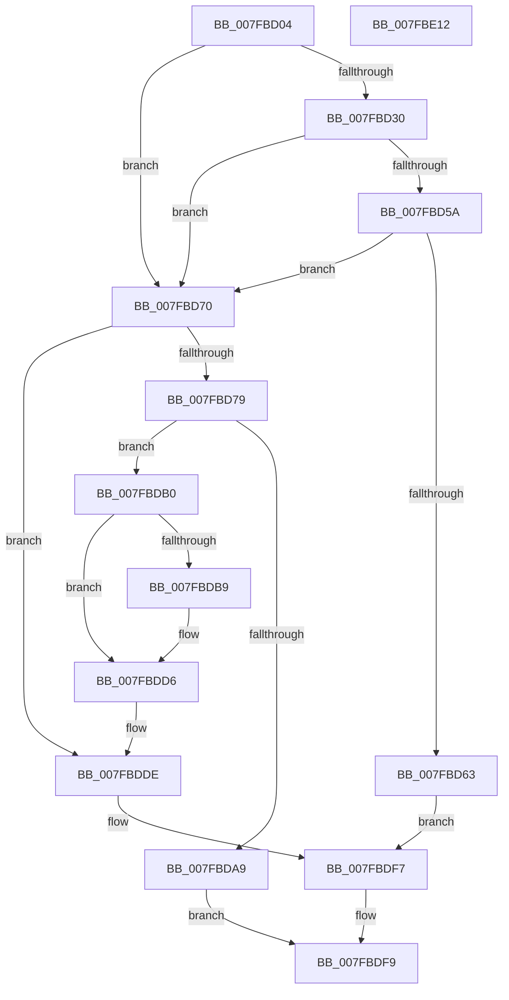

# MiAddRun

- RVA: `0x007FBD04`–`0x007FBE13` (길이 `271` bytes)
- VA: `0x00000001407FBD04`
- 실행 섹션: `PAGE`
- PDB 이름 있음: `예`; PDB Function 태그: `아니요`
- unwind 정보 RVA: `0x00060300`
- 디코드: `78`개 명령, `271/271` bytes 표시
- 미해석 바이트: `0` (있으면 어셈블리에 `.byte`로 보존)

> 이 문서는 커널 이미지의 기계어와 PDB 기호를 분석해 생성했습니다. 4번과 5번은 함수 원형과 자료형을 바이너리 사용 방식에서 추정한 C 해석이며 원본 소스 복구 결과는 아닙니다.

## 1. Dependencies

- 직접 호출 지점: **3**; 고유 호출 대상: **3**
- 직접 호출자로 확인된 함수: **2**
- RIP 상대 이미지 참조: **0**

### Outgoing calls
- `0x007FBD9C` → [MiAllocatePool](../../text/35/MiAllocatePool_function_0035B540.md) (function, `0x0035B540`)
- `0x007FBDC7` → [memcpy](../../text/6C/memcpy_function_006C6840.md) (function, `0x006C6840`)
- `0x007FBDD1` → [ExFreePoolWithTag](../../poolcode/B8/ExFreePoolWithTag_function_00B82870.md) (function, `0x00B82870`)

### Direct callers
- [MiAddRuns](MiAddRuns_function_007FBE1C.md) at `0x007FBF19`
- [MmAllocateMemoryRanges](MmAllocateMemoryRanges_function_007FC0C0.md) at `0x007FC23A`

### Static image references
- 디코드된 RIP-relative 메모리 참조가 없습니다.

## 2. Other-region calls and transfers

- 다른 실행 섹션으로 향하는 call: **3**
  - `0x007FBD9C` → [MiAllocatePool](../../text/35/MiAllocatePool_function_0035B540.md) (`PAGE` → `.text`)
  - `0x007FBDC7` → [memcpy](../../text/6C/memcpy_function_006C6840.md) (`PAGE` → `.text`)
  - `0x007FBDD1` → [ExFreePoolWithTag](../../poolcode/B8/ExFreePoolWithTag_function_00B82870.md) (`PAGE` → `POOLCODE`)
- 별도 외부 분기/꼬리 이동을 확인하지 못했습니다.

## 3. Assembly (complete function range)

```asm
007FBD04  48 89 5C 24 08                  mov qword ptr [rsp + 8], rbx
007FBD09  48 89 6C 24 10                  mov qword ptr [rsp + 0x10], rbp
007FBD0E  48 89 74 24 18                  mov qword ptr [rsp + 0x18], rsi
007FBD13  57                              push rdi
007FBD14  41 56                           push r14
007FBD16  41 57                           push r15
007FBD18  48 83 EC 20                     sub rsp, 0x20
007FBD1C  4C 8B 0A                        mov r9, qword ptr [rdx]
007FBD1F  49 8B D8                        mov rbx, r8
007FBD22  48 8B FA                        mov rdi, rdx
007FBD25  41 BF FF FF 3F 00               mov r15d, 0x3fffff
007FBD2B  4D 85 C9                        test r9, r9
007FBD2E  74 40                           je 0x1407fbd70
007FBD30  4C 8B 52 10                     mov r10, qword ptr [rdx + 0x10]
007FBD34  33 D2                           xor edx, edx
007FBD36  4C 8B 59 18                     mov r11, qword ptr [rcx + 0x18]
007FBD3A  4F 8B 44 CA F8                  mov r8, qword ptr [r10 + r9*8 - 8]
007FBD3F  49 8B C0                        mov rax, r8
007FBD42  49 F7 F3                        div r11
007FBD45  49 23 C7                        and rax, r15
007FBD48  48 8D 4A 01                     lea rcx, [rdx + 1]
007FBD4C  48 03 C8                        add rcx, rax
007FBD4F  48 8B C3                        mov rax, rbx
007FBD52  49 23 C7                        and rax, r15
007FBD55  48 3B C8                        cmp rcx, rax
007FBD58  75 16                           jne 0x1407fbd70
007FBD5A  49 8D 43 FF                     lea rax, [r11 - 1]
007FBD5E  48 3B D0                        cmp rdx, rax
007FBD61  74 0D                           je 0x1407fbd70
007FBD63  49 FF C0                        inc r8
007FBD66  4F 89 44 CA F8                  mov qword ptr [r10 + r9*8 - 8], r8
007FBD6B  E9 87 00 00 00                  jmp 0x1407fbdf7
007FBD70  48 8B 4F 08                     mov rcx, qword ptr [rdi + 8]
007FBD74  4C 3B C9                        cmp r9, rcx
007FBD77  75 65                           jne 0x1407fbdde
007FBD79  48 85 C9                        test rcx, rcx
007FBD7C  48 8D 04 09                     lea rax, [rcx + rcx]
007FBD80  BD 02 00 00 00                  mov ebp, 2
007FBD85  B9 40 00 00 00                  mov ecx, 0x40
007FBD8A  48 0F 45 E8                     cmovne rbp, rax
007FBD8E  41 B8 4D 69 48 70               mov r8d, 0x7048694d
007FBD94  48 8D 14 ED 00 00 00 00         lea rdx, [rbp*8]
007FBD9C  E8 9F F7 B5 FF                  call 0x14035b540
007FBDA1  4C 8B F0                        mov r14, rax
007FBDA4  48 85 C0                        test rax, rax
007FBDA7  75 07                           jne 0x1407fbdb0
007FBDA9  B8 9A 00 00 C0                  mov eax, 0xc000009a
007FBDAE  EB 49                           jmp 0x1407fbdf9
007FBDB0  48 8B 77 10                     mov rsi, qword ptr [rdi + 0x10]
007FBDB4  48 85 F6                        test rsi, rsi
007FBDB7  74 1D                           je 0x1407fbdd6
007FBDB9  4C 8B 47 08                     mov r8, qword ptr [rdi + 8]
007FBDBD  48 8B D6                        mov rdx, rsi
007FBDC0  49 C1 E0 03                     shl r8, 3
007FBDC4  49 8B CE                        mov rcx, r14
007FBDC7  E8 74 AA EC FF                  call 0x1406c6840
007FBDCC  33 D2                           xor edx, edx
007FBDCE  48 8B CE                        mov rcx, rsi
007FBDD1  E8 9A 6A 38 00                  call 0x140b82870
007FBDD6  4C 89 77 10                     mov qword ptr [rdi + 0x10], r14
007FBDDA  48 89 6F 08                     mov qword ptr [rdi + 8], rbp
007FBDDE  48 8B 0F                        mov rcx, qword ptr [rdi]
007FBDE1  49 23 DF                        and rbx, r15
007FBDE4  48 8B 47 10                     mov rax, qword ptr [rdi + 0x10]
007FBDE8  48 C1 E3 1E                     shl rbx, 0x1e
007FBDEC  48 89 1C C8                     mov qword ptr [rax + rcx*8], rbx
007FBDF0  48 8D 41 01                     lea rax, [rcx + 1]
007FBDF4  48 89 07                        mov qword ptr [rdi], rax
007FBDF7  33 C0                           xor eax, eax
007FBDF9  48 8B 5C 24 40                  mov rbx, qword ptr [rsp + 0x40]
007FBDFE  48 8B 6C 24 48                  mov rbp, qword ptr [rsp + 0x48]
007FBE03  48 8B 74 24 50                  mov rsi, qword ptr [rsp + 0x50]
007FBE08  48 83 C4 20                     add rsp, 0x20
007FBE0C  41 5F                           pop r15
007FBE0E  41 5E                           pop r14
007FBE10  5F                              pop rdi
007FBE11  C3                              ret
007FBE12  CC                              int3
```

## 4. C-style interpretation (structured pseudocode)

```c
__int64 __fastcall MiAddRun(__int64 a1, __int64 a2, __int64 a3)
{
    __int64 result;
    __int64 v_rbp;
    __int64 v_rbx;
    __int64 v_rsp;
    unsigned __int64 v_stack_p10;
    unsigned __int64 v_stack_p18;
    unsigned __int64 v_stack_p8;

    v_stack_p8 = v_rbx;
    v_stack_p10 = v_rbp;
    v_stack_p18 = v_rsi;
    v_rsp = (v_rsp) - (32);
    if (*(unsigned __int64 *)(a2) == 0) goto loc_007FBD70;
    a2 = 0;
    result = (*(unsigned __int64 *)(*(unsigned __int64 *)(a2 + 16) + *(unsigned __int64 *)(a2) * 8 - 8)) & ((unsigned int)(0x3FFFFFULL));
    a1 = (a2 + 1) + (result);
    result = (a3) & ((unsigned int)(0x3FFFFFULL));
    if (a1 != result) goto loc_007FBD70;
    if (0 == (*(unsigned __int64 *)(a1 + 24) - 1)) goto loc_007FBD70;
    a3 = (*(unsigned __int64 *)(*(unsigned __int64 *)(a2 + 16) + *(unsigned __int64 *)(a2) * 8 - 8)) + 1;
    *(unsigned __int64 *)(*(unsigned __int64 *)(a2 + 16) + *(unsigned __int64 *)(a2) * 8 - 8) = a3;
    goto loc_007FBDF7;
loc_007FBD70:
    if ((*(unsigned __int64 *)(a2)) != (*(unsigned __int64 *)(a2 + 8))) goto loc_007FBDDE;
    v_rbp = 2;
    if (*(unsigned __int64 *)(a2 + 8) != 0) { v_rbp = *(unsigned __int64 *)(a2 + 8) + *(unsigned __int64 *)(a2 + 8) * 1; }
    result = MiAllocatePool(64, v_rbp * 8, (unsigned int)(0x7048694DULL), *(unsigned __int64 *)(a2));
    if (result != 0) goto loc_007FBDB0;
    goto loc_007FBDF9;
loc_007FBDB0:
    result = (unsigned int)(0xC000009AULL);
    if (*(unsigned __int64 *)(a2 + 16) != 0) {
        a3 = *(unsigned __int64 *)(a2 + 8);
        a2 = *(unsigned __int64 *)(a2 + 16);
        a3 = (a3) << (3);
        a1 = result;
        result = memcpy(a1, a2, a3, *(unsigned __int64 *)(a2));
        a2 = 0;
        a1 = *(unsigned __int64 *)(a2 + 16);
        result = ExFreePoolWithTag(a1, a2, a3, *(unsigned __int64 *)(a2));
    }
    *(unsigned __int64 *)(a2 + 16) = result;
    *(unsigned __int64 *)(a2 + 8) = v_rbp;
loc_007FBDDE:
    v_rbx = (a3) & ((unsigned int)(0x3FFFFFULL));
    v_rbx = (v_rbx) << (30);
    *(unsigned __int64 *)(*(unsigned __int64 *)(a2 + 16) + *(unsigned __int64 *)(a2) * 8) = v_rbx;
    *(unsigned __int64 *)(a2) = *(unsigned __int64 *)(a2) + 1;
loc_007FBDF7:
    result = 0;
loc_007FBDF9:
    v_rsp = (v_rsp) + (32);
    return result;
}
```

## 5. (Beta) C Style

```c
int64_t MiAddRun(void *Arg1, void *Arg2, int64_t Arg3)
{
    uint8_t *arg1 = (uint8_t *)Arg1;
    uint8_t *arg2 = (uint8_t *)Arg2;

    int64_t result;
    int64_t local_rbp;
    int64_t local_rbx;
    int64_t local_rsp;
    uint64_t v_stack_p10;
    uint64_t v_stack_p18;
    uint64_t v_stack_p8;

    v_stack_p8 = local_rbx;
    v_stack_p10 = local_rbp;
    v_stack_p18 = local_rsi;
    local_rsp = (local_rsp) - (32);
    if (*(uint64_t *)(arg2) == 0) goto loc_007FBD70;
    Arg2 = 0;
    result = (*(uint64_t *)(*(uint64_t *)(arg2 + 0x10) + *(uint64_t *)(arg2) * 8 - 0x8)) & ((uint32_t)(0x3FFFFFULL));
    Arg1 = (Arg2 + 1) + (result);
    result = (Arg3) & ((uint32_t)(0x3FFFFFULL));
    if (Arg1 != result) goto loc_007FBD70;
    if (0 == (*(uint64_t *)(arg1 + 0x18) - 1)) goto loc_007FBD70;
    Arg3 = (*(uint64_t *)(*(uint64_t *)(arg2 + 0x10) + *(uint64_t *)(arg2) * 8 - 0x8)) + 1;
    *(uint64_t *)(*(uint64_t *)(arg2 + 0x10) + *(uint64_t *)(arg2) * 8 - 0x8) = Arg3;
    goto loc_007FBDF7;
loc_007FBD70:
    if ((*(uint64_t *)(arg2)) != (*(uint64_t *)(arg2 + 0x8))) goto loc_007FBDDE;
    local_rbp = 2;
    if (*(uint64_t *)(arg2 + 0x8) != 0) { local_rbp = *(uint64_t *)(arg2 + 0x8) + *(uint64_t *)(arg2 + 0x8) * 1; }
    result = MiAllocatePool(64, local_rbp * 8, (uint32_t)(0x7048694DULL), *(uint64_t *)(arg2));
    if (result != 0) goto loc_007FBDB0;
    goto loc_007FBDF9;
loc_007FBDB0:
    result = (uint32_t)(0xC000009AULL);
    if (*(uint64_t *)(arg2 + 0x10) != 0) {
        Arg3 = *(uint64_t *)(arg2 + 0x8);
        Arg2 = *(uint64_t *)(arg2 + 0x10);
        Arg3 = (Arg3) << (3);
        Arg1 = result;
        result = memcpy(Arg1, Arg2, Arg3, *(uint64_t *)(arg2));
        Arg2 = 0;
        Arg1 = *(uint64_t *)(arg2 + 0x10);
        result = ExFreePoolWithTag(Arg1, Arg2, Arg3, *(uint64_t *)(arg2));
    }
    *(uint64_t *)(arg2 + 0x10) = result;
    *(uint64_t *)(arg2 + 0x8) = local_rbp;
loc_007FBDDE:
    local_rbx = (Arg3) & ((uint32_t)(0x3FFFFFULL));
    local_rbx = (local_rbx) << (30);
    *(uint64_t *)(*(uint64_t *)(arg2 + 0x10) + *(uint64_t *)(arg2) * 8) = local_rbx;
    *(uint64_t *)(arg2) = *(uint64_t *)(arg2) + 1;
loc_007FBDF7:
    result = 0;
loc_007FBDF9:
    local_rsp = (local_rsp) + (32);
    return result;
}
```

### 관측된 메모리 오프셋

구조체 형식이 확인되지 않은 접근은 인자 기준의 오프셋으로만 기록했습니다.

| 기준 인자 | 오프셋 표현 | 폭 (bit) | 접근 |
|---|---:|---:|---|
| `Arg1` | `+ 0x18` | `64` | `R` |
| `Arg2` | `+ 0x0` | `64` | `R` |
| `Arg2` | `+ 0x0` | `64` | `W` |
| `Arg2` | `+ 0x8` | `64` | `R` |
| `Arg2` | `+ 0x8` | `64` | `W` |
| `Arg2` | `+ 0x10` | `64` | `R` |
| `Arg2` | `+ 0x10` | `64` | `W` |

## 6. Execution-region graph

[열기: 2D/3D 그래프와 함수 탐색 컨트롤 패널](../../../control-panel.html?section=page&rva=0x007FBD04&view=graph)

- 2D 그래프는 위에서 아래로 흐르고, 3D 그래프는 빈 공간을 드래그해 회전합니다. Shift+드래그는 이동, 휠은 확대·축소, 함수 노드 선택은 대상 보고서 이동입니다.

### Static fallback


