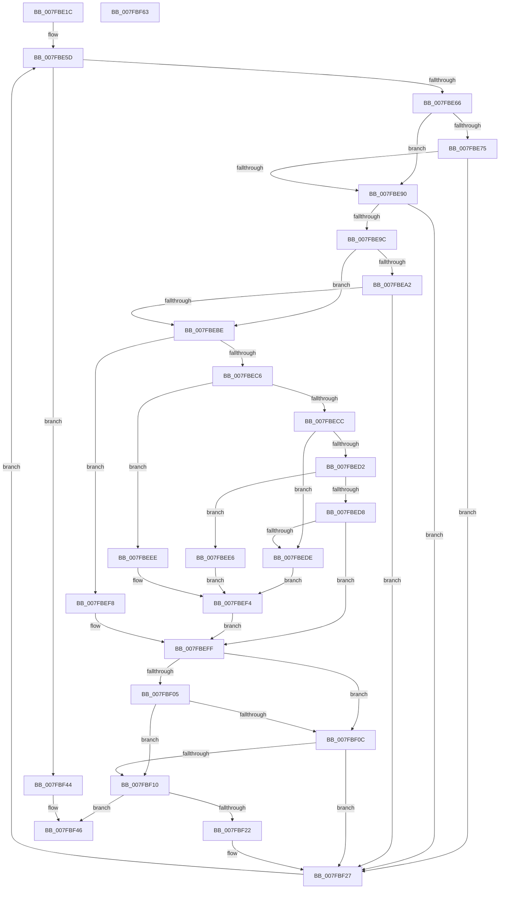

# MiAddRuns

- RVA: `0x007FBE1C`–`0x007FBF64` (길이 `328` bytes)
- VA: `0x00000001407FBE1C`
- 실행 섹션: `PAGE`
- PDB 이름 있음: `예`; PDB Function 태그: `아니요`
- unwind 정보 RVA: `0x00075C18`
- 디코드: `98`개 명령, `328/328` bytes 표시
- 미해석 바이트: `0` (있으면 어셈블리에 `.byte`로 보존)

> 이 문서는 커널 이미지의 기계어와 PDB 기호를 분석해 생성했습니다. 4번과 5번은 함수 원형과 자료형을 바이너리 사용 방식에서 추정한 C 해석이며 원본 소스 복구 결과는 아닙니다.

## 1. Dependencies

- 직접 호출 지점: **2**; 고유 호출 대상: **2**
- 직접 호출자로 확인된 함수: **1**
- RIP 상대 이미지 참조: **1**

### Outgoing calls
- `0x007FBEAF` → [MiPageToNode](../../text/33/MiPageToNode_function_00338CD0.md) (function, `0x00338CD0`)
- `0x007FBF19` → [MiAddRun](MiAddRun_function_007FBD04.md) (function, `0x007FBD04`)

### Direct callers
- [MmQueryMemoryRanges](MmQueryMemoryRanges_function_007FC3A0.md) at `0x007FC4E1`

### Static image references
- `0x007FBE38` → RVA `0x00E300C0` (`.data`; read)

## 2. Other-region calls and transfers

- 다른 실행 섹션으로 향하는 call: **1**
  - `0x007FBEAF` → [MiPageToNode](../../text/33/MiPageToNode_function_00338CD0.md) (`PAGE` → `.text`)
- 별도 외부 분기/꼬리 이동을 확인하지 못했습니다.

## 3. Assembly (complete function range)

```asm
007FBE1C  48 89 5C 24 08                  mov qword ptr [rsp + 8], rbx
007FBE21  48 89 6C 24 10                  mov qword ptr [rsp + 0x10], rbp
007FBE26  48 89 74 24 18                  mov qword ptr [rsp + 0x18], rsi
007FBE2B  57                              push rdi
007FBE2C  41 54                           push r12
007FBE2E  41 55                           push r13
007FBE30  41 56                           push r14
007FBE32  41 57                           push r15
007FBE34  48 83 EC 20                     sub rsp, 0x20
007FBE38  48 8B 05 81 42 63 00            mov rax, qword ptr [rip + 0x634281]
007FBE3F  49 8B D8                        mov rbx, r8
007FBE42  41 81 E0 FF FF 3F 00            and r8d, 0x3fffff
007FBE49  4C 8B EA                        mov r13, rdx
007FBE4C  45 33 F6                        xor r14d, r14d
007FBE4F  4D 8B E1                        mov r12, r9
007FBE52  48 8B E9                        mov rbp, rcx
007FBE55  4E 8D 3C C0                     lea r15, [rax + r8*8]
007FBE59  41 8D 56 01                     lea edx, [r14 + 1]
007FBE5D  4D 3B F4                        cmp r14, r12
007FBE60  0F 83 DE 00 00 00               jae 0x1407fbf44
007FBE66  49 8B 3F                        mov rdi, qword ptr [r15]
007FBE69  B8 01 04 00 00                  mov eax, 0x401
007FBE6E  66 39 44 24 70                  cmp word ptr [rsp + 0x70], ax
007FBE73  74 1B                           je 0x1407fbe90
007FBE75  0F B7 44 24 70                  movzx eax, word ptr [rsp + 0x70]
007FBE7A  48 8B CF                        mov rcx, rdi
007FBE7D  48 C1 E9 04                     shr rcx, 4
007FBE81  81 E1 FF 07 00 00               and ecx, 0x7ff
007FBE87  48 3B C8                        cmp rcx, rax
007FBE8A  0F 85 97 00 00 00               jne 0x1407fbf27
007FBE90  48 8B F7                        mov rsi, rdi
007FBE93  83 E6 07                        and esi, 7
007FBE96  0F 84 8B 00 00 00               je 0x1407fbf27
007FBE9C  83 7D 20 00                     cmp dword ptr [rbp + 0x20], 0
007FBEA0  7C 1C                           jl 0x1407fbebe
007FBEA2  48 8B CB                        mov rcx, rbx
007FBEA5  81 E1 FF FF 3F 00               and ecx, 0x3fffff
007FBEAB  48 C1 E1 12                     shl rcx, 0x12
007FBEAF  E8 1C CE B3 FF                  call 0x140338cd0
007FBEB4  BA 01 00 00 00                  mov edx, 1
007FBEB9  3B 45 20                        cmp eax, dword ptr [rbp + 0x20]
007FBEBC  75 69                           jne 0x1407fbf27
007FBEBE  33 C9                           xor ecx, ecx
007FBEC0  48 83 EE 01                     sub rsi, 1
007FBEC4  74 32                           je 0x1407fbef8
007FBEC6  48 83 EE 01                     sub rsi, 1
007FBECA  74 22                           je 0x1407fbeee
007FBECC  48 83 EE 01                     sub rsi, 1
007FBED0  74 0C                           je 0x1407fbede
007FBED2  48 83 EE 01                     sub rsi, 1
007FBED6  74 0E                           je 0x1407fbee6
007FBED8  48 83 FE 01                     cmp rsi, 1
007FBEDC  75 21                           jne 0x1407fbeff
007FBEDE  8B 4D 04                        mov ecx, dword ptr [rbp + 4]
007FBEE1  C1 E9 03                        shr ecx, 3
007FBEE4  EB 0E                           jmp 0x1407fbef4
007FBEE6  8B 4D 04                        mov ecx, dword ptr [rbp + 4]
007FBEE9  C1 E9 04                        shr ecx, 4
007FBEEC  EB 06                           jmp 0x1407fbef4
007FBEEE  8B 4D 04                        mov ecx, dword ptr [rbp + 4]
007FBEF1  C1 E9 02                        shr ecx, 2
007FBEF4  23 CA                           and ecx, edx
007FBEF6  EB 07                           jmp 0x1407fbeff
007FBEF8  F6 45 04 02                     test byte ptr [rbp + 4], 2
007FBEFC  0F 45 CA                        cmovne ecx, edx
007FBEFF  40 F6 C7 08                     test dil, 8
007FBF03  74 07                           je 0x1407fbf0c
007FBF05  8B 45 04                        mov eax, dword ptr [rbp + 4]
007FBF08  A8 20                           test al, 0x20
007FBF0A  75 04                           jne 0x1407fbf10
007FBF0C  85 C9                           test ecx, ecx
007FBF0E  74 17                           je 0x1407fbf27
007FBF10  4C 8B C3                        mov r8, rbx
007FBF13  49 8B D5                        mov rdx, r13
007FBF16  48 8B CD                        mov rcx, rbp
007FBF19  E8 E6 FD FF FF                  call 0x1407fbd04
007FBF1E  85 C0                           test eax, eax
007FBF20  78 24                           js 0x1407fbf46
007FBF22  BA 01 00 00 00                  mov edx, 1
007FBF27  48 8D 4B 01                     lea rcx, [rbx + 1]
007FBF2B  4C 03 F2                        add r14, rdx
007FBF2E  48 33 D9                        xor rbx, rcx
007FBF31  49 83 C7 08                     add r15, 8
007FBF35  48 81 E3 00 00 C0 FF            and rbx, 0xffffffffffc00000
007FBF3C  48 33 D9                        xor rbx, rcx
007FBF3F  E9 19 FF FF FF                  jmp 0x1407fbe5d
007FBF44  33 C0                           xor eax, eax
007FBF46  48 8B 5C 24 50                  mov rbx, qword ptr [rsp + 0x50]
007FBF4B  48 8B 6C 24 58                  mov rbp, qword ptr [rsp + 0x58]
007FBF50  48 8B 74 24 60                  mov rsi, qword ptr [rsp + 0x60]
007FBF55  48 83 C4 20                     add rsp, 0x20
007FBF59  41 5F                           pop r15
007FBF5B  41 5E                           pop r14
007FBF5D  41 5D                           pop r13
007FBF5F  41 5C                           pop r12
007FBF61  5F                              pop rdi
007FBF62  C3                              ret
007FBF63  CC                              int3
```

## 4. C-style interpretation (structured pseudocode)

```c
__int64 __fastcall MiAddRuns(__int64 a1, __int64 a2, __int64 a3, __int64 a4, unsigned __int16 a5)
{
    __int64 result;
    __int64 v_r14;
    __int64 v_r15;
    __int64 v_rbx;
    __int64 v_rsi;
    __int64 v_rsp;
    unsigned __int64 v_stack_p10;
    unsigned __int64 v_stack_p18;
    unsigned __int64 v_stack_p8;

    v_stack_p8 = v_rbx;
    v_stack_p10 = v_rbp;
    v_stack_p18 = v_rsi;
    v_rsp = (v_rsp) - (32);
    a3 = (unsigned int)((a3) & (0x3FFFFFULL));
    v_r14 = 0;
loc_007FBE5D:
    if (0 >= a4) goto loc_007FBF44;
    if (a5 == ((unsigned __int16)((unsigned int)(0x401ULL)))) goto loc_007FBE90;
    a1 = (*(unsigned __int64 *)(*(unsigned __int64 *)(v_rip + 6505089) + a3 * 8)) >> (4);
    a1 = (unsigned int)((a1) & (0x7FFULL));
    if (a1 != a5) goto loc_007FBF27;
loc_007FBE90:
    v_rsi = (unsigned int)((*(unsigned __int64 *)(*(unsigned __int64 *)(v_rip + 6505089) + a3 * 8)) & (7));
    if (condition_is_equal) goto loc_007FBF27;
    if ((*(unsigned int *)(a1 + 32)) < 0) goto loc_007FBEBE;
    a1 = (unsigned int)((a3) & (0x3FFFFFULL));
    a1 = (a1) << (18);
    result = MiPageToNode(a1, v_r14 + 1, a3, a4);
    if (((unsigned int)(result)) != (*(unsigned int *)(a1 + 32))) goto loc_007FBF27;
loc_007FBEBE:
    a1 = 0;
    v_rsi = (v_rsi) - (1);
    if (condition_is_equal) goto loc_007FBEF8;
    v_rsi = (v_rsi) - (1);
    if (condition_is_equal) goto loc_007FBEEE;
    v_rsi = (v_rsi) - (1);
    if (condition_is_equal) goto loc_007FBEDE;
    v_rsi = (v_rsi) - (1);
    if (condition_is_equal) goto loc_007FBEE6;
    if (v_rsi != 1) goto loc_007FBEFF;
loc_007FBEDE:
    a1 = (unsigned int)(((unsigned int)(*(unsigned int *)(a1 + 4))) >> (3));
    goto loc_007FBEF4;
loc_007FBEE6:
    a1 = (unsigned int)(((unsigned int)(*(unsigned int *)(a1 + 4))) >> (4));
    goto loc_007FBEF4;
loc_007FBEEE:
    a1 = (unsigned int)(((unsigned int)(*(unsigned int *)(a1 + 4))) >> (2));
loc_007FBEF4:
    a1 = (unsigned int)((a1) & (1));
    goto loc_007FBEFF;
loc_007FBEF8:
    if (((*(unsigned __int8 *)(a1 + 4)) & (2)) != 0) { a1 = 1; }
loc_007FBEFF:
    if ((((unsigned __int8)(*(unsigned __int64 *)(*(unsigned __int64 *)(v_rip + 6505089) + a3 * 8))) & (8)) == 0) goto loc_007FBF0C;
    if ((((unsigned __int8)((unsigned int)(*(unsigned int *)(a1 + 4)))) & (32)) != 0) goto loc_007FBF10;
loc_007FBF0C:
    if ((unsigned int)(a1) == 0) goto loc_007FBF27;
loc_007FBF10:
    result = MiAddRun(a1, a2, a3, a4);
    if (sign_flag) goto loc_007FBF46;
loc_007FBF27:
    v_r14 = (v_r14) + (1);
    v_rbx = (a3) ^ (a3 + 1);
    v_r15 = (*(unsigned __int64 *)(v_rip + 6505089) + a3 * 8) + (8);
    v_rbx = (v_rbx) & (0xFFFFFFFFFFC00000ULL);
    v_rbx = (v_rbx) ^ (a3 + 1);
    goto loc_007FBE5D;
loc_007FBF44:
    result = 0;
loc_007FBF46:
    v_rsp = (v_rsp) + (32);
    return result;
}
```

## 5. (Beta) C Style

```c
int64_t MiAddRuns(void *Arg1, int64_t Arg2, void *Arg3, int64_t Arg4, uint16_t Arg5)
{
    uint8_t *arg1 = (uint8_t *)Arg1;
    uint8_t *arg3 = (uint8_t *)Arg3;

    int64_t result;
    int64_t local_r14;
    int64_t local_r15;
    int64_t local_rbx;
    int64_t local_rsi;
    int64_t local_rsp;
    uint64_t v_stack_p10;
    uint64_t v_stack_p18;
    uint64_t v_stack_p8;

    v_stack_p8 = local_rbx;
    v_stack_p10 = local_rbp;
    v_stack_p18 = local_rsi;
    local_rsp = (local_rsp) - (32);
    Arg3 = (uint32_t)((Arg3) & (0x3FFFFFULL));
    local_r14 = 0;
loc_007FBE5D:
    if (0 >= Arg4) goto loc_007FBF44;
    if (Arg5 == ((uint16_t)((uint32_t)(0x401ULL)))) goto loc_007FBE90;
    Arg1 = (*(uint64_t *)(*(uint64_t *)(v_rip + 0x634281) + arg3 * 8)) >> (4);
    Arg1 = (uint32_t)((Arg1) & (0x7FFULL));
    if (Arg1 != Arg5) goto loc_007FBF27;
loc_007FBE90:
    local_rsi = (uint32_t)((*(uint64_t *)(*(uint64_t *)(v_rip + 0x634281) + arg3 * 8)) & (7));
    if (condition_is_equal) goto loc_007FBF27;
    if ((*(uint32_t *)(arg1 + 0x20)) < 0) goto loc_007FBEBE;
    Arg1 = (uint32_t)((Arg3) & (0x3FFFFFULL));
    Arg1 = (Arg1) << (18);
    result = MiPageToNode(Arg1, local_r14 + 1, Arg3, Arg4);
    if (((uint32_t)(result)) != (*(uint32_t *)(arg1 + 0x20))) goto loc_007FBF27;
loc_007FBEBE:
    Arg1 = 0;
    local_rsi = (local_rsi) - (1);
    if (condition_is_equal) goto loc_007FBEF8;
    local_rsi = (local_rsi) - (1);
    if (condition_is_equal) goto loc_007FBEEE;
    local_rsi = (local_rsi) - (1);
    if (condition_is_equal) goto loc_007FBEDE;
    local_rsi = (local_rsi) - (1);
    if (condition_is_equal) goto loc_007FBEE6;
    if (local_rsi != 1) goto loc_007FBEFF;
loc_007FBEDE:
    Arg1 = (uint32_t)(((uint32_t)(*(uint32_t *)(arg1 + 0x4))) >> (3));
    goto loc_007FBEF4;
loc_007FBEE6:
    Arg1 = (uint32_t)(((uint32_t)(*(uint32_t *)(arg1 + 0x4))) >> (4));
    goto loc_007FBEF4;
loc_007FBEEE:
    Arg1 = (uint32_t)(((uint32_t)(*(uint32_t *)(arg1 + 0x4))) >> (2));
loc_007FBEF4:
    Arg1 = (uint32_t)((Arg1) & (1));
    goto loc_007FBEFF;
loc_007FBEF8:
    if (((*(uint8_t *)(arg1 + 0x4)) & (2)) != 0) { Arg1 = 1; }
loc_007FBEFF:
    if ((((uint8_t)(*(uint64_t *)(*(uint64_t *)(v_rip + 0x634281) + arg3 * 8))) & (8)) == 0) goto loc_007FBF0C;
    if ((((uint8_t)((uint32_t)(*(uint32_t *)(arg1 + 0x4)))) & (32)) != 0) goto loc_007FBF10;
loc_007FBF0C:
    if ((uint32_t)(Arg1) == 0) goto loc_007FBF27;
loc_007FBF10:
    result = MiAddRun(Arg1, Arg2, Arg3, Arg4);
    if (sign_flag) goto loc_007FBF46;
loc_007FBF27:
    local_r14 = (local_r14) + (1);
    local_rbx = (Arg3) ^ (Arg3 + 1);
    local_r15 = (*(uint64_t *)(v_rip + 0x634281) + Arg3 * 8) + (8);
    local_rbx = (local_rbx) & (0xFFFFFFFFFFC00000ULL);
    local_rbx = (local_rbx) ^ (Arg3 + 1);
    goto loc_007FBE5D;
loc_007FBF44:
    result = 0;
loc_007FBF46:
    local_rsp = (local_rsp) + (32);
    return result;
}
```

### 관측된 메모리 오프셋

구조체 형식이 확인되지 않은 접근은 인자 기준의 오프셋으로만 기록했습니다.

| 기준 인자 | 오프셋 표현 | 폭 (bit) | 접근 |
|---|---:|---:|---|
| `Arg1` | `+ 0x4` | `8` | `R` |
| `Arg1` | `+ 0x4` | `32` | `R` |
| `Arg1` | `+ 0x20` | `32` | `R` |
| `Arg3` | `+ 0x1` | `64` | `R` |

## 6. Execution-region graph

[열기: 2D/3D 그래프와 함수 탐색 컨트롤 패널](../../../control-panel.html?section=page&rva=0x007FBE1C&view=graph)

- 2D 그래프는 위에서 아래로 흐르고, 3D 그래프는 빈 공간을 드래그해 회전합니다. Shift+드래그는 이동, 휠은 확대·축소, 함수 노드 선택은 대상 보고서 이동입니다.

### Static fallback


