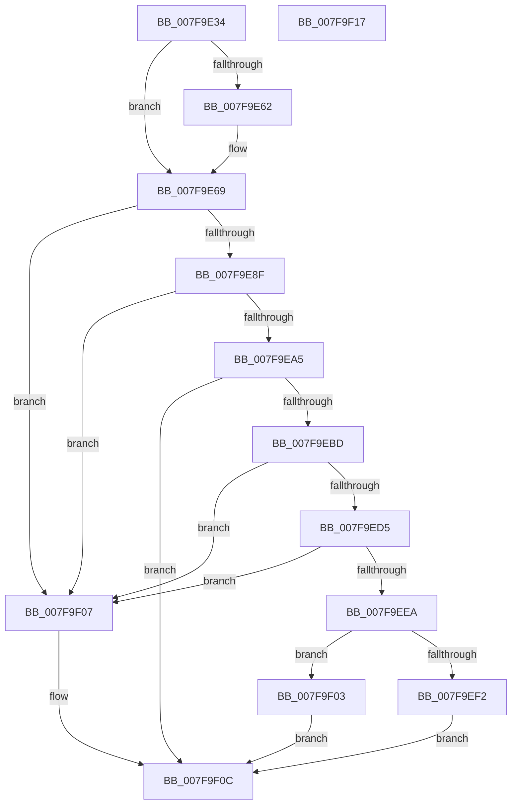

# MiAllocateInitialMemoryBlocks

- RVA: `0x007F9E34`–`0x007F9F18` (길이 `228` bytes)
- VA: `0x00000001407F9E34`
- 실행 섹션: `PAGE`
- PDB 이름 있음: `예`; PDB Function 태그: `아니요`
- unwind 정보 RVA: `0x0005CAAC`
- 디코드: `64`개 명령, `228/228` bytes 표시
- 미해석 바이트: `0` (있으면 어셈블리에 `.byte`로 보존)

> 이 문서는 커널 이미지의 기계어와 PDB 기호를 분석해 생성했습니다. 4번과 5번은 함수 원형과 자료형을 바이너리 사용 방식에서 추정한 C 해석이며 원본 소스 복구 결과는 아닙니다.

## 1. Dependencies

- 직접 호출 지점: **4**; 고유 호출 대상: **3**
- 직접 호출자로 확인된 함수: **2**
- RIP 상대 이미지 참조: **2**

### Outgoing calls
- `0x007F9E92` → [MiAllocateMemoryBlock](MiAllocateMemoryBlock_function_007F9F20.md) (function, `0x007F9F20`)
- `0x007F9EB4` → [MiDescribePageRun](MiDescribePageRun_function_007FA38C.md) (function, `0x007FA38C`)
- `0x007F9ED9` → [MiAllocateMemoryBlock](MiAllocateMemoryBlock_function_007F9F20.md) (function, `0x007F9F20`)
- `0x007F9EF5` → [MiHonorExistingHotMemoryFlights](MiHonorExistingHotMemoryFlights_function_007FA514.md) (function, `0x007FA514`)

### Direct callers
- [MiAcquireRemoveMemoryResources](../../text/67/MiAcquireRemoveMemoryResources_function_00671A38.md) at `0x00671A89`
- [MiAcquireAddMemoryResources](MiAcquireAddMemoryResources_function_007F9538.md) at `0x007F95AD`

### Static image references
- `0x007F9E81` → RVA `0x00FC6B88` (`ALMOSTRO`; read)
- `0x007F9EC4` → RVA `0x00E38D20` (`.data`; read)

## 2. Other-region calls and transfers

- 다른 실행 섹션으로 향하는 call: **0**
- 별도 외부 분기/꼬리 이동을 확인하지 못했습니다.

## 3. Assembly (complete function range)

```asm
007F9E34  48 89 5C 24 08                  mov qword ptr [rsp + 8], rbx
007F9E39  57                              push rdi
007F9E3A  48 83 EC 20                     sub rsp, 0x20
007F9E3E  48 8B 41 10                     mov rax, qword ptr [rcx + 0x10]
007F9E42  48 8B D9                        mov rbx, rcx
007F9E45  48 89 41 50                     mov qword ptr [rcx + 0x50], rax
007F9E49  48 8B 41 20                     mov rax, qword ptr [rcx + 0x20]
007F9E4D  48 89 41 58                     mov qword ptr [rcx + 0x58], rax
007F9E51  48 8D 41 40                     lea rax, [rcx + 0x40]
007F9E55  48 83 C1 70                     add rcx, 0x70
007F9E59  48 8B 11                        mov rdx, qword ptr [rcx]
007F9E5C  48 39 4A 08                     cmp qword ptr [rdx + 8], rcx
007F9E60  74 07                           je 0x1407f9e69
007F9E62  B9 03 00 00 00                  mov ecx, 3
007F9E67  CD 29                           int 0x29
007F9E69  48 89 10                        mov qword ptr [rax], rdx
007F9E6C  48 89 48 08                     mov qword ptr [rax + 8], rcx
007F9E70  48 89 42 08                     mov qword ptr [rdx + 8], rax
007F9E74  48 89 01                        mov qword ptr [rcx], rax
007F9E77  C7 83 80 00 00 00 01 00 00 00   mov dword ptr [rbx + 0x80], 1
007F9E81  48 8B 0D 00 CD 7C 00            mov rcx, qword ptr [rip + 0x7ccd00]
007F9E88  8B 11                           mov edx, dword ptr [rcx]
007F9E8A  83 C2 01                        add edx, 1
007F9E8D  74 78                           je 0x1407f9f07
007F9E8F  45 33 C0                        xor r8d, r8d
007F9E92  E8 89 00 00 00                  call 0x1407f9f20
007F9E97  33 FF                           xor edi, edi
007F9E99  48 89 83 A0 00 00 00            mov qword ptr [rbx + 0xa0], rax
007F9EA0  48 85 C0                        test rax, rax
007F9EA3  74 62                           je 0x1407f9f07
007F9EA5  4C 8B 43 20                     mov r8, qword ptr [rbx + 0x20]
007F9EA9  48 8D 8B 88 00 00 00            lea rcx, [rbx + 0x88]
007F9EB0  48 8B 53 10                     mov rdx, qword ptr [rbx + 0x10]
007F9EB4  E8 D3 04 00 00                  call 0x1407fa38c
007F9EB9  85 C0                           test eax, eax
007F9EBB  78 4F                           js 0x1407f9f0c
007F9EBD  44 8B 8B 98 00 00 00            mov r9d, dword ptr [rbx + 0x98]
007F9EC4  48 8B 0D 55 EE 63 00            mov rcx, qword ptr [rip + 0x63ee55]
007F9ECB  8B 11                           mov edx, dword ptr [rcx]
007F9ECD  41 03 D1                        add edx, r9d
007F9ED0  41 3B D1                        cmp edx, r9d
007F9ED3  76 32                           jbe 0x1407f9f07
007F9ED5  44 8D 47 01                     lea r8d, [rdi + 1]
007F9ED9  E8 42 00 00 00                  call 0x1407f9f20
007F9EDE  48 89 83 A8 00 00 00            mov qword ptr [rbx + 0xa8], rax
007F9EE5  48 85 C0                        test rax, rax
007F9EE8  74 1D                           je 0x1407f9f07
007F9EEA  8B 4B 28                        mov ecx, dword ptr [rbx + 0x28]
007F9EED  F6 C1 02                        test cl, 2
007F9EF0  75 11                           jne 0x1407f9f03
007F9EF2  48 8B CB                        mov rcx, rbx
007F9EF5  E8 1A 06 00 00                  call 0x1407fa514
007F9EFA  85 C0                           test eax, eax
007F9EFC  0F 48 F8                        cmovs edi, eax
007F9EFF  8B C7                           mov eax, edi
007F9F01  EB 09                           jmp 0x1407f9f0c
007F9F03  33 C0                           xor eax, eax
007F9F05  EB 05                           jmp 0x1407f9f0c
007F9F07  B8 9A 00 00 C0                  mov eax, 0xc000009a
007F9F0C  48 8B 5C 24 30                  mov rbx, qword ptr [rsp + 0x30]
007F9F11  48 83 C4 20                     add rsp, 0x20
007F9F15  5F                              pop rdi
007F9F16  C3                              ret
007F9F17  CC                              int3
```

## 4. C-style interpretation (structured pseudocode)

```c
__int64 __fastcall MiAllocateInitialMemoryBlocks(__int64 a1, __int64 a2, int a3)
{
    __int64 result;
    __int64 v_rdi;
    __int64 v_rsp;
    unsigned __int64 v_stack_p8;

    v_stack_p8 = v_rbx;
    v_rsp = (v_rsp) - (32);
    *(unsigned __int64 *)(a1 + 80) = *(unsigned __int64 *)(a1 + 16);
    *(unsigned __int64 *)(a1 + 88) = *(unsigned __int64 *)(a1 + 32);
    a1 = (a1) + (112);
    if ((*(unsigned __int64 *)(*(unsigned __int64 *)(a1) + 8)) != a1) {
        a1 = 3;
    }
    *(unsigned __int64 *)(a1 + 64) = *(unsigned __int64 *)(a1);
    *(unsigned __int64 *)(a1 + 64 + 8) = a1;
    *(unsigned __int64 *)(*(unsigned __int64 *)(a1) + 8) = a1 + 64;
    *(unsigned __int64 *)(a1) = a1 + 64;
    *(unsigned int *)(a1 + 128) = 1;
    a2 = (unsigned int)(((unsigned int)(*(unsigned int *)(*(unsigned __int64 *)(v_rip + 8178944)))) + (1));
    if (condition_is_equal) goto loc_007F9F07;
    a3 = 0;
    result = MiAllocateMemoryBlock(*(unsigned __int64 *)(v_rip + 8178944), a2, a3, a4);
    v_rdi = 0;
    *(unsigned __int64 *)(a1 + 160) = result;
    if (result == 0) goto loc_007F9F07;
    result = MiDescribePageRun(a1 + 136, *(unsigned __int64 *)(a1 + 16), *(unsigned __int64 *)(a1 + 32), a4);
    if (sign_flag) goto loc_007F9F0C;
    a2 = (unsigned int)(((unsigned int)(*(unsigned int *)(*(unsigned __int64 *)(v_rip + 6549077)))) + ((unsigned int)((unsigned int)(*(unsigned int *)(a1 + 152)))));
    if (((unsigned int)(a2)) <= ((unsigned int)((unsigned int)(*(unsigned int *)(a1 + 152))))) goto loc_007F9F07;
    result = MiAllocateMemoryBlock(*(unsigned __int64 *)(v_rip + 6549077), a2, v_rdi + 1, (unsigned int)(*(unsigned int *)(a1 + 152)));
    *(unsigned __int64 *)(a1 + 168) = result;
    if (result == 0) goto loc_007F9F07;
    if ((((unsigned __int8)((unsigned int)(*(unsigned int *)(a1 + 40)))) & (2)) != 0) goto loc_007F9F03;
    result = MiHonorExistingHotMemoryFlights(a1, a2, v_rdi + 1, (unsigned int)(*(unsigned int *)(a1 + 152)));
    if (sign_flag) { v_rdi = (unsigned int)(result); }
    goto loc_007F9F0C;
loc_007F9F03:
    result = 0;
    goto loc_007F9F0C;
loc_007F9F07:
loc_007F9F0C:
    v_rsp = (v_rsp) + (32);
    return (unsigned int)(0xC000009AULL);
}
```

## 5. (Beta) C Style

```c
int64_t MiAllocateInitialMemoryBlocks(void *Arg1, int64_t Arg2, int32_t Arg3)
{
    uint8_t *arg1 = (uint8_t *)Arg1;

    int64_t result;
    int64_t local_rdi;
    int64_t local_rsp;
    uint64_t v_stack_p8;

    v_stack_p8 = local_rbx;
    local_rsp = (local_rsp) - (32);
    *(uint64_t *)(arg1 + 0x50) = *(uint64_t *)(arg1 + 0x10);
    *(uint64_t *)(arg1 + 0x58) = *(uint64_t *)(arg1 + 0x20);
    Arg1 = (Arg1) + (112);
    if ((*(uint64_t *)(*(uint64_t *)(arg1) + 0x8)) != Arg1) {
        Arg1 = 3;
    }
    *(uint64_t *)(arg1 + 0x40) = *(uint64_t *)(arg1);
    *(void **)(arg1 + 0x40 + 0x8) = Arg1;
    *(void **)(*(uint64_t *)(arg1) + 0x8) = Arg1 + 64;
    *(void **)(arg1) = Arg1 + 64;
    *(uint32_t *)(arg1 + 0x80) = 1;
    Arg2 = (uint32_t)(((uint32_t)(*(uint32_t *)(*(uint64_t *)(v_rip + 0x7CCD00)))) + (1));
    if (condition_is_equal) goto loc_007F9F07;
    Arg3 = 0;
    result = MiAllocateMemoryBlock(*(uint64_t *)(v_rip + 0x7CCD00), Arg2, Arg3, a4);
    local_rdi = 0;
    *(uint64_t *)(arg1 + 0xA0) = result;
    if (result == 0) goto loc_007F9F07;
    result = MiDescribePageRun(Arg1 + 136, *(uint64_t *)(arg1 + 0x10), *(uint64_t *)(arg1 + 0x20), a4);
    if (sign_flag) goto loc_007F9F0C;
    Arg2 = (uint32_t)(((uint32_t)(*(uint32_t *)(*(uint64_t *)(v_rip + 0x63EE55)))) + ((uint32_t)((uint32_t)(*(uint32_t *)(arg1 + 0x98)))));
    if (((uint32_t)(Arg2)) <= ((uint32_t)((uint32_t)(*(uint32_t *)(arg1 + 0x98))))) goto loc_007F9F07;
    result = MiAllocateMemoryBlock(*(uint64_t *)(v_rip + 0x63EE55), Arg2, local_rdi + 1, (uint32_t)(*(uint32_t *)(arg1 + 0x98)));
    *(uint64_t *)(arg1 + 0xA8) = result;
    if (result == 0) goto loc_007F9F07;
    if ((((uint8_t)((uint32_t)(*(uint32_t *)(arg1 + 0x28)))) & (2)) != 0) goto loc_007F9F03;
    result = MiHonorExistingHotMemoryFlights(Arg1, Arg2, local_rdi + 1, (uint32_t)(*(uint32_t *)(arg1 + 0x98)));
    if (sign_flag) { local_rdi = (uint32_t)(result); }
    goto loc_007F9F0C;
loc_007F9F03:
    result = 0;
    goto loc_007F9F0C;
loc_007F9F07:
loc_007F9F0C:
    local_rsp = (local_rsp) + (32);
    return (uint32_t)(0xC000009AULL);
}
```

### 관측된 메모리 오프셋

구조체 형식이 확인되지 않은 접근은 인자 기준의 오프셋으로만 기록했습니다.

| 기준 인자 | 오프셋 표현 | 폭 (bit) | 접근 |
|---|---:|---:|---|
| `Arg1` | `+ 0x0` | `64` | `R` |
| `Arg1` | `+ 0x0` | `64` | `W` |
| `Arg1` | `+ 0x8` | `64` | `W` |
| `Arg1` | `+ 0x10` | `64` | `R` |
| `Arg1` | `+ 0x20` | `64` | `R` |
| `Arg1` | `+ 0x28` | `32` | `R` |
| `Arg1` | `+ 0x40` | `64` | `R` |
| `Arg1` | `+ 0x50` | `64` | `W` |
| `Arg1` | `+ 0x58` | `64` | `W` |
| `Arg1` | `+ 0x80` | `32` | `W` |
| `Arg1` | `+ 0x88` | `64` | `R` |
| `Arg1` | `+ 0x98` | `32` | `R` |
| `Arg1` | `+ 0xA0` | `64` | `W` |
| `Arg1` | `+ 0xA8` | `64` | `W` |

## 6. Execution-region graph

[열기: 2D/3D 그래프와 함수 탐색 컨트롤 패널](../../../control-panel.html?section=page&rva=0x007F9E34&view=graph)

- 2D 그래프는 위에서 아래로 흐르고, 3D 그래프는 빈 공간을 드래그해 회전합니다. Shift+드래그는 이동, 휠은 확대·축소, 함수 노드 선택은 대상 보고서 이동입니다.

### Static fallback


